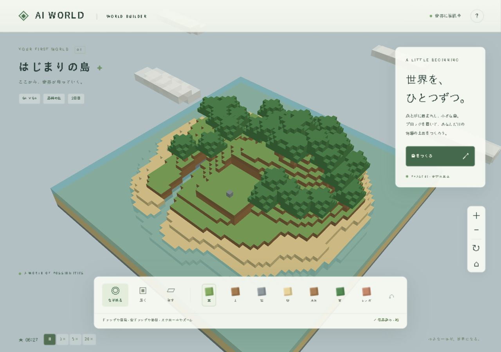

# AI WORLD — はじまりの島

プレイヤーが世界を創造し、AI住民が文明を築くファンタジーゲームの **Phase 1** です。現在は、3Dの島を眺め、ブロックを置いたり消したりして、次のフェーズの村づくりの土台を作れます。キャラクターや既存ゲームの素材は使用していません。



[スマホ幅390×844の確認画面](docs/screenshots/mobile.jpg)

## 起動

Windows 11とDocker Desktop（Linuxコンテナ）を使用します。WindowsにNode.jsをインストールする必要はありません。

初回はプロジェクトフォルダで以下を実行します。

```powershell
Copy-Item .env.example .env
docker compose up --build -d
```

PCでは **http://localhost:5173** を開いてください。この実装時のワークスペースには `.env` を作成済みです。

スマートフォンはPCと同じWi-Fiに接続して `http://PCのIPv4アドレス:5173` を開きます。`ipconfig` でWi-FiまたはEthernetのIPv4アドレスを確認してください。接続できない場合はWindowsファイアウォールのプライベートネットワークに限ってTCP 5173を許可し、Wi-Fiの端末間通信制限も確認してください。バックエンドの3001ポートはホストへ公開していません。

```powershell
docker compose logs -f
docker compose stop
docker compose start
```

コード変更後は `docker compose up --build -d` で再ビルドします。ソースのホストマウントは行っていないため、ホスト側ファイルの編集だけでは稼働中のコンテナに反映されません。

### Windowsの日本語パスに関する回避設定

Docker Desktop 4.44.3 / Docker 28.3.2では、日本語を含むフォルダからのBakeビルドで `x-docker-expose-session-sharedkey ... non-printable ASCII characters` が発生しました。`.env.example` の `COMPOSE_BAKE=false` により従来のComposeビルダーに切り替えて起動を確認しています。この設定はDockerから非推奨の警告が出ます。将来のDockerで不要になれば設定を削除してください。従来ビルダーがなくなった環境で同じエラーが出る場合は、英数字のみのパス（例：`D:\work\AIWorld`）にチェックアウトしてください。

## 遊び方

| 操作 | PC | スマートフォン |
| --- | --- | --- |
| カメラ回転 | 左ドラッグ、↻ボタン | 2本指をひねる、↻ボタン |
| カメラ移動 | 右ドラッグ、Shift＋左ドラッグ | 1本指ドラッグ |
| ズーム | ホイール、＋／−ボタン | 2本指ピンチ、＋／−ボタン |
| 島全体に戻す | ⌂ボタン | ⌂ボタン |
| ブロック配置 | 「置く」または素材→地形をクリック | 「置く」または素材→地形をタップ |
| ブロック削除 | 「消す」→固体ブロックをクリック | 「消す」→固体ブロックをタップ |
| 配置ツールを開く | 素材ボタン | 地形を長押し（550ms） |
| 直前の編集を戻す | ↶ボタン | ↶ボタン |

草、土、石、砂、木材、葉、レンガの7種類を配置できます。固体の面に隣接する空気または水の位置を編集します。高さ0の基盤、ワールドの外側、既存の固体への上書きは保護されています。水そのものは削除対象にしません。水に置いたブロックを↶で戻すと元の水を復元します。

「ながめる」で編集を止めて自由にカメラを操作できます。編集モードでもドラッグはカメラ操作です。右上の「?」から操作ガイドを開けます。

時間は一時停止、1×、5×、20×から選択できます。1×では実時間1秒＝ゲーム内1分、ゲーム内24時間＝実時間24分です。昼夜に合わせて空と照明が変化します。停止中でもカメラ、編集、雲、水面の演出は動作します。

## 実装済み

- 64×64×32の決定論的ボクセル地形生成。草原、森林、川、小山、砂浜、海、11×11の建築用平地。
- Three.jsによる3D描画。16×32×16の16チャンク、Greedy Meshing、隠れた面の除去、チャンクごとのフラスタムカリング。
- モバイルではピクセル比の上限1.5、近距離の観察時は遠いチャンクを省略。島全体の表示時は全体を描画。
- マウスとタッチによるカメラ操作、配置位置のプレビュー、ブロック配置・削除・直前の編集を戻す操作。
- サーバー主導の地形、WebSocketで複数ブラウザに同期。切断時は編集を止め、再接続時に保存された全差分を同期。
- Zodによるメッセージ検証、座標・素材・速度の上限、編集競合の検出、操作レート制限、同一Originの検証。
- SQLiteで地形差分、シード、ワールドID、保存バージョン、更新番号、時間と速度を保存。
- 地形は編集ごとにトランザクションで保存後に通知。時間は5秒ごと・速度変更時・正常終了時に保存。
- Docker ComposeによるNode.js 22のfrontend/backendとデータ永続ボリューム。
- 固定250msステップの世界時計、昼夜、動く雲と水面。描画フレームとは独立。

## 保存と復元

DBはバックエンドの `/data/world.sqlite` にあります。Dockerの `ai-world_world-data` ボリュームに保存され、コンテナの停止・再作成・再ビルド後も復元します。`docker compose down` ではデータは消えません。**`docker compose down -v` は世界を削除するため、通常は実行しないでください。**

`WORLD_SEED` は新規ワールド生成時のみ使用します。すでに保存された世界ではDBのシードを使用します。未対応の保存バージョンではデータを書き換えず起動を停止します。現在の保存バージョンは1、ワールド数は1です。

停止中の時間経過はシミュレーションしません。異常終了時に失われる可能性があるのは直近最大5秒の時計進行です。保存完了通知済みの地形編集は即時保存済みです。↶の履歴はブラウザ内に最大50件保持し、リロード・再接続で消えます。

## 検証

```powershell
docker compose exec -T backend npm run build
docker compose exec -T backend npm test
docker compose exec -T backend npm run test:integration
```

2026-10-11、Windows 11 / Docker Desktopで型チェックと本番向けfrontendビルド、13件の単体テスト、1件の統合テストが成功しました。

単体テストは地形の再現性・地形要件・平地・境界、コマンド検証、Greedy Meshingの面積と巻き順・チャンク境界・水、SQLite再読込・競合拒否・元に戻す・バージョン拒否を検証します。統合テストは一時DBと実サーバープロセスを使用し、HTTP、WebSocket、2クライアントへの配信、不正Originと不正コマンドの拒否、時間停止、実プロセスの再起動後の差分復元を確認します。稼働中のゲーム用DBはテストに使用しません。

ブラウザで島の描画、配置、元に戻す、サーバー保存の通知、PC幅とスマホ幅のレイアウトを確認しています。観察時の表示は約60 FPSでした。**スマートフォン実機でのタッチ操作とLAN接続、スマートフォンGPUでの30 FPS以上は未確認です。**

Node.js 22の組込み `node:sqlite` を使用しているため、SQLiteのExperimentalWarningが表示されます。起動失敗ではありません。依存バージョンは `package-lock.json` と `npm ci` で固定しています。

## 未実装・次のフェーズ

Phase 1のみを実装しています。AI住民5人、自律行動、採集、建物・建築アニメーション、自然言語指示、LLM連携、会話・記憶、資源・人口・文明発展、効果音は未実装です。現状では住民や資源を実在するように表示していません。

次のPhase 2では、固定ステップのシミュレーションに住民、到達可能性を確認する移動、資源採集、小屋建築、行動理由の表示を追加します。先にスマートフォン実機で操作と描画性能を検証することを推奨します。

## 構成

```text
frontend/src/
  camera/controls.ts           マウス・タッチのカメラ操作
  renderer/world-renderer.ts   Three.jsのチャンク描画と選択
  main.ts                     UI、WebSocket、編集履歴
  style.css                   PC・スマホの画面
backend/src/
  database/store.ts           SQLiteとサーバー上の世界
  server.ts                   HTTP、WebSocket、固定ステップ時計
shared/
  world.ts                    型・定数・地形生成
  schema.ts                   入力検証
  mesher.ts                   描画に依存しないGreedy Meshing
tests/                        単体テストと実プロセスの統合テスト
```

このCompose構成は自宅LANでの開発用です。開発サーバーを無認証でインターネット公開しないでください。公開版にはHTTPS、認証、ユーザーごとのワールド、WebSocket権限検証、本番静的配信が必要です。現在は同じLANの接続者が同じ世界を編集できます。APIキーは使用も送信もしていません。

技術資料：[Three.js](https://threejs.org/docs/) / [Viteのサーバー設定](https://vite.dev/config/server-options) / [Node.js 22 SQLite](https://nodejs.org/docs/latest-v22.x/api/sqlite.html)
