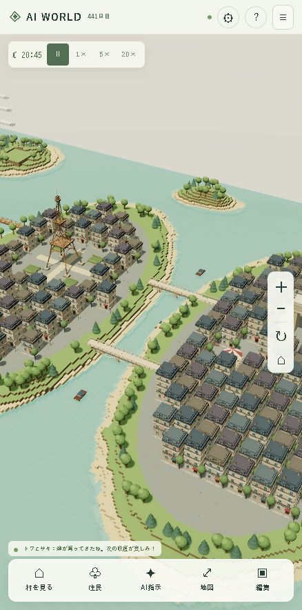
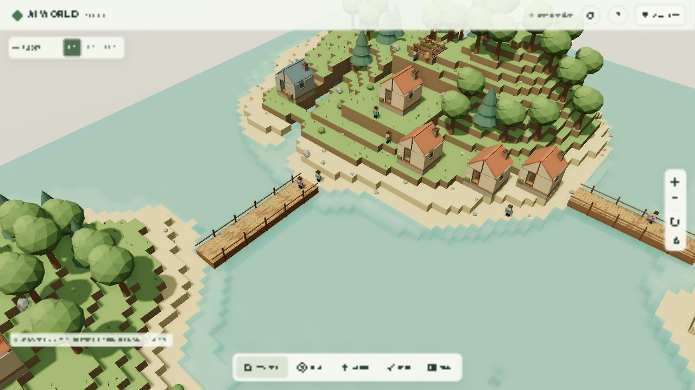
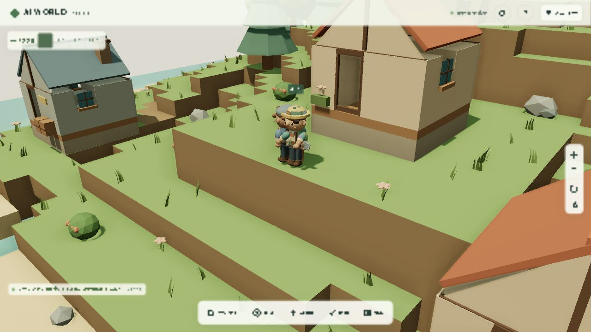

# AI WORLD — パリと自律する住民

**実地理のParis Digital Twin（車両・街路設備）:** 建物739棟と散策を維持し、40台の推定車両、102か所の自転車置き場、107個のごみ箱、13本の信号柱を追加。160人の歩行者と車両はGIS由来の安全な経路を移動し、距離に応じて描画を省略します。起動は `Paris-DigitalTwin.cmd`、Cで車両周辺、F8で散策、Vで視点、WASDで移動、Shiftで走行、F2で上空。P/Tで人/車、F6で設備、F7で品質を切替。車両・人物・装飾の外観や動きは推定です。[最新の検証・残作業](docs/paris-digital-twin-phase67.md) / [既存構成の技術調査](docs/paris-digital-twin-phase0.md)。

**Unreal Engine版への移行:** Windows用のUE 5.8プロジェクトを追加しました。起動は `.\unreal\scripts\Start-AIWorldUE.ps1`、初回ビルドは `.\unreal\scripts\Build-AIWorldUE.ps1` です。現在の世界と住民AI・SQLiteを引き継ぎ、UEのネイティブ3D画面と操作で遊べます。[起動方法・移行構成・検証](docs/unreal-migration.md) を参照してください。

プレイヤーが世界を創造し、AI住民が文明を築くファンタジーゲームの **Phase 1〜6** です。384×384の世界で、5人の住民から始まる村が採集して小屋を建て、農業・住宅・移住へ発展します。住民と会話し、記憶や世界の歴史を読みながら、文明を見守れます。自然言語で建築・農業・採集・休息を指示でき、会話も指示も外部APIを使わずに遊べます。キャラクター、地形、演出、Web Audioの効果音は独自制作です。

ワールドは384×384の連続したパリ市街へ再構成しました。蛇行するセーヌ川、シテ島、エッフェル塔、放射状の大通りを持つ凱旋門広場、ルーヴル美術館、ノートルダム大聖堂を配置し、川を石橋6本で渡れます。ハウスマン様式の街区を4つの大きな描画地区にまとめ、住民AIと地形編集には従来どおりの座標系を使います。旧セーブでは住民、村の建物、資源、時計、手編集を残して地形を移行します。[パリの再構成と検証](docs/paris-diorama.md) / [最初のフランス街区](docs/french-city.md) / [グラフィック・Phase 5](docs/graphics-phase5.md) / [Phase 6の自律行動](docs/phase6.md)を参照してください。







[Phase 6の調査・検証結果](docs/phase6.md) / [住民の判断スコア](docs/screenshots/phase6-utility.png) / [橋と村の仕事](docs/screenshots/phase6-tasks.png) / [関連する住民・建物を開く履歴](docs/screenshots/phase6-history.png)

[Phase 5の住民との会話](docs/screenshots/phase5-conversation-mobile.png) / [世界の歴史](docs/screenshots/phase5-history.png) / [スマホ幅の世界](docs/screenshots/phase5-world-mobile.png)

[スマホ幅390×844の確認画面](docs/screenshots/mobile.jpg) / [住民詳細の確認画面](docs/screenshots/resident.jpg) / [AI指示・JSON・履歴の確認画面](docs/screenshots/instructions.jpg)

[Phase 4の文明発展画面](docs/screenshots/civilization.png)

[発展した村の3D画面](docs/screenshots/developed-village.png) / [Phase 4のスマホ幅の画面](docs/screenshots/civilization-mobile.png)

## 起動

Windows 11とDocker Desktop（Linuxコンテナ）を使用します。WindowsにNode.jsをインストールする必要はありません。

初回はプロジェクトフォルダで以下を実行します。

```powershell
Copy-Item .env.example .env
docker compose up --build -d
```

PCでは **http://localhost:5173** を開いてください。この実装時のワークスペースには `.env` を作成済みです。

スマートフォンはPCと同じWi-Fiに接続して `http://PCのIPv4アドレス:5173` を開きます。`ipconfig` でWi-FiまたはEthernetのIPv4アドレスを確認してください。接続できない場合はWindowsファイアウォールのプライベートネットワークに限ってTCP 5173を許可し、Wi-Fiの端末間通信制限も確認してください。バックエンドの3001ポートはホストへ公開していません。

```powershell
docker compose logs -f
docker compose stop
docker compose start
```

コード変更後は `docker compose up --build -d` で再ビルドします。ソースのホストマウントは行っていないため、ホスト側ファイルの編集だけでは稼働中のコンテナに反映されません。

### Windowsの日本語パスに関する回避設定

Docker Desktop 4.44.3 / Docker 28.3.2では、日本語を含むフォルダからのBakeビルドで `x-docker-expose-session-sharedkey ... non-printable ASCII characters` が発生しました。`.env.example` の `COMPOSE_BAKE=false` により従来のComposeビルダーに切り替えて起動を確認しています。この設定はDockerから非推奨の警告が出ます。将来のDockerで不要になれば設定を削除してください。従来ビルダーがなくなった環境で同じエラーが出る場合は、英数字のみのパス（例：`D:\work\AIWorld`）にチェックアウトしてください。

## 遊び方

**何も指示しなくても住民は生活します。**「村を近くで見る」、または「住民」から「この住民を近くで見る」で観察してください。「ながめる」モードで3Dの住民をタップしても詳細を開けます。行動理由、体力・元気・空腹、所持品、目標、寝床、最近の記憶が見えます。

住民を近くで見るとカメラが移動を追い、画面左上に名前と現在の行動を小さく表示します。名前を押すと詳細、×で追跡を終了。右ドラッグやタッチの移動、地図、島全体表示、村を見る、編集への切り替えでも終了します。回転とズームは追跡中も使えます。

メニュー内の食料・木材・石材は拠点の共有在庫です。まだ運搬中の資源は各住民の所持品に表示します。**一時停止では住民も停止します。Phase 1で停止していた世界は、その速度を引き継ぐので1×・5×・20×を選んでください。** 最初の小屋をすぐ観察したい場合は5×または20×にします。

| 操作 | PC | スマートフォン |
| --- | --- | --- |
| カメラ回転 | 左ドラッグ、↻ボタン | 2本指をひねる、↻ボタン |
| カメラ移動 | 右ドラッグ、Shift＋左ドラッグ | 1本指ドラッグ |
| ズーム | ホイール、＋／−ボタン | 2本指ピンチ、＋／−ボタン |
| 島全体に戻す | ⌂ボタン | ⌂ボタン |
| ブロック配置 | 「置く」または素材→地形をクリック | 「置く」または素材→地形をタップ |
| ブロック削除 | 「消す」→固体ブロックをクリック | 「消す」→固体ブロックをタップ |
| 配置ツールを開く | 素材ボタン | 地形を長押し（550ms） |
| 直前の編集を戻す | ↶ボタン | ↶ボタン |

草、土、石、砂、木材、葉、レンガの7種類を配置できます。固体の面に隣接する空気または水の位置を編集します。高さ0の基盤、ワールドの外側、既存の固体への上書きは保護されています。水そのものは削除対象にしません。水に置いたブロックを↶で戻すと元の水を復元します。

「ながめる」で編集を止めて自由にカメラを操作できます。編集モードでもドラッグはカメラ操作です。右上の「?」から操作ガイドを開けます。

ジオラマ表示でも、ブロック編集時は元のボクセル形状を表示します。「ながめる」に戻ると新しいモデルを表示します。設定の「草・影・描画距離・ポストエフェクト」では草と花を「なし／少なめ／豊か」に切り替えられ、描画品質に応じて密度と表示距離も調整されます。

時間は一時停止、1×、5×、20×から選択できます。1×では実時間1秒＝ゲーム内1分、ゲーム内24時間＝実時間24分です。昼夜に合わせて空と照明が変化します。停止中でもカメラ、編集、雲、水面の演出は動作します。

## 自律型AIと島をつなぐ橋（Phase 6）

住民は食料採集・木材採集・石材採集・建築（橋を含む）・農業・休息・交流・探索を採点し、実行可能な候補の中から選びます。各スコア関数は `backend/src/agents/utility.ts` に独立して定義し、空腹・疲労・備蓄・住宅不足・職業・性格・道の距離を参照します。住民の勤勉さ・好奇心・社交性・慎重さ・得意な仕事はIDと職業から決めて保存し、実行中にランダムに変えません。

村の状態はゲーム内5分ごとに評価します。食料・材料・寝床の不足と未接続の島を検知し、建築・採集・畑・橋の仕事を生成します。仕事はID、優先度、必要資源、確保済み資源、必要人数、作業場所、担当、状態、進捗を保存します。作業場所は担当1人が予約し、材料は経路を確認してから一度だけ共有在庫から取り置きます。採集品は運搬して初めて共有在庫に入ります。

行動変更のクールダウンは4分、同じ採集地を選び直す待ちは8分、失敗した仕事の再評価は60分です。実行中の仕事には16点の継続加点を与え、別の候補がさらに20点上回ったときに切り替えます。空腹と極度の疲労は安全のため先に対処します。到達不能な仕事を除外し、120分間移動も作業も進まない仕事は失敗理由を記録して担当を解放します。消費済みの建築材料は再選択しても二重に取りません。

「住民」の判断欄で現在の目標・仕事・点数の内訳・進捗・最近の行動履歴を確認できます。「メニュー」→「村の仕事・橋」で全体の課題、作業の分担、橋の進捗を表示します。「世界の歴史」→「村の課題と仕事」で課題検知・担当決定・採集を読めます。リンクのある出来事を開くと関連する住民や建物が表示され、住民の詳細や現地へ移動できます。古い履歴には関連リンクがありません。

橋は村から到達できる岸を起点に、水上に幅約3ブロックの木の床を順に設置します。先に東の島、次に未接続の島と川岸を調べ、既存の陸地と橋を再利用します。材料費は床のブロック数と同じ木材数です。橋を同時に重複計画せず、完成した通路と建設予定地は編集から保護します。森や建物を削る整地は行いません。道を作れない地形では計画を見送り、状況が変わった後に再調査します。橋が完成すると既存の経路探索で住民が渡れるようになります。

世界の保存はバージョン6、住民状態はバージョン4です。旧セーブは建物・座標・会話・記憶を残し、世界の拡張と塔の記録を追加します。仕事・予約・失敗待ち・橋の設計と進捗・地形差分はSQLiteで同じトランザクションに保存します。

## 会話・記憶・演出と広い世界（Phase 5）

「住民」を開き、会話欄から話しかけます。「何をしているの？」「目標は？」「最近の思い出は？」に、住民の行動・性格・目標・記憶から応答します。「青い花が好きです。覚えて」→「前に何を話した？」のような会話もできます。会話は常にローカルで住民の状態と記憶から応答します。会話欄からは建築や行動を実行せず、仕事は世界への指示欄から届けます。一時停止中でも会話できます。

各住民の会話は直近12往復、最近の記憶は8件、古い記憶の短い要約は500文字以内で保存します。同じ作業の記憶を重複させず、古い経験を要約にまとめます。近くの起きている住民同士も短い会話を交わし、親しさと記憶が増えます。村を近くで見ると吹き出しが見えます。住民ごとに会話の間隔をゲーム内2時間空けます。

「世界の歴史」は建築・収穫・移住・発展・天候・祭り・交易の年表です。日付と時刻、種類別の絞り込みに対応します。重要な出来事は直近300件を保存し、それより古い出来事は種類別の件数と期間にまとめます。旧セーブの移行では残っている直近30件から年表を始めます。過去に破棄された履歴は復元できません。

世界は **256×256×32**。グラフィックPhase 5で128×128から面積を4倍に広げました。元の128×128領域と住民・建物・地形編集の座標を残し、東に大きな新大陸、南に島、北東に小島を追加します。新大陸の内側は平らな市街地となり、エッフェル塔を囲む51棟の建物と歩ける通りがあります。「地図」をタップすると世界地図が開き、タップした場所にカメラを移せます。新大陸の空き地は編集・保存できます。塔と街区は保護し、住宅や畑はその敷地を避けて配置します。住民は泳がないため、新大陸への橋も自動計画します。元の村に空き地がなく、改築できる小屋もない場合は、接続した島に住宅や畑を追加します。資源の拠点は村全体で共有し、島ごとに独立した拠点は未実装です。

建築中は工具を振り、ブロックが降りて粒子が散ります。完成・収穫・移住も演出し、効果音はWeb Audioで合成します。右上の設定で音、エフェクト、吹き出し、描画品質を変更できます。音は初期状態でオフで、オンにして画面を操作すると鳴ります。設定は端末のブラウザに保存します。視差効果を減らす設定では粒子と作業アニメーションを抑えます。

地形は144個の32×32チャンクをGreedy Meshingで描画します。Web Workerが近い場所からメッシュを作り、表示開始後も残りを読み込みます。変更時は該当チャンクと境界だけを再生成します。画面外・遠方の地形を省略し、低FPSが続くと自動モードが解像度・影・AOを含む品質を段階的に下げます。非表示のタブでは描画を停止します。経路探索は結果をキャッシュし、地形変更時は床の変わった列だけを更新します。

## グラフィックリメイク Phase 1

右上の設定→「世界の描き方」でジオラマと旧ボクセルを切り替えます。低・中・高・自動の品質、影、AO、描画距離を調整でき、昼・夕方・夜の光だけをプレビューできます。住民の時間は通常どおり進みます。品質を低にすると影と AO を停止します。草の密度は Phase 2 で草のモデルを追加する際に実装します。

「この端末の描画性能」→「10秒間の性能を測る」で平均 FPS・フレーム時間・CPU描画時間を確認できます。PCの AMD Radeon Graphics / 1280×720 では高品質・影・AO付きで平均60.0 FPSを測定しました。iPhone実機のSafariと30 FPS目標は未検証です。390×844の画面幅確認はPC上で実施しており、iPhoneの性能測定とは別です。

今回の変更は描画と設定画面に限定し、ワールド生成、AI、建築、資源、保存バージョン5、Docker構成を維持しています。樹木・住宅・橋・住民のモデル刷新は次の Phase です。

## ことばで村に指示する（Phase 3）

下部の「AI指示」から文章を入力して村に指示できます。同じ画面で指示の例、解釈したJSON、進み具合を確認できます。通常は世界を広く表示し、人口・資源・住民一覧は右上の「メニュー」、ブロック操作は下部の「編集」で必要なときだけ開きます。× または Escape で閉じられ、編集を閉じると観察に戻ります。

| 入力例 | 実行内容 |
| --- | --- |
| 小屋を1軒建てて | 到達できる村の近くの敷地に小屋を追加 |
| 川の近くに小屋を2軒建てて | 川に近い平地を確認して、順に建築 |
| 森の近くに家を一軒建てて | 採集できる木の近くに小屋を建築 |
| ミオに木材を集めてほしい | ミオの木材採集をゲーム内4時間優先 |
| みんな食料を集めて | 全員の食料採集を4時間優先 |
| レンを休ませて | レンに1時間の休息を指示 |
| みんな自律行動に戻って | 行動指示を解除して自律AIに戻す |
| 畑を1面作って | 畑の敷地を確保して建築 |
| 住宅を1軒建てて | 4人分の住宅を建築 |
| 倉庫を1棟建てて | 収穫量と備蓄目標を増やす倉庫を建築 |
| 農業を優先して | 全員が4時間、種まきと収穫を優先 |
| アオに農業を優先させて | 移住済みのアオに畑仕事を指示 |

句点・改行・「そして」で区切り、一度に5コマンドまで送れます。建物は1コマンド1〜5棟、世界全体20棟まで（小屋は10軒まで）です。「家」は小屋、「住宅」は住宅、「村を作って」は小屋3軒の追加として解釈します。場所は村・川・森の近くで、川と木への距離は敷地中心から10ブロック以内です。地形に条件を満たす空き地がない場合は拒否します。森を切り開く整地や、任意座標には対応していません。

建築前に4×4の平地、頭上、入口への経路、他の建物・拠点・採集地との干渉を検査します。低い入口には1段の踏み台を設けます。複数の指示の一部だけを登録することはありません。材料不足の場合は採集・納品を待ち、各建物の必要資源を一度だけ取り置いてから着工します。建築家への採集・休息指示で着工が遅れる場合があります。行動指示でも資源の運搬、食事、疲労回復は優先します。4時間・1時間はゲーム内の時間で、一時停止中は指示を保存し、再開後に実行します。自律行動への復帰は建築計画を取り消しません。

ルール解析は対応する単純な日本語指示を扱います。未対応の建物、否定、条件、複数の住民名、採集数量・指定時間、曖昧な資源は実行せず説明を返します。自然言語の解釈は常にローカルで行います。

## 文明の発展（Phase 4）

右上のメニュー内の **「村の発展 ↗」** で、文明レベル、人口と寝床、発展条件、職業、畑の生育、建築進捗、次の移住、イベントを確認できます。指示がなくても小屋3軒から畑・倉庫・住宅へ発展します。人口に対して畑が不足すれば追加を計画し、空き寝床が2人分未満なら住宅を増やします。空き地がないときは小屋を住宅へ改築します。敷地や到達可能な道が足りない場合は、地形が整うまで待ちます。

| 建物 | 木材 / 石材 | 完成時の効果 |
| --- | --- | --- |
| 小屋 | 24 / 8 | 寝床2人分 |
| 住宅 | 48 / 20 | 寝床4人分、レンガの壁 |
| 畑 | 12 / 4 | 種まき・成長・収穫の循環 |
| 倉庫 | 32 / 16 | 収穫量24から32、木材80・石材40が備蓄の目安 |
| 小屋から住宅への自動改築 | 24 / 12 | 寝床の所属を引き継ぎ、2人分から4人分へ拡張 |

農家は種まき・収穫を6分、他の住民は10分の作業で行います。種まき後、作物はゲーム内約3時間で成熟します。収穫は持てる量8までを所持品に入れ、拠点へ運んだ時点で共有食料に加わります。畑全体の収穫が終わると次の種まきができます。倉庫の効果は次に実る作物から適用します。十分な食料があれば次の種まきを控えますが、初めての収穫は備蓄が多い旧セーブでも行います。種・季節・肥料・作物の種類は未実装です。

最初の畑が完成すると採集家のソラが農家へ転職します。移住者は農家・木こり・採掘師の人数を見て、少ない仕事を選びます。職業は仕事の優先度と農作業の速さに影響し、人口に応じて食料の備蓄目標も増えます。移住した住民にも名前で行動を指示できます。

文明は **Level 1「集落」→ Level 2「村」** の2段階です。人口5人以上、完成した畑と最初の収穫、住宅1軒、倉庫1棟、共有食料20以上、農家がいることのすべてが揃うと発展します。一度獲得したレベルは下がりません。

Level 2で空き寝床と入口への道があり、共有食料が「現在の人口×3＋4」以上なら移住者1人を迎えます。歓迎に食料4を使います。初回は村の開始または旧セーブ移行から約12時間後、それ以降は前回の移住から約12時間後に判定します。条件不足なら約1時間ごとに再確認します。人口は最大20人で、出生・死亡・人口減少は未実装です。住民の体調・所持品・寝床・人間関係・行動指示も保存されます。

約12時間ごとに恵みの雨（生育中の畑が20%成長）、収穫祭（食料を人口分使い、全員の元気が15回復）、旅の商人（倉庫で食料6と木材8・石材4を交換）が順に発生します。祭り・交易には食料の余裕が必要で、条件不足では穏やかな暮らしや備蓄不足のお知らせになります。外部APIを呼ばず、イベントの効果と履歴を保存します。一時停止中は農業・建築・移住・イベントのすべてが停止します。

## 外部APIを使わないローカル動作（Phase 6）

住民の判断・会話・プレイヤーの自然言語指示はすべてローカルで動きます。サーバーはAPIキーを参照せず、ComposeからもAPI設定を渡しません。旧Phase 3〜5のAPI通信クラスは回帰テスト用に残していますが、稼働サーバーからAPI通信を呼ぶ経路はありません。住民の判断理由は実際の評価項目と点数から作ります。

指示は5種類（建築・採集・農業・休息・自律復帰）に限定し、Zodで余分なフィールド、数量、対象を検証します。受付は全接続合計12回/分です。受理済みIDは保存した直近20件の指示・住民ごとの12件の会話の範囲で再実行しません。

## 実装済み

- 256×256×32の決定論的ボクセル地形生成。既存の島々、新大陸とエッフェル塔、草原、森林、川、山、砂浜、海、建築用平地。
- Three.jsによる3D描画。32×32×32の144チャンク、Web WorkerでのGreedy Meshing、隠れた面の除去、チャンクごとのフラスタムカリング。
- モバイルではピクセル比の上限1.5、近距離の観察時は遠いチャンクを省略。島全体の表示時は全体を描画。
- マウスとタッチによるカメラ操作、配置位置のプレビュー、ブロック配置・削除・直前の編集を戻す操作。
- サーバー主導の地形、WebSocketで複数ブラウザに同期。切断時は編集を止め、再接続時に保存された全差分を同期。
- Zodによるメッセージ検証、座標・素材・速度の上限、編集競合の検出、操作レート制限、同一Originの検証。
- SQLiteで地形差分、シード、ワールドID、保存バージョン、更新番号、時間と速度を保存。
- 地形は編集ごとにトランザクションで保存後に通知。時間は5秒ごと・速度変更時・正常終了時に保存。
- Docker ComposeによるNode.js 22のfrontend/backendとデータ永続ボリューム。
- 固定250msステップの世界時計、昼夜、動く雲と水面。描画フレームとは独立。
- 5人の住民（建築家・木こり2人・採掘師・採集家）。名前・年齢・性格・体調・仕事・目標・所持品・関係・記憶を保持。
- 空腹・疲労・資源不足・職業に応じたUtility AIと状態機械。移動・木材/石材/食料の採集・運搬・食事・休息・交流を選択。
- ブロックの床と頭上2ブロックの空間を検査する経路探索。水域、壁、2段以上の崖、斜めのすり抜けを避け、地形変更時に経路を検証し直す。
- 所持上限8の運搬、拠点への納品、有限の採集地在庫。採集地はゲーム内8時間ごとに最大在庫の半分を回復。
- 木材24・石材8で小屋を建築。4×4の平地と到達可能な入口を確保し、資源を一度だけ取り置いて、約60個のブロックを順に置く。3軒で全員の寝床を確保。
- 住民の足場・身体と小屋/建築敷地を地形編集から保護。建築中の住民衝突を避ける。
- 完成した小屋での休息、最近8件の住民記憶と古い記憶の短い要約、直近30件の村の出来事。
- WebSocketによる住民・資源・建築進捗の同期、歩行・採集・建築・運搬の描画、住民を選択する詳細パネル。
- ローカルの自然言語入力、検証済みJSONへの変換、建築計画・住民の行動指示。指示の履歴・進捗・JSON表示。
- Utility AIによる8種類の採点、保存される個性、村の課題と仕事の生成、担当・資源・場所の予約、継続加点、失敗と停滞の検出、判断の可視化。
- 木材を取り置いて岸から建設する橋、全島・川岸への経路接続、関連する住民・建物へ移動できるイベント履歴。
- 畑の種まき・生育・有限の収穫・運搬、4人分の住宅、倉庫による収穫量と備蓄目標の増加、小屋から住宅への改築。
- 食料・寝床・道・待機時間を検査する移住、農家への転職と移住者の職業選択、人口に合わせた建築と食料管理。
- 条件による集落から村への文明発展、雨・祭り・交易と資源や元気への効果、発展パネルと作物の3D描画。
- 住民との会話、直近12往復の保存、APIの任意連携とローカル代替応答、住民同士の会話と吹き出し。
- 記憶の重複整理と要約、300件の世界史と古い出来事の集計、種類による絞り込み。
- 建築アニメーション、最大160粒のInstancedMeshによるエフェクト、Web Audioの効果音、端末ごとの設定。
- 移動できる地図、夜間のUIの読みやすさ、スマホの横スクロール住民一覧、描画品質の自動調整。

## 保存と復元

DBはバックエンドの `/data/world.sqlite` にあります。Dockerの `ai-world_world-data` ボリュームに保存され、コンテナの停止・再作成・再ビルド後も復元します。`docker compose down` ではデータは消えません。**`docker compose down -v` は世界を削除するため、通常は実行しないでください。**

`WORLD_SEED` は新規ワールド生成時のみ使用します。すでに保存された世界ではDBのシードを使用します。Phase 1〜5の保存バージョン1〜4は5へ、住民状態バージョン1〜3は4へ自動移行します。元の64×64領域は同じシードで完全に同じ地形になり、編集差分・住民・建物・位置・所持品・寝床・指示・時間・速度を保持します。会話・年表・個性・仕事管理を追加します。Phase 4以前の村には世界拡張の出来事を記録します。村の移行データと保存バージョンの更新は同じトランザクションで確定します。現在の保存バージョンは5、住民状態バージョンは4、ワールド数は1です。未知のバージョンや不正な住民保存データでは、データを保護するため起動を停止します。

今回の実装時には、稼働中のPhase 4のDBをSQLiteの `VACUUM INTO` で `/data/world-before-phase5.sqlite` にバックアップしました。会話は返信成功の通知前にSQLiteへ保存し、再接続・再起動後も本人の履歴と記憶へ復元します。

住民の位置・行動・経路・所持品・記憶、共有資源、採集地の残量、建築の資源取り置きと進捗も保存します。指示の直近20件、解釈結果、各仕事の進捗、行動指示の残り時間も保存し、受付成功の通知前に保存を確定します。画面は直近8件を表示します。建築の地形変更と住民状態を同じSQLiteトランザクションで保存し、再起動後の資源の二重消費を防ぎます。採集・納品・食事などの資源変更でも保存し、通常の移動は5秒ごとに自動保存します。保存失敗時は進行を停止し、Dockerの再起動で直前の正常な保存から復元します。

停止中の時間経過はシミュレーションしません。異常終了時は、直近最大5秒の移動・時計進行が巻き戻る場合があります。保存完了通知済みの地形編集は即時保存済みです。↶の履歴はブラウザ内に最大50件保持し、リロード・再接続で消えます。

## 検証

Phase 4では無操作での農業・住宅・倉庫・Level 2への発展と移住、収穫物の運搬、資源不足、移住条件・間隔、イベントの効果、1×/20×と一時停止、旧セーブ移行、住宅への改築を検証します。実サーバーの統合テストで、発展済みの村・畑・移住タイマー・新住民への指示がWebSocketで同期し、再起動後も引き継ぐことを確認します。

畑の生育段階・残り収穫量・収穫回数、文明レベル、移住・イベントの次回時刻と順番、改築の材料と進捗もSQLiteへ保存します。成長タイマーと住民の移動は5秒ごとの保存、資源・人口・レベル・イベントの変化はそのステップで保存します。

```powershell
docker compose exec -T backend npm run build
docker compose exec -T backend npm test
docker compose exec -T backend npm run test:integration
```

2026-10-11、Windows 11 / Docker Desktopで型チェックと本番向けfrontendビルド、58件の単体テスト、5件の統合テストが成功しました。Phase 5では旧地形のSHA-256一致、128×128の境界、新しい島の編集の保存、会話の状態参照・記憶・重複防止、住民同士の会話と間隔、記憶と世界史の保存上限、LLMの参照範囲・エラーとタイムアウトを検証します。実プロセスの再起動後にも会話と記憶が残り、一時停止中に会話できることも確認します。

2026-10-12のPhase 6では、全体71件の単体テストが成功し、その後人口上限の住宅判定を1件追加して最終差分を含む29件を再検証しました（単体テストの総数72件）。統合テスト5件、型チェック、本番向けビルドも成功しました。A〜Hの不足・休息・予約・到達不能・1000ステップ・保存復元に加え、全島への経路、停滞、探索と資源発見を確認しました。既存の村でも住民が橋3本、住宅・畑の増設を完了し、人口が16人から20人へ増えました。保存済み地形から全島と川岸への経路、仕事の担当の整合性を再確認し、画面では評価内訳、橋の完成、関連する住民・建物を開く履歴を確認しました。

Phase 1の回帰テストに加え、無操作で3軒の小屋が完成して5人が入居すること、足場と入口の到達性、資源不足、食料消費、有限資源と回復、1×/20×の計算結果の一致、地形変更時の経路検証、Phase 1保存の移行、建築途中の保存・復元、住民と建築敷地の編集保護を検証します。統合テストは一時DBと実サーバープロセスを使用し、WebSocket経由で住民が採集・納品・着工すること、一時停止で状態が変化しないこと、実プロセス再起動で進捗・資源・所持品が復元されて再開できることを確認します。稼働中のゲーム用DBは自動テストに使用しません。Phase 3では日本語解析、否定・条件・数量の拒否、LLMの構造化リクエスト、通信エラー・タイムアウト・不正JSONの代替動作、頻度制限、行動の優先と期限、建築の原子性、追加建築と場所、指示ID重複防止、旧セーブ互換性、段差上の行動切替も検証します。LLM通信は偽のtransportで検証し、実キーによる外部API呼び出しは未確認です。

ブラウザで島の描画、配置、元に戻す、サーバー保存の通知、PC幅とスマホ幅のレイアウトを確認しています。観察時の表示は約60 FPSでした。**スマートフォン実機でのタッチ操作とLAN接続、スマートフォンGPUでの30 FPS以上は未確認です。**

Node.js 22の組込み `node:sqlite` を使用しているため、SQLiteのExperimentalWarningが表示されます。起動失敗ではありません。依存バージョンは `package-lock.json` と `npm ci` で固定しています。

## 未実装・次のフェーズ

Phase 1〜6を実装しています。町・都市（Level 3〜4）、市場・一般道路・城、出生・死亡、島ごとの独立した拠点・資源管理や村間移住は未実装です。

採集は有限の採集地から行い、森林は再生可能な採集地として扱います。採集で木のボクセルそのものを倒す仕組みは未実装です。食料は低木、石材は岩場から集めます。初期目標は小屋3軒で、その後は農業・住宅・倉庫へ自律的に発展します。追加建築はプレイヤーも指示できます。地形を大きく壊して仕事先へ到達できなくなった場合は、届く仕事を探すか休息して待ちます。安全な足場が変わった場合のみ、住民を近くの安全な床へ退避します。

スマートフォン実機での操作・性能確認は残っています。現在のブラウザではPC幅1440×900とスマホ幅438×884で世界・会話・歴史・設定を確認し、128×128の全体表示で約60 FPSを観測しました。実キーによるLLM応答とスマホの効果音再生は未確認です。

## 構成

```text
frontend/src/
  camera/controls.ts           マウス・タッチのカメラ操作
  renderer/world-renderer.ts   Three.jsのチャンク描画と選択
  renderer/village-renderer.ts 住民・採集地・建築敷地の描画
  renderer/mesh-worker.ts      地形メッシュの非同期生成
  renderer/effects.ts          建築・完成・収穫・移住の粒子
  renderer/environment.ts      描画専用の空・太陽/月・水面
  renderer/post-processing.ts  SSAO・ACES・sRGB出力
  renderer/graphics.ts         品質・光・性能測定の型と計算
  renderer/water-depth.ts      保存地形を読む水深計算
  audio.ts                    Web Audioの合成効果音
  ui/village-ui.ts            村の状況と住民詳細
  ui/instruction-ui.ts        自然言語入力・履歴・JSON表示
  ui/life-ui.ts               会話・世界史・地図・設定
  ui/graphics-ui.ts           旧表示比較・品質・性能測定
  main.ts                     UI、WebSocket、編集履歴
  style.css                   PC・スマホの画面
backend/src/
  database/store.ts           SQLiteとサーバー上の世界
  server.ts                   HTTP、WebSocket、固定ステップ時計
  agents/navigation.ts        床・頭上空間・段差の経路探索
  agents/utility.ts           独立した8種類のスコア関数
  agents/autonomy.ts          課題検知・仕事管理・予約・再評価
  buildings/hut.ts            小屋の設計・敷地判定
  buildings/development.ts    住宅・畑・倉庫の資源と設計
  buildings/bridge.ts         水上の橋の設計と経路接続
  simulation/engine.ts        住民AI・採集・運搬・建築・指示実行
  llm/interpreter.ts          Responses API・JSON検証・代替動作
  llm/conversation.ts         住民の会話・限定した文脈・代替応答
  llm/rules.ts                日本語のルール解析
shared/
  world.ts                    型・定数・地形生成
  schema.ts                   入力検証
  mesher.ts                   描画に依存しないGreedy Meshing
  village.ts                  住民・資源・建物・文明の共有型
  autonomy.ts                 個性・評価・仕事・橋の共有型
  conversation.ts             会話の型と入力検証
  memory.ts                   記憶の重複整理と短い要約
  instructions.ts             指示・仕事・履歴の共有型と表示
  instruction-schema.ts       指示入力・JSONのZodスキーマ
tests/                        単体テストと実プロセスの統合テスト
```

このCompose構成は自宅LANでの開発用です。開発サーバーを無認証でインターネット公開しないでください。公開版にはHTTPS、認証、ユーザーごとのワールド、WebSocket権限検証、本番静的配信が必要です。現在は同じLANの接続者が同じ世界を編集できます。Phase 6はAPI設定にかかわらずローカルで動きます。

技術資料：[Three.js](https://threejs.org/docs/) / [Viteのサーバー設定](https://vite.dev/config/server-options) / [Node.js 22 SQLite](https://nodejs.org/docs/latest-v22.x/api/sqlite.html)
