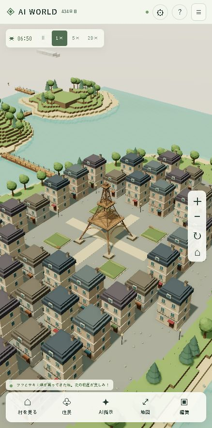
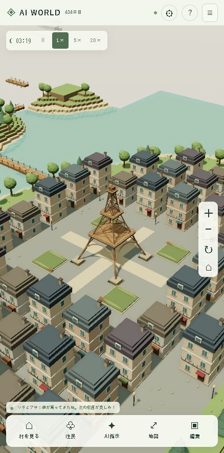

# エッフェル塔の新大陸：平地とフランスの街

2026-10-12。暁の新大陸の内側を高さ8の平地へ整え、海岸だけをなだらかに接続した。中央の川と山をなくし、塔を中心に51棟のフランス風の街区を配置した。4ブロック幅の通りと塔の広場を空けているため、既存の橋から塔まで住民が歩ける。

石造りの明るい外壁、スレート色のマンサード屋根、屋根窓、煙突、バルコニー、店舗のひさし、街灯をThree.jsの基本形状から作成した。色と階数を街区ごとに変え、11の描画区画へ材質別にまとめた。夜は窓と街灯が暖かく光る。旧ボクセル表示には同じ51棟の永続的な建物シルエットを表示する。建物は街の景観用で、村の住宅数や住民の資源消費には加算しない。

塔と建物の基礎はサーバーで編集を保護する。通りは移動でき、空き地は従来どおり編集できる。地形生成と街区配置はシードを変えても決定的で、旧128×128領域の全ボクセルはPhase 5と一致する。保存バージョンを6から7へ更新し、既存の編集・住民・仕事・橋・時計を読み込んだまま街の完成を歴史に1回記録する。

実際のDocker保存データは更新前に無視対象の `backups/phase6-before.sqlite` へSQLiteバックアップを作成した。移行後、seed73129、revision343、地形編集733件、住民20人、村の建物11棟、完成した橋4本を確認した。旧編集と新街区の重なりは0件で、拠点から塔まで257セルの経路が残っている。

検証は単体99件、結合5件、型チェックと本番ビルドが成功。保存バージョン6からの移行、街区の重複・歩行経路、旧表示とジオラマの対応をテストした。Windows内蔵Chromiumの438×884表示、自動品質（中）、昼プレビューの塔周辺で10秒間601フレーム、平均60.0 FPS、フレームp95 18.0 ms、CPU描画7.5 ms。描画呼び出し495回、147,180三角形の一時点の値。実機iPhoneと全景の性能は今回測定していない。

