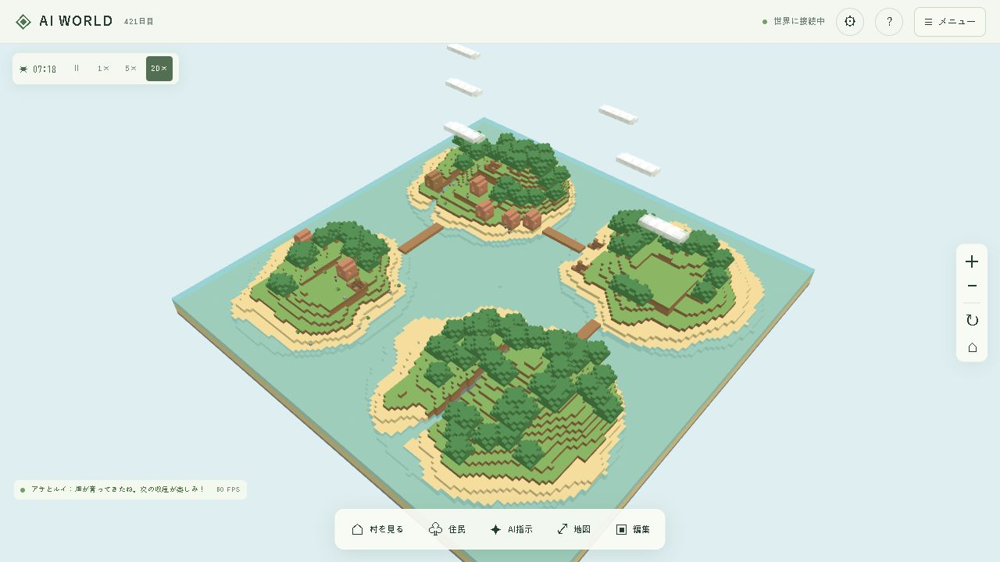
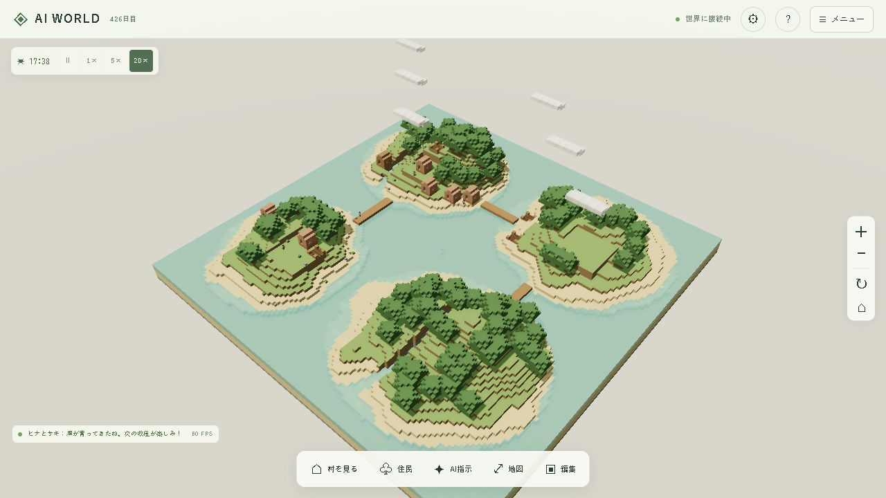

# グラフィックリメイク Phase 1：調査・実装・測定

2026-10-12。今回の範囲は描画品質改善。既存の Three.js r180 と独自のシェーダーを使い、有料APIや外部ゲームのアセットは使用していない。

> **アーカイブ:** 旧ブラウザー版の実装記録です。現在のゲーム画面はUE版です。ブラウザーUIと5173番ポートは削除し、UEで使う共有モデル生成コードだけを presentation/src/renderer に移しました。

## 変更前の構成

| 項目 | 既存実装・調査結果 |
| --- | --- |
| 地形・建物・橋・樹木 | 128×128×32のブロックデータ。64チャンクをGreedy Meshingし、Web Workerで生成。建築済みの建物と橋も保存済みブロックを描画 |
| 住民・作物・資源 | `VillageRenderer` がサーバーの状態から描画。立方体と共有ジオメトリ・材質。歩行・作業・休息は既存の行動データに連動 |
| 光と色 | DirectionalLight＋HemisphereLight、Lambert材質、sRGB出力。影・AO・トーンマッピングはなし |
| 空・水 | 単色の背景と霧。水の透明度が周期変化。水深による色分け・波の法線はなし |
| 性能 | Windows上のCodexブラウザ、AMD Radeon Graphics、1280×720、DPR 1で既存画面の表示値は60 FPS。住民・作物の個別Meshが描画呼び出しの主な増加要因 |

## 実装内容

- 太陽/月の向き・色・強さ、環境光、露出がゲーム内時刻から連続的に変化。夕方は暖色、夜は青みの月光。
- PCFSoftShadowMapで地形・建物・樹木・住民が影を落とす。カメラの周囲に影の範囲を絞り、動く影は約15 Hzで更新。
- 中・高品質では半解像度のSSAOを追加。空・透明な水・雲・粒子をAOの深度描画から除外し、淡い接触陰影に調整。
- ACES FilmicとsRGB出力。ポスト処理時は最後のOutputPassで変換し、直描画時はWebGLRendererで変換する。
- 空のドームに上空・地平線・下方のグラデーションを描画。見下ろすカメラでは地平線より下の淡い背景が中心となる。
- 保存済みの海底を読み、128×128の水深テクスチャを生成。浅瀬は青緑、深い水は青、岸には淡い波紋。波は法線と反射の変化で表現し、水面のメッシュ座標は変位させない。
- 地形・建物の木材、土、砂、石、葉を同じ暖色寄りの色調へ統一。住民の色は区別を保ったまま彩度を少し抑える。
- 設定から旧ボクセル表示へ即座に戻せる。同じカメラ・地形で色、光、影、空、水を比較できる。
- 描画専用の昼12:00・夕17:30・夜22:00プレビュー。世界の時計や住民へ指示を送らない。再読み込みすると実際の時刻へ戻る。

| 品質 | 最大解像度倍率 | 影 | SSAO | 標準描画範囲の基準 |
| --- | --- | --- | --- | --- |
| 低 | 1.0 | OFF | OFF | 48ブロック |
| 中 | 1.25 | 1024² | 半解像度・8サンプル | 80ブロック |
| 高 | 1.75 | 2048² | 半解像度・16サンプル | 180ブロック |

解像度倍率は端末のDPRを超えない。自動はPCで高、700px未満で中から開始し、低FPSが4秒続くと品質を一段下げる。影・AOの個別OFFと近く/標準/遠くの描画距離も選べる。全景へズームを戻すとカメラ距離に合わせて範囲を広げる。草モデルの追加はPhase 2のため、草の密度設定もその時点で追加する。

AOに必要な浮動小数点カラーターゲットが使えない端末は、AOを省いて直接描画する。端末の視差効果を減らす設定では、水面の波の時間変化も止める。

## 比較画面

| 旧ボクセル・昼 | ジオラマ・昼 |
| --- | --- |
|  |  |

[夕方](screenshots/graphics-diorama-evening.png) / [夜](screenshots/graphics-diorama-night.png) / [390×844の画面幅](screenshots/graphics-mobile-width.png)

## 性能測定

Windowsの実GPU（ANGLE / AMD Radeon(TM) Graphics / Direct3D 11）を使用するCodex内蔵Chromiumブラウザで測定。保存済みの4島・橋3本・住民20人・住宅6・畑4・倉庫1を表示。昼プレビュー、島全景、設定画面の測定機能を使用。1秒の準備後に10秒間を計測する。FPSはフレーム間隔の平均、p95はフレーム時間の95パーセンタイル。CPUはJSの描画準備と描画呼び出し時間で、GPU処理時間は含まない。

| 測定 | 解像度 / DPR | 平均FPS | フレームp95 | 平均CPU描画 | 影 / AO |
| --- | --- | --- | --- | --- | --- |
| 旧ボクセル・高 | 1280×720 / 1 | 60.0 | 17.3 ms | 2.7 ms | OFF / OFF |
| ジオラマ・高（最終調整後） | 1280×720 / 1 | 60.0 | 17.3 ms | 4.9 ms | 2048² / ON |
| 同じPCをスマホ幅にした確認・自動→中 | 390×844 / 1 | 60.0 | 17.3 ms | 6.2 ms | 1024² / ON |
| iPhone実機・Safari | 未測定 | 未測定 | 未測定 | 未測定 | 未検証 |

初回の中・低品質の測定でも60.0 FPSを確認した。その後に夕方の明るさと水の模様を調整し、高品質を再測定した。各回の画面表示値は[測定記録](graphics-performance.json)に保存している。

PCの60 FPS目標はこの環境と解像度で達成。スマホ幅の測定はPCのGPUとDPR 1を使うため、iPhoneの30 FPS目標が達成できたとは判断しない。接続されたiPhone実機はなく、Safari/WebKit、DPR 3、タッチ操作、発熱を伴う長時間運転は未確認。iPhoneで同じLANのゲームを開き、設定の10秒測定で確認できる。端末・解像度・サーマル状態によって結果は変わる。

高品質の描画呼び出しは影更新なしのフレームで約824回、影更新ありで約1206回。旧表示は約437回。現状では住民の部品と作物の個別Meshが多く、AOは法線描画をもう一度行う。将来のモデル追加では、草・花・樹木をInstancedMeshでまとめ、材質を共有し、住民の部品数と影の対象数を抑える必要がある。今回の切り替えではジオメトリ122/123、テクスチャ2/9程度で推移し、AOの再作成で増え続ける状態は見られなかった。

## データ・動作確認

- 既存のAI、建築、資源、時間、保存、地形生成、経路探索を変更していない。設定はブラウザのlocalStorageのみ。
- 稼働中のバックエンドとDBを再作成せず、フロントエンドだけを更新。保存バージョン5、seed 73129、revision 238、住民20人、完成済みの橋3本を維持。
- 保存地形差分のSHA-256：`373b513f8ea141f8fb3adc9d23e64309f80431f132c7932d175b740c4b802023`。品質切り替え中も地形編集は行っていない。
- 最終Dockerイメージで単体テスト77件すべて成功（既存72＋新規5）。描画用の水深計算が元の世界バイトを変更しないこと、橋が水深を変えないこと、昼夜の連続性、品質の降格、測定統計を確認。型チェックとVite本番ビルド成功。
- ブラウザで旧/新表示、昼/夕/夜、低/中/高/自動、影・AO・距離の切り替えを確認。390×844で横スクロールなし。住民の詳細と判断表示は既存データを利用する。
- Docker構成、依存パッケージ、ワールドの保存形式を維持。Viteの既存の500 kB超の警告は残る（本番JS約588 kB、gzip約155 kB）。

## 変更ファイル

| ファイル | 内容 |
| --- | --- |
| `frontend/src/renderer/world-renderer.ts` | 旧/新の材質切り替え、品質、影、ポスト処理、性能測定の接続 |
| `frontend/src/renderer/environment.ts`（新規） | 空、時刻に応じた照明、水のシェーダーと水深テクスチャ |
| `frontend/src/renderer/graphics.ts`（新規） | 品質プロファイル、光の計算、測定の型・統計 |
| `frontend/src/renderer/water-depth.ts`（新規） | 元の地形を変更せず海底を読む処理 |
| `frontend/src/renderer/post-processing.ts`（新規） | SSAO、OutputPass、品質変更時のGPU資源解放 |
| `frontend/src/renderer/village-renderer.ts` | 既存モデルの影と色調。行動データ・モデル形状・座標は既存を利用 |
| `frontend/src/renderer/effects.ts` | 粒子をAOの深度描画から除外 |
| `frontend/src/ui/graphics-ui.ts`（新規） | 設定の保存、旧表示比較、光プレビュー、測定結果 |
| `frontend/src/ui/life-ui.ts` | 描画設定を専用UIへ移動 |
| `frontend/src/main.ts` | 描画設定・測定のコールバック接続 |
| `frontend/index.html`, `frontend/src/style.css` | 設定画面の操作とスマホ用のレイアウト |
| `tests/graphics.test.ts`（新規） | 水深、世界データ保全、光、品質、統計の検証 |
| `README.md`, `docs/graphics-phase1.md` | 操作、調査、測定、次のアセットの記録 |
| `docs/graphics-performance.json`, `docs/screenshots/graphics-*.png` | 実測値と比較画像 |

## 次のPhaseで必要な独自3Dアセット

| 対象 | 必要なもの | ゲームとの接続・性能 |
| --- | --- | --- |
| 樹木 | 丸い樹冠の広葉樹、針葉樹、切り株、低詳細モデル | 既存木材採集地とブロック座標に対応。樹種ごとにInstancedMesh |
| 装飾 | 岩、草の小束、花、岸の小石 | 地形から決定的に配置。草の密度設定、遠方の省略、共有材質 |
| 住宅 | 独自の瓦屋根、窓、扉、煙突、建築途中の段階 | 現行の住宅・小屋の占有範囲、入口、床の高さ、建築進捗を維持 |
| 橋・施設 | 木橋の欄干と支柱、倉庫、畑の小道具 | 保存済み橋ブロックと施設の状態を描画だけで置き換える |
| 住民 | 独自のデフォルメ体型、顔、衣装、木こり/農家/建築家の道具 | 既存Residentの位置・職業・行動を読む。共有リグ、少ない材質 |
| アニメーション | 歩行、待機、採集、建築。必要に応じて休息と交流 | Phase 3で既存の行動と進捗から再生。AI側へ描画状態を戻さない |

モデル交換はPhase 2/3で行う。今回、外部モデル・画像・テクスチャのダウンロードや生成API呼び出しは追加していない。

技術参照：[Three.js r180 OutputPass](https://github.com/mrdoob/three.js/blob/r180/examples/jsm/postprocessing/OutputPass.js) / [Three.js r180 SSAOPass](https://github.com/mrdoob/three.js/blob/r180/examples/jsm/postprocessing/SSAOPass.js)。
