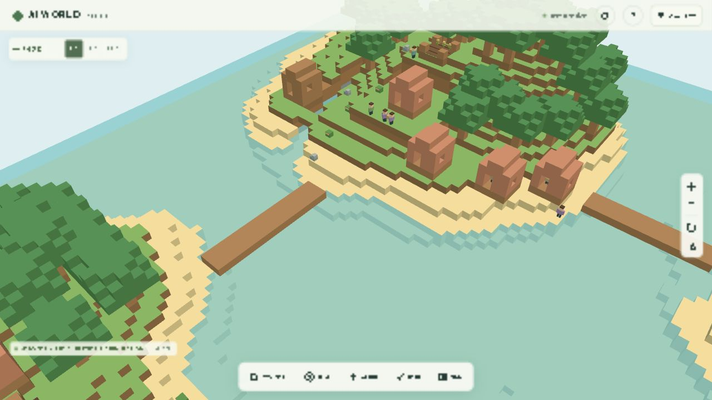

# グラフィックリメイク Phase 2：3Dモデル刷新

2026-10-12。Three.js r180のプリミティブから独自のモデルを制作。外部アセット、有料API、新規依存パッケージは使用していない。住民モデルの刷新は次のPhase 3で行う。

## 実装した見た目

- 樹木：丸い樹冠の広葉樹と、重なる円錐の針葉樹。既存の幹と葉の配置を読んで同じ場所に表示。木材採集地と再生周期は従来どおり。
- 装飾：曲がった草の束、淡い花、岸や山の小石。草・砂・石の表面から決定的に配置。建物・畑の入口、橋、採集地、拠点の周囲を避ける。
- 小屋・住宅：木の梁、塗り壁、切妻の瓦屋根、窓枠、窓台、煙突、花鉢。扉は開いた入口として表現し、元の歩けるセルを塞がない。
- 倉庫：青灰色の瓦屋根、木枠、窓、入口の木箱と看板。
- 畑：畝、柵、開いた正面、桶、成長と収穫残量に連動する作物。
- 橋：保存済みの床に沿った板材、欄干、支柱。横方向・縦方向の橋に対応し、出入口と未建築部分には横断する欄干を置かない。床の上面は保存ブロックの `y+1` に維持。
- 建築途中は進捗に応じて床・壁・屋根・仕上げを表示。住宅への改築中は既存の小屋を表示し続ける。

| 同じ村・旧ボクセル | 同じ村・ジオラマ |
| --- | --- |
|  |  |

[島全景](screenshots/models-diorama-islands.png) / [スマホ幅](screenshots/models-mobile.png)

## 描画とゲーム状態の分離

`model-plan.ts` はワールドと村を読み、モデルの位置と描画から省くブロックを計算する。元のワールドを変更せず、Web Worker内のコピーからモデルに対応するブロックだけを除外してジオラマ用メッシュを生成する。旧ボクセル用メッシュも保持するため、設定から即座に比較できる。

建物の描画用ブロックレシピはフロントエンドに置き、バックエンドの建築関数と一致することをテストする。建築途中は実際に存在する建築済みブロックだけを省略する。改築の場合は既存の木壁も扱う。プレイヤーが置いた単独の木材・葉や未登録の建造物を一律に削除する処理はない。

編集モードでは元のブロック形状を表示し、ブロック単位で従来どおり編集・取り消しできる。「ながめる」に戻るとジオラマ表示を再開する。住民選択や編集のRaycastは元の地形メッシュを使う。経路探索、当たり判定、資源、住民AI、時計、保存形式は変更していない。

## 性能設計

- 樹木・草・花・小石は32×32の領域ごとにInstancedMeshへまとめる。共有ジオメトリ・材質を使用し、領域とメッシュの境界球で不要な描画を省く。
- 草の束は3本の曲がった葉、合計9三角形。草と花は影を落とさず、近距離だけ表示する。
- 建物の瓦や梁、橋の板は同じ材質ごとにジオメトリを結合。部品ごとに描画呼び出しを増やさない。
- 村の更新が来ても、建築進捗・作物の成長段階・資源残量の表示段階が変わらなければモデルを再生成しない。地形変更と建築の変化に応じて表示計画を更新。
- モデル差し替え時は旧ジオメトリをdisposeし、InstancedMeshを作り直す場合はインスタンス用GPUバッファを解放。共有プリミティブを誤ってdisposeしない。

設定の「草・影・描画距離・ポストエフェクト」で、草と花の密度を「なし／少なめ／豊か」から選択できる。選択はブラウザに保存する。

| 品質 | 草・花の密度上限 | 装飾の表示距離基準 | 影 / AO |
| --- | --- | --- | --- |
| 低 | 12% | 28ブロック | OFF / OFF |
| 中 | 45% | 55ブロック | 1024² / 半解像度 |
| 高 | 100% | 90ブロック | 2048² / 半解像度 |

表示距離には領域の大きさの余白を加える。自動品質の低下にも連動する。岩と主要モデルの距離は地形の描画距離に合わせる。

## 性能測定

Windowsの実GPU（AMD Radeon Graphics、ANGLE / Direct3D11）を使用したCodex内蔵Chromiumで測定。保存済みの4島、住民20人、建物11棟、橋3本を表示し、世界の進行は停止していない。昼プレビュー、DPR 1、1秒の準備後に10秒間を計測。CPU描画時間はGPU処理時間を含まない。

| 表示 / 品質 / 場所 | 解像度 | 平均FPS | フレームp95 | 平均CPU描画 | 影 / AO |
| --- | --- | --- | --- | --- | --- |
| ジオラマ / 高 / 島全景 | 1280×720 | 60.0 | 17.3 ms | 9.6 ms | 2048² / ON |
| ジオラマ / 高 / 村 | 1280×720 | 60.0 | 17.3 ms | 8.2 ms | 2048² / ON |
| 旧ボクセル / 高 / 村 | 1280×720 | 60.0 | 17.5 ms | 3.0 ms | OFF / OFF |
| ジオラマ / 低・草少なめ / 村 | 1280×720 | 60.0 | 17.4 ms | 4.3 ms | OFF / OFF |
| PCをスマホ幅に変更 / 自動→中 / 村 | 390×844 | 60.0 | 17.5 ms | 7.1 ms | 1024² / ON |
| iPhone実機 / Safari | 未測定 | 未測定 | 未測定 | 未測定 | 未検証 |

[測定記録](graphics-phase2-performance.json)。描画呼び出しは、島全景・高品質の個別フレームで約1156〜1675回、村・高品質で約771〜1047回。影の更新フレームや画面内の住民・作物によって変化する。記録のmetricsは測定終了後の個別フレームを含み、10秒間の平均呼び出し数ではない。

このPCと解像度で60 FPS目標を達成。Phase 1よりモデルの三角形数とCPU描画時間が増えており、上限60 FPSでの測定はGPUの余力を保証しない。旧/新の比較用メッシュを同時保持するため、ウォームアップ後のジオメトリは約289〜315（Phase 1では約122〜123）。大きな画面や高DPRでは低・中品質、影/AOのOFF、草の密度・描画距離の調整が利用できる。

390×844では横スクロールがないことを確認した。この測定にもPCのGPUを使っているため、iPhoneの30 FPS目標を確認したとは扱わない。接続されたiPhone実機がなく、Safari/WebKit、DPR 3、長時間の発熱は未検証。iPhone実機で設定の10秒計測を行う必要がある。

## 動作確認

- 既存の単体テスト77件と、新規モデルテスト7件が成功。追加テストではワールド・村の非破壊、決定的な配置、全建築レシピと進捗、改築、プレイヤーの木材・葉、木の削除、橋の出入口、住宅の入口、表示・品質切り替え、復元を検証。
- HTTP/WebSocket、2クライアント、会話、自然言語指示、建築・農業、保存・プロセス再起動の結合テスト5件が成功。
- TypeScript型チェックとVite本番ビルド成功。本番JSは約638 kB、gzip約171 kB。既存の500 kB警告は継続。
- Dockerのフロントエンドだけを再構築・更新。バックエンド、Compose設定、SQLiteボリュームは維持。
- 稼働中の保存データはversion 5 / revision 238 / 住民20人 / 建物11棟 / 完成橋3本。地形差分SHA-256はPhase 1と同じ `373b513f8ea141f8fb3adc9d23e64309f80431f132c7932d175b740c4b802023`。
- 保存ワールドから樹木119本、装飾候補1025個を検出。置き換え後の地形コピーに既存樹木の葉ブロックが残らないことを確認。

## 変更ファイル

| ファイル | 内容 |
| --- | --- |
| `frontend/src/renderer/model-plan.ts` | 非破壊の樹木・装飾・建物・橋の表示計画 |
| `frontend/src/renderer/model-kit.ts` | 独自プリミティブモデルと材質別ジオメトリ結合 |
| `frontend/src/renderer/world-models.ts` | インスタンス描画、村の状態との同期、距離・密度・GPU資源管理 |
| `frontend/src/renderer/mesh-worker.ts` | 元の地形と描画用コピーのメッシュ生成 |
| `frontend/src/renderer/world-renderer.ts` | 旧/新メッシュ、モデル、編集モードの切り替え |
| `frontend/src/renderer/village-renderer.ts` | 旧ボクセルの畑・採集地を比較表示用に維持 |
| `frontend/src/renderer/graphics.ts`, `frontend/src/ui/graphics-ui.ts` | 密度と距離の品質設定・保存 |
| `frontend/src/main.ts`, `frontend/index.html` | 村の状態の接続、設定の操作 |
| `tests/models.test.ts` | モデル表示と既存データの整合性のテスト |
| `README.md`, `docs/graphics-phase2.md`, `docs/graphics-phase2-performance.json`, `docs/screenshots/models-*.png` | 操作、測定、比較画面 |

## 次に必要なアセット

Phase 3では独自のデフォルメ住民、職業ごとの衣装・道具、共有リグによる歩行・待機・採集・建築アニメーションを制作する。現在の住民は従来のボクセルモデルと行動連動アニメーションを使う。今回の樹木・建物・施設はすべて手続き的モデルなので、外部のGLBやテクスチャは不要。
