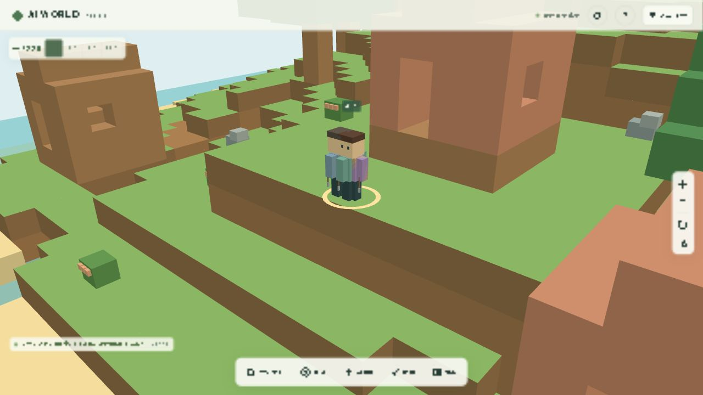

# グラフィックリメイク Phase 3：住民グラフィック

2026-10-12。独自のデフォルメ3D住民と、既存の行動に連動するアニメーションを実装。Three.jsのプリミティブから制作し、外部ゲームのモデル・テクスチャ、有料API、外部LLMは使用していない。

## キャラクター

丸い大きな頭、髪、目と頬、襟付きの服、手、ズボン、ブーツでミニチュア住民を表現。元の服の色を引き継ぎ、住民IDから肌・髪の色と動きの位相を決定する。読み込みのたびに容姿をランダムに変えない。

| 職業 | 衣装 | 通常の道具 |
| --- | --- | --- |
| 建築家 | 革の帽子、作業エプロン、ベルト | ハンマー |
| 木こり | 緑のニット帽、革のベスト | 斧 |
| 採掘師 | 灰青色の帽子、首巻き | つるはし |
| 農家 | 麦わら帽子、布のエプロン | 鍬 |
| 採集家・その他 | 斜めの袋ひも、襟付きの服 | 小さなかご |

実際の作業を優先して道具を選ぶ。木材採集は斧、石材採集はつるはし、食料採集はかご、農業は鍬、建築・橋はハンマー。例えば、農家が住宅を建築している間はハンマーを使う。職業変更を受け取ると衣装も更新する。

| 同じ場所・旧住民 | 同じ場所・新しい住民 |
| --- | --- |
|  |  |

[村の住民](screenshots/residents-diorama-village.png) / [スマホ幅](screenshots/residents-mobile.png)

## 行動との接続

- 歩行：足と腕を交互に振り、上半身がわずかに上下する。運搬中は両腕で荷物を持つ。
- 待機：控えめな呼吸と視線の動き。住民ごとの位相を変え、全員が同時に同じ動きをしない。
- 採集：斧・つるはしを振る。食料では前にかがんで手を伸ばす。
- 建築：ハンマーを反復して振る。建物、または建設中の橋の次の床の方向を向く。
- 農業：鍬の往復と前傾姿勢。畑の既存の生育・収穫データと同時に表示する。
- 休息：腰を下げた姿勢。交流では片手で身振りをし、探索では周囲を見る。
- 所持品：実際のinventoryから、食料のかご、丸太の束、石材の袋を表示。所持品が空になったら荷物も消す。

住民の位置と向きの既存処理に、描画用の肩・腰・頭の支点を追加。アニメーションが変更するのは子オブジェクトのみで、Residentの位置、経路、AI、作業量、資源に書き戻さない。行動の切り替わりは短い補間でなめらかにする。

各住民の描画用時計は一時停止で停止し、その時点の表示姿勢も維持。「視差効果を減らす」が有効な場合は揺れ・反復運動を省き、行動に合った静止姿勢を使う。

旧ボクセル表示では以前の住民を表示。ブロック編集時の旧表示にも対応する。Raycastでは見えているモデルだけを選択対象にするため、隠れた旧住民や道具を誤ってクリックしない。名前・会話・思考表示・選択リングを継続して利用する。

「この住民を近くで見る」は顔と服が見やすい距離へ移動し、足元より少し上をカメラの中心にする。PCで半径16、スマホ幅で24ブロック。さらにズーム・回転できる。

## 性能設計

顔の目・髪・帽子、服の襟・エプロン・ベルトなどを、部位ごとのジオメトリに結合。頂点色を使い、全住民で1つのStandard材質を共有する。動く部分は胴体・頭・腕2本・脚2本の6メッシュで、道具・荷物を含めても表示は最大8メッシュ。旧住民は荷物なしで11メッシュ、ありで12メッシュ。

細かな目・頬・手・靴には低詳細の球を使用。衣装と容姿が同じ住民はテンプレートのジオメトリを共有し、道具・荷物も共有する。職業変更や住民の削除では参照数を減らし、最後の利用者がいなくなったテンプレートだけをGPUから解放する。

## 性能測定

Windows上のCodex内蔵Chromium、AMD Radeon Graphics（ANGLE / Direct3D11）、DPR 1。保存済みの4島、住民20人、建物11棟、橋3本を表示。昼プレビュー、シミュレーション1×、1秒の準備後に10秒間を測定。CPU描画時間にGPUの実行時間は含まない。

| 表示 / 品質 | 解像度 | 平均FPS | フレームp95 | 平均CPU描画 | 影 / AO |
| --- | --- | --- | --- | --- | --- |
| 島全景 / 高 | 1280×720 | 59.8 | 17.8 ms | 10.2 ms | 2048² / ON |
| 村 / 高 | 1280×720 | 60.0 | 17.3 ms | 8.3 ms | 2048² / ON |
| PCをスマホ幅に変更 / 自動→中 | 390×844 | 60.0 | 17.1 ms | 6.9 ms | 1024² / ON |
| iPhone実機 / Safari | 未測定 | 未測定 | 未測定 | 未測定 | 未検証 |

[測定記録](graphics-phase3-performance.json)。この環境でほぼ60 FPSを維持。島全景では10秒間に598フレームで、厳密な60.0 FPSには届かなかった。Phase 2の島全景60.0 FPS / CPU9.6 msに対し、今回は59.8 FPS / CPU10.2 ms。描画呼び出しを減らした一方で、丸い住民の三角形数が増えている。

測定後の個別フレームの描画呼び出しは全景1359回、村621回、スマホ幅428回。影の更新と画面内の人数により変化し、10秒間の平均値ではない。ジオメトリは379、テクスチャはAO有効時9。旧/新の住民と地形を保持する比較機能も含む。高DPRでは品質や影・AO・装飾の設定を調整できる。

390×844で横スクロールなし。スマホ幅の測定にもPCのGPUを使っているため、iPhoneで30 FPS以上という実機目標を確認したとは扱わない。接続されたiPhone実機でのSafari、高DPR、長時間の発熱の計測が残る。

## 動作確認

- 単体テスト89件すべて成功（既存84＋住民描画5）。実際の作業による道具選択、姿勢の違い、視差低減、資源表示、ゲーム座標の非破壊、共有ジオメトリの解放、一時停止を検証。
- TypeScript型チェックとVite本番ビルド成功。
- 本番JSは約648 kB、gzip約175 kB。既存の500 kB超の警告は継続。
- ブラウザで顔・衣装の近接表示、旧/新の比較、クリックによる住民詳細、一時停止・再開を確認。ブラウザに新規の描画エラーなし。
- Dockerのフロントエンドを更新。バックエンド、保存形式、Compose設定、SQLiteボリュームは維持。
- 稼働中のワールドは保存version 5、revision 238、seed 73129、住民20人・建物11棟・完成橋3本。地形差分SHA-256はPhase 1/2と同じ `373b513f8ea141f8fb3adc9d23e64309f80431f132c7932d175b740c4b802023`。一時停止の確認後は元の1×に戻した。
- iPhone実機は接続されておらず、Safari・高DPR・発熱を含む30 FPSの実機確認は未実施。

## 変更ファイル

| ファイル | 内容 |
| --- | --- |
| `frontend/src/renderer/resident-model.ts` | 独自モデル、衣装、共有材質、道具・荷物、ジオメトリ管理 |
| `frontend/src/renderer/resident-pose.ts` | 実際の職業・作業・所持品から道具と姿勢を計算 |
| `frontend/src/renderer/village-renderer.ts` | 旧/新モデル、職業更新、時計、向き、クリック、既存UIの接続 |
| `frontend/src/renderer/world-renderer.ts` | 住民を近くで見るカメラの調整 |
| `frontend/index.html` | 描画スタイルの案内 |
| `tests/resident-rendering.test.ts` | モデル・アニメーション・データ整合性のテスト |
| `README.md`, `docs/graphics-phase3.md`, `docs/graphics-phase3-performance.json`, `docs/screenshots/residents-*.png` | 操作、性能、比較画像 |

## 今後のアセット

このPhaseで必要な住民、衣装、道具、荷物、歩行・待機・採集・建築の動作はコード内で制作済み。追加の外部GLB・画像は不要。さらに表現を増やす場合は、歩行の膝・肘、まばたき、感情表情、衣装の種類を追加できる。
