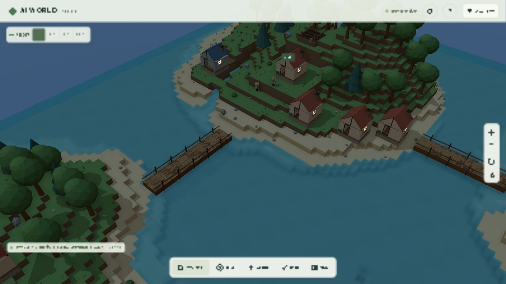
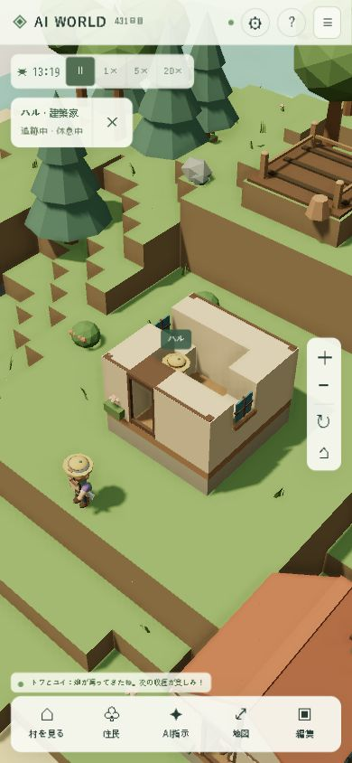

# グラフィックリメイク Phase 4：表情・暮らしの演出・観察と負荷調整

2026-10-12。元のグラフィック計画はPhase 3までのため、ユーザーの指定により「表情・建物の演出・画面の見やすさ・描画負荷をまとめて改善」をPhase 4として実装。

> **アーカイブ:** 旧ブラウザー版の実装記録です。現在のゲーム画面はUE版です。ブラウザーUIと5173番ポートは削除し、UEで使う共有モデル生成コードだけを presentation/src/renderer に移しました。

## 住民の表情

目と口を既存の頭メッシュ内で変形し、描画呼び出しを追加せず表情を表示する。容姿の共有・職業の衣装・行動アニメーションを継続利用する。

| 状態 | 見た目 |
| --- | --- |
| 通常 | 穏やかな顔、住民IDで間隔を変えたまばたき |
| 交流中または発話中 | 口元の笑顔 |
| 休息中または元気25未満 | 眠そうな目。休息中はさらに閉じる |
| 空腹75超または体力40未満 | 心配そうな口元。交流より優先 |

目は3.2〜5.4秒の周期で約0.24秒かけて閉じて開く。実際の体力・元気・空腹・行動・speechを読み、AIや会話に架空の感情を書き込まない。一時停止では表情もその時点で止まる。「視差効果を減らす」ではまばたきを省き、状態に合った静止表情にする。

## 建物の演出と屋内の観察

- 窓の共通材質を夕暮れから暖色に変え、夜は発光させる。追加のPointLightや影は使わない。光のプレビューにも対応する。
- 完成し、住民が寝床として使っている小屋・住宅から淡い煙を表示。60個のInstancedMeshを共有し、1つの描画呼び出しにまとめる。低品質・視差低減では省略し、一時停止では煙の上昇を止める。
- 追跡中の住民が建物の内部にいる場合、近距離だけ屋根・破風・煙突を非表示にする。外へ出る、追跡を終了する、ズームアウトすることで復帰する。壁と床は維持する。
- 住民選択は表示中のジオラマ地形とモデルで遮蔽を確認。省いた屋根や旧表示用の不可視ブロックが、屋内の住民のクリックを妨げない。

## 住民を追うカメラ

「住民」→「この住民を近くで見る」で追跡する。補間された描画位置を中心に追い、画面左上の小さなカードから名前・職業・現在の行動を確認できる。名前を押すと既存の詳細・判断スコア・会話を開く。×で追跡を終了する。

回転とズームは追跡中も利用可能。カメラを移動する操作、地図からの移動、村を見る、島全体表示、編集開始で追跡を解除する。住民が状態から消えた場合も解除する。メニューを常設で増やさず、追跡中だけカードを表示する。

## 描画負荷

住民が画面上で28px以上なら毎フレーム、12〜28pxなら10回/秒、それ以下なら4回/秒で姿勢を更新する。選択中の住民は毎フレーム。画面の外では姿勢の更新を省き、画面内へ戻ったら描画用時計の現在値を反映する。位置の補間、選択、シミュレーションの頻度は変えない。

仕事の場所と資源種類は村の更新時に取得し、毎フレームの検索を削減。ジオラマ表示中は隠れている旧住民の腕・脚を更新しない。非表示ラベルのDOMへの重複書き込みも抑える。中品質の影は約10回/秒、高品質は約15回/秒。一時停止中はカメラ・照明・地形の変化が必要とする場合に影を更新する。

屋根を材質別の追加バッチに分けるため、完成住宅は最大16メッシュ。表情は既存の頭メッシュに3つの変形ターゲットを持たせる。今回の実装は遠距離の更新を減らす一方、表情のGPU処理と建物のバッチ数を増やしている。

## 性能測定

Windows PC / Codex内蔵Chromium / AMD Radeon Graphics（ANGLE / D3D11）/ DPR 1。保存済みの4島、住民20人、建物11棟、橋3本。ジオラマ、昼プレビュー、草「豊か」、シミュレーション1×。1秒の準備後、10秒間測定。

| 表示 / 品質 | 解像度 | 平均FPS | フレームp95 | CPU描画 |
| --- | --- | --- | --- | --- |
| 村 / 高 | 1280×720 | 60.0 | 17.8 ms | 9.8 ms |
| 島全景 / 高 | 1280×720 | 60.1 | 20.0 ms | 11.4 ms |
| PCをスマホ幅へ変更 / 自動→中 | 390×844 | 60.0 | 17.7 ms | 8.4 ms |
| iPhone実機 / Safari | 未測定 | 未測定 | 未測定 | 未測定 |

[測定記録](graphics-phase4-performance.json)。約60 FPSを維持したが、島全景のp95は20msで、一部フレームは60 FPS相当の16.7msを超える。CPU描画はPhase 3の村8.3ms・全景10.2ms・スマホ幅6.9msに対し増加した。画面内の住民の場所・作物・影更新により負荷が変わるため、同じフレームの厳密な比較ではない。CPU時間にGPU実行時間は含まない。

記録時の個別フレームは村623回 / 166,920三角形、全景974回 / 260,370三角形、スマホ幅480回 / 127,244三角形。10秒間の平均描画回数ではない。ジオメトリ379、テクスチャ29。Three.jsの表情用モーフターゲットのGPUテクスチャにより、Phase 3の9テクスチャから増えている。

390×844で横スクロールなし。スマホ幅の測定はPCのGPUを使用している。iPhone実機でSafari・高DPR・長時間の発熱を含む30 FPS目標の検証は残る。

## 動作確認

- 全92件の単体テスト成功（既存89＋表情、更新間隔、窓明かりと屋根・煙の3件）。最後のクリック遮蔽修正後も、関係する15件を再確認し成功。
- TypeScript型チェックとVite本番ビルド成功。本番JS約653 kB / gzip約176 kB。500 kB超の既存警告は継続。
- ブラウザで追跡カード、屋内の屋根省略、追跡終了、旧/新表示、夜の窓、PC・スマホ幅の表示を確認。
- 屋根を省いた家の中の住民を直接クリックして詳細が開くことを確認。新規のブラウザ描画エラーなし。確認後はジオラマ・自動品質・通常速度1×へ戻し、測定用の画面サイズ指定も解除した。
- フロントエンドだけをDockerで再構築。Compose・バックエンド・SQLiteボリューム・保存形式は維持。
- 稼働中の保存データはversion 5 / revision 238 / seed 73129 / 住民20人 / 建物11棟 / 橋3本。地形差分SHA-256は以前と同じ `373b513f8ea141f8fb3adc9d23e64309f80431f132c7932d175b740c4b802023`。

## 変更ファイルと今後のアセット

| ファイル | 内容 |
| --- | --- |
| `presentation/src/renderer/resident-pose.ts`, `resident-model.ts` | 実状態からの表情、頭メッシュの変形 |
| `frontend/src/renderer/village-renderer.ts（旧Web専用・削除済み）` | 表示サイズに応じた更新と作業先のキャッシュ |
| `presentation/src/renderer/model-kit.ts`, `旧Web版world-models.ts（削除済み）` | 窓の光、屋根の分離・省略、煙、選択時の遮蔽 |
| `frontend/src/renderer/world-renderer.ts（旧Web専用・削除済み）`, `frontend/src/camera/controls.ts` | 住民追跡、解除、影更新、表示モデルでの住民選択 |
| `frontend/src/main.ts`, `frontend/index.html`, `frontend/src/style.css` | 小さな追跡カードと既存操作の接続 |
| `tests/resident-rendering.test.ts`, `tests/models.test.ts` | 状態・一時停止・データ非破壊・表示復帰の検証 |
| `README.md`, `docs/graphics-phase4*`, `docs/screenshots/polish-*` | 操作、測定結果、表示記録 |

モデルと表情は独自のコードで制作。新しい外部GLB、画像、有料API、依存パッケージは不要。さらに仕上げる場合は、膝・肘の関節、表情に合った眉、道や地面のより滑らかな形状、iPhone実機に合わせたモデルの詳細度調整が候補。
