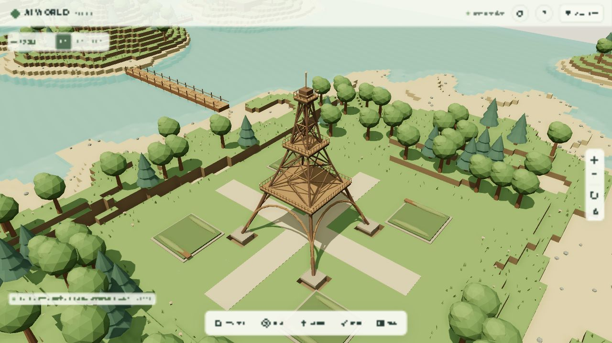
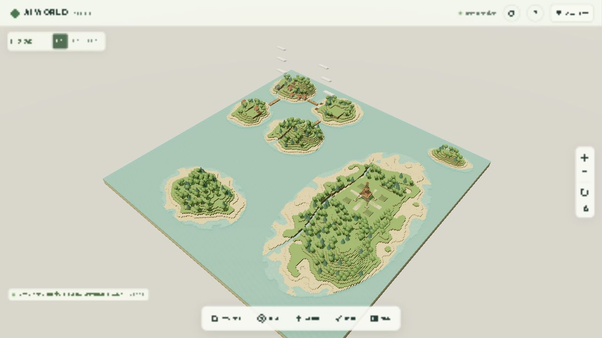
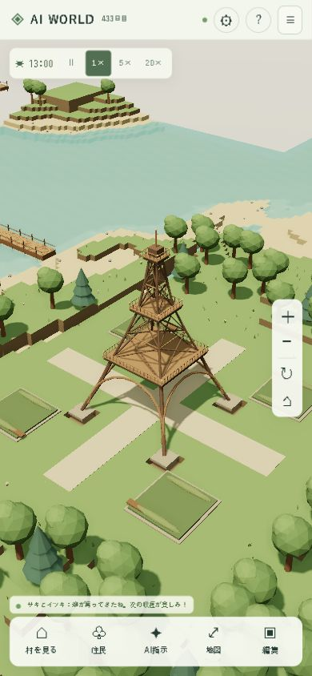

# グラフィックリメイク Phase 5：新大陸とエッフェル塔

2026-10-12。ワールドを128×128×32から256×256×32へ拡張。面積は4倍、ワールド配列は2,097,152バイト。既存の島々を残し、東側に「暁の新大陸」、南に島、北東に小島を追加した。新大陸には森林・川・山・海岸と、段差をなだらかにつなぐ平らな塔の広場がある。

## エッフェル塔と移動

塔の基点は `(196, 9, 122)`、高さは22ブロックのミニチュア表現。4本の脚、格子梁、4つの入口アーチ、3段の展望階・手すり・先端、舗装した十字の通路、庭園、ベンチを独自のThree.jsプリミティブから制作した。実寸の建築図面の再現ではない。夜には展望階の小さな灯りと縁が暖かく光る。

今回の塔は完成したランドマークとしてワールド生成時に配置する。NPCの資源を消費する建築タスクとしては扱わない。ボクセルの塔も同じ場所に生成し、旧ボクセル表示、歩行の当たり判定、保存復元に対応する。アーチの中央は住民が歩ける。

[夜のライトアップ](screenshots/continent-eiffel-night.png) / [旧ボクセル表示](screenshots/continent-eiffel-classic.png)

右上「メニュー」→「新大陸のエッフェル塔を見る」、または「地図」→「新大陸とエッフェル塔」で近景へ移動する。地図の♜印でも場所を確認できる。地図上の任意の位置への移動は、256×256に合わせて座標を変換する。全景カメラの距離・上限・遠方クリップと霧を広い世界に対応させた。

塔と基礎の編集はサーバーで保護する。自動・手動の住宅や畑の敷地判定では広場を避ける。住民AIは既存の橋建設を使って新大陸への道を計画し、木材確保・担当・着工・完成を従来の仕事と歴史に表示する。南の追加島と北東の小島は今回の橋の自動生成対象に追加していない。

## セーブ互換性とDocker

保存バージョンを5から6へ更新。住民状態は4を維持する。旧保存バージョン1〜5を読み込み、座標で保存された地形差分を新しいワールド配列に適用する。拡張イベントをSQLiteのトランザクション内で歴史に1度だけ追加する。

旧128×128領域の全ボクセルは以前の生成結果と一致する。旧端で増えてしまう樹木や、新しい樹冠が旧領域へはみ出すことも防いだ。シード73129と100について、以前のジェネレーターから採取したSHA-256と、拡張後から切り出した全128×128×32のSHA-256の一致をテストした。

稼働中のSQLiteを更新前に `backups/phase5-before.sqlite` へバックアップ。GitとDockerのビルド対象から除外した。移行直後、一時停止中のデータをバックアップと比較し、住民・建物・資源・仕事・既存橋・拠点が構造的に一致した。

| 移行時の情報 | 値 |
| --- | --- |
| 保存バージョン | 5 → 6 |
| seed / revision | 73129 / 238を維持 |
| 時計 | 621806.5、移行中は停止 |
| 住民 / 建物 / 既存橋 | 20 / 11 / 3を維持 |
| 地形差分SHA-256 | `373b513f8ea141f8fb3adc9d23e64309f80431f132c7932d175b740c4b802023`を維持 |

バックエンドとフロントエンドを再構築し、同じComposeとSQLiteボリュームで起動。確認後は速度1×へ戻したため、新大陸への橋の進捗や地形差分は正常なシミュレーションによって増える。

実際の村でハルが「暁の新大陸への橋」を自律的に建設し、105/105ブロックで完成した。完成後はrevision 343、住民20人・建物11棟。プレイヤーから橋の建設指示や資源追加は行っていない。
稼働中の保存済み地形を読み直し、村の拠点から塔の中央 `(196.5, 9, 122.5)` まで257セルの歩行経路が存在することも確認した。

## 検証

- 単体テスト96件すべて成功（既存92＋大陸・塔・移行の4件）。小さな灯りの追加後に関連17件、旧ボクセルの脚をつながる形に整えた後に関連26件を確認し成功。
- HTTP/WebSocket、2クライアント、会話、建築・農業・人口、実プロセスの保存復元を含む結合テスト5件成功。
- TypeScript型チェックとVite本番ビルド成功。JS約658 kB、gzip約178 kB。既存の500 kB超の警告は継続。
- 広場への橋を計画して、その全床を置いた状態で旧島から塔のアーチ下まで歩行経路があることを確認。
- 塔のモデルは9材質の9メッシュに結合。地形・ゲーム状態を描画モデルの制作時に変更しない。
- 旧領域の一致、新大陸の編集・再起動後の保存、塔の編集保護、広場への住宅配置拒否、旧表示との切り替えに対応。
- 画面全体へ引いたときは草・花を省き、樹木と地形・建物・塔を表示する。
- 地形チャンクの表示境界を樹木の32×32領域に揃え、遠景の木だけが地形のない場所に浮いて見える表示を修正。

## 性能測定

測定結果は [graphics-phase5-performance.json](graphics-phase5-performance.json) に記録する。Windows / Codex内蔵Chromium / AMD Radeon Graphics（ANGLE / D3D11）/ DPR 1。昼プレビュー、草「豊か」、シミュレーション1×、1秒の準備後に10秒間測定。スマホ幅の測定にもPCのGPUを使っており、iPhone実機ではない。

| 表示 / 品質 | 解像度 | 平均FPS | フレームp95 | CPU描画 |
| --- | --- | --- | --- | --- |
| 塔の近景 / 高 | 1280×720 | 60.0 | 17.6 ms | 10.7 ms |
| 全景 / 高 | 1280×720 | 57.0 | 23.5 ms | 15.5 ms |
| 全景 / 中 | 1280×720 | 56.2 | 22.6 ms | 14.6 ms |
| PCをスマホ幅へ変更、塔 / 自動→中 | 390×844 | 60.0 | 17.5 ms | 6.4 ms |
| iPhone実機 / Safari | 未測定 | 未測定 | 未測定 | 未測定 |

全景の60 FPS目標は未達。地形範囲が広がり、描画対象とCPU負荷が増えた。高品質の全景の個別フレームで描画呼び出し2173回、485,994三角形を記録した。Phase 4の全景は974回、260,370三角形。影・AOの複数パスや新大陸の木・地形が負荷になる。中品質でも今回の平均値は60 FPSに届かなかった。測定後の中品質の短期値は59.7 FPSで、橋の建設中の更新やフレームごとの影更新により変動する。高品質と中品質は同じ10秒区間の比較ではない。

ジオメトリ736〜742、テクスチャ29。比較用の旧/新地形も保持しているため、広い世界はGPUメモリも増やす。遠景LODとチャンクの描画統合が今後の改善点。CPU値はGPUの実行時間を含まず、描画呼び出しと三角形数は測定後の個別フレームで平均値ではない。

390×844で横スクロールなし。塔周辺ではPCのGPUで60 FPSを維持したが、iPhoneのSafari・高DPR・長時間の発熱を含む30 FPS実機目標は未検証。

## 変更ファイル

| ファイル | 内容 |
| --- | --- |
| `shared/world.ts` | 256×256の地形、旧領域の保存、塔の永続ボクセルと広場 |
| `backend/src/database/store.ts` | バージョン6への移行、拡張イベント、塔の編集保護 |
| `backend/src/buildings/hut.ts`, `bridge.ts`, `backend/src/agents/autonomy.ts` | 広場の予約、新大陸への橋候補、目的地判定 |
| `backend/src/simulation/engine.ts` | 新規ワールドの歴史に塔と大陸を記録 |
| `frontend/src/renderer/eiffel-model.ts` | 独自の格子塔・アーチ・展望階・庭園・ベンチ |
| `frontend/src/renderer/model-plan.ts`, `world-models.ts`, `model-kit.ts` | 塔の表示とボクセルの対応、夜の光、遠景の装飾負荷 |
| `frontend/src/renderer/world-renderer.ts`, `frontend/src/camera/controls.ts` | 大陸の近景、広い全景、描画距離・霧 |
| `frontend/src/ui/life-ui.ts`, `frontend/src/main.ts`, `frontend/index.html`, `frontend/src/style.css` | 地図の座標と塔の印、移動ボタン、世界サイズの案内 |
| `tests/continent.test.ts`, `tests/world.test.ts`, `tests/store.test.ts` | 拡張、旧地形一致、移行・保存、モデルと経路 |
| `.gitignore`, `.dockerignore`, `README.md`, `docs/graphics-phase5*`, `docs/screenshots/continent-*` | バックアップ除外、操作、検証と表示記録 |

外部GLB・テクスチャ・有料API・新規依存パッケージは使用していない。追加のアセットは不要。今後は新大陸への住民の移住・観光、塔のNPC建築タスク化、遠景地形のLODとGPUメモリ削減が候補になる。
