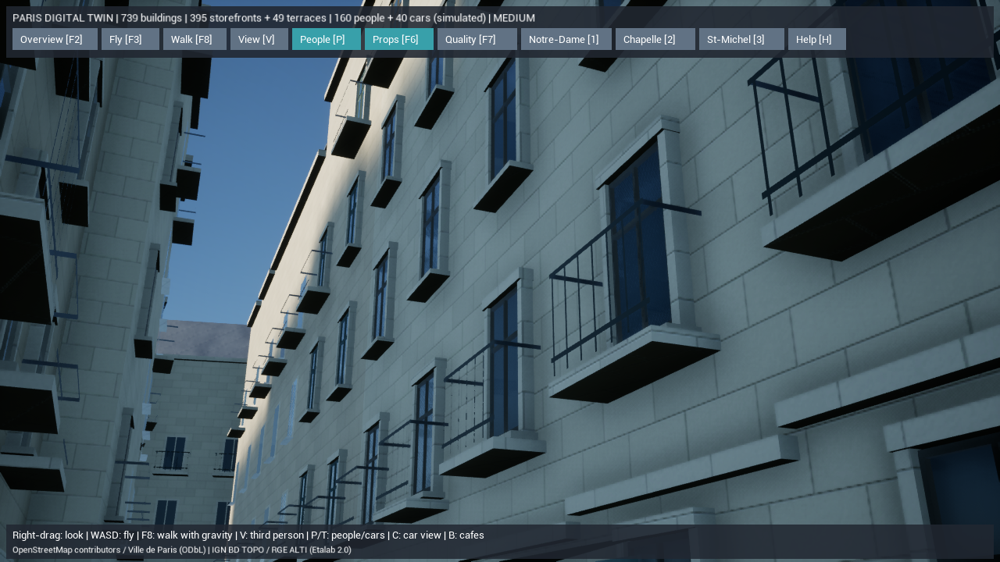
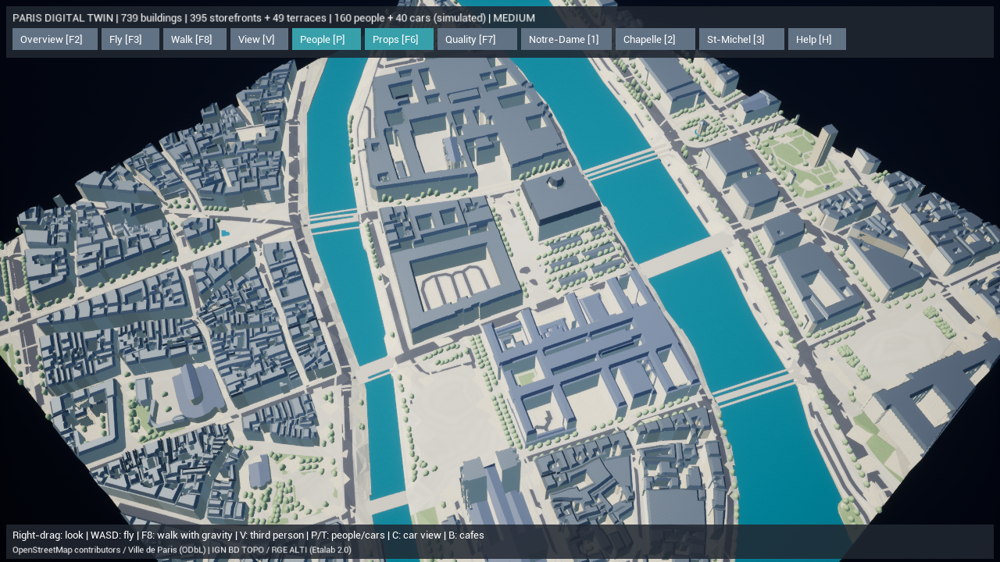

# Paris Digital Twin — 実寸の素材と100m範囲の窓の細部

変更前を `backup/pre-paris-materials-20261015` に保存しました。739棟の位置・高さと道路・川・橋、住民の経路・着席・挨拶を維持し、表面の質感と重点範囲の外観を改善しています。

## 実装

石灰岩、スレート、亜鉛屋根、敷石、アスファルトの5種類に、512×512の独自PBR素材を追加しました。元画像をダウンロードせず、固定した計算式と標準Pythonだけで再生成します。ベースカラーは既存の建物ごとの色を生かすsRGBの乗算用画像、表面画像は線形のR=AO、G=粗さ、B=高さです。高さはワールド座標の法線の細かな変化に使い、地理データや衝突形状を変位させません。

cm単位で投影し、石灰岩は80×40cmの目地、亜鉛は60cm幅の継ぎ目、スレートは30×20cm、敷石は25×20cmを基準にしています。寸法・石の模様・摩耗は地域に合わせた推定で、現地の計測値ではありません。模様の境界は周期的に連続し、UEのミップマップで遠景を縮小します。最大の高さ係数は亜鉛の1.2cmです。

設定済みのサン・ミシェル周辺100m四方では、露出する壁の窓に立体的な石の縦枠・上枠・窓台、塗装した木枠と横桟を加えます。木枠の色は元の建物IDから決めます。教会・記念建築、隣の建物に隠れる壁は従来どおり除外します。追加部品は見た目とクリック選択のための形状で、歩行者の移動を遮りません。

低品質では素材を単色にし、重点範囲の追加部品を隠します。中・高品質ではPBRを使い、追加部品の表示距離は100m／170mです。**M**でPBRと単色を切り替え、F1の再現度表示・F5の輪郭表示の後も選んだ状態を保持します。

壁・屋根は傾いた面に合わせた3方向投影、舗装・アスファルトは水平面向けの1方向投影です。後者はベースカラーと表面画像を合わせて6回→2回のテクスチャ参照に減らします。橋は側面もあるため、石灰岩の3方向投影を使います。

## 起動・再生成

**`Paris-Materials.cmd` をダブルクリック**すると、素材確認用の街路視点へ移動します。通常の全景は `Paris-DigitalTwin.cmd`。右ドラッグで視線、WASDで移動、Mで素材比較、F7で品質、F8で歩行、F2で全景、Hで操作一覧です。

素材確認では100m範囲内で現在の太陽に向く壁を優先し、1.7mの目線を置ける場所を選びます。通路の幅に合わせて距離と横位置を試し、置けない店は次の候補へ進みます。候補は最大8か所、距離は3段階に制限し、世界の配置や太陽の条件は変えません。素材確認では大きな店舗の検査欄を開かず、建築が見える面積を確保します。

```powershell
# 素材PNGと出典・SHA-256を再生成（外部通信なし）
.\gis\.venv\Scripts\python.exe unreal/scripts/paris_surfaces.py
$env:PYTHONPATH=Join-Path (Get-Location) 'gis'
.\gis\.venv\Scripts\python.exe -m paris_twin prepare --offline
# C++と実際のUE素材アセットを生成
.\unreal\scripts\Build-AIWorldUE.ps1
.\unreal\scripts\Start-ParisDigitalTwin.ps1 -MaterialsView
# 実画面・性能計測（5秒予熱後に20秒計測）
.\unreal\scripts\Measure-ParisDigitalTwin.ps1 -View Materials -ReportPath docs/paris-twin-materials-detail-performance.json
```

この開発環境は、起動スクリプトが `UnrealEditor.exe <project> -game -ParisTwin -dx11` で開きます。`Binaries/Win64/AIWorld.exe` の開発ターゲットにはCook済みシェーダー・データがそろっておらず、直接起動するとGlobal shader library不足で終了します。配布用パッケージ化は別の作業です。起動用CMDを使ってください。

## 変更ファイル

| 対象 | ファイル |
| --- | --- |
| 素材の再生成・出典 | `unreal/scripts/paris_surfaces.py`、`unreal/textures/paris/` の10画像とmanifest |
| UE素材 | `create-paris-assets.py`、`Content/Textures/T_Paris*`、`Content/Materials/M_Paris*` |
| 重点範囲の窓 | `gis/paris_twin/facades.py`、`gis/tests/test_facade_details.py` |
| 表示・品質・衝突 | `ParisSurfaceMaterials.cpp`、`ParisDigitalTwin.h/.cpp` |
| 検証 | `test_surfaces.py`、`ParisSurfaceTests.cpp`、`Test-ParisDigitalTwin.ps1` |
| 起動・撮影 | `Paris-Materials.cmd`、`Start-ParisDigitalTwin.ps1`、`Measure-ParisDigitalTwin.ps1` |

撮影スクリプトは撮影時刻を検査し、新しい画像がない場合は失敗にします。独自のレポート名から画像名を決めるため、比較撮影で以前のPhaseの画像を上書きしません。

## データと自動検証

Python全60テストに成功（339.110秒）。同じ実データを2回生成したSHA-256の一致、タイル境界の連続、PBRの値域、素材キャッシュの修復、重点範囲だけの部品追加、教会の除外と窓数の維持を確認しました。[Pythonの結果](paris-twin-materials-python-tests.txt)。

全体の地理検証はエラー0件。道路と建物の交差面積0㎡、座標変換の往復誤差は最大約2.8×10⁻⁹mでした。これは演算の誤差で、元データの測量精度ではありません。既存の建物重複、軒高情報の不足、道路網の分断、範囲端で切れた橋の警告4種類は残ります。[検証JSON](paris-twin-materials-validation.json)。

739棟と既存33,536窓を保持し、24棟・524窓に細部を追加しました。静的メッシュは441→451コンポーネント、1,035,432→1,097,264三角形（+61,832、約6%）です。追加の10コンポーネントは100mセルでまとめ、低品質では表示・クリック判定を省きます。

シーンSHA-256: `3840a8c864991c111ef7f48485707541daeaf4d3b1df3d67956a5368e032232f`。素材の生成式・寸法・チャンネルと画像のSHAは[素材manifest](../unreal/textures/paris/manifest.json)に記録しています。

UE 5.8.3 Development EditorのC++ビルドは成功（初回236.54秒）。UE素材生成コマンドレットも成功（29.29秒、エラー・警告0）。実行していない配布用Cook/Packageは成功扱いにしていません。

UEは軽量データ12件・旧JSON12件のテストに成功しました。取り込んだ画像のサイズ・色空間、PBR/単色の切替、再現度表示後の復元、低品質での追加部品の省略、表示を戻した部品が移動を遮らないことを検証し、既存の歩行・交通・着席・挨拶のテストも通過しています。[UEの結果](paris-twin-materials-native-tests.txt)。

最初の追加テストはNullRHIでGPU側の画像サイズを取得して失敗しました。UEの実装で未生成のPlatformDataはサイズ0を返すことを確認し、インポート元Sourceの512pxを検査する方法に修正しています。修正後のC++ビルドは21.91秒で成功しました。

```powershell
$env:PYTHONPATH=Join-Path (Get-Location) 'gis'
.\gis\.venv\Scripts\python.exe -m unittest discover -s gis/tests -v
.\unreal\scripts\Test-ParisDigitalTwin.ps1
.\unreal\scripts\Test-ParisDigitalTwin.ps1 -LegacyJSON
.\unreal\scripts\Test-AIWorldUE.ps1
docker compose config --quiet
docker compose -f compose.yaml -f compose.unreal.yaml config --quiet
```

Dockerの基本構成とUnreal用の重ね合わせ構成は `config --quiet` に成功しました。コンテナの再構築は今回実行していません。

従来の村モードは5テスト（独自モデル、保存済みの村、GISアーカイブ、コマンド、保存と地形）に成功しました。既存のWeb版・住民AI・SQLiteのデータ形式を変更せず、未追跡の `DefaultInput.ini` も保持しています。

## 実描画と性能

AMD Radeon(TM) Graphics内蔵GPU / Ryzen 7 7735HS / RAM約28.8GB、UE 5.8.3 Development Editor `-game -dx11 -RenderOffscreen`。出力1280×720、描画解像度80%（1024×576）、影あり、VSync・FPS上限なし。先頭5秒を予熱として除外し、他のテストやビルドを止めて順に測定しました。

| 視点・品質 | 計測秒数 | 平均fps | P95 ms | 読込 ms | 物理メモリ MiB |
| --- | ---: | ---: | ---: | ---: | ---: |
| [素材確認 / 中](paris-twin-materials-detail-performance.json) | 20 | 95.88 | 12.02 | 1661.70 | 2954.61 |
| [カフェ / 中](paris-twin-materials-cafe-performance.json) | 15 | 97.86 | 11.59 | 1576.26 | 3041.17 |
| [全景 / 中](paris-twin-materials-overview-performance.json) | 20 | 57.62 | 19.00 | 1672.51 | 3025.97 |
| [全景 / 中・単色](paris-twin-materials-overview-flat-performance.json) | 15 | 56.57 | 19.52 | 1644.40 | 3025.52 |
| [全景 / 低](paris-twin-materials-overview-low-performance.json) | 20 | 58.32 | 18.91 | 1636.84 | 2979.39 |

街路の2視点は平均60fpsとP95 16.67ms以内でした。**全景は中・単色・低のいずれも60fpsに未達**です。毎フレームの60fps維持、高品質、4K、別GPU、iPhoneや配布用パッケージの性能を確認した結果ではありません。

地面の水平投影への変更前は全景57.50fps、変更後は57.62fpsでした。単色でも56.57fpsで、テクスチャ参照の削減による大きな改善は確認できませんでした。変更前のカフェは97.99fps、最終版97.86fpsですが、住民の行動・実行時刻は異なり、厳密な高速化比較とは扱いません。[全景の初回値](paris-twin-materials-overview-initial-performance.json) / [変更前カフェ](paris-twin-materials-before-performance.json)。

追加の `stat unit` 撮影ではFrame 17.01ms、Game 4.39ms、Draw 17.04ms、RHIT 4.80ms、GPU 17.22ms、593 draws、約30.17万の可視プリミティブを読み取りました。これは撮影時の平滑化表示で、上表の平均やP95ではありません。描画スレッドとGPUがともに16.67msを超え、ゲームスレッドは小さいため、この時点では描画側が全景の制限です。待機や描画パスごとの内訳は未計測なので、影・形状・ドライバーのどれか一つを主因と断定しません。[診断画像](screenshots/paris-twin-materials-unit-profile.png) / [読み取り値](paris-twin-materials-unit-profile.json)。

最終版は451静的コンポーネント、1,097,264三角形、19種・5,607街路インスタンス、読込93,218,751バイトです。重点範囲の追加部品は約6%の静的形状増加に抑えましたが、広域の描画負荷は残ります。次の最適化は全景用HLODとメッシュ統合、地区の段階読み込み、影の予算を優先します。

最終の素材・橋の割当更新はC++ビルド21.10秒と素材生成1.73秒で成功し、その後もUEの12テストを再実行して成功しました。





Mの単色表示も別の実行で確認しました。[単色の素材視点](screenshots/paris-twin-materials-flat.png) / [実測](paris-twin-materials-flat-performance.json)。

## 制限と次の段階

独自のプロシージャル素材と推定窓枠の改善です。現地写真・測量に基づく外装や彫刻、写真級のランドマーク、リグ付き人物、World Partition/HLOD、地区の段階読み込みは未実装です。建物全体の再現度L1と、根拠のある本体部分のL2という区別を維持します。DX11上の結果をLumen・Naniteの動作確認として扱いません。

次は重点範囲の外観を現地資料と照合し、石材・屋根・店舗の専用モジュールを追加します。続いて地区単位の段階読み込みと描画距離の管理を実装します。

| 今後必要なアセット | 受け入れ時に確認する仕様 |
| --- | --- |
| 現地に対応する石灰岩・亜鉛・屋根・舗装 | 実寸のタイル寸法、4Kの色・法線・粗さ・AO、低解像度への縮小、資料・ライセンス・再配布条件 |
| ランドマーク外装・店舗・装飾モジュール | 対応する元地物ID、現地資料に基づく形状、複数LOD、既存の原点と本体衝突を保持する配置 |
| リグ付き人物と樹木 | 歩行・着席・挨拶と接地、人物LOD、葉の透過を抑えるMasked素材、樹木の複数LODと遠景モデル |

これらは未導入の仕様です。存在しないモデルや写真テクスチャを今回の描画から参照していません。
