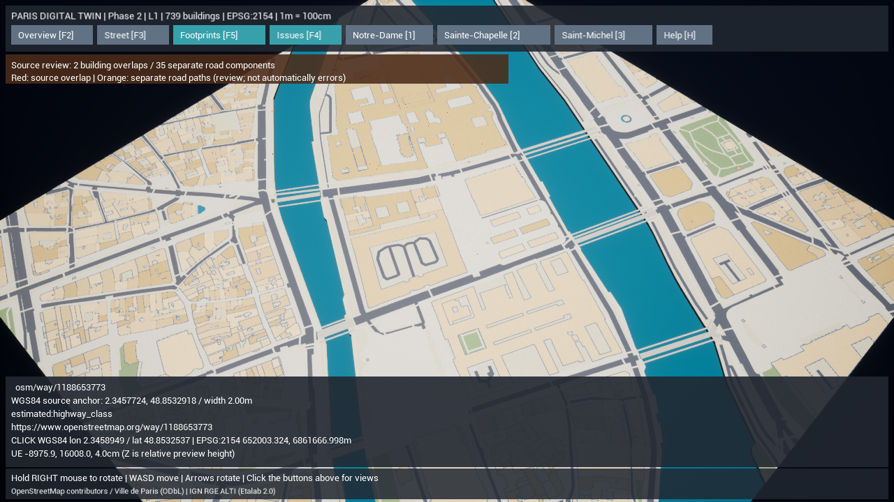
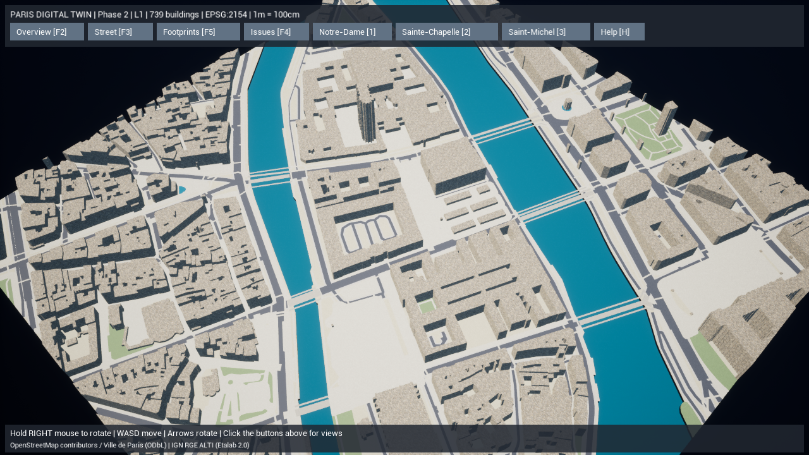

# PROJECT PARIS DIGITAL TWIN — Phase 2

実座標、道路と建物の輪郭、問題箇所の確認を進めました。739棟の再現レベルはL1です。高さは引き続き推定・未検証のsourceタグで、実測ボリュームや写真品質の完成を意味しません。変更前の状態はGitコミット `dd8f1e4` に保存済みです。

## 1. 実装済み機能

- **共通原点と地区範囲の分離**。`origin_wgs84` は都市全体の基準、`district_center_wgs84` は各地区の中心です。地区を移しても同じ地物のUE座標を維持します。Citéと西側の隣接地区設定は同じ `paris_lambert93_shared_v1` を使用します。
- **UE内の座標相互変換**。Python/PROJと同じEPSG:2154をC++の倍精度で計算。地面・建物・道・橋・水面のクリック地点について、WGS84のlon/lat、Lambert-93のE/N、UEのcmを表示します。元データの代表点と実際にクリックした地点を区別します。Zは平面プレビュー基準の相対値で、NGFと楕円体高を二重変換しません。
- **道路・河川の元ID選択**。描画用に統合した道路面から、近傍のOSM中心線と幅、元ポリゴンを照合して該当sourceを表示。地下道路は地上の選択対象から除外。河川はVisibility用の衝突だけを有効にしました。
- **輪郭モード**。F5または画面ボタンで建物の柱を隠し、実輪郭の着色面と線を一つの補助メッシュで表示。非表示の屋根がマウス選択を妨げないようにし、平面から建物のIDを選べます。線幅は見やすさのための補助表現です。元のGIS輪郭は変更しません。
- **source品質レビュー**。建物の重なり2件、独立した道路成分35件を元IDと形状付きで保存。道路の6成分は範囲境界で切断、29成分は内部の独立経路です。独立した歩道や敷地内の道があるため、これらを自動的に不具合とは判定しません。道路の接続を捏造したり元建物を削除したりせず、F4でレビュー表示します。
- **オフライン地図**。HTML地図のレビュー項目を選ぶと、関連sourceと重なり部分を強調。建物を選ぶと高さの根拠、緯度経度、URLを表示し、地図クリックでLambert-93とUE座標を表示。外部の地図CDNやAPIを使用しません。
- **操作UI**。画面上のコンパクトなボタンで俯瞰、目線、輪郭、レビュー、各ランドマークに移動できます。右ドラッグに加えて矢印キーで視点を回せます。詳細操作はHelpで開きます。

Lambert-93は[PROJのLCC仕様](https://proj.org/en/stable/operations/projections/lcc.html)と、インストール済みPROJのEPSG:2154定義を用いて確認しています。C++の投影はGRS80、標準緯線44°/49°、原点緯度46.5°、中央経線3°、偽原点700000m/6600000mです。測量精度と計算の往復誤差は別です。

## 2. 変更ファイル

| 対象 | ファイル |
| --- | --- |
| 共通座標・取得範囲 | `gis/paris_twin/coordinates.py`, `normalize.py`, `gis/config/ile_de_la_cite.json`, `saint_michel_west.json` |
| 決定的なレビュー情報 | `gis/paris_twin/diagnostics.py`, `validate.py` |
| 選択用source・輪郭・対話地図 | `gis/paris_twin/mesh.py` |
| Python検証 | `gis/tests/test_pipeline.py` |
| UE Lambert-93 | `unreal/AIWorld/Source/AIWorld/ParisGeoReference.h`, `ParisGeoReference.cpp` |
| UE表示・選択・UI | `ParisDigitalTwin.h`, `ParisDigitalTwin.cpp`, `ParisDigitalTwinTests.cpp` |
| 起動オプション | `unreal/scripts/Start-ParisDigitalTwin.ps1` |
| 結果・手順 | 本書、`gis/README.md`、Phase 2検証JSONと画面キャプチャ |

`Data/Processed` と `Data/Generated` は引き続き再生成する中間成果物です。`diagnostics.json`、`pick_features`、`landmarks`、`coordinate_checks`、`footprint_mesh` を追加しました。取得済みRaw、住民シミュレーション、SQLiteとDocker構成は変更していません。

## 3. 実行・検証手順

```powershell
# Citéの通常起動
.\Paris-DigitalTwin.cmd
# 輪郭と品質レビューを最初から表示
.\unreal\scripts\Start-ParisDigitalTwin.ps1 -Footprints -Issues
# 20秒の実描画計測とスクリーンショット
.\unreal\scripts\Start-ParisDigitalTwin.ps1 -Footprints -Issues -Capture -Benchmark 20 -ExitAfterBenchmark
# ビルドとUE上の自動検証
.\unreal\scripts\Build-AIWorldUE.ps1 -SkipAssets
.\unreal\scripts\Test-ParisDigitalTwin.ps1
# Pythonの実スナップショット検証
$env:PYTHONPATH=Join-Path (Get-Location) 'gis'
.\gis\.venv\Scripts\python.exe -m unittest discover -s gis/tests -v
```

F2:全景、F3:1.7mの確認カメラ、F4:品質レビュー、F5:輪郭、1/2/3:Notre-Dame/Sainte-Chapelle/Saint-Michel、H:説明、F1:L1色、F9:撮影。WASD移動、右ボタンを押しながらマウス移動または矢印キーで回転、俯瞰時のホイールでズーム。F3は自由カメラで、重力付き歩行ではありません。

地図は `gis/Data/Generated/ile_de_la_cite/map.html` をブラウザーで開けます。レビューJSONを再生成する場合は `python -m paris_twin generate --offline` と `validate --offline` を実行します。

隣接地区設定は例として追加しました。**西側地区のデータは今回取得していません**。将来取得するときは以下を使用します。これは一地区を選択して起動する経路であり、複数地区の同時ストリーミングではありません。

```powershell
.\unreal\scripts\Start-ParisDigitalTwin.ps1 -Config .\gis\config\saint_michel_west.json -Download
# 取得済み後はAPIなしで同じ地区を起動
.\unreal\scripts\Start-ParisDigitalTwin.ps1 -Config .\gis\config\saint_michel_west.json
```

## 4. 実際に検証した内容

- Python **8件成功**（38.131秒）。同じRaw/設定から2回生成したsceneのSHA-256が一致。隣接地区の同一点が同一UE座標になり、地区範囲が重なることを確認。境界切断と内部経路の分類も検証しました。
- UE 5.8.3のC++ビルド成功。最初の投影定数名の衝突を修正後、最終ビルドは26.54秒で成功しました。
- UE **2件成功**。C++とPythonの投影比較、実シーンの屋根衝突、元IDの選択、クリック座標、F1/F4/F5の復元、平面モードの選択、ランドマークへのカメラ移動を検証。C++/PROJの最大座標差は約 `1e-9m`（数値演算の一致であり実世界の精度ではありません）。
- 生成道路面と建物の重なりは **0m²**。元データの建物重なり2件はレビュー情報として保持。道路3171ノード、3702辺、最大成分94.17%。739棟すべてに実測高さの欠損が明示されています。
- ブラウザーでHTML地図を開き、重なり項目を選んだ際のsource強調を視認。SVGをクリックし、建物の元ID・根拠とLambert-93/UE座標が更新されることを確認しました。
- 実DX11画面を取得。FPSと最終画面は以下の記録を参照してください。Nativeゲームの右ドラッグや画面ボタンを人間が操作する確認は今回の自動検証に含めていません。

1280×720、各20秒、DX11、AMD Radeon統合GPUで実測しました。

| 表示 | 平均FPS | P95フレーム時間 | 記録 |
| --- | --- | --- | --- |
| 建物ボリュームの全景 | 26.5 | 46.95ms | [実測JSON](paris-twin-phase2-volume-performance.json) |
| 着色輪郭＋品質レビュー | 95.6 | 12.72ms | [実測JSON](paris-twin-phase2-footprints-performance.json) |

**通常3D全景の60fps目標は未達です**。輪郭表示では739棟の描画・衝突を無効化し、道路面などと一つの補助メッシュ（33,400三角形、計22可視コンポーネント）を表示しています。95.6fpsを3D建物表示の性能とは扱いません。全景側は760コンポーネント・71,302三角形。地区のStaticMesh統合やHLODは未実装です。主原因を特定するCPU/GPUプロファイルは今回実行していません。





全検証データは [Phase 2 validation JSON](paris-twin-phase2-validation.json) に記録しています。最後の再生成scene SHA-256は `799f586f97224ee3816b68b813ede340d82a242cbe5c3b7bc254a47c0adef22b` です。

## 5. 未実装項目

検証済みの実測建物高さ、教会の複数高さの棟と屋根、ファサード・窓・入口、詳細DEM、橋桁・護岸断面、重力と一人称キャラクター、World Partition/HLODによる地区同時読み込みは未実装です。取得済みGISの基礎形状は増やせますが、L2以上の再現精度は別資料で検証する必要があります。道路の孤立成分や建物sourceの重なりを現地資料で解決する作業も残ります。

## 6. 次Phase

Phase 3は、高さ・建物volumeと屋根生成を進めます。Paris Dataの階数、OSMの高さタグ、別途入手する実測メートル高を照合し、出典と推定を建物単位で区別します。特にNotre-Dameの低い高さタグやSainte-Chapelleの尖塔高を、そのまま一枚の壁高にする現在の表示を、部位別のボリュームへ改めます。根拠がない部位をL2へ昇格させません。
