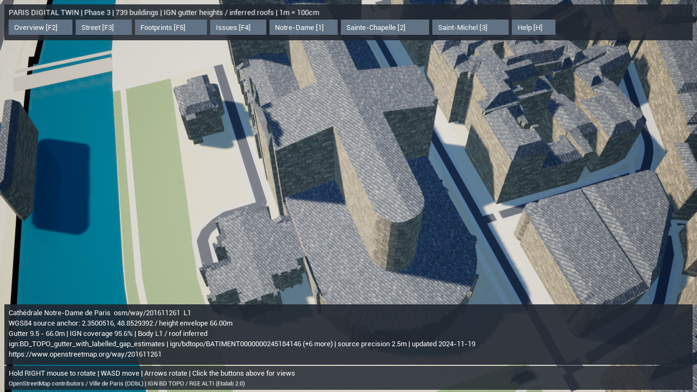
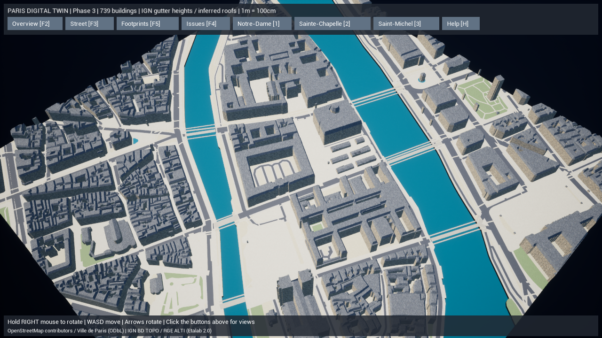

# PROJECT PARIS DIGITAL TWIN — Phase 3

建物本体の高さを、公的なIGN BD TOPOデータと対応付けました。高さが異なる棟を分割し、屋根の形を生成します。建物全体は引き続きL1です。十分な高さ対応を持つ**本体だけ**L2とし、推定した屋根や未制作の外観をL2/L3の完成と扱いません。変更前のコードはGitコミット `3211191` に保存済みです。

## 1. 実装済み機能

- **高さデータの追加取得**。IGN Géoplateforme WFS 2.0.0の `BDTOPO_V3:batiment` から867件を取得。EPSG:2154の3D輪郭、`hauteur`、地面標高、取得方法、標高精度、更新日時、安定した `cleabs` IDを保存しました。500件＋367件のページとXSD、統合JSONとSHA-256 manifestを同梱します。取得済みのOSM/Parisスナップショットを上書きせず、高さ取得が失敗した場合も前の高さキャッシュを保ちます。
- **複数高さの建物**。既存OSM輪郭とIGNの空間的な重なりを使い、棟の境界を分割。重複する高さ部分を消費済み面から差し引き、中庭を保持します。739棟のうち644棟に公的な高さを対応付け、4,407部分として生成。公的な対応がない部分は、近くのIGN部分または既存の推定値で補い、推定理由を保存します。
- **高さの意味を区別**。IGNの値は主に建物輪郭・軒の高さです。地面のNGF標高を引いて相対高さを求めます。尖塔の最高点、実地調査の最新の高さ、最高屋根高と同一視しません。未知の教会本体に75mなどの最高点タグをそのまま壁高として使わないようにしました。
- **3D輪郭の軒**。信頼できるIGNのZを持つ輪郭では、輪郭の辺の高さを補間し、壁の上端へ反映します。地面はPhase 2と同じ平面プレビューです。標高差に対応した基礎・実地形への着地は後続Phaseです。
- **屋根生成**。平らな屋根、切妻、寄棟、マンサード、角錐型の簡易形状を生成。中庭を覆わず、棟・軒の境界を分けて三角形化。切妻端部の面も閉じます。OSMに形がある場合は未検証の宣言値として優先し、ない場合は地区の様式による推定にします。屋根の向き・勾配・高さは根拠のある実測形状として扱いません。
- **屋根の材質と配置負荷**。実在する既存 `M_Slate` を使用。屋根を一棟ずつコンポーネントにせず、100m単位の63グループへまとめました。屋根クリックは元の建物IDに戻り、F5で壁と屋根を一緒に隠す/復元できます。
- **高さの確認UI**。建物を選ぶと軒高の範囲、IGN対応率、本体/全体の再現レベル、元ID、source精度と更新日を表示。F1は本体L2を緑、L1を橙で表示します。通常起動は高さのある3Dです。`-Landmark 1/2/3` で各名所へ直接移動して撮影できます。

## 2. 出典と重要な制限

取得先は [IGNのWFS公式仕様](https://cartes.gouv.fr/aide/fr/guides-utilisateur/utiliser-les-services-de-la-geoplateforme/diffusion/wfs/)、[BD TOPOの公式カタログ](https://www.data.gouv.fr/datasets/bd-topo-r)、属性の確認は [IGN Bâtiment仕様（2026年9月版）](https://bdtopoexplorer.ign.fr/batiment) です。BD TOPOはLicence Ouverte / Etalab 2.0。既存OSM・Paris派生データのODbL条件も継承します。

IGNには画像・表面モデル等に基づく値が含まれます。採用した記録の標高精度属性は1.5mまたは2.5mであり、取得日を測量日とみなしません。高さなし、Zなし、精度不明を公的な実高さとして採用しません。境界・軒輪郭と地上輪郭の差は残るため、対応率と推定部分を確認する必要があります。

| ランドマーク | IGN対応率 | 対応する軒高 | この段階の制限 |
| --- | --- | --- | --- |
| Notre-Dame | 95.64% | 9.5〜66m、7つのsource ID | 低い棟と2つの高い部分を別に生成。尖塔・彫刻・細かな屋根形は未再現 |
| Sainte-Chapelle | 91.91% | 本体23.4m、2つのsource ID | OSMの75mを一枚の壁にしない。高い尖塔は未再現 |

ここに記載した高さは取得したsourceの値で、名所全体を現地測量して再現したという意味ではありません。建物本体L2の条件は、98%以上の公的高さ対応、使用可能な精度、取得範囲で切れていない輪郭です。該当する本体は324棟。推定屋根を含む建物全体739棟はL1です。

## 3. 変更ファイル

| 対象 | ファイル |
| --- | --- |
| IGN取得とオフラインキャッシュ | `gis/paris_twin/building_source.py`, `acquire.py`, `__main__.py` |
| 高さ対応・根拠・部位 | `gis/paris_twin/building_heights.py`, `normalize.py` |
| 壁・屋根・100m単位の出力 | `gis/paris_twin/building_mesh.py`, `mesh.py` |
| 幾何・出典・再生成の検証 | `gis/paris_twin/validate.py`, `gis/tests/test_pipeline.py` |
| 取得済み実データ | `gis/Data/Raw/ile_de_la_cite/heights/` |
| UE屋根材質・選択・再現レベル | `ParisDigitalTwin.h`, `ParisDigitalTwin.cpp`, `ParisDigitalTwinTests.cpp` |
| 取得・名所へ移動する起動オプション | `unreal/scripts/Start-ParisDigitalTwin.ps1` |
| 結果・手順 | 本書、GIS README、データ出典README、検証JSON・測定JSON・実画面 |

依存ライブラリとUEバージョンは既存の固定構成です。住民・資源・セーブ・Web・Dockerを変更していません。

## 4. 実行・検証手順

```powershell
# 高さのある3Dで通常起動
.\Paris-DigitalTwin.cmd
# Notre-Dameの近くへ移動して起動（2:Sainte-Chapelle、3:Saint-Michel）
.\unreal\scripts\Start-ParisDigitalTwin.ps1 -Landmark 1
# 再生成・検証は同梱スナップショットでオフライン実行
$env:PYTHONPATH=Join-Path (Get-Location) 'gis'
.\gis\.venv\Scripts\python.exe -m paris_twin generate --offline
.\gis\.venv\Scripts\python.exe -m paris_twin validate --offline
# 公的高さをオンライン更新する場合だけ指定
.\gis\.venv\Scripts\python.exe -m paris_twin download-buildings --refresh
# ビルド・自動確認
.\unreal\scripts\Build-AIWorldUE.ps1 -SkipAssets
.\gis\.venv\Scripts\python.exe -m unittest discover -s gis/tests -v
.\unreal\scripts\Test-ParisDigitalTwin.ps1
```

F2:全景、F3:目線、F5:輪郭に切替/3Dへ戻る、F4:sourceレビュー、F1:本体レベルの色、1/2/3:名所、H:操作説明。右ボタンを押したままマウスで回転、矢印キーでも回転、WASD移動。手動のUEエディタ操作は不要です。

## 5. 実際の検証結果

Pythonの11件が成功しました。取得失敗時のキャッシュ保全、NGFからの相対高さ、複数高さの維持、教会の最高点タグと本体の区別、5種類の屋根の中庭維持、実スナップショットの検証と2回再生成の同一性を確認。C++のWin64 Development Editorビルドも成功しました。

UEの2件（座標一致、実シーンの衝突・source選択・色/輪郭の復元）を実行し成功しました。別グループに統合した屋根からでも元の建物IDを選択でき、F5で屋根の衝突を無効化/復元できることを確認しました。生成道路と建物の重なりは0m²。sourceの建物重なり2件と独立道路35成分はレビュー情報として保持します。

最終のPython11件は92.126秒、最終C++ビルドは27.20秒で成功しました。UEはDX11の実描画でも起動できています。Nanite/Lumen、パッケージ化、スマートフォンでの検証は今回行っていません。

1280×720、DX11、AMD Radeon統合GPU、影有効、20秒の実描画計測です。739棟、823メッシュコンポーネント、162,631三角形です。

| 視点 | 平均FPS | P95時間 | 記録 |
| --- | --- | --- | --- |
| Notre-Dameの近景 | 87.6 | 13.10ms | [実測JSON](paris-twin-phase3-notre-dame-performance.json) |
| 街全体の3D俯瞰 | 23.3 | 53.87ms | [実測JSON](paris-twin-phase3-overview-performance.json) |

近景と全景は見える範囲が異なります。全景の60fps目標は未達です。Phase 2の通常全景は26.5fpsで、今回は高さ分割と屋根を増やして描画量が増えています。屋根は63グループへまとめましたが、建物壁739コンポーネントの統合やHLODは残っています。CPU/GPUプロファイルによる主原因の特定は未実行です。





[最終validation JSON](paris-twin-phase3-validation.json) に検証の全数を記録。最終scene SHA-256は `5698017640f691d73306badb1f51fa2e77f0e51de638f33ea11cbfa72d6ace75`。取得した4ファイルのGitインデックス内のSHA-256もheight manifestと一致することを確認して保存します。

## 6. 未実装項目と次Phase

屋根はsourceに対応した精密な測量メッシュではありません。建物の窓・入口・バルコニー・彫刻、教会の尖塔、現状の改修を確認した外観、実地形、護岸・橋の断面、重力付き散策、World Partition/HLODは未実装です。

次のPhase 4では、標高基準と地面の補間、道路・歩道・河岸・橋の高さ整合を進めます。その後、Phase 5の建築モジュールで実景に近い外観を制作し、写真と比較してL3以上を判定します。
