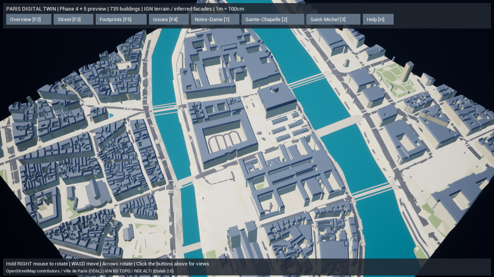
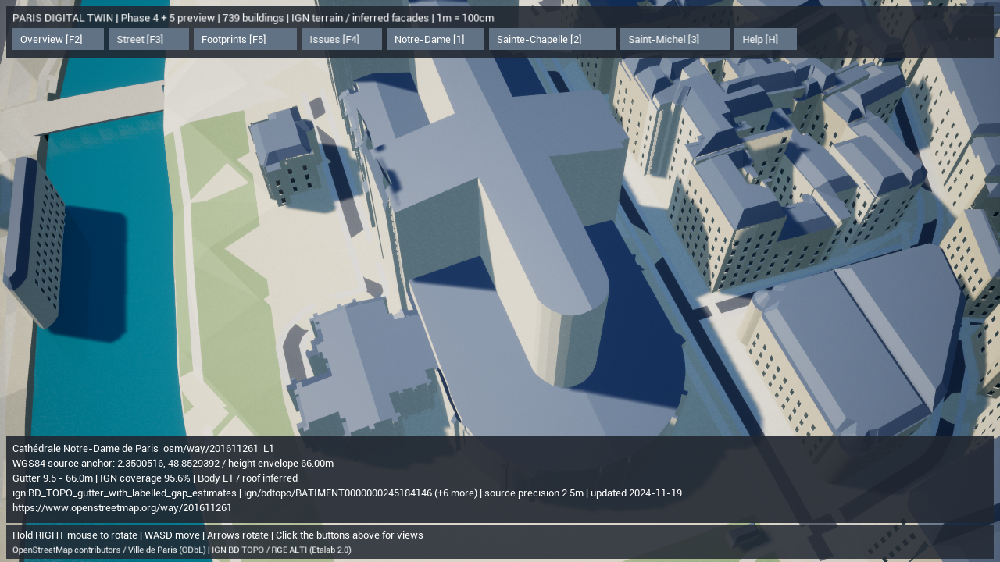
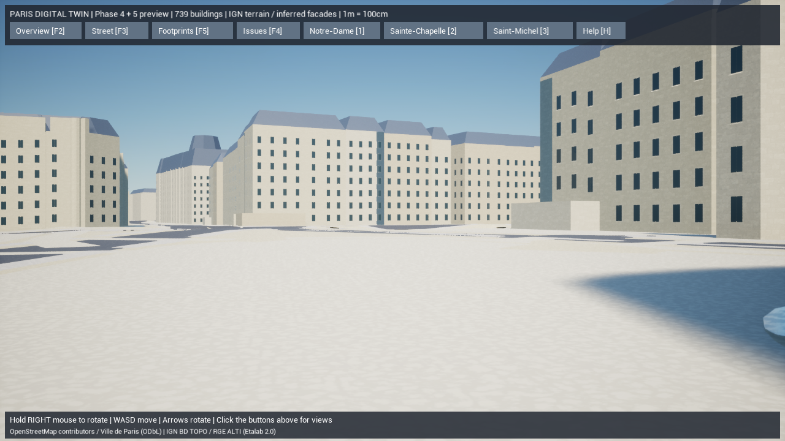

# Paris Digital Twin — Phase 4 / Phase 5基盤

2026-10-15。実地形と道路・河岸・建物の共通標高を導入し、窓・窓枠とPBR材質、描画の統合まで進めました。Phase 5のフォトリアルな固有建築は未完成です。既存739棟の位置・輪郭・高さの根拠を保持し、外観を実測済みとして昇格させません。

変更前の保全はGitタグ `backup/pre-paris-phase4-20261015`。既存のThree.js版、住民AI、SQLite、Docker構成を変更していません。

## 1. Phase 4で実装した機能

- IGN RGE ALTIの20m間隔・1,681点と共通原点の標高を別キャッシュへ取得。元の121点やOSM/Paris/BD TOPOキャッシュは保持。
- 地形、道路、歩道、歩行空間、公園、輪郭デバッグを同じ標高場へ補間。中庭・河川の穴と元の位置を維持。
- UE座標のZはNGF-IGN69正標高から共通原点 **35.38m** を引き、100倍してcmへ変換。原点は現地区と西側の拡張設定に固定し、将来DEMを更新して原点の観測値が変わっても地区間の座標枠を動かさない。建物の公的地盤高と軒高にも同じ原点を使用。地面との隙間を閉じるため、壁の下端は必要な箇所で地形より20cm下まで延長する推定基礎を含む。
- セーヌ川の実ポリゴンに波材質を使用。橋を除いた299点のDEM値から水位 **NGF 26.88m** を推定し、838区間の護岸壁を生成。これは水位計や河床測量の値ではない。
- 橋の道路と並行歩道の狭い間隔を結合し、14の連続デッキ面へ整理。端部のIGN補間標高をつないだ推定桁高と薄い橋桁を生成。断面・クラウン・厚さは推定で、実際のアーチ構造の再現ではない。
- クリックした点のWGS84、EPSG:2154、UE cm、NGF標高を表示。俯瞰・名所・目線視点も地形標高へ対応。空の地表基準を同じ海抜0mへ移し、負のUE Zでも目線視点の空を表示。

標高サンプルは26.76〜37.04m。**20mは取得点の間隔であり、元DEMの解像度・精度ではありません。** 補間は段差・縁石・階段を測量した形状ではありません。

取得元は[IGN計算サービス公式仕様](https://cartes.gouv.fr/aide/fr/guides-utilisateur/utiliser-les-services-de-la-geoplateforme/calcul-altimetrique/)。APIは400点以下のバッチで順次取得し、要求内容・取得日時・URL・Etalab 2.0ライセンス・各SHA-256を `gis/Data/Raw/ile_de_la_cite/terrain/manifest.json` に保存しました。API障害でも旧キャッシュを残します。

## 2. Phase 5で実装した基盤

- **656棟、65,541窓**に推定窓・石枠・中央の桟・張り出した窓台を追加。OSMの外周・中庭の辺に沿って配置し、階高・幅・装飾の出典は推定と明示。教会、塔、特異な記念建築を汎用窓生成から除外。
- 壁739コンポーネントを**77グループ**へ統合。100mの描画単位にまとめても、元の建物ID・個別の本体レベル・要確認色・クリック選択を維持。壁の境界や中庭の縁も選択可能。
- 屋根63グループ、窓ガラス52グループ、窓枠52グループ。窓装飾は300mより遠い距離で省略。最終全体は **279コンポーネント、706,312三角形**。遠景で省略される窓の三角形もこの総数に含む。
- 既存の独自石材・スレート画像から新規PBR材質を自動生成。石材4m/屋根3mの実スケールでワールド投影し、細かな凹凸法線と粗さを設定。石灰岩色は棟ごとに変化し、ガラスは別の粗さを使用。元の村の材質を保持。
- 同じ入力・設定・ジェネレータ・依存版と、生成物のチェックサムが一致する起動では再生成を省略。別地区を表示した後やUE用ファイルが破損した場合は、選んだ地区の保存済み結果から復元。Rawの改変や設定変更は再生成対象となる。

建物全体739棟はL1。本体の公的高さ・対応率条件を満たす324棟だけ本体L2です。推定屋根と窓を追加したことだけでL3にはしません。

## 3. 変更ファイル

| 対象 | ファイル |
| --- | --- |
| 取得・共通標高・橋 | `gis/paris_twin/elevation_source.py`, `terrain.py`, `bridges.py`, `acquire.py`, `coordinates.py`の既存変換を利用 |
| 正規化・生成・キャッシュ | `normalize.py`, `mesh.py`, `building_mesh.py`, `facades.py`, `prepare.py`, `__main__.py` |
| 検証・設定 | `validate.py`, `gis/tests/test_pipeline.py`, `gis/config/ile_de_la_cite.json`, `saint_michel_west.json` |
| UE表示・選択・座標・自動テスト | `unreal/AIWorld/Source/AIWorld/ParisDigitalTwin.cpp`, `.h`, `ParisDigitalTwinTests.cpp`, `ParisGeoReference.cpp`, `.h` |
| 起動・材質生成 | `unreal/scripts/Start-ParisDigitalTwin.ps1`, `create-assets.py`, `create-paris-assets.py` |
| 実在する新規材質 | `unreal/AIWorld/Content/Materials/M_ParisLimestone.uasset`, `M_ParisSlate.uasset`, `M_ParisGlass.uasset` |
| 地形スナップショット | `gis/Data/Raw/ile_de_la_cite/terrain/` の5応答ページ、結合データ、manifest |
| 報告・証拠 | 本書、`gis/README.md`, index、`paris-twin-phase45-*.json`, `paris-twin-phase45-tests.txt`, `screenshots/paris-twin-phase45-*.png` |

`unreal/AIWorld/Config/DefaultInput.ini` はUEが生成した既存の未追跡ファイルとして保留しました。コミットに含めません。

## 4. 起動・再生成・検証手順

通常はルートの **`Paris-DigitalTwin.cmd`** をダブルクリック。エディタでの手動配置・Blueprint操作は不要です。

```powershell
# workspaceのルートから実行
$env:PYTHONPATH=Join-Path (Get-Location) 'gis'
.\unreal\scripts\Build-AIWorldUE.ps1  # C++と材質を生成
.\gis\.venv\Scripts\python.exe -m paris_twin prepare --offline
.\gis\.venv\Scripts\python.exe -m paris_twin validate --offline
.\gis\.venv\Scripts\python.exe -m unittest discover -s gis/tests -v
.\unreal\scripts\Test-ParisDigitalTwin.ps1
.\unreal\scripts\Start-ParisDigitalTwin.ps1 -Eye
# 保存済みデータで強制再生成する場合
.\gis\.venv\Scripts\python.exe -m paris_twin generate --offline
# オンラインで地形だけを更新する場合
.\unreal\scripts\Start-ParisDigitalTwin.ps1 -DownloadTerrain -Refresh
# 共通原点で座標を確認（WGS84の最後の値は正標高）
.\gis\.venv\Scripts\python.exe -m paris_twin coordinates --wgs84 2.3471 48.8547 35.38
```

F2:全景、F3:目線、F5:輪郭/3D、F4:元データの問題、F1:本体の精度色、1/2/3:名所。右ボタンを押したままマウスで回転、WASD移動、矢印キーで回転、Hで説明、F9で撮影。F3は目線の検証カメラです。移動中の重力・段差追従・建物との衝突を伴うキャラクター散策はまだありません。

## 5. 実際に確認した内容

Python **17件が成功（144.754秒）**。座標の往復、共通垂直原点、DEM更新でも固定原点を維持すること、補間面と法線、公的軒高の絶対位置、橋が川のDEMへ沈み込まない補間、キャッシュ更新失敗の保全、統合した建物ID、教会の汎用窓除外、実スナップショットの2回再生成一致を自動確認しました。C++最終ビルドも成功（26.02秒）、UE自動テスト2件も成功。最終結果は[テスト記録](paris-twin-phase45-tests.txt)に保存。

変更なしのオフライン `prepare` は `cached=true` で **1.21秒**でした。これはデータの準備処理だけの時間です。UE起動と表示には別途読み込み時間がかかります。

UEの実シーンで屋根/壁の元建物選択、NGFクリック表示、衝突、F1/F4/F5の色・表示・衝突の復元、名所カメラを確認。元データからの生成道路面と建物輪郭の重なりは **0m²**。既存2件の建物source重複と35道路成分はレビュー情報として保持しました。Docker Compose設定の検証も成功しました。

1280×720、DX11、AMD Radeon統合GPU、影有効、5秒の準備後20秒の描画計測です。端末はRyzen 7 7735HS / RAM 28.8GB。数値はこの条件での実測であり、全解像度・全視点やスマートフォンの保証ではありません。

| 視点 | 平均FPS | P95フレーム時間 | 記録 |
| --- | --- | --- | --- |
| 全景 | 69.8 | 16.75ms | [実測JSON](paris-twin-phase45-overview-performance.json) |
| Notre-Dame近景 | 94.3 | 12.72ms | [実測JSON](paris-twin-phase45-notre-dame-performance.json) |
| 目線1.7m | 108.1 | 10.84ms | [実測JSON](paris-twin-phase45-street-performance.json) |

Phase 3全景の23.3fpsから改善しました。壁の統合と遠景装飾の省略を同時に導入しているため、どちらの寄与かを個別に計測した値ではありません。暫定平均60fpsの目標をこの全景条件で満たしました。Nanite/Lumen/VSM、HLOD、World Partition、GPU/CPU詳細プロファイル、パッケージ版とiPhoneは今回の実測に含みません。







[パリ市のサン・ミシェル写真資料](https://www.paris.fr/pages/1-lieu-3-histoires-la-fontaine-saint-michel-35340)（Ludivine Boizard / Ville de Paris）をブラウザで見て目線画像と比較しました。実景の彫刻、色の異なる柱、丸窓、複雑な冠飾り、樹木は現在の汎用モデルに不足しています。撮影位置・レンズを一致させた画像計測は未実施です。写真をゲームのアセットとして取り込んではいません。

全数とSHA-256は[検証JSON](paris-twin-phase45-validation.json)を参照。

## 6. 未実装項目と次の進め方

ポン・ヌフとポン・サン＝ルイの2つの境界断片は、取得範囲が橋の途中で切れ、推定桁高が低いことを検出しました。実構造の再現として完成扱いにせず、取得範囲の拡張と橋全体の標高・断面資料で補います。水位の観測、実測橋アーチ、階段・縁石の細かな地形も未実装です。

Phase 5の続きは入口、バルコニー、コーニス、屋根の小窓、亜鉛屋根を、元の位置と出典属性を保つモジュールとして追加します。Notre-Dame・Sainte-Chapelle・Saint-Michelには資料に基づいた専用外観が必要です。続くPhase 6で街路樹・街灯・ベンチ・車両・人を追加し、位置データがない補完配置を区別します。Phase 7で地区接続とStaticMesh化・LOD/HLOD、対応GPUでのNanite/Lumenを検証します。

| 必要なアセット | 推奨する初期仕様 |
| --- | --- |
| 石灰岩・亜鉛・スレート・舗装 | 独自/利用許諾済みの2K〜4K Albedo、Normal、Roughness/ORM。実寸のタイルサイズを記録 |
| 入口・窓・バルコニー・冠飾り・屋根小窓 | 実寸の反復モジュール、複数LOD、シンプルな衝突、素材の共用。装飾の配置は資料と推定を区別 |
| 教会・噴水・橋の固有モデル | 現地/公的写真・測量資料と利用条件、寸法・撮影時点を記録。近景詳細と遠景LODを分離 |
| 街路樹・街路設備 | 近景モデルと遠景表現を分離し、反復物はインスタンス化。設置位置の元IDまたは推定理由を保存 |

これらの不足アセットを存在するものとして参照していません。今回の新規材質3点はUEのPythonで生成・保存して実際にロードできたものです。
