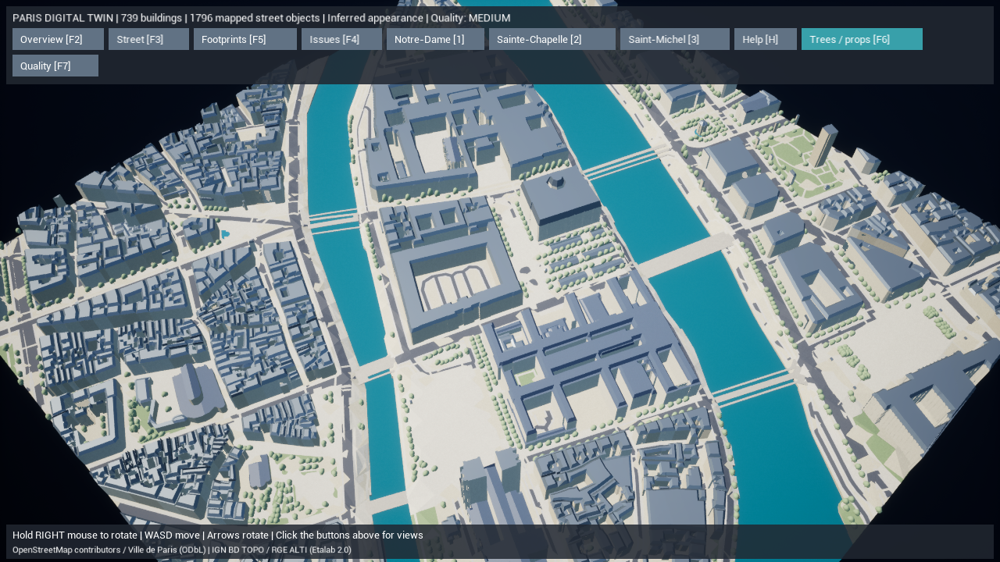
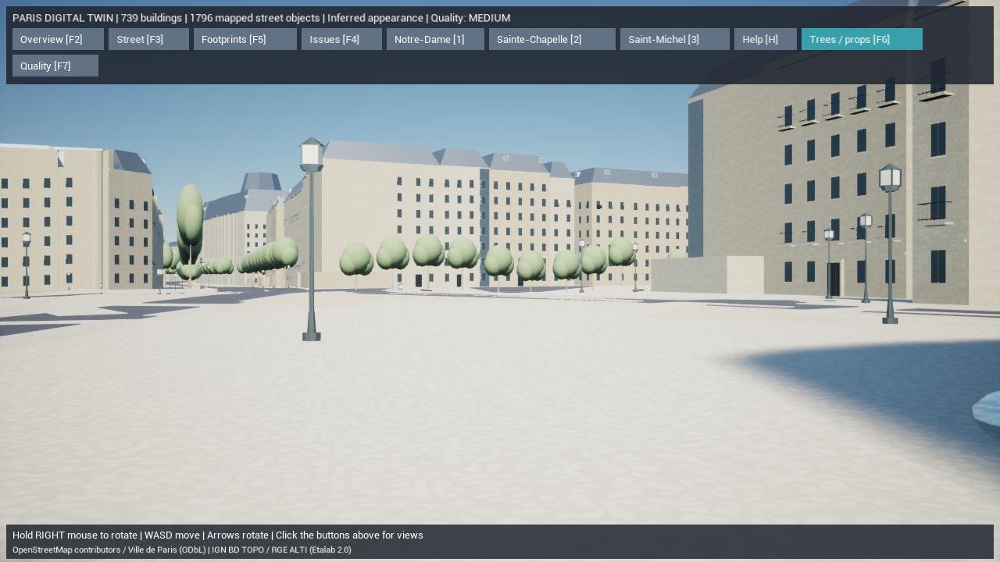

# Paris Digital Twin — Phase 5の装飾とPhase 6の静的街路設備

2026-10-15。建物の実輪郭と高さを保持し、住宅外観の補完モジュールと、保存済みOSM位置の街路設備を追加しました。Phase 5の固有建築・フォトリアル外観と、Phase 6の人・車・重力付き散策は引き続き未完成です。

変更前はGitタグ `backup/pre-paris-phase56-20261015` で保全。Rawの取得済みデータ、共通座標原点、既存Webゲーム・住民AI・DB・Dockerの構成は保持しました。

## 1. Phase 5で追加した機能

- 推定の入口626か所、バルコニー10,684か所、コーニス6,965区間、屋根窓686か所を生成。
- 隣の建物に塞がれた壁の6,868列を省略。中庭の露出した壁は保持。窓は33,536か所、装飾を持つ建物は632棟です。
- 教会・塔・特異な記念建築を汎用装飾から除外。屋根窓は適した推定マンサード形状の内部に置き、屋根窓の矩形が元の高さポリゴンをはみ出さないように検査。
- OSMの `roof:material` がmetal/zinc/steelの場合は金属系を表示。未登録のマンサード/陸屋根は亜鉛系、その他はスレート系として補完。このルール自体も推定であり、各棟の実材質の観測ではありません。
- 石灰岩・窓ガラス・スレートに加え、実在する新規UE材質 `M_ParisZinc`、`M_ParisIron`、`M_ParisWood`、`M_ParisFoliage` を生成・保存。既存の独自テクスチャを利用し、有料APIや未取得アセットへの参照は追加していません。
- 10,684個の小さな鉄柵に多数の立体棒を使う負荷を避け、両面の薄い面形状を使用。街路設備を除くメッシュは **1,035,432三角形 / 441コンポーネント**。開発中の立体棒版2,210,672三角形から削減しました。この薄い鉄柵は近接撮影向けの最終アセットではありません。

全建物739棟の再現レベルはL1。条件を満たす324棟の**本体だけL2**を維持します。入口・バルコニー・屋根窓の追加を理由にL3へ昇格させていません。F1と建物クリックで根拠を確認できます。

## 2. Phase 6で追加した機能

Phase 1に保存した公式OSMの `osm-map.xml.gz` には、以前の正規化処理で省略していた設備ノードがありました。このファイルのSHA-256とライセンスを既存manifestで検証して読み込みます。新規のOverpass取得も樹木・街灯・ベンチのノードを取得するようにしました。今回の生成のための追加ネットワーク取得は不要です。

| 設備 | 元の範囲内ノード数 | 実際に表示した数 |
| --- | ---: | ---: |
| 樹木 | 1,124 | 1,108 |
| 街灯 | 834 | 479 |
| ベンチ | 238 | 209 |
| 合計 | 2,196 | 1,796 |

400点は理由付きで保留しています。建物輪郭と代理物の設置範囲が干渉する285点、壁/天井/吊り下げ取り付けの44点、河川上かつ生成橋面がない71点です。ノード位置を黙ってずらす処理はありません。これらには道路幅の推定やデータ位置のずれ、河岸の壁付け灯も含まれ得るため、誤った元データと断定しません。

元のOSM位置・ID・URL・タグ・ライセンス・スナップショットを維持し、外観は自作の一般的な代理モデルです。高さタグを持つ表示設備466点はタグの値を使用し、未登録高さは推定。樹冠径、ベンチの向き、地面/橋面からの設置高も出典を別々に保存します。樹種・灯具の実デザイン・現地の測量精度は再現した扱いにしません。推定配置の追加は0点です。

UEは樹幹・樹冠・街灯金属・灯具ガラス・ベンチ木部・ベンチ金属の**6つのモデルを一度だけ生成し、3,592インスタンスをHISMで配置**します。樹冠432三角形、樹幹30三角形などの自作小型モデルを共用し、全インスタンスを数えた場合の三角形数は636,468です。実際の可視数はカメラと距離設定で変わります。

クリックしたインスタンスから元のOSMノードを解決し、地理座標と推定寸法を表示。樹冠はクリック用の単純な箱の当たり判定で、物理的な通行を塞ぎません。幹や設備にも安価な代理の当たり判定を使用します。細かな現地の衝突形状ではありません。

点の正規化は [OSM樹木タグ](https://wiki.openstreetmap.org/wiki/Tag:natural%3Dtree)、[街灯タグ](https://wiki.openstreetmap.org/wiki/Tag:highway%3Dstreet_lamp)、[ベンチタグ](https://wiki.openstreetmap.org/wiki/Tag:amenity%3Dbench)に対応。共用配置は [UE 5.8のHISM一括追加](https://dev.epicgames.com/documentation/unreal-engine/API/Runtime/Engine/UHierarchicalInstancedStaticMesh-/AddInstances?lang=en-US)を使用しています。元データはOpenStreetMap contributors / ODbL-1.0です。

## 3. 変更ファイル

| 対象 | 主な変更ファイル |
| --- | --- |
| GISの街路点取得・正規化 | `gis/paris_twin/acquire.py`, `normalize.py`, 新規 `street_furniture.py` |
| 建築補完・自作形状 | `facades.py`, `building_mesh.py`, 新規 `detail_geometry.py` |
| エクスポート・再利用・検証 | `mesh.py`, `prepare.py`, `validate.py` |
| Pythonテスト | `gis/tests/test_pipeline.py`, 新規 `test_streets.py` |
| UE共用モデル・インスタンス・選択・品質 | `ParisDigitalTwin.cpp`, `.h`, 新規 `ParisStreetMeshes.cpp`, `.h`, `AIWorld.Build.cs` |
| UEテスト・起動・性能測定 | `ParisDigitalTwinTests.cpp`, `Test-ParisDigitalTwin.ps1`, `Start-ParisDigitalTwin.ps1`, 新規 `Measure-ParisDigitalTwin.ps1` |
| 材質の生成・実ファイル | `create-paris-assets.py`, `Content/Materials/M_Paris*.uasset`（インスタンス用フラグを含む） |
| 手順・証拠 | 本書、README、GIS README、検証JSON、テスト記録、測定JSON、画像 |

再生成可能なローカル成果物は `gis/Data/Processed/ile_de_la_cite/` と `gis/Data/Generated/ile_de_la_cite/` に出力します。設備の詳細・保留理由は `Generated/street-placement.json`、位置と全属性は `Processed/features.wgs84.geojson`。Rawファイルを改変していません。既存の未追跡 `unreal/AIWorld/Config/DefaultInput.ini` は含めていません。

## 4. 実行・検証手順

ルートの **`Paris-DigitalTwin.cmd`** から起動。エディタでの手動配置やBlueprint作成は不要です。

- F2:全景、F3:1.7mの目線、1/2/3:名所へ移動。
- 右ボタンを押してマウスで回転、WASDで移動、矢印キーで回転、ホイールで俯瞰ズーム。
- F1:本体精度色、F4:元データの問題、F5:2D輪郭。
- **F6:樹木・街灯・ベンチの表示切替、F7:低・中・高の距離設定**。
- H:操作説明、F9:撮影。輪郭モードでもユーザーが選んだ設備の有効/無効を保持。

現在の品質設定は装飾と設備の描画距離を変更します。高品質設定でも未実装のフォトリアルアセットやNanite/Lumenが追加されるわけではありません。物理・GIS情報の数は品質変更で削除しません。

| 距離設定 | 低 | 中（初期値） | 高 |
| --- | ---: | ---: | ---: |
| 樹木 | 900m | 1,200m | 1,800m |
| 街灯・ベンチ | 120m | 250m | 450m |
| ガラス・石枠・屋根窓 | 150m | 300m | 510m |
| 鉄柵・入口木部 | 90m | 180m | 306m |

```powershell
# リポジトリのルートで実行
$env:PYTHONPATH=Join-Path (Get-Location) 'gis'
.\gis\.venv\Scripts\python.exe -m paris_twin prepare --offline
.\gis\.venv\Scripts\python.exe -m paris_twin validate --offline
.\gis\.venv\Scripts\python.exe -m unittest discover -s gis/tests -v
.\unreal\scripts\Build-AIWorldUE.ps1
.\unreal\scripts\Test-ParisDigitalTwin.ps1
.\unreal\scripts\Start-ParisDigitalTwin.ps1 -Eye -Quality Medium
# ビルド/生成が済んだ状態から測定。補助プロセスは終了後に閉じる。
.\unreal\scripts\Measure-ParisDigitalTwin.ps1 -View Overview -Quality Medium
.\unreal\scripts\Measure-ParisDigitalTwin.ps1 -View Street -Quality Medium
```

## 5. 実際に確認した内容

Python **22件成功（184.986秒）**。座標・地形・高さ・キャッシュ・再現性に加え、XML/JSONの元ノード保持、方位タグの解釈、保留点を移動しないこと、橋面の設置高、点断片を含む道路の向き参照、代理メッシュの有効性、建物間の壁の省略、中庭の保持を確認しました。

保存済み入力から2回再生成し、scene SHA-256は両方 **`f65de97471eeb4c833f6e344c20c95373eab0acc50d2ac5d1cbdd7e35eee88b0`**。地理座標の往復最大誤差は約2.8nm、生成道路面と建物輪郭の重なりは0㎡。この変換誤差は元データの位置精度を意味しません。元データにある2件の建物重複、別成分の道路、2か所の低い境界橋断片はレビュー情報を保持しています。

UEのライブテストは共通座標、建物の選択・精度/問題/輪郭切替、街路設備の元ID・品質設定・表示状態の保存の3件です。街路設備を実際の複雑トレースでクリックできることもテストに含めています。最終ビルド・材質と測定の実行記録は [テスト記録](paris-twin-phase56-tests.txt)、地理検証は [検証JSON](paris-twin-phase56-validation.json) を参照。

UE 5.8.3 Development Editorの最終C++ビルドは成功（25.60秒）、材質生成もエラー0件でした。材質にHISM用フラグを保存し、初回に検出した灰色の代替材質表示とCPU衝突データ警告を修正して再検証。最終のUEライブテスト3件が成功し、最終描画ログにも当該警告はありません。Dockerは基本Composeと基本＋UEオーバーレイの構成検証が成功しました。コンテナの起動・稼働テストは今回実行していません。

以下はAMD Radeon統合GPU、Ryzen 7 7735HS、RAM 28.8GB、DX11、出力1280×720、影有効、中の距離設定、5秒の準備後20秒の計測です。プロジェクトの既定 `r.ScreenPercentage=80` を使用します。ウィンドウを表示する測定ではなく、隠した補助プロセスの **`-RenderOffscreen`** を使い、上限FPS/VSyncを解除しています。前段階のウィンドウ表示のFPSとは条件が異なり、厳密な比較や改善率の算出には使いません。

| 視点 | 平均FPS | P95フレーム時間 | 記録 |
| --- | ---: | ---: | --- |
| 全景 | 68.4 | 17.57ms | [実測JSON](paris-twin-phase56-overview-performance.json) |
| 目線1.7m | 102.2 | 11.68ms | [実測JSON](paris-twin-phase56-street-performance.json) |

この2視点の平均は暫定60fpsを満たします。全景のP95は16.67msを上回り、全フレームで60fpsを保つ保証ではありません。高/低設定のFPS、表示ウィンドウ、パッケージ版、他GPU、iPhone、CPU/GPU別のプロファイルは今回未測定です。





両画像を目視確認し、形状・地面との位置・材質の適用・メニューの表示を確認しました。現地写真と撮影位置・レンズを一致させた比較は未実施です。ノートルダムの装飾や噴水の彫刻などの固有外観を再現した画像ではありません。

## 6. 未実装項目と次Phase

この段階では汎用外観・静的設備です。人や車の移動、カフェテラス、交通信号、店舗、重力・段差追従・一人称/三人称のキャラクター散策、壁付けの実灯具は未実装。既存の目線視点は自由移動する確認カメラです。World Partition/HLOD、広域接続、Nanite/Lumen、DX12やパッケージ版の性能検証も未実施です。

次はPhase 6の歩行システムと道路に沿った歩行者、さらにPhase 5の固有建築を進めます。Notre-Dame・Sainte-Chapelle・Saint-Michelの外観、橋アーチ、河岸の階段は資料と専用モデルが必要です。今回の球状樹冠、薄い鉄柵、単純な入口や灯具をフォトリアルな完成品として扱いません。

| 必要な次のアセット | 初期の推奨仕様 |
| --- | --- |
| 地域に合う樹木 | 実寸、複数種/形状、幹と葉のPBR、3段階以上のLODまたは遠景表現、単純な幹衝突 |
| バルコニー・扉・屋根窓・店構え | 2K〜4K材質、近景立体部品と遠景代理、実寸、棟ごとの出典と推定を明記 |
| 名所の固有建築・噴水・橋 | 現地/公的資料と寸法・撮影時点・利用条件。近景詳細と遠景LOD、衝突を分離 |
| 歩行者・車・自転車 | 利用許諾済み独自モデル、実寸、基本アニメーション、LOD、経路/停止/回避の検証 |

無料/既存データと自作コードの範囲で実装し、実在しないアセットへの参照や未実行の検証を成功扱いにしていません。
