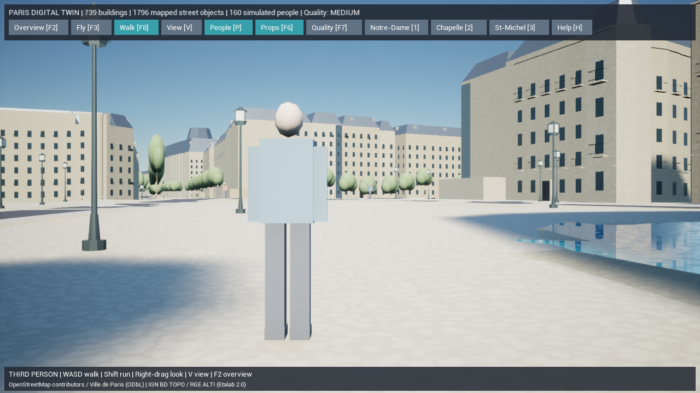
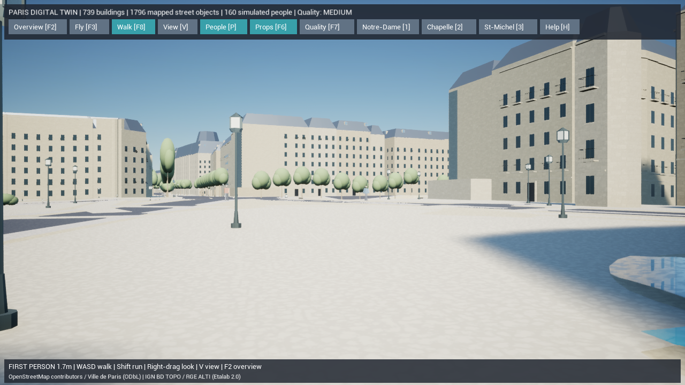

# Paris Digital Twin — Phase 6 散策と歩行者

2026-10-15。実地理の街を一人称・三人称で歩く機能と、GISから作った経路を移動する歩行者を追加しました。変更前は `backup/pre-paris-walking-20261015` で保全。既存739棟の輪郭・高さ・共通原点、Web版の住民AI・保存・Dockerは保持しています。

## 1. 実装した機能

### 現実のスケールでの散策

- Unreal標準の `ACharacter` / `CharacterMovementComponent` を利用し、地面への着地、重力、壁・設備との衝突、段差、斜面に対応。
- カプセルは直径68cm、高さ176cm。目線は足元から約1.7m、歩行1.7m/s、Shiftで3.4m/s。最大段差35cm、最大歩行斜面44度。
- F8で地表へ移動して一人称散策。Vまたは再度F8で三人称と切替。三人称のカメラは壁で手前へ寄るSpringArmを使用。
- F2で上空、F3で従来の自由移動カメラ、1/2/3で名所へ移動。散策と自由カメラは別Pawnとし、俯瞰に戻るとキャラクターを非表示・衝突無効・移動停止にする。
- 散策開始時は元建物輪郭・河川・橋・床の法線・カプセルの空き空間を検査。範囲外や足元を大きく下回る落下では最後に立てた場所へ戻す。泳ぎや水中散策はありません。
- 三人称の代理アバターは身長約1.72m。歩行速度に連動して手足を動かし、停止時は待機姿勢へ戻します。

元の地形はIGNの20m間隔標高を補間したものです。歩けるようになったことは、実在の階段・段差・縁石を測量したという意味ではありません。建物内部や扉を通る機能は未実装です。

### GISに沿った歩行者

- **841本の安全な経路、160人分のシミュレーション**。OSM歩行者道路の中心線が475本、道路幅から補完した左側歩道178本・右側188本です。
- 生成済みの歩道・歩行空間・橋から歩行可能領域を作り、建物、河川の橋以外の部分、樹幹、街灯、ベンチを除外。人物の半径分の余裕も確保。
- 曲がり角の元の頂点を残して1.5m以下に分割。分割点を直線補間した時にも、曲がり角を切り取って建物や川へ入らないことを検査します。
- 経路端で待機して折り返し、近くの人やプレイヤーには停止して譲る。詰まった場合は向きを変えます。固定50ms単位で更新し、大きな時間飛びで無制限のループに入らないようにしています。
- 色の異なる上着、頭、腕、脚の8つの自作モデルを共用し、各人6部位をISMでまとめて描画。モデルは歩行・待機に連動。近くの床への照会で設置高も合わせます。
- 低設定は80人、中/高は160人の描画予算。描画距離は100/200/350m。経路と160人のシミュレーション状態は表示設定で削除しません。
- Pで歩行者の表示を切替。クリックでシミュレーションID、元道路ID・URL、経路の補完方法、速度、歩行/待機を表示。輪郭モードを往復してもユーザーが歩行者を無効にした状態を維持。

**人数・人物・服装・速度・配置・動作は推定のシミュレーション**です。実際に観測した人や交通量ではありません。元の地理データと混同しないよう、画面・人物選択・出力属性に明示します。経路は独立した安全な線分で、交差点の信号、全域の目的地探索、交通シミュレーションは未実装。歩行者同士は譲り合いますが、プレイヤーを物理的に押し戻す群衆衝突はありません。

### 操作画面

通常のボタンを整理し、1280px幅で1段に収めました。精度・問題・輪郭はショートカットを維持し、問題/輪郭ボタンはヘルプを開いた時に表示。下部は現在の視点に合わせた操作案内です。

| 操作 | 機能 |
| --- | --- |
| F8 / Walk | 散策を開始。散策中は一人称/三人称の切替 |
| V / View | 一人称/三人称。上空からは三人称散策を開始 |
| WASD / Shift | 移動 / 走行 |
| 右ボタンを押してマウス移動 / 矢印 | 視点の回転 |
| F2 / F3 | 全景 / 自由移動の目線カメラ |
| P / F6 / F7 | 歩行者 / 街路設備 / 低・中・高の描画設定 |
| 1 / 2 / 3 | Notre-Dame / Sainte-Chapelle / Saint-Michel |
| F1 / F4 / F5 | 本体精度 / 元データの問題 / 建物輪郭 |
| H / F9 | ヘルプ / 撮影 |

## 2. 変更ファイルとデータ

| 対象 | ファイル |
| --- | --- |
| 経路・推定人口・人物モデル | 新規 `gis/paris_twin/pedestrians.py` |
| 出力・キャッシュ・品質検証 | `mesh.py`, `prepare.py`, `validate.py` |
| 再現性・曲がり角・橋・障害物・分割道路 | `gis/tests/test_pedestrians.py`, `test_pipeline.py` |
| 散策・カメラ・代理アバター | 新規 `ParisWalker.h`, `.cpp` |
| 歩行者・歩行姿勢・インスタンス描画・選択 | 新規 `ParisPedestrians.h`, `.cpp` |
| モード・起動・UI・計測 | `ParisDigitalTwin.h`, `.cpp`, `Start-ParisDigitalTwin.ps1`, `Measure-ParisDigitalTwin.ps1` |
| Native自動テスト | 新規 `ParisWalkingTests.cpp`, `Test-ParisDigitalTwin.ps1` |
| 実在する新しい材質 | `create-paris-assets.py`, `M_ParisCloth.uasset`, `M_ParisSkin.uasset` |

`Generated/pedestrian-network.json` は元道路ID付きの経路、歩行可能領域、座標を保存。`scene.json` の `pedestrians` にUE cm座標、代理モデル、初期の推定人口と属性を保存します。元OSM・IGN・ParisのRawファイルは変更せず、API追加取得や有料サービスは不要です。

経路IDにはOSM道路ID、中心線/補完歩道の区別、元の分割線番号、切り抜き後の線番号を含めます。実データ検証で検出した複数線のID重複を修正し、UE読込でも重複を拒否します。人の現在の移動状態・プレイヤー位置は実行中の状態で、保存済み人口観測ではありません。

基盤は [UnrealのCharacter Movement](https://dev.epicgames.com/documentation/unreal-engine/movement-components-in-unreal-engine?lang=en-US) と [ISMの一括変換更新](https://dev.epicgames.com/documentation/unreal-engine/API/Runtime/Engine/UInstancedStaticMeshComponent/BatchUpdateInstancesTransforms)です。人物やカメラをエディタで手動配置する操作は不要です。

## 3. 起動・再生成・検証

ルートの **`Paris-DigitalTwin.cmd`** を開き、**Walk [F8]** を押すと散策できます。

```powershell
# リポジトリのルートで実行
$env:PYTHONPATH=Join-Path (Get-Location) 'gis'
.\gis\.venv\Scripts\python.exe -m paris_twin prepare --offline
.\gis\.venv\Scripts\python.exe -m paris_twin validate --offline
.\gis\.venv\Scripts\python.exe -m unittest discover -s gis/tests -v
.\unreal\scripts\Build-AIWorldUE.ps1
.\unreal\scripts\Test-ParisDigitalTwin.ps1
# 最初から散策で起動
.\unreal\scripts\Start-ParisDigitalTwin.ps1 -Walk
.\unreal\scripts\Start-ParisDigitalTwin.ps1 -ThirdPerson
# 計測はデータ生成とビルドの後。補助プロセスは終了時に閉じる。
.\unreal\scripts\Measure-ParisDigitalTwin.ps1 -View Overview
.\unreal\scripts\Measure-ParisDigitalTwin.ps1 -View WalkFirst
.\unreal\scripts\Measure-ParisDigitalTwin.ps1 -View WalkThird
```

## 4. 実際の検証結果

Pythonは **27件成功（215.095秒）**。経路の建物/河川/設備回避、橋面の高さ、補間線が曲がり角をはみ出さないこと、私有道路の除外、人物の実寸、複数線に分割された道路でもIDが一意であること、元データから2回生成して同じ結果になることを確認しました。

主要機能のC++ビルドは成功（52.21秒）、三人称の構図調整後の最終ビルドも **成功（18.06秒）**。新規の衣服・肌材質もUE Pythonで生成・保存しました。UEのライブテスト **4件が成功**。既存の座標・選択・表示切替に加え、実地理の地面に立ち移動すること、カメラだけの切替、落下速度と着地、テスト用の壁で止まること、30cmのテスト用段差を上ること、地形下への落下からの復帰、1,000シミュレーションステップ後も全歩行者が有限の経路上に留まること、人物選択と表示状態の保持を検証しました。テスト用の箱は検証後に破棄し、都市データには保存しません。

生成結果のscene SHA-256は **`6c9a087e2cdef4ac90ff8adaf6917498eb019f061ada7f6c6e4c8904ca39eb46`**。生成道路と建物輪郭の重なりは0㎡、地理検証エラー0件。元データの重なり・道路の別成分・低い境界橋断片のレビュー情報は維持しています。Chaosの `Input trimesh contains ... bad triangles` という既存地区メッシュの診断は前段階から残っており、今回の歩行・着地・壁のテストはその状態で実行しました。

Dockerの基本＋UEオーバーレイは `config --quiet` で検証成功。今回はコンテナの稼働試験は行っていません。既存の未追跡 `unreal/AIWorld/Config/DefaultInput.ini` は変更対象に含めていません。

証拠は [Python・UE・ビルド記録](paris-twin-phase6-tests.txt) と [地理検証JSON](paris-twin-phase6-validation.json) を参照。

AMD Radeon統合GPU / Ryzen 7 7735HS / RAM 28.8GB、UE 5.8.3 Development Editor、DX11のオフスクリーン描画で実測しました。出力1280×720、既定 `r.ScreenPercentage=80`、影有効、中の距離設定、推定歩行者160人を有効にし、5秒の準備後20秒を測定。FPS上限とVSyncを解除しています。

| 視点 | 平均FPS | P95フレーム時間 | 記録 |
| --- | ---: | ---: | --- |
| 全景 | 68.9 | 17.16ms | [実測JSON](paris-twin-phase6-overview-performance.json) |
| 一人称散策 | 99.3 | 12.20ms | [実測JSON](paris-twin-phase6-walkfirst-performance.json) |
| 三人称散策（構図調整後） | 97.6 | 12.46ms | [実測JSON](paris-twin-phase6-walkthird-performance.json) |

3視点の平均は暫定60fpsを満たしました。全景のP95は16.67msを超えるため、全フレームで60fpsという結果ではありません。視点ごとにカメラ・可視範囲・画角も違います。表示ウィンドウ、低/高設定のFPS、全地点、他GPU、パッケージ版やiPhoneは未測定であり、全環境の性能保証ではありません。JSONの160人は描画予算で、距離によって省略された人も含みます。





撮影画像を見て、一人称で自分のアバターを表示しないこと、三人称の全身・足元、操作案内、街並みと材質の表示を確認しました。三人称で足元が切れた初回の構図を修正し、再ビルド・ライブテスト・撮影・性能測定を行いました。人物は上記の軽量代理モデルであり、現地人物の写真に一致させた完成アセットではありません。


## 5. 未実装項目と次の工程

現在の人物は自作の軽量な代理形状と部位アニメーションです。顔・指・服の布地・足のIK・スケルタルアニメーションやフォトリアルな人物アセットは未実装。全域の歩行経路探索、信号待ち、車両、自転車、店舗、カフェテラスも残っています。プレイヤー位置や歩行者の実行中状態のセーブ/復元・ネットワーク同期は今回の対象外です。

既存の窓・バルコニー・屋根は推定、名所の固有外観はL3以上に昇格させません。建物内の散策、実測の階段・縁石、橋アーチの実構造、水位観測も引き続き不足しています。

次はPhase 6の車両・街路の小物と、Phase 7の地区接続・表示最適化を進めます。名所や住宅を写真に近づけるには、現地資料と寸法を持つ固有モデル、近景の石材・建築装飾、樹木・人物のPBR/LODアセットが必要です。Nanite/Lumen、World Partition/HLOD、DX12・パッケージ版・iPhoneは未検証です。
