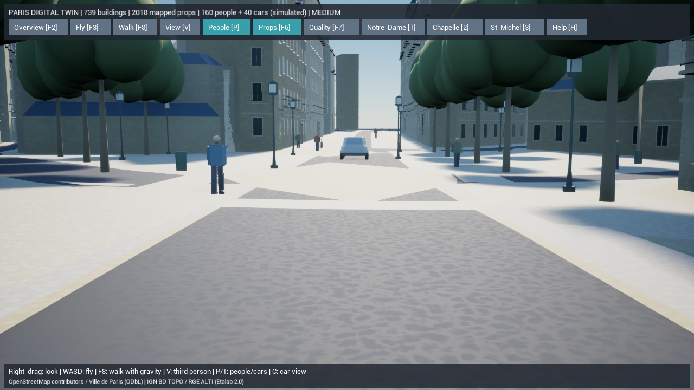
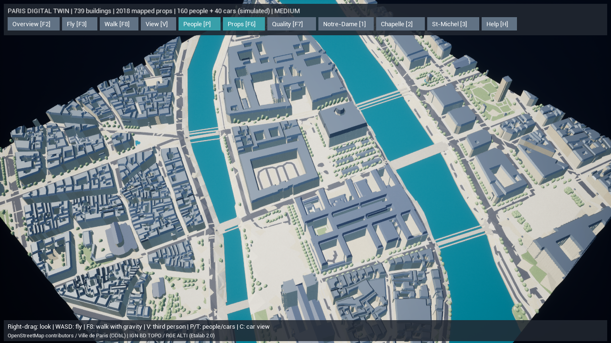
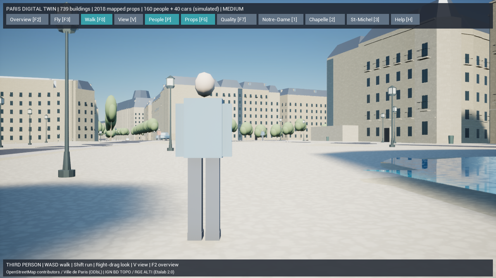

# Paris Digital Twin — 車両・街路設備・表示予算

2026-10-15。Phase 6の交通と設備、Phase 7の表示最適化の一部を追加しました。変更前は `backup/pre-paris-traffic-20261015` で保全しています。739棟の元輪郭・高さ・共通原点、既存の散策、Web版のAI・保存・Dockerを保持しています。地区拡張やWorld Partitionは今回の完了範囲に含みません。

## 1. 実装した機能

### 道路に沿う推定車両

- 元OSMの道路形状に由来する**60本の独立した方向付き経路、40台の推定車両**を生成。
- 一方通行 `yes/1/true/-1` とラウンドアバウト、右側車線、数値の最高速度属性を解釈。通行不可・私有・目的地限定・条件付き制限・バス指定などは候補から除外。
- 通常5m/sのプレビュー速度。数値のOSM最高速度がそれより低ければ上限として使用し、速度・幅・車線は推定であることを記録。
- 車体は全長4.2m、全高1.55mの自作汎用モデル。3色の車体、傾斜した窓、タイヤ、ホイール、バンパーを6個のStaticMeshで共用し、ISMで描画。路面の勾配に車体を合わせます。
- 中心線だけでなく、車体全体を覆う**半径2.4mの掃引範囲**が道路・橋の生成領域内に収まることを検証。建物、橋以外の河川、明示された歩行空間・横断箇所、設備を避けます。狭すぎる道には配置しません。
- 固定50ms単位で進行。人・プレイヤー・車両の近くでは停止して譲ります。経路端では非表示にし、待機後に始点の空きを確認して再投入。一方通行を逆走して折り返す処理はありません。
- クリックでシミュレーションID、元道路ID・URL、推定であること、速度・移動/待機状態とクリック地点の地理座標を表示。

**実際の交通量・実車・信号制御を再現した交通シミュレーターではありません。** 接続していない安全な区間を移動する表示用の交通です。経路端での再投入、交差時の単純な停止、混雑時の停滞があり、都市全体の目的地探索・交差点優先制御・渋滞解消は未実装です。車はプレイヤーに物理的な力を与えず、停止して回避します。

### 実データの自転車置き場・ごみ箱・信号柱

取得済みの `osm-map.xml.gz` をオフラインで再利用し、追加のAPI取得・有料サービスは使用していません。

| 設備 | 今回の描画数 | 実在情報と補完の区別 |
| --- | ---: | --- |
| 自転車置き場 | 102 | OSM点の位置。汎用スタンドと自転車1台の形状・占有状態は推定 |
| ごみ箱 | 107 | OSM点の位置。外観・寸法・向きは汎用の補完 |
| 信号柱 | 13 | `traffic_signals=signal` の点のみ。レンズは未点灯で、実際の信号現示を主張しない |

交差点を表す論理的な `highway=traffic_signals` ノードをそのまま道路中央の柱にしません。柱として記録されていない点は理由付きで描画対象から除外。建物や橋のない水域と干渉する設備も従来と同様に除外し、位置を黙って動かしません。

既存の街路樹1,108本・街灯479本・ベンチ209台と合わせ、**描画する実地図由来の設備は2,018件**。11種の共有StaticMeshをHISMで使用します。自転車の台数は駐輪場の実測収容数や観測された占有数ではなく、選択表示にも明示します。新しい障害物を歩行経路から除外した結果、推定歩行者160人の安全な経路は858本になりました。

### 表示負荷と操作

- 人物と車両は、描画距離内でカメラに近いものを優先してISMへ送ります。遠くの人物の部位変換・地面照会を省きます。表示対象から外れても元のシミュレーション状態を削除しません。
- 低設定は歩行者最大80人・車両最大20台、中/高は最大160人・40台。人物の距離は100/200/350m、車両は120/250/450m。車両の表示更新は低15Hz、中/高30Hz。
- 描画予算と、その瞬間にISMへ送った件数を分けて性能JSONへ記録。
- `T` で車両表示、`C` で品質検証地区に近い車両の周囲へカメラを移動。地面上に立てる空間と車への見通しを検査し、約1.7mの目線へ移動します。移動後は通常の自由カメラ操作が可能で、自動追跡ではありません。
- 通常のツールバーは1段の構成を維持。TrafficボタンはHのヘルプ内に表示。輪郭表示を往復してもユーザーが無効にした車両表示を保持します。
- 影なし起動の設定が歩行者にも適用されるよう修正。

## 2. 変更ファイル

| 対象 | ファイル |
| --- | --- |
| GIS車両経路・速度・モデル・検証 | 新規 `gis/paris_twin/traffic.py`, `gis/tests/test_traffic.py` |
| 地図の追加設備と自作形状 | `acquire.py`, `street_furniture.py`, `detail_geometry.py`, `test_streets.py` |
| 出力・キャッシュ・再現性 | `mesh.py`, `prepare.py`, `validate.py`, `test_pipeline.py` |
| 歩行者の設備回避 | `pedestrians.py` |
| UE車両・停止・インスタンス・選択 | 新規 `ParisTraffic.h`, `.cpp`, `ParisTrafficTests.cpp` |
| カメラ・UI・距離予算・品質・計測 | `ParisDigitalTwin.h`, `.cpp`, `ParisPedestrians.h`, `.cpp`, `ParisDigitalTwinTests.cpp`, `ParisWalkingTests.cpp` |
| 実在する新規材質 | `create-paris-assets.py`, `Content/Materials/M_ParisVehicle.uasset` |
| 起動・検証・撮影 | `Start-ParisDigitalTwin.ps1`, `Test-ParisDigitalTwin.ps1`, `Measure-ParisDigitalTwin.ps1` |

`Generated/traffic-network.json` に、元道路ID付きの方向付き経路・走行可能領域・安全な中心領域を保存。`scene.json` の `traffic` にUE cm座標・モデル・初期車両・推定属性を保存します。Rawスナップショットとライセンス・チェックサムを維持し、元のOSMノード/道路IDへ追跡可能です。

## 3. 実行・検証手順

ルートの **`Paris-DigitalTwin.cmd`** を開き、`C`で車両周辺、`F8`で散策、`V`で一人称/三人称を切替。`P`は人、`T`は車、`F6`は設備、`F7`は低/中/高、`F2`は全景です。

```powershell
$env:PYTHONPATH=Join-Path (Get-Location) 'gis'
.\gis\.venv\Scripts\python.exe -m paris_twin prepare --offline
.\gis\.venv\Scripts\python.exe -m paris_twin validate --offline
.\gis\.venv\Scripts\python.exe -m unittest discover -s gis/tests -v
.\unreal\scripts\Build-AIWorldUE.ps1
.\unreal\scripts\Test-ParisDigitalTwin.ps1
.\unreal\scripts\Start-ParisDigitalTwin.ps1 -TrafficView
.\unreal\scripts\Start-ParisDigitalTwin.ps1 -Walk
# 車両を非表示にする比較用の起動
.\unreal\scripts\Start-ParisDigitalTwin.ps1 -NoTraffic
# 計測はデータ生成とビルド後。各実行の補助プロセスは自動終了。
.\unreal\scripts\Measure-ParisDigitalTwin.ps1 -View Overview
.\unreal\scripts\Measure-ParisDigitalTwin.ps1 -View Traffic
.\unreal\scripts\Measure-ParisDigitalTwin.ps1 -View WalkThird
```

エディタでモデルや経路を手動配置する操作はありません。既存の未追跡 `Config/DefaultInput.ini` は変更対象に含めていません。

## 4. 実際の検証結果

Python **33件成功（228.544秒）**。一方通行の正逆、右側車線、通行制限、速度上限、車体全体の掃引範囲、建物/川/歩行空間回避、橋の高さ、自転車/ごみ箱と人の余裕、実在設備の位置保持、論理信号ノードの除外、元データから2回の再生成一致を確認しました。

C++の主要変更のビルド **成功（189.56秒）**、距離省略の回帰テストを更新したカメラ修正を含む最終ビルドも **成功（31.69秒）**。車体用PBR材質をUE Pythonで実際に生成・保存しました。UEのライブテスト **5件成功**。既存の座標・建物選択・設備・表示切替・散策の重力/着地/壁/段差/落下復帰を確認し、車両と歩行者それぞれ1,000ステップ、車両間の余裕、プレイヤーへの停止、再投入、道路IDへの選択、低設定の近傍予算、地区から離れた際の人物描画省略と帰還時の復帰を検証しました。

最終scene SHA-256は **`b204dc80dae2e21c8509f5862d9e05ab31909941cea4e11256535919dff38087`**。地理検証エラー0件、生成道路と建物輪郭の重なり0㎡。取得済みの地図設備2,464点のうち2,018点を描画し、残り446点の除外理由を保存。設備のHISMインスタンスは3,929件です。元データの建物重複・道路の別成分・2つの境界橋断片のレビュー情報は維持しています。既存の地区メッシュに対するChaosの `bad triangles` 診断は残っています。

Dockerの基本構成とUEオーバーレイは `config --quiet` で検証成功。今回はコンテナの起動試験は行っていません。記録は [テスト・ビルド抜粋](paris-twin-phase67-tests.txt)、[地理検証JSON](paris-twin-phase67-validation.json) を参照。

撮影時に車両確認カメラが建物内へ入る問題も発見し、空き空間と見通しを検査する目線カメラへ修正しました。壁を映していた初回の性能値は採用せず、衝突データの非同期準備を待つ再試行も加え、修正版で測り直しました。

AMD Radeon統合GPU / Ryzen 7 7735HS / RAM 28.8GB、UE 5.8.3 Development Editor、DX11のオフスクリーン描画で測定。出力1280×720、既定の `r.ScreenPercentage=80`、影有効・中設定、歩行者160人と車両40台のシミュレーションを有効にし、5秒準備後20秒を測定しました。FPS上限とVSyncは解除しています。

| 視点 | 平均FPS | P95フレーム時間 | 記録 |
| --- | ---: | ---: | --- |
| 俯瞰 | 68.0 | 17.50ms | [実測JSON](paris-twin-phase67-overview-performance.json) |
| 車両周辺の目線（起動待ち修正後） | 100.5 | 11.92ms | [実測JSON](paris-twin-phase67-traffic-performance.json) |
| 三人称散策 | 100.4 | 11.82ms | [実測JSON](paris-twin-phase67-walkthird-performance.json) |

3視点の平均は暫定60fpsを満たしました。俯瞰のP95は16.67msを超え、全フレーム60fpsには未達です。CPU/GPU別の時間を計測していないため、遅いフレームの主原因は断定しません。表示予算の導入と設備・車両追加を同時に行っているため、この数値から省略処理だけの改善率も主張しません。低/高設定・全地点・通常ウィンドウ・他GPU・パッケージ版・iPhoneは未測定です。

俯瞰と三人称は起動待ち修正前、車両周辺は修正後に測定。両者の地理・モデル・交通・描画処理は同一で、後の変更は車両確認カメラの起動タイミングと計測のカメラ属性です。JSONの予算・ISMへ送った件数は、画面に写ったピクセル上の人数とは異なります。フラスタムやGPUの距離省略はさらに適用されます。







撮影画像を開き、車両確認カメラが壁に入らず道路上から車両と歩行者を見られること、全景の地理配置、三人称アバターの全身と操作画面を確認しました。写真との外観一致・固有建築の詳細再現は今回の検証対象ではありません。

検証中、距離外の俯瞰カメラからも人物を選択できるという既存テストの前提が新しい距離省略と合わず、初回の歩行者選択テストが失敗しました。選択を確認する前に実際のカメラを人物の近くへ戻すよう更新し、「地区から離れると描画0、人口を保持し、戻ると描画・選択が復帰する」ことも検証対象に加えています。

## 5. 未実装項目と次の工程

現在の車両・自転車・人物・街路設備は自作の軽量代理形状で、写真に一致する完成アセットではありません。店舗・カフェテラス・駐車車両、接続した交通ネットワーク、信号現示・横断制御、実行中交通の保存/同期は未実装です。

建物・名所の固有外観は引き続きL3以上に昇格させません。次の品質向上には、資料と寸法を持つNotre-Dame/Sainte-Chapelle/Saint-Michelの固有モデル、石灰岩/亜鉛/スレートの近景PBR、窓・扉・彫刻・店舗の建築モジュール、樹木と人物/車両のLOD付き高品質アセットが必要です。存在しないアセットを参照して完成扱いにはしていません。車両の加減速・サスペンション・個別の車輪回転も未実装です。

次はGIS地区の接続とストリーミング、タイルごとのStaticMesh/HLOD、カフェ・店舗、交通の経路接続を進めます。World Partition、Nanite/Lumen、DX12、パッケージ版、iPhoneの検証は残っています。
