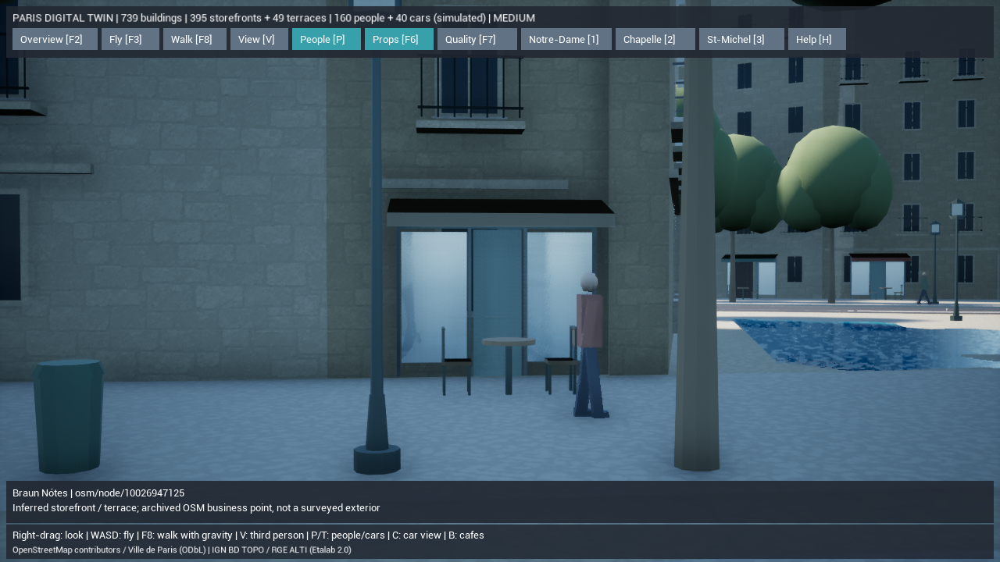
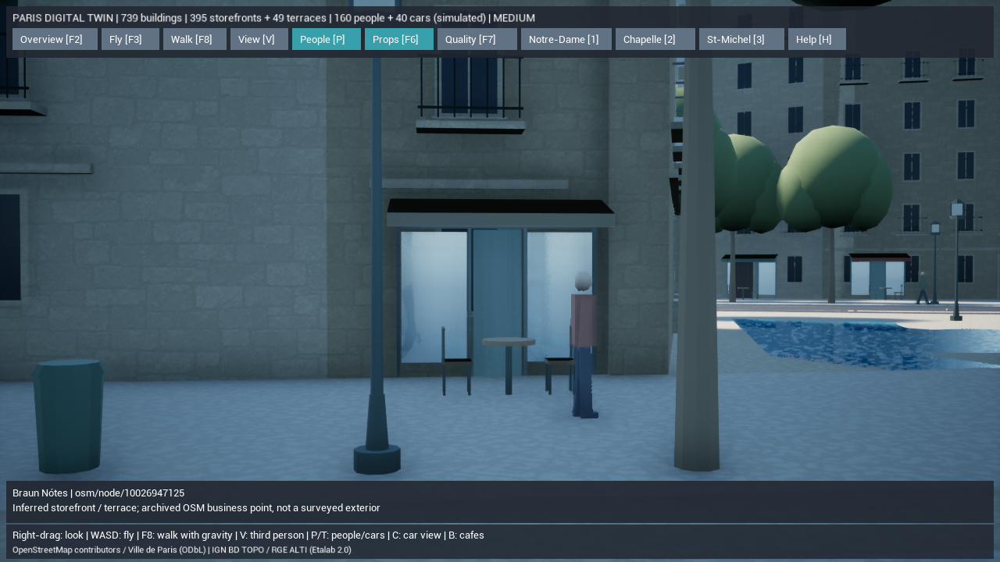
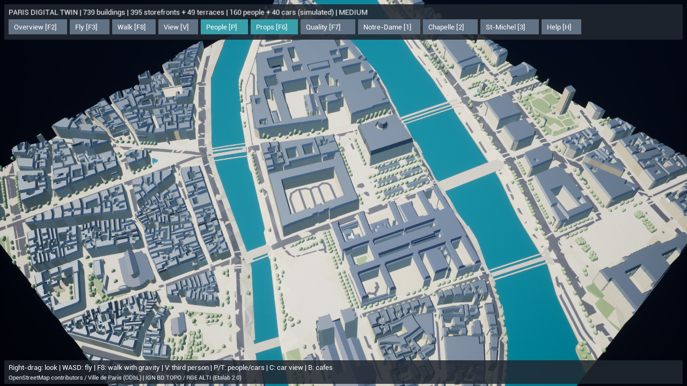

# Paris Digital Twin — 店先・カフェテラス・軽量読み込み

2026-10-15。Phase 6の店舗・屋外席と、Phase 7の読み込み基盤を追加しました。変更前は `backup/pre-paris-cafes-loading-20261015` で保全。既存739棟の輪郭・高さ・道路・川・共通原点、歩行と交通、Web版の住民AI・保存・Dockerを維持しています。

## 実装した機能

### 地図の店舗と推定の店先

取得済みOSMスナップショットからカフェ・レストラン・バー・店舗のノードを抽出。名前・元ID・URL・緯度経度・屋外席タグを保持します。地図上のPOIは建物内にある場合もあるため、元の点を動かさず、近くの歩行空間に向く外壁へ表示用の店先を補います。

- 元の店舗点527件のうち、店先395か所を配置。配置できない点もデータに残し、理由を記録。
- 地上階の窓・入口・枠・看板用パネルと3色の日よけを、自作の共有モデルで表現。色・寸法・実際の入口との対応は推定。
- 教会・大聖堂・城・記念建築、低すぎる建物、他の建物に接する面、歩行空間に接しない面を除外。同じ壁面を重複使用しないよう間隔を確保。
- 外壁の表示位置、建物との対応、元POIからの距離、外観が未検証であることを属性に保存。
- クリックで店舗名、元POIの座標とID、建物ID、推定の店先・屋外席であることを確認可能。

名前は**取得済み地図の登録情報**で、現在の営業状況、実際の看板・扉・建築デザインを現地で確認したものではありません。商業施設や建物全体をL3以上へ昇格させていません。

### 屋外席と通路

`outdoor_seating=yes` の登録があり、配置用の歩行空間が十分な場所だけに、汎用のテーブル1台と椅子2脚を補完します。49か所に配置。席数・寸法・色・占有状態・実際のテラス境界は推定です。

机と椅子の範囲が建物、道路、河川、既存設備や他テラスに入らないことを検査。壁との間に1.2m以上の通路を残し、狭い歩道には席を置きません。屋外席を補完できなかった理由も保存します。歩行者経路はテラスの範囲と人物分の余裕を除外して再生成し、交通側にも同じ障害範囲を渡します。

**B**でカフェ周辺の目線へ移動。立てる空間と店先への見通しを検査し、地面の衝突データが非同期で準備中なら起動時の自動移動を再試行します。移動後は自由カメラとして操作でき、F8で散策へ移れます。通常のメニューは1段のまま、CafesボタンはHのヘルプ内に配置しています。

### 描画用の軽量メッシュ形式

元の `scene.json` は監査・検証用として保持し、UEの既定読み込みを次の2ファイルに分けました。

| ファイル | 内容 |
| --- | --- |
| `paris-digital-twin-runtime.json` | 元ID・地理・材質・精度・推定属性・選択情報・各メッシュの位置と件数 |
| `paris-digital-twin-meshes.bin` | メッシュの位置・法線・頂点色・インデックス |

軽量側では数百万個の数値をJSONオブジェクトとして展開せず、検査済みのバイト範囲からUEの配列へ直接読み込みます。位置はfloat32のcm単位。元の座標値は完全なJSONへ残し、実地区の全頂点について誤差上限0.01cmを検証します。地理の基準点や軸を再変換する処理はありません。

ヘッダー・バージョン・サイズ・CRC32を検査し、範囲外の参照、破損・欠損、範囲外インデックス、NaNを拒否。CRC32は破損検知用で、署名認証ではありません。再生成した軽量ファイルも生成キャッシュのハッシュ管理に含め、オフラインのprepareで復元可能です。

**`-LegacyJSON`**で元のJSON読み込みへ切り替えられます。軽量ファイルが無い古いスナップショットでは従来形式を使用しますが、存在する軽量ファイルが破損していた場合はエラーにして再生成を案内します。

現在は地区全体を一括で読み込みます。今回の変更はWorld Partition、HLOD、非同期の地区ストリーミングの完成ではありません。メッシュのバイト範囲と元IDを分離し、次の地区・タイル単位の読み込みへ進める基盤です。完全なJSONも保持するため、保存する総ディスク容量を減らした変更ではありません。

## 変更ファイル

| 対象 | ファイル |
| --- | --- |
| 店舗点・外壁・テラス・自作モデル | 新規 `gis/paris_twin/businesses.py` |
| 軽量パケット生成・検証 | 新規 `gis/paris_twin/runtime.py` |
| データ取得・正規化・出力・復元 | `acquire.py`, `normalize.py`, `street_furniture.py`, `mesh.py`, `prepare.py`, `validate.py` |
| 通路と交通のテラス回避 | `pedestrians.py`, `traffic.py` |
| UEの直接読み込み | 新規 `ParisRuntimeMesh.h`, `.cpp` |
| 店舗選択・カメラ・UI・計測 | `ParisDigitalTwin.h`, `.cpp` |
| 配布ファイル・起動・比較 | `AIWorld.Build.cs`, `Start-ParisDigitalTwin.ps1`, `Measure-ParisDigitalTwin.ps1`, `Test-ParisDigitalTwin.ps1`, `.gitignore` |
| 自動検証 | 新規 `test_businesses.py`, `test_runtime.py`, `ParisBusinessTests.cpp`、更新 `test_pedestrians.py`, `test_pipeline.py`, `ParisDigitalTwinTests.cpp` |

`Generated/business-placement.json` に屋外席の範囲・歩行空間・配置結果を保存。`runtime.json` と `runtime-meshes.bin` を再生成できる中間データとして保存し、UE用ファイルはContent/Dataへ複製します。新たなネット取得・有料API・外部アセットは使用していません。既存の未追跡 `Config/DefaultInput.ini` は変更していません。

## 実行・検証手順

ルートの **`Paris-DigitalTwin.cmd`** を開き、**Bでカフェ、F8で散策、Vで視点、Cで車両周辺、F2で全景**。WASD・Shift・右ドラッグの操作は従来と同じです。F6は設備と店先、F7は描画品質を切り替えます。

```powershell
$env:PYTHONPATH=Join-Path (Get-Location) 'gis'
.\gis\.venv\Scripts\python.exe -m paris_twin prepare --offline
.\gis\.venv\Scripts\python.exe -m paris_twin validate --offline
.\gis\.venv\Scripts\python.exe -m unittest discover -s gis/tests -v
.\unreal\scripts\Build-AIWorldUE.ps1 -SkipAssets
.\unreal\scripts\Test-ParisDigitalTwin.ps1
.\unreal\scripts\Test-ParisDigitalTwin.ps1 -LegacyJSON
.\unreal\scripts\Start-ParisDigitalTwin.ps1 -CafeView
# 比較用の従来読み込み
.\unreal\scripts\Start-ParisDigitalTwin.ps1 -CafeView -LegacyJSON
# 同じデータ・視点で測定
.\unreal\scripts\Measure-ParisDigitalTwin.ps1 -View Cafe
.\unreal\scripts\Measure-ParisDigitalTwin.ps1 -View Cafe -LegacyJSON
.\unreal\scripts\Measure-ParisDigitalTwin.ps1 -View Overview
```

新しい材質ファイルは不要で、既存の実在する石・木・鉄・ガラス・布の材質を使用します。エディタで店や家具を手動配置する手順はありません。パッケージ用依存ファイルの登録は更新しましたが、パッケージ作成そのものは今回の検証対象ではありません。

## 実際の検証結果

Python **41件成功（299.634秒）**。店舗点の名前・ID・座標保持、外壁の重複/記念建築除外、屋外席タグ・通路・道路干渉、テラスを避ける歩行経路、軽量パケットの再現性・座標/色/インデックス一致・破損/欠損/不正参照/NaN拒否を確認。実地区を2回再生成して同じ結果になることを検証しました。

C++ビルド **成功（187.95秒）**、操作画面の店舗数表示を更新した最終ビルドも **成功（41.31秒）**。UEライブテストは **軽量形式7件・従来形式7件が成功**。既存の座標・選択・表示・散策/重力/衝突・歩行者/車両1,000ステップに加え、店舗インスタンスの追跡、カフェの目線と外壁回避、両形式の配列一致、不正バッファ拒否を検証しました。

最終scene SHA-256は **`7ff8dacce5e320e95fb987a23aea33c2b253a5f47c27bcd404ef93cdd2908658`**。地理検証エラー0件、生成道路と建物の重なり0㎡。442メッシュの軽量パケットは77,435,528bytes、CRC32 `1490272c`。全頂点の最大座標差は **0.00194cm（約0.019mm）**。これは追加の数値変換誤差で、元地図・標高・測量の精度を意味しません。873本の経路を160人が移動し、40台の交通と60本の方向付き車両経路を保持します。

店舗点527件のうち132件は、十分な幅の外壁や歩行空間などの条件を満たさず、理由付きで描画対象から除外。395店先と49テラスは19種の街路/店舗共有モデルで描画します。元データの建物重複・道路の別成分・2つの低い境界橋断片のレビュー情報、Chaosの既存 `bad triangles` 診断は残っています。

Docker基本構成＋UEオーバーレイは `config --quiet` 成功。コンテナ起動・パッケージ作成は未実行。記録は[テスト抜粋](paris-twin-phase7-cafes-tests.txt) と[地理検証JSON](paris-twin-phase7-cafes-validation.json)。

AMD Radeon統合GPU / Ryzen 7 7735HS / RAM 28.8GB、UE 5.8.3 Development Editor、DX11・オフスクリーン、1280×720出力 / `r.ScreenPercentage=80`、影有効・中設定。5秒準備後20秒、FPS上限/VSync解除で測定しました。すべて同じscene SHAです。

同じカフェ視点を **軽量→従来→軽量** の順に別プロセスで測定しました。地区読み込み時間はSceneのBeginPlay開始からREADYまでで、UEエンジン自体の起動時間は含みません。プロセスメモリは計測終了時の使用物理メモリで、GPU専用メモリや他アプリの使用量ではありません。

| カフェ・同じ視点 | 地区読み込み | 入力サイズ | 使用物理メモリ | 平均FPS / P95 |
| --- | ---: | ---: | ---: | --- |
| 軽量・初回 | 1.317秒 | 87.1MB | 2,922MiB | 108.4 / 11.08ms |
| 従来JSON | 11.955秒 | 186.2MB | 4,290MiB | 108.6 / 11.08ms |
| 軽量・再測定 | 1.278秒 | 87.1MB | 2,986MiB | 107.9 / 11.11ms |

この環境の比較では地区の読み込み時間が約89%、入力サイズが約53%、使用物理メモリが約30%減少。描画処理とモデルは共通なのでFPSはほぼ同等です。OSのファイルキャッシュやメモリ状態の影響も含む少数回の比較であり、他環境の短縮率を保証するものではありません。

記録：[軽量初回](paris-twin-phase7-cafes-cafe-initial-performance.json)、[従来JSON](paris-twin-phase7-cafes-cafe-legacy-performance.json)、[軽量再測定](paris-twin-phase7-cafes-cafe-performance.json)。軽量のメタデータは約9.6MB、バイナリは約77.4MBです。

俯瞰の軽量形式は **平均66.7fps / P95 17.84ms**。[実測JSON](paris-twin-phase7-cafes-overview-performance.json)。平均は暫定60fpsを超えましたが、P95が16.67msを超えるため全フレーム60fpsには未達。CPU/GPU別の主原因解析は未実施です。低/高設定、全地点、通常ウィンドウ、他GPU、パッケージ版やiPhoneの実測は行っていません。







画像を開き、両形式で同じ店先・家具・建物・地理配置が見えること、カフェの目線が外壁に入らないこと、1段のメニューと店舗名/推定表示を確認しました。人物は撮影時刻に応じて移動します。画素の完全一致や現地写真との外観一致を主張する検証ではありません。

## 未実装項目と次の工程

日よけ・店構え・家具・人物・車両は軽量な自作代理形状です。現地写真に一致する看板、建物固有の店舗外観、内装、注文・買い物・着席行動、テラスの実測形状は未実装。実際の営業や混雑のデータも取得していません。

次は地区/タイル単位の読み込みと衝突準備、地区間の接続・HLOD、店舗を目的地にする歩行経路、着席などの行動を進めます。フォトリアル品質には資料と寸法のある名所固有モデル、近景の石材・建築装飾・店舗PBR、LOD付き樹木・人物・車両が必要です。Nanite/Lumen・World Partition/HLOD・DX12・iPhoneは引き続き未検証です。
