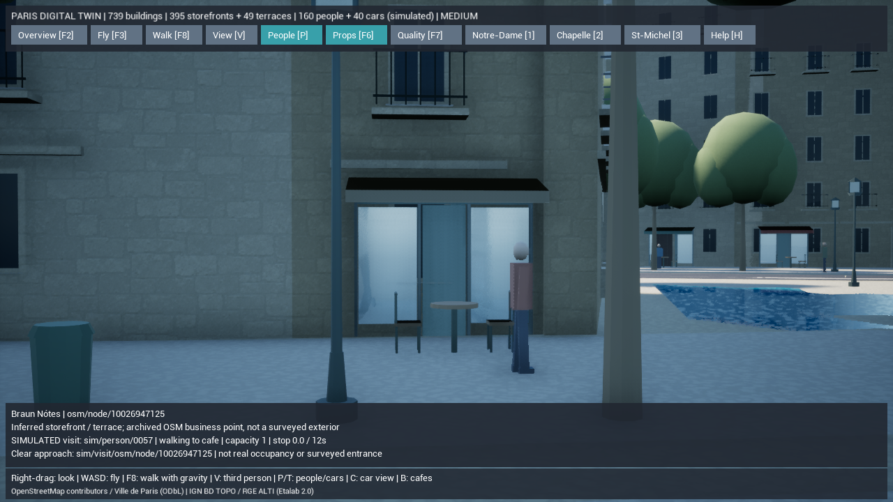
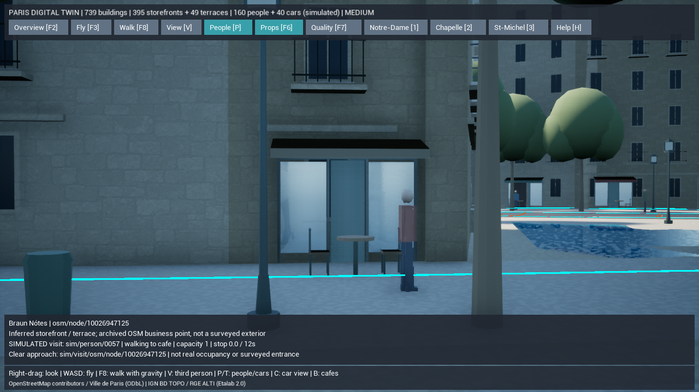
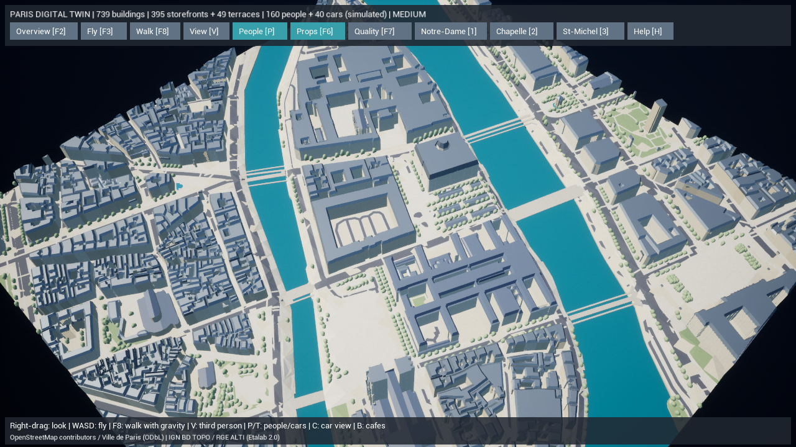

# Paris Digital Twin — 歩行経路網と別の通りへの訪問

独立した歩行区間を、安全を検査した短い通路と一致点でつなぎ、住民が別の道路の店へ移動できる経路網を追加しました。変更前を `backup/pre-paris-navigation-20261015` に保全しています。

## 実装した機能

### 実地区の歩行経路網

以前の873本の歩行区間と38本の店先への接続を維持し、**957本の短い接続路と405か所の一致点**を追加。経路は合計1,868本、経路網は**2,978ノード・3,467辺**になりました。既存の739棟、道路・橋・河川、395店先、49テラス、共通のNGF原点、160人・40台の推定シミュレーションを維持します。

- 歩行区間の端と近くの区間、既存区間どうしの交点・重複端を接続候補にします。
- 新しい接続路は最大6m。既存の歩行可能面から建物・川・車道・街路設備・テラスを除外し、車道から約38cmの余白を空けた範囲に全体が収まる場合だけ採用します。
- 地表・歩道・橋の既存の高さを参照し、段差・勾配を検査。異なる階層の道路は、共通のOSMノードがある場合に限って候補にし、高さの検査も行います。
- 一致点の高さも検査し、立体交差を同じ地点としてつなぎません。接続元の道路ID・URL・両側の元ID・推定であることを保存します。
- **分断した279領域はそのまま残します。** 未登録の横断歩道や、川・車道を横切る近道を新設する処理ではありません。

生成結果は `pedestrian-network.json` の `navigation` と、UE用データの `pedestrians.navigation` に保存。同じ入力・設定から再生成でき、ノードと経路上の距離、辺の両端・長さ、目的地との接続を検証します。追加のネット取得・依存ライブラリ・有料APIは使用していません。

接続路は移動のためのデータで、地形や舗装のメッシュを追加するものではありません。

### 別の通りまでの往復

住民は現在の区間上の位置を出発点として、Dijkstra法で経路網の距離を計算します。経路網上で120m以内に到達できる、予約可能な店先を候補にし、店先への接続を含む往復距離が最短の仕事を選びます。

全区間の連続性と作業枠を確認してから1人分を予約。経路を順に歩き、店先で10〜18秒滞在し、同じ経路を逆にたどって**出発した位置**へ戻り、元の巡回を再開します。瞬間移動で区間を切り替えません。以前と同じ区間内だけの訪問も継続し、経路網がない旧形式では同一区間の往復を使います。

通行人やプレイヤーに進路を塞がれた場合は、来た道を戻って中止します。往復距離と速度に基づく行動期限、最低90秒の期限とその10秒後の予約解放、再選択のクールダウン、256区間までの計画上限を設けます。戻り道が塞がれた場合も、通れない場所へワープしません。

候補がない場合は5〜9秒待って再評価し、予約済みの店や到達できない目的地を毎ステップ選び直しません。選択理由には実際の往復距離・区間数を使います。表示の人物数を減らしても行動計算は継続します。

### 経路表示と更新される検査欄

**N**で近くの経路網を表示。水色が既存の歩行区間、橙色が推定の短い接続路です。表示は近く150mに制限し、通常はオフにしています。Pで人物を非表示にしている間は、この表示も止めます。

人物をクリックすると、現在の区間・目標・行動段階・滞在残り時間・実際の選択理由・最近の履歴が随時更新されます。店舗を選択した場合も予約者・移動／滞在／帰還の状態を更新します。クリックした地点の地理座標はクリック時の位置として保持し、動いている人物の現在地と混同しません。

カフェへの立ち寄り、人数・利用状況・通路の補完はシミュレーションです。現在の営業状況・実際の客数・店舗入口・通行権・横断可否を現地確認したものではありません。元の店舗POI、建物輪郭、道路と河川の位置を移動していません。

## 変更ファイル

| 対象 | ファイル |
| --- | --- |
| 経路網の生成・検証と参照探索 | 新規 `gis/paris_twin/navigation.py`、更新 `mesh.py`, `validate.py` |
| UEの読み込み・最短経路・区間遷移・デバッグ線 | 新規 `ParisNavigation.cpp`、更新 `ParisPedestrians.h`, `.cpp` |
| 継続更新する選択欄・Nキー・計測 | `ParisDigitalTwin.h`, `.cpp` |
| 自動テスト | 新規 `test_navigation.py`, `ParisNavigationTests.cpp`、更新 `test_pipeline.py`, `ParisWalkingTests.cpp` |
| 検証・計測と案内 | 新規 `Test-ParisWalkingLongRun.ps1`、更新 `Test-ParisDigitalTwin.ps1`, `Measure-ParisDigitalTwin.ps1`, README類 |

既存のWeb版、住民AI・保存、Docker構成、未追跡の `Config/DefaultInput.ini` は変更していません。

## 実行手順

`Paris-DigitalTwin.cmd` から起動。**Bでカフェ、Nで経路表示、F8で散策、Vで一人称／三人称、F2で全景**。人物や店舗をクリックして変化する状態を確認します。WASD・Shift・右ドラッグは従来どおりです。

```powershell
$env:PYTHONPATH=Join-Path (Get-Location) 'gis'
.\gis\.venv\Scripts\python.exe -m paris_twin prepare --offline
.\gis\.venv\Scripts\python.exe -m paris_twin validate --offline
.\gis\.venv\Scripts\python.exe -m unittest discover -s gis/tests -v
.\unreal\scripts\Build-AIWorldUE.ps1 -SkipAssets
.\unreal\scripts\Test-ParisDigitalTwin.ps1
.\unreal\scripts\Test-ParisDigitalTwin.ps1 -LegacyJSON
.\unreal\scripts\Test-ParisWalkingLongRun.ps1
.\unreal\scripts\Measure-ParisDigitalTwin.ps1 -View Cafe
.\unreal\scripts\Measure-ParisDigitalTwin.ps1 -View Routes
.\unreal\scripts\Measure-ParisDigitalTwin.ps1 -View Overview
```

## 実際に検証できた内容

2026-10-15、このPCのUE 5.8.3で実行しました。

| 検証 | 結果 |
| --- | --- |
| Python全体テスト | **52件成功、308.267秒**。実スナップショットを2回生成してSHA一致、全体検証エラー0件 |
| C++ビルド | 成功。初回258.37秒、計画処理の最終更新38.55秒、店舗の状態表示更新23.72秒 |
| UE Liveテスト | **軽量形式9件・従来JSON形式9件、ともに成功** |
| 専用の経路探索テスト | 別の道路にある店への往復42mを最短として選択し、移動・滞在後に出発点へ帰還。区間遷移の瞬間移動なし |
| 到達不能・不正データ | 分断先は予約せず、5〜9秒の再評価間隔を維持。負の経路コスト、端点・距離の不整合を拒否 |
| 実地区の継続実行 | 1000ステップ後も有限値・現在の経路上を維持。別の元道路へ向かう訪問計画が存在 |
| 検査欄 | 実際のクリック対象の人物IDを保持し、再クリックなしで現在の状態と一致。クリア時に解除 |
| 道路との整合 | 新規957接続すべてで車道との重複0m。最小余白約37.96cm（38cm設計、ポリゴン近似誤差0.5mm以内） |
| キャッシュとDocker | オフラインprepareが`cached=true`。通常構成とUnrealオーバーレイの`config --quiet`成功 |

途中の全体検証では、車道の境界上に沿う3接続を検出しました。車道の38cmバッファーを除外する修正と境界の回帰テストを追加し、52件を再実行しています。コンテナ実行とパッケージ化は今回行っていません。

生成SHA-256は `12f43237f5e8ca030baf54692fb02f45ffbfbc8c8aa00f0644b5d9b2c7273ebc`。[検証ログ](paris-twin-phase7-navigation-tests.txt)・[全体の地理検証](paris-twin-phase7-navigation-validation.json)・[車道からの余白検査](paris-twin-phase7-navigation-clearance.json)に結果を保存しています。

既存の元データの建物重複、公式軒高の十分な範囲を欠く362棟、道路網の分断、境界で切れた橋2断片に関する警告4件は残存。Chaosの既存三角形診断も残っています。今回のテスト成功は、これらの実地精度を保証するものではありません。

### 実地区の長時間行動

通常の45秒間の描画計測では、別の元道路への訪問23件が始まった一方、長い往復の完了は0件でした。そのため、描画とは分けて長時間のシミュレーション検証を追加しました。

`Test-ParisWalkingLongRun.ps1` はNullRHIと固定フレーム時間0.1秒（AIは0.05秒×2ステップ）で実行。UEのフレーム時間から固定刻みが実際に適用されたことを確認し、少なくとも5000ステップ、人口160人の維持、別の元道路への往復完了を必須にしています。**このテストの合成FPSは描画性能として使いません。** 実行時間は約28.32秒です。

| 長時間検証の実測 | 結果 |
| --- | ---: |
| 最小AIステップ数（予熱分を除く下限） | **13,228** |
| 最小シミュレーション時間 | **661.4秒** |
| 別の元道路へ向かった訪問 | 192件 |
| 別の元道路への訪問・出発点への帰還が完了 | **54件** |
| 全訪問の帰還完了 | 288件 |
| 通路妨害などによる中止後の帰還完了 | 181件 |
| 人口 | 160人を維持 |

中止件数は混雑時の復帰を含みます。永久にすべての訪問が成功するという検証ではありません。[長時間テスト結果](paris-twin-phase7-navigation-long-run.json)に、描画測定ではないこと、固定刻みの確認、件数、同じscene SHAを記録しました。

### 画面と性能

Ryzen 7 7735HS / AMD Radeon(TM) Graphics / 使用可能RAM約28.8GB。UE 5.8.3 Development Editor `-game`、DX11、オフスクリーン出力1280×720、`r.ScreenPercentage=80`、品質「中」、影あり、VSync・FPS上限なし。5秒予熱し、カフェは40秒、経路表示・全景は20秒計測しました。ほかのテストと長時間検証は止めた状態で描画計測しています。

| 視点 | 平均fps | P95フレーム時間 |
| --- | ---: | ---: |
| カフェ・通常表示 | 108.34 | 11.29ms |
| カフェ・Nの経路表示あり | 95.76 | 12.40ms |
| 全景 | 65.30 | 18.19ms |

全景は平均60fps以上ですが、P95は16.67msを超え、毎フレーム60fpsの達成とは扱いません。Nは検査用の追加描画で、通常はオフです。通常ウィンドウ、低・高品質、iPhone、パッケージ版の性能は今回計測していません。前版との性能向上を主張する比較ではありません。

[カフェ実測](paris-twin-phase7-navigation-cafe-performance.json)・[経路表示実測](paris-twin-phase7-navigation-routes-performance.json)・[全景実測](paris-twin-phase7-navigation-overview-performance.json)に保存。建物・道路・川の配置、目線付近の人物、店への移動状態、歩行経路の色分けを実レンダリングで確認しました。専用の着席・飲食動作や現地外観の再現は追加していません。







## 未実装と次の計画

未接続の道路横断箇所を、位置・幅・高さ・交通との関係を根拠付きで接続する処理が次の段階です。今回の短い接続だけで街全域を歩ける経路網の完成とは扱いません。

着席・飲食・会話の専用動作、途中の訪問状態の保存・復元、信号と交差点の交通制御、World Partition/HLOD、地区の非同期読み込みは未実装。フォトリアル化に必要な骨格付き人物、着席・飲食のアニメーション、現地資料に対応する建築・店舗・彫刻・PBR素材も引き続き必要です。今回の汎用モデルで建物をL3〜L5へ昇格させません。
