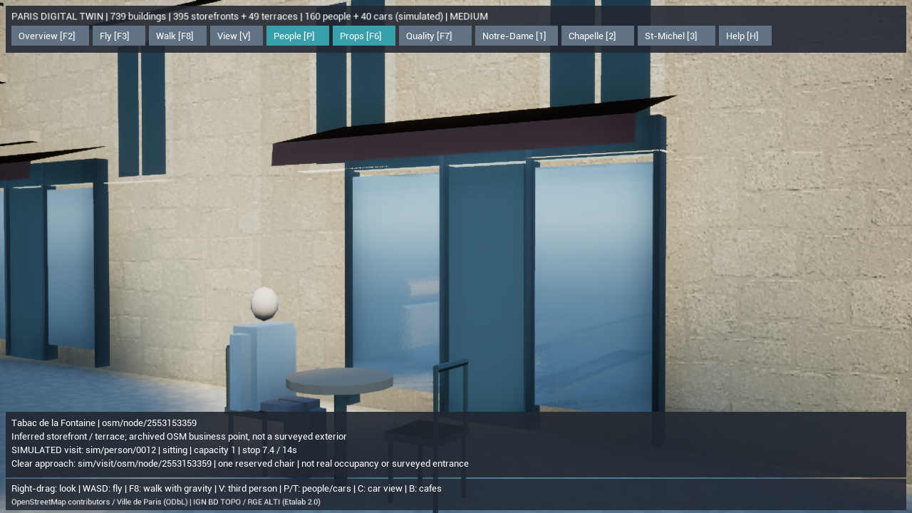
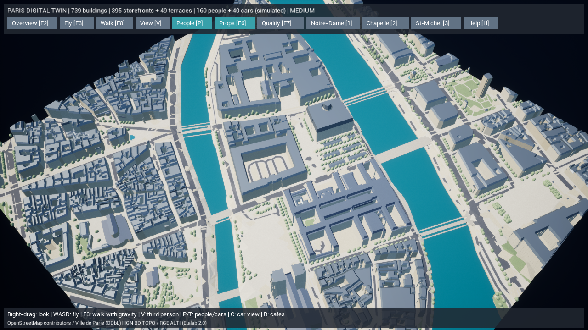

# Paris Digital Twin — カフェの着席と近くの人物との挨拶

安全な歩行経路網を使った訪問に、椅子の予約・着席・立ち上がりと短い挨拶を追加しました。変更前は `backup/pre-paris-seating-20261015` に保存しています。

## 実装内容

実データ地区の38か所の訪問先に、既存の立ち寄り位置から椅子への専用経路を生成します。1店舗につき1人分を予約し、最短往復の計画に椅子までの距離も含めます。基本の休憩は10〜18秒で、挨拶中は滞在を延長します。その後、立ち上がって来た経路を戻り、出発位置から巡回を再開します。通行人やプレイヤーに塞がれた場合の中止、期限、予約解放、再選択待ちを維持しています。

椅子までの経路は最大6m。地形・歩道の高さと勾配を検査し、建物・水面・車道・街路設備・他店のテラス・テーブル・反対側の椅子・背もたれを避けます。選んだ椅子の座面は、座る動作で入る専用領域として扱います。一般の歩行経路は今までどおりテラスを避け、椅子の経路を公共の経路網や近道に混ぜません。接続できない場合は従来の立ったままの訪問を残します。

人物は48cmの座面に合わせて腰を下げ、膝とすねを分けた8部位の姿勢へ移行します。立ち上がりを終えてから帰路へ進みます。座っている人物には座位の遠距離モデルを使用し、距離を離した際に立った姿へ戻らないようにします。通常の歩行は既存の6部位と遠距離の1部位モデルを使います。

近くの人物が休んでいる場合、125〜280cm以内、地面の高低差40cm以内、視線を遮る物がない条件で2.5秒の挨拶を交わします。相手を1人ずつ対応付け、短く手を動かし、終了後は25秒待ってから次の交流を選びます。通行中の2人が次々に立ち止まる動作は避け、帰還中や接近の最後の区間では交流を始めません。フランス語の短い定型句を使い、外部LLMは呼びません。

人物と店をクリックすると、実際の着席・予約・交流相手・残り時間と最近の履歴が更新されます。大きな常設メニューは増やしていません。

既存の739棟、道路・川・橋、395店先・49テラス、160人・40台、EPSG:2154と共通NGF原点を維持しています。既存のWeb版・住民AI・保存・Docker設定・未追跡の `DefaultInput.ini` は変更していません。

## 実行と検証

`Paris-DigitalTwin.cmd` で起動します。**Bでカフェ、人物や店をクリックして状態確認、Nで経路、F8で散策、Vで視点、F2で全景**。

```powershell
$env:PYTHONPATH=Join-Path (Get-Location) 'gis'
.\gis\.venv\Scripts\python.exe -m paris_twin prepare --offline
.\gis\.venv\Scripts\python.exe -m paris_twin validate --offline
.\gis\.venv\Scripts\python.exe -m unittest discover -s gis/tests -v
.\unreal\scripts\Build-AIWorldUE.ps1 -SkipAssets
.\unreal\scripts\Test-ParisDigitalTwin.ps1
.\unreal\scripts\Test-ParisDigitalTwin.ps1 -LegacyJSON
.\unreal\scripts\Test-ParisWalkingLongRun.ps1 -ReportPath docs/paris-twin-phase7-seating-long-run.json
.\unreal\scripts\Measure-ParisDigitalTwin.ps1 -View Cafe -Duration 40 -CaptureAfter 14
.\unreal\scripts\Measure-ParisDigitalTwin.ps1 -View Seating -Duration 20 -CaptureAfter 10
.\unreal\scripts\Measure-ParisDigitalTwin.ps1 -View Overview
```

- Python **57テスト成功、312.623秒**。障害物・道路・水面・他店のテラスによる着席不可、立ち寄りへの代替、専用経路の接続・追跡・決定性、座位の遠距離メッシュを検証。実地区を2回生成しSHA-256の一致と全体検証エラー0を確認しました。
- UE **11テスト成功 × 軽量／従来JSONの両形式**。着席・立ち上がり・帰還・予約解放、地面の座標の連続性、近距離交流の終了と巡回再開、壁越しの交流禁止、専用経路を公共経路として読む不正データの拒否、および既存の散策・車両・表示・選択を検証しました。
- UE 5.8.3 Development Editorのビルド成功。初回の型チェックエラー2点は修正し、最終ビルドは30.56秒。未実行のパッケージ版ビルドを成功扱いにしていません。
- 地理検証 **エラー0、既存の警告4件**。38本の椅子への専用経路は最長1.785m、最大勾配0.111。車道・建物・水面との交差長0m、最小車道距離2.039m、テーブル中心との最小距離0.72mでした。これらは生成した簡易形状に対する検査値で、測量精度ではありません。
- 全1,906経路のうち38本が椅子への専用経路。公共の経路網は2,978ノード・3,467辺のままです。遠距離座位モデル等を含む人物モデルは16種。
- 長時間QAは **13,778 AIステップ以上・688.9シミュレーション秒以上**。160人が着席321回、挨拶48回開始・48回終了、別道路からの訪問69往復・全体302往復を完了。混雑による中止帰還192回も記録し、進路を塞がれた訪問を毎回成功扱いにしていません。固定deltaのNullRHIテストであり、描画性能の測定値には使いません。
- Dockerは基本構成とUnreal用の重ね合わせ構成の `config --quiet` 成功。コンテナの再構築やiPhoneでの実機動作は今回実行していません。

証跡: [テスト結果](paris-twin-phase7-seating-tests.txt)、[全体検証](paris-twin-phase7-seating-validation.json)、[専用経路の独立検査](paris-twin-phase7-seating-clearance.json)、[長時間QA](paris-twin-phase7-seating-long-run.json)。

生成シーンSHA-256: `9644c5720473b2747ff7043601c33eec4071bd201ed8a99213768aaab7b28acf`。

### 描画性能と実画面

AMD Radeon内蔵GPU / Ryzen 7 7735HS / 利用可能RAM 28.8GB、UE 5.8.3 Development Editorの `-game -dx11 -RenderOffscreen`、1280×720、中品質、画面解像度倍率80%、影あり、VSync・FPS上限なし。最初の5秒をウォームアップとして除外しています。

| 視点 | 計測秒数 | 平均fps | フレーム時間P95 | 読み込みms | プロセス物理メモリMiB |
| --- | ---: | ---: | ---: | ---: | ---: |
| カフェ | 40 | 121.50 | 9.70 | 1,328.71 | 2,971.41 |
| 着席中の店の確認ビュー | 20 | 95.35 | 14.03 | 1,399.11 | 2,948.45 |
| 全景 | 20 | 75.42 | 15.12 | 1,312.08 | 2,932.05 |

今回の3視点では平均60fpsとP95 16.67ms以内を満たしました。ただし全フレームの60fps維持、4K、高品質、DX12/Lumen/Nanite、パッケージ版、別GPU・iPhoneでの達成を確認したものではありません。前回とは人物の行動・時刻が異なるため、前回との数値差を今回の機能による高速化とは判定していません。

静的メッシュは441コンポーネント・1,035,432三角形、HISMは19モデル・5,607インスタンスを維持。読み込んだ軽量JSON＋メッシュバイナリは88,997,409バイト。人物の追加モデルと経路のメタデータだけ増えています。パリ全体のストリーミングは未実装です。

[カフェ計測](paris-twin-phase7-seating-cafe-performance.json) / [着席確認の計測](paris-twin-phase7-seating-seating-performance.json) / [全景計測](paris-twin-phase7-seating-overview-performance.json)。カフェ計測では着席34回と挨拶5回の終了を記録しました。撮影時は選択した店への移動中で、空席が写っています。

確認用の `-View Seating -CaptureAfter 10` は、10秒経過後に実際に着席している人物がいる店へカメラを移し、0.2秒待って撮影します。人物を移動させたり、着席を強制したりしません。このため通常のカフェ視点とは撮影場所が異なります。





屋根・外壁・人物は引き続き簡易モデルです。写真品質へ仕上げた画面ではありません。

## 変更ファイル

| 対象 | ファイル |
| --- | --- |
| 椅子への専用経路と検証 | 新規 `gis/paris_twin/seating.py`、更新 `mesh.py`, `pedestrians.py`, `navigation.py`, `validate.py` |
| 姿勢・予約・往復・状態表示 | `ParisPedestrians.h`, `.cpp`, `ParisNavigation.cpp`, `ParisDigitalTwin.cpp` |
| 近距離の挨拶 | 新規 `ParisSocial.cpp` |
| テスト | 新規 `test_seating.py`, `ParisSeatingTests.cpp`、更新 `test_pedestrians.py`, `ParisWalkingTests.cpp`, `Test-ParisDigitalTwin.ps1` |
| 計測・案内 | `Measure-ParisDigitalTwin.ps1`, `Test-ParisWalkingLongRun.ps1`、README類、この報告 |

## 制限と次の実装

人物、椅子と外観、訪問・挨拶は推定シミュレーションです。地図の店舗IDとの対応は保持しますが、実際の客数・営業・店舗の座席配置を再現したものではありません。座り動作は分割した簡易モデルによる補間で、手足の接地IKやモーションキャプチャ、表情・音声は未実装です。実測のランドマーク外装やL3〜L5の詳細再現を完成扱いにしません。

今後必要なアセットは、歩行・着席・挨拶に対応するリグ付き人物とアニメーション、接地IK、カップなどのテーブル小物です。近景用と遠景用のLOD、PBRテクスチャ、利用・再配布条件をそろえる必要があります。現状の簡易人物にはこれらを参照させていません。

次は、建築モジュールと石灰岩・亜鉛屋根・舗装の素材を改善し、100m四方の重点範囲で見た目と描画負荷を比較します。続いてタイルの段階読み込みと、地区をまたぐ経路の接続を進めます。
