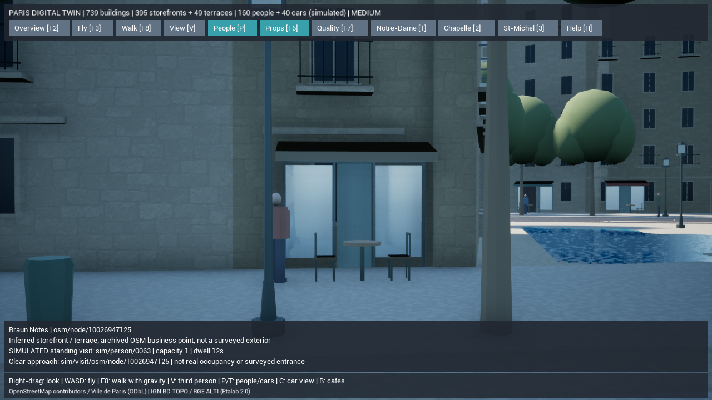
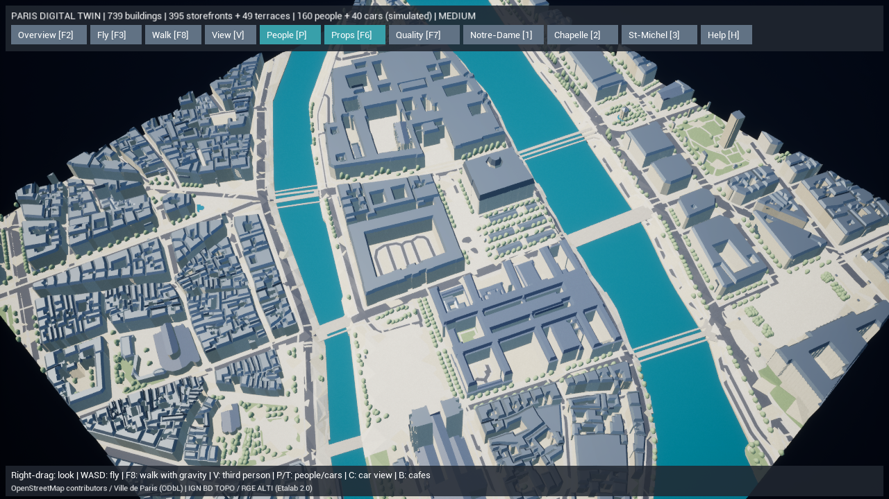

# Paris Digital Twin — カフェ訪問と歩行者LOD

Phase 6の目的地行動とPhase 7の描画負荷対策を進めました。変更前は `backup/pre-paris-visits-20261015` で保全しています。

## 実装済み

### 安全な店先への立ち寄り

実データの建物739棟・道路・河川、395店先・49テラスと共通の座標系を維持。既存873本の歩行経路から、飲食店38か所へ接続する短い訪問経路を追加しました。全911本です。対象は配置済みテラスのある飲食店で、椅子に座らず、家具の外側に確保した点で立ち止まります。

1. 店先の側方・前方に停止候補を作り、歩行可能な面にあるか確認。
2. 既存経路との直接接続が1.25〜12mで、全区間が建物・水・道路・街路設備・テラスを除外した歩行空間に収まる場合だけ採用。
3. 接続元の高さを引き継ぎ、20cmを超える段差と30%を超える勾配を除外。
4. 元の道路ID・店舗ID、経路、接続距離、向き、滞在時間、推定であることを中間データへ保存。

歩道同士の全域経路探索や、地図にない横断歩道は追加していません。接続できない飲食店8件は理由を記録して訪問候補から除外します。残り3テラスは今回の飲食店対象に含まれません。`pedestrian-network.json` の `destinations` と `report.visits` から確認できます。

### 予約と復帰を持つ目的地行動

160人の推定歩行者のうち、接続元の経路上にいる人物が、予約可能な停止点を歩行距離に基づいて選びます。入口までの距離と往復の接続距離の合計が最短の候補を優先し、この計算結果を選択理由として表示します。

`元経路 → 接続点 → 店先 → 10〜18秒滞在 → 接続経路を逆行 → 元経路へ復帰` の順に実行。各停止点は1人分で、同一ステップ内の予約も競合しません。店舗の方を向いて滞在します。訪問後は30〜46秒の再選択クールダウンを設けます。

通行人やプレイヤーに進路を塞がれた場合、接続点へ向かう段階では中止し、接続経路上では来た道を戻ります。90秒の行動期限と100秒の予約期限を設け、戻り道が塞がれてもワープせず、永久に停止枠を確保し続けません。近接回避と経路上への拘束を継続します。

人物をクリックすると、目標の店舗・行動段階・実際の選択距離・滞在残り時間・最近の行動を確認できます。履歴は人物ごとに直近4件を保持し、画面には直近2件を表示。店舗のクリックでは停止枠と予約者を確認できます。Bは訪問経路のあるカフェを優先して移動します。

検査欄はクリックまたはB実行時点のスナップショットです。動き続ける人物や予約をもう一度選択すると、その時点の情報へ更新します。

人数、移動、立ち寄り、滞在時間、停止位置、利用状況はすべてシミュレーションです。実在店舗の現在の客数、営業状況、入口、椅子配置を再現したものではありません。店舗点の緯度経度は取得済みOSMの元位置を維持します。外部LLM/APIや新規有料素材は使っていません。

### 遠距離の人物モデル

近くでは6部位を動かす既存の歩行アニメーションを継続。遠くでは同じ寸法・服と肌の頂点色を持つ統合モデル1体へ切り替え、部位ごとの毎回の変換更新と遠距離人物の影を省きます。位置、向き、行動、クリック時の人物IDは保持します。

| 品質 | 近距離アニメーション範囲 | 既存の人物表示距離・人数上限 |
| --- | --- | --- |
| 低 | 約25m | 100m / 80人 |
| 中 | 約40m | 200m / 160人 |
| 高 | 約60m | 350m / 160人 |

境界に前後2mのヒステリシスを設け、往復による切り替えの連発を避けます。人数や思考を削除する処理ではありません。遠距離モデルは足を振らずに移動するため、近づけば関節モデルへ戻ります。比較用の `-ParisTwinFullPeople` または計測スクリプトの `-FullPeople` で従来の全身部位表示を選べます。

## 変更ファイル

| 対象 | ファイル |
| --- | --- |
| 訪問経路と追跡・検証 | 新規 `gis/paris_twin/visits.py`、更新 `mesh.py`, `validate.py` |
| 遠距離の頂点色付き統合モデル | `gis/paris_twin/pedestrians.py`, `ParisStreetMeshes.cpp` |
| 予約・移動・滞在・復帰・履歴・LOD | `ParisPedestrians.h`, `.cpp` |
| 店舗選択・視点・計測値 | `ParisDigitalTwin.cpp` |
| テスト | 新規 `test_visits.py`, `ParisVisitTests.cpp`、更新 `test_pedestrians.py`, `test_pipeline.py`, `ParisWalkingTests.cpp` |
| 起動・検証 | `Test-ParisDigitalTwin.ps1`, `Measure-ParisDigitalTwin.ps1` とREADME類 |

Web版の住民AI・保存・Docker構成、既存の未追跡 `Config/DefaultInput.ini` は変更していません。

## 実行・検証手順

`Paris-DigitalTwin.cmd` から起動し、**Bでカフェ、F8で散策、Vで一人称/三人称、F2で全景**。人物または店舗をクリックして行動・データの区別を確認します。WASD・右ドラッグ・Shiftは従来どおりです。

```powershell
$env:PYTHONPATH=Join-Path (Get-Location) 'gis'
.\gis\.venv\Scripts\python.exe -m paris_twin prepare --offline
.\gis\.venv\Scripts\python.exe -m paris_twin validate --offline
.\gis\.venv\Scripts\python.exe -m unittest discover -s gis/tests -v
.\unreal\scripts\Build-AIWorldUE.ps1 -SkipAssets
.\unreal\scripts\Test-ParisDigitalTwin.ps1
.\unreal\scripts\Test-ParisDigitalTwin.ps1 -LegacyJSON
.\unreal\scripts\Measure-ParisDigitalTwin.ps1 -View Cafe
.\unreal\scripts\Measure-ParisDigitalTwin.ps1 -View Cafe -FullPeople
```

## 実際に検証した結果

2026-10-15、このWindows PCのUE 5.8.3で実行しました。

| 検証 | 結果 |
| --- | --- |
| Python自動テスト | **47件成功、298.275秒**。実スナップショットを2回生成し、SHA-256一致・全体検証エラー0件 |
| UE C++ビルド | 成功。機能の修正ビルド161.35秒、最後のタイムアウトテスト追加19.72秒 |
| UE Live自動テスト | **軽量形式8件・従来JSON形式8件、ともに成功** |
| 実地区の歩行 | 1000ステップ進めても有限値・現在の経路上を維持。実地区で訪問と帰還が完了 |
| 予約と復帰の専用テスト | 2人の同時予約で1枠、プレイヤーによる進路妨害で中止・クールダウン、100秒超の戻り道妨害で予約解除、解除後に帰還 |
| 人物LOD | 実GPUインスタンス数が「近距離×6＋遠距離×1」と一致。遠方の非表示・再表示・選択IDと表示トグルの維持 |
| オフラインprepare | `cached=true`。全3つのUE用生成ファイルを復元・照合 |
| Docker Compose | 通常構成とUnrealオーバーレイの`config --quiet`成功。コンテナ起動・パッケージ化は今回未実行 |

生成結果のSHA-256は `a6574512aebeec5713196866fc505b4a529f7469046609aba1c69916c4c4fd7e`。道路との接続元を含む地理情報・生成コードを追跡できます。[検証ログ](paris-twin-phase7-visits-tests.txt)と[地理・メッシュ検証結果](paris-twin-phase7-visits-validation.json)に保存しました。

途中の検証で、経路端の距離を小数6桁へ丸めたことによる接続エラーの誤検知を修正。訪問用の人物配置が既存人物へ近づきすぎるケースも修正し、1.25m以上の初期間隔を実地区と専用テストで確認しています。初回のC++文字列型・変数名のコンパイルエラーも修正後に再ビルドしています。

元データの建物重複、公式軒高の十分な範囲を欠く362棟、道路網の分断、境界で切れた橋2断片についての**警告4件は残存**。今回の検証成功はこれらの地理精度を現地資料で保証するものではありません。Chaosの既存三角形診断も引き続き出ています。

### このPCでの描画計測

Ryzen 7 7735HS / AMD Radeon(TM) Graphics / 使用可能RAM約28.8GB。Development Editor `-game`、DX11、オフスクリーン出力1280×720、`r.ScreenPercentage=80`、品質「中」、影あり、VSync・FPS上限なし。5秒予熱後20秒計測。ほかのテストは終了させ、カフェでLODあり→全6部位→LODありの順に比較しました。

| 視点・設定 | 平均fps | P95フレーム時間 | 表示人物 | 人物の描画部位数 |
| --- | ---: | ---: | ---: | ---: |
| カフェ・LODあり初回 | 107.16 | 11.14ms | 41 | 61（近4・遠37） |
| カフェ・全6部位 | 107.60 | 11.16ms | 41 | 246 |
| カフェ・LODあり再測定 | 108.35 | 11.25ms | 41 | 61（近4・遠37） |
| 全景・LODあり | 65.99 | 17.81ms | 15 | 25（近2・遠13） |

カフェ視点では、表示人数を保ったまま人物の部位インスタンスを**約75.2%削減**しました。遠距離の影を省く品質変更も含む比較です。**平均fpsはほぼ同等で、FPS向上を確認したとは扱いません。** 全景の平均は60fps以上ですが、P95は16.67msを超え、毎フレーム60fpsの達成ではありません。通常ウィンドウ・低/高品質・iPhoneでは今回FPSを測っていません。

カフェの計測終了時（予熱込み約25秒）には、地区全体で29〜30件の訪問・帰還を記録。人物・車両の表示を削減してもシミュレーションは継続します。全4測定のscene SHAは同一です。[初回](paris-twin-phase7-visits-cafe-initial-performance.json)・[全6部位](paris-twin-phase7-visits-cafe-fullpeople-performance.json)・[再測定](paris-twin-phase7-visits-cafe-performance.json)・[全景](paris-twin-phase7-visits-overview-performance.json)に実測値を保存しました。

Bのカフェ目線と全景の実レンダリングを取得し、店先の脇に立つ人物、既存の道路・川・建物配置の維持、近景と背景の人物の色を目視しました。NPCは汎用モデルで、椅子は空席のままです。現地写真に一致する店舗・人物の外観を検証したものではありません。





## 未実装と次の段階

椅子への着席、飲食・会話の専用アニメーション、全域の歩行経路接続、信号と交差点の交通制御、訪問途中の保存・復元は未実装。Parisプレビューの人物は従来どおり起動時に生成します。次は横断箇所を根拠付きで接続する経路網と、骨格付き人物・着席動作、店舗の利用可能地点の精度を進めます。

フォトリアル化には、現地資料に対応した建築・彫刻・外壁素材、骨格付き人物、椅子や飲食用の小物とアニメーションが引き続き必要です。今回の汎用モデルで建物全体をL3〜L5と扱いません。World Partition/HLOD、非同期の地区読み込み、iPhone・パッケージ版での検証は未完了です。既存の元データ重複・道路の分断・境界橋の要確認箇所とChaos三角形診断も残しています。
