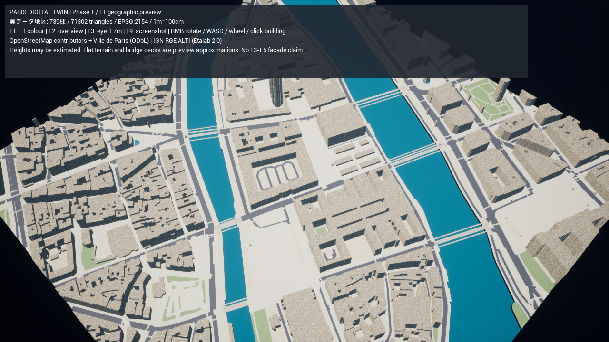
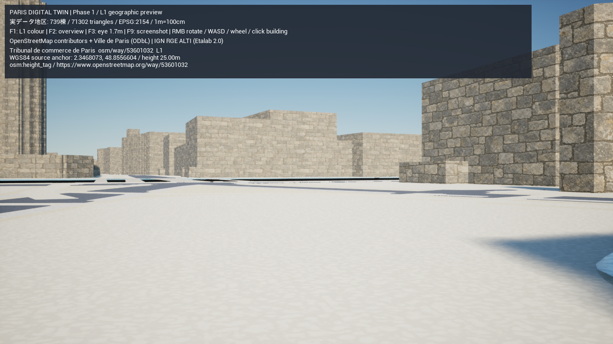

# PROJECT PARIS DIGITAL TWIN — Phase 0 / 1

最新の実装と検証結果は [歩行経路網と別の通りへの訪問](paris-digital-twin-phase7-navigation.md) を参照してください。[カフェ訪問と歩行者LOD](paris-digital-twin-phase7-visits.md)、[店舗・カフェと軽量読み込み](paris-digital-twin-phase7-cafes.md)、[車両・街路設備・表示予算](paris-digital-twin-phase67.md)、[Phase 6・散策と歩行者](paris-digital-twin-phase6.md)、[Phase 5続き・Phase 6静的設備](paris-digital-twin-phase56.md)、[Phase 4・5基盤](paris-digital-twin-phase45.md)、[Phase 3報告書](paris-digital-twin-phase3.md)、[Phase 2報告書](paris-digital-twin-phase2.md) と以下は各段階の完了時の記録です。

旧箱庭と独立した実地理モードを追加しました。都市配置はOSMの実輪郭・道路中心線・セーヌ川ポリゴンから生成します。現時点のUE表示は地理とデータ契約を検証するL1の簡易柱状メッシュで、写真品質の完成品ではありません。

## Phase 0: 調査と保全

既存C++/Blueprint、生成方式、アセット、プラグイン、Python、UE 5.8.3、ビルド・起動、GPU・RAMを調査。変更前のGitタグと未追跡設定のバックアップを作成しました。詳細は[技術調査](paris-digital-twin-phase0.md)。旧村を `AIWorld-Unreal.cmd` で起動する経路とSQLiteを保持しています。

## Phase 1: 実データの取得

原点はWGS84 `(lon=2.3471, lat=48.8547)`。500m×500mの中核に150mの周辺範囲を付けた800m×800mを取得しました。これはノートルダムの全輪郭、サント・シャペルとサン・ミシェル広場を同じ画面で確認するためです。100mの重点確認枠はサン・ミシェル側に設定。

| 取得・正規化データ | 件数 |
| --- | --- |
| 建物輪郭 | 739 |
| 道路・歩行者道路のway | 1627 |
| セーヌ川のmultipolygon / 水盤・噴水 | 1 / 3 |
| 公園 / 広場・面状歩行空間 | 16 / 188 |
| Paris Data建物volume | 2151 |
| IGN標高点 | 121（80m間隔） |

Overpassの2つのサーバーはタイムアウトしました。OSM公式map APIと必要なrelation/full APIで取得し、元のXMLを圧縮保管。Paris Dataは空間条件＋全ページ取得、IGNはRGE ALTI APIを使用。Raw manifestに各URL、ライセンス、取得日時、SHA-256を記録しています。

出典は[OSM/ODbL](https://www.openstreetmap.org/copyright)、[Paris Volumes bâtis](https://opendata.paris.fr/explore/dataset/volumesbatisparis/)、[IGNの標高計算API](https://cartes.gouv.fr/aide/fr/guides-utilisateur/utiliser-les-services-de-la-geoplateforme/calcul-altimetrique/)。Parisの取得時metadataはODbLを指定しています。[公式の属性説明PDF](https://opendata.paris.fr/api/explore/v2.0/catalog/datasets/volumesbatisparis/attachments/volumes_batis_paris_pdf)でh_et_maxの階数という意味を確認しました。詳しいデータ条件は[Data README](../gis/Data/README.md)。

## 簡易UE表示

Pythonで不正形状を修復し、中庭・河川の穴を保持して三角形化。建物の実輪郭を柱状に生成し、道路幅属性または推定幅から面を生成します。交差点はbufferのunion、道路面は建物輪郭から切り抜き、川にかかるbridge-tagのwayを別のデッキとして表示します。データは `paris_twin_scene_v1` の独立形式です。cmで出力済みなのでボクセルの座標変換を重ねません。

OSMのheightタグ18棟は宣言値・未検証、721棟は階数/Paris階数/既定値による推定です。全739棟について検証済み実測メートル高がないことを明記し、L2に昇格させません。Notre-Dameのsource heightタグ10.5mやSainte-Chapelleの75mを柱へ適用したプレビューは、塔や尖塔を含む実ボリュームの再現を意味しません。実際の外観はPhase 3以降で別資料を照合します。

## 起動・再生成・検証

`Paris-DigitalTwin.cmd` をダブルクリックすると、保存済みRawから生成・検証してGISモードを起動します。Docker・LLM・地理APIへの常時接続は不要です。Python依存を初めて導入する場合はパッケージ配布元への接続が必要です。

```powershell
# ビルドする場合（初回）
.\unreal\scripts\Build-AIWorldUE.ps1 -SkipAssets
# 通常の起動
.\unreal\scripts\Start-ParisDigitalTwin.ps1
# 人間の目線1.7mでキャプチャ・20秒の実描画計測
.\unreal\scripts\Start-ParisDigitalTwin.ps1 -Eye -Capture -Benchmark 20 -ExitAfterBenchmark
# GISモードの衝突・選択・L1表示をUE上で自動検証
.\unreal\scripts\Test-ParisDigitalTwin.ps1
```

右ドラッグで回転、WASDでカメラ移動、ホイールでズーム。F1でL1の色表示、建物クリックで元ID・WGS84中心点・高さと根拠を表示。F2は全景、F3は1.7mの確認視点、F9でSaved/Screenshots/paris-twin.pngを保存。F3は検証用のカメラで、重力を伴う歩行システムではありません。

Python単体の取得・再生成、変換の相互利用、テストは[GIS README](../gis/README.md)に記載しています。オフラインHTML地図は `gis/Data/Generated/ile_de_la_cite/map.html`。建物のツールチップに元IDと高さの根拠を表示します。

## 自動検証結果と制限

GIS検証は座標変換往復、形状、source ID、元ファイル追跡、道路の共有ノードによる接続、高さ属性、橋と川、mesh indexを検査します。生成道路面と建物の重なりは0㎡。2つの建物sourceの重なりは、Palais de Justice/Cour d'assise等の重ね合わせを含むため、元情報を保って要確認として記録。地下と切り出し境界、内部歩行路などの孤立成分も記録し、接続を捏造しません。最大接続成分は道路ノードの94.17%。

変換往復誤差は数値処理の誤差を意味し、OSMや地形の測量精度ではありません。IGN標高サンプルは保存済みですが、今の地面は平面であり地形補間は未実装。水面には既存の波材質を適用しますが、水位・橋桁・護岸断面はプレビューの推定で、実測水理モデルではありません。

Python 6件のテストを通過しました。座標・cm/軸の確認、中庭三角形分割、道路幅の属性、失敗したオンライン更新による旧キャッシュの保全、取得データの検証と2回再生成したバイト列の一致を確認。現在の自動検証結果は[validation JSON](paris-twin-validation.json)、依存・GEOS/PROJの実際の版は[実行環境JSON](paris-twin-environment.json)。

UE 5.8.3 Win64 Development Editorのビルドを実行して成功。UE既存側の5件（旧住民セーブ接続を含む）と、新GISモードの実Scene衝突・建物選択・WGS84表示・L1色表示の1件が成功しました。新モードはDocker・外部APIへの接続を使わず読み込めました。検証後の実描画数値と画像を以下に記録します。

## 変更ファイル

| 対象 | 主なファイル |
| --- | --- |
| GIS処理・固定依存・設定 | gis/paris_twin/{acquire,coordinates,normalize,mesh,validate,io,__main__}.py、gis/requirements.lock、gis/config/ile_de_la_cite.json |
| 取得済みRaw・出典 | gis/Data/Raw/ile_de_la_cite/、gis/Data/README.md |
| 再生成・品質検査 | gis/tests/test_pipeline.py、gis/README.md |
| UE専用GIS表示とテスト | unreal/AIWorld/Source/AIWorld/ParisDigitalTwin.{h,cpp}、ParisDigitalTwinTests.cpp |
| 起動モード分岐・配布データ | AIWorldPlayer.cpp、AIWorld.Build.cs |
| 起動・自動検証 | Paris-DigitalTwin.cmd、unreal/scripts/Start-ParisDigitalTwin.ps1、Test-ParisDigitalTwin.ps1 |
| Docker / Git除外 | .dockerignore（ホスト専用GISをNodeイメージに入れない）、.gitignore（venv・再生成できる成果物） |
| 調査・測定・スクリーンショット | docs/paris-digital-twin*.md、docs/paris-twin-*.json、docs/screenshots/paris-twin-*.png |

旧セーブ・Web都市の生成コードは今回変更していません。

## 実描画・写真との比較

DX11の実ゲーム画面を撮影しました。全景は739棟・760メッシュコンポーネント・71,302三角形。1280×720で20秒を計測し、平均27.4fps、P95 43.2msでした。[実測JSON](paris-twin-overview-performance.json)。目標60fpsには届いていません。



1.7mの確認視点は平均127.3fps、P95 9.54ms（1280×720、20秒）でした。歩行の重力やキャラクターは未実装です。[目線視点の実測JSON](paris-twin-eye-performance.json)。全景と可視範囲が違うので、FPSの差を品質設定だけの差とは扱いません。



影なしの試行は26.1fpsでしたが、旧版の757コンポーネントでの計測です。[試行JSON](paris-twin-no-shadows-performance.json)。影を切るだけで改善したという結果にはなっていません。760コンポーネントの描画準備、統合GPUの広い可視範囲、メモリ圧迫が候補ですが、CPU/GPUタイミングの詳細計測がないため主原因を断定しません。次の最適化は描画メッシュの地区単位の統合と可視範囲を優先し、source IDによる選択は保持します。

参考は[Ville de Parisの現地写真](https://www.paris.fr/pages/1-lieu-3-histoires-la-fontaine-saint-michel-35340)（Ludivine Boizard / Ville de Paris）をブラウザーで確認しました。写真をテクスチャやモデルとして流用していません。

| 見比べた要素 | この段階の判定 |
| --- | --- |
| 街区・道路の位置 | GISの元輪郭とsource IDで確認。写真と同じ位置・画角での定量校正は未実施 |
| 彫刻・柱・丸い装飾・マーブル | 参考写真には存在。今回の柱状メッシュにはなく、L4再現には専用モデルが必要 |
| 窓・入口・屋根・街路樹 | 未生成。石テクスチャを貼った壁がファサードの再現とはならない |
| 街のスケール | cm座標と1.7mの視点を検証。重力つき散策の体感確認はPhase 6で行う |

フォトリアル品質やL3〜L5は未達です。ここで完成したのは、実地理に基づく配置と、次段階の実高さ・外観を差し込めるデータ生成・検証・UE描画の経路です。

## 次Phase

Phase 2: 道路の孤立成分と元ポリゴンの重なりを地図で精査。クリック位置の地理座標と隣接地区の共通原点を拡張。

Phase 3: Paris volumeごとの階数と別の実測メートル高を照合し、複数高さの棟・屋根を生成。L2の根拠を記録。教会の高さタグを均一な壁高にするプレビューから置き換える。

Phase 4–5: 細かなDEM地形、橋・護岸・歩道の断面、屋根・ファサードPBRモジュール、現地写真との照合。Phase 6で家具・歩行者・歩行/衝突/重力、Phase 7でStaticMeshタイル・World Partition/HLOD・広域接続を実装。

Gitに保存する17個のRawファイルは、インデックスから読み戻したバイト列のSHA-256がmanifestとすべて一致しました。.gitattributesでRawを-text扱いにし、clone時の改行変換を防いでいます。
