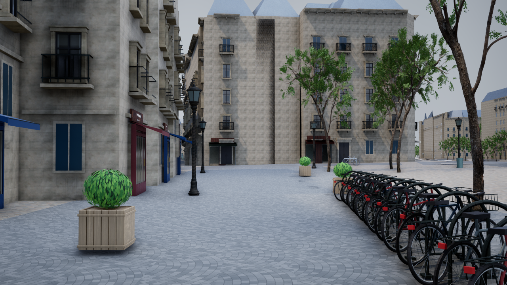

# 店先と駐輪列のあるパリの通り

2026-11-08。参照写真の、扇状の石畳・落ち着いた青い庇・店先のガラス・自転車の列・木製プランター・柔らかな昼光を取り入れた追加表示。

`Paris-Lane.cmd` でビュシュリー通りから起動。従来の `Paris-Reference.cmd` とお祭り・散策モードも保持する。`F8` 散策、`F3` 飛行、`F6` 小物、`G` 昼／夕／夜、`R` 雨、`8` 地図、`F10` HUD。

対象は既存のOpenStreetMapスナップショットの `osm/way/40067719`（Rue de la Bûcherie）。`surface=sett` の登録を使用。扇形の敷設模様、店舗の意匠、駐輪台数と配置、植木鉢は参照写真に合わせた推定であり、写真の場所そのものや現地の実物を再現したという扱いにはしない。

## 追加内容

- 4種類の車体・傾き、タイヤ・リム・スポーク・キャリア・一部にかごを持つ駐輪自転車15台と黒いラック15基。
- 青・緑・ワイン色の庇と塗装枠、奥行きのあるガラス表現を持つ5店舗分の店先。対象店舗の元の簡易庇と窓は二重表示を避ける。
- 木のスラット、金具、土、密な葉を持つプランター3基。
- 10～12cm程度の石を想定した扇形の目地、浅い凹凸、色・粗さの変化。既存の道路・歩道・地面に位置を合わせ、雨のWetnessへ連動するPBR素材を使用。
- 乾いた昼は明るい曇天を想定した柔らかな光。夜・雨の既存の切替は保持。

元のGIS座標、建物・道路形状、高さ、道路の衝突判定を維持。新しい自転車・植木鉢には別の衝突箱を設定し、F6や再現度表示で隠れたときは無効にする。小物をクリックすると推定配置である旨と元データID・座標を表示する。

配置は元の道路中心線の幅2.1mの通行帯を避け、既存歩行者経路から55cmの余白も確保。実際の道路幅は元データで推定値として扱われている。

## 再生成と検証

UEを閉じてプロジェクト直下で実行する。

```powershell
.\unreal\scripts\Build-ParisLane.ps1
.\unreal\scripts\Test-ParisLane.ps1
.\unreal\scripts\Capture-ParisLane.ps1 -View Before
.\unreal\scripts\Capture-ParisLane.ps1 -View After
.\unreal\scripts\Capture-ParisLane.ps1 -View Night
.\unreal\scripts\Capture-ParisLane.ps1 -View Rain
```

C++変更後は先に既存のUEビルド手順で `AIWorldEditor Win64 Development` をビルドする。中間データは `unreal/assets/paris-lane/Generated/lane.json`、UE用は `unreal/AIWorld/Content/Data/paris-lane.json`。元の `paris-reference.json` と元のGISデータは更新しない。

主な変更：`generate_paris_lane.py`、`bake-paris-lane.py`、`ParisReference.cpp/.h`、`ParisLaneTests.cpp`、`ParisDigitalTwin.cpp`、`ParisGroundDisplay.cpp`、`ParisSurfaceMaterials.cpp`、起動・ビルド・撮影・検証スクリプト。

実行結果と実画像は `paris-lane-validation.json` および `paris-lane-*.png` に記録する。キャプチャ画像はUEの実描画を直接保存し、加工しない。比較では人物・交通を止め、通常の起動では有効にする。

実行済み：UE 5.8のC++ビルドとアセット保存が成功。Python 5件、従来機能・参照表示12件、追加表示1件のUE自動検証が成功。元のGISメッシュのSHA-256は変更前の記録と一致し、追加データの再生成でも同じ結果になった。

1280×720・High・描画100%での実測は、追加前27.03fps、追加後27.21fps、雨26.29fps、夜26.55fps。60fpsは未達。通常起動はMedium・80%・人物／交通ありで条件が異なる。



[追加前](paris-lane-before.png)・[雨](paris-lane-rain.png)・[夜](paris-lane-night.png)。

## 出典と残る作業

地理情報：[© OpenStreetMap contributors](https://www.openstreetmap.org/copyright)、既存のParis Open Data・IGNの記録を継続使用。建物・樹木・素材の出典は [既存の参照表示](paris-reference-look.md) を参照。小物と扇状舗装の模様は本プロジェクトの手続き生成で、参照写真をテクスチャとして使用していない。

写真と同等の密度には、建物ごとの店先・細い装飾・汚れ、屋根の個別形状、さらに多様な樹木や自転車の実物モデルが必要。河岸の既存DTMの勾配など、元の地理データの警告も残る。60fps達成とはしない。

次は重点区間の個別店舗と壁の細部・局所的な汚れを改善し、GPU計測に合わせて樹木の影と描画距離の予算を調整する。変更前バックアップは `backups/current-lane-backup.txt` に記録したフォルダー。
