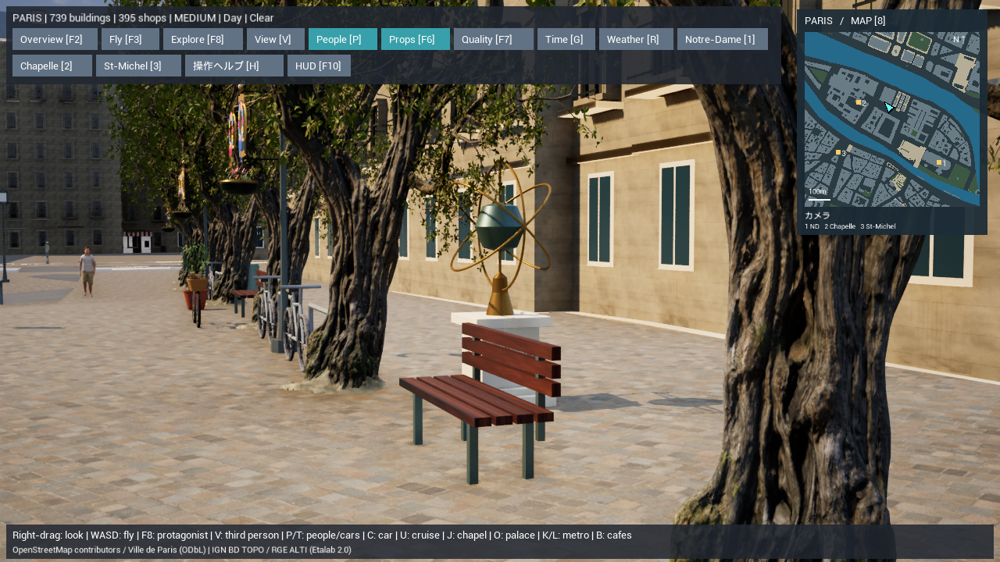

# 華やかな街角の小物と吊り飾り v10

`Paris-More-Objects.cmd`で、追加した小物が見える地上視点から起動する。`F8`で散策、`7`で地区巡回、`8`でミニマップ、`G`で昼夕夜、`F6`で街路の小物を切り替える。

## 追加内容

前回の店先260か所とパラソル17か所に加え、地上の小物を325組追加した。

| 種類 | 組数 |
|---|---:|
| 鉢植えの低木 | 166 |
| カフェのサービスワゴン | 68 |
| ワイン樽とボトル | 44 |
| 花かご付き自転車 | 22 |
| パンの陳列台 | 18 |
| 天球儀をイメージした装飾彫刻 | 7 |

さらに、既存の街灯310本に2つずつ、計620個の花輪とリボンを追加した。夜は金色の縁が発光する。追加の実ライトは作らず、既存の照明枠を使う。

これらは店舗や街路設備の位置を基準にした推定の装飾。現地に実在する商品台・自転車・彫刻・イベントを測量したものではない。元の店舗・街路設備IDと配置地点の緯度経度を保存し、地上の物をクリックすると推定配置であることと座標を確認できる。

地上の追加物は建物・川・道路・橋・入口・既存の小物と歩行経路を避け、歩道や歩行者道に支持される位置へ置く。吊り飾りは十分な高さを確保し、衝突判定を付けない。地上の追加物は実寸に合わせた衝突の箱を持ち、F6で隠すと衝突も解除する。

共有モデルを12種類増やし、全89種類をインスタンス描画する。既存77モデル、全配置と巡回カメラ、汚れとミニマップのデータを保持する。追加した確認用視点は、地区の中心寄りにある地上170cmの歩ける場所から、吊り花と小物が一緒に見えるように選ぶ。

## 再生成と確認

プレビューを閉じて実行する。

```powershell
./unreal/scripts/Build-AIWorldUE.ps1
./unreal/scripts/Build-ParisLuxury.ps1
./gis/.venv/Scripts/python.exe -m unittest discover -s unreal/scripts/tests -p test_paris_luxury.py
./unreal/scripts/Test-ParisLuxury.ps1
./unreal/scripts/Capture-ParisExtraObjects.ps1 -View After
./unreal/scripts/Capture-ParisExtraObjects.ps1 -View Before
./unreal/scripts/Capture-ParisExtraObjects.ps1 -View Night
```

`Before`は今回追加した小物・吊り飾りだけを隠し、前回までの状態と同じカメラで比較する。

主な変更は`generate_paris_extra_objects.py`、`generate_paris_luxury.py`、`ParisLuxury.cpp`、起動・撮影・検証スクリプト、生成済みJSONとモデル。変更前は`backups/paris-before-extra-objects-20261107-145107`へ保存した。

## 確認結果

C++ビルド、Pythonの13件、確認用カメラ1件、吊り飾り追加後の4件の確認が成功。形状、座標追跡、既存配置の保持、歩道・歩行経路との整合、吊り飾りの高さ、同じ入力からの生成一致を確認した。UEの11件も成功。新しい地上の物の衝突、F6で隠した際の衝突解除、雨・夜景・汚れ・ミニマップを確認した。中心寄りの確認用視点も再検証した。

[追加前](paris-extra-objects-before.png)と[追加後](paris-extra-objects-after.png)を同じカメラで比較し、彫刻・自転車・鉢植え・吊り飾りを目視確認した。[雨の夜](paris-extra-objects-night.png)では金色の花輪の発光を確認した。画像は加工していない。全3画面で材料のコンパイルエラーはない。

AMD Radeon内蔵GPU、1280×720、中設定、画面解像度80%で測定した。

| 視点 | 平均fps | 95%フレーム時間 |
|---|---:|---:|
| 追加前・昼 | 38.10 | 29.23ms |
| 追加後・昼 | 37.17 | 29.76ms |
| 追加後・雨の夜 | 34.63 | 31.65ms |

目標60fpsは未達。[機械可読の検証記録](paris-extra-objects-validation.json)。




## 今後

小物は静的な装飾。店員の接客、商品の購入、天球儀の操作、営業時間に合わせた出し入れは未実装。今後は店先に人が立ち寄る行動と、近景の素材・細部を充実させる。
