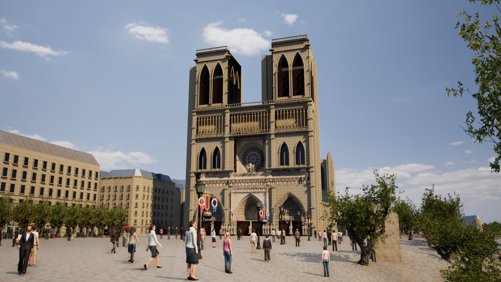
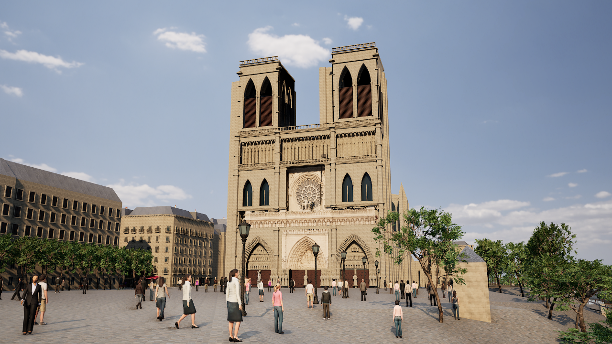
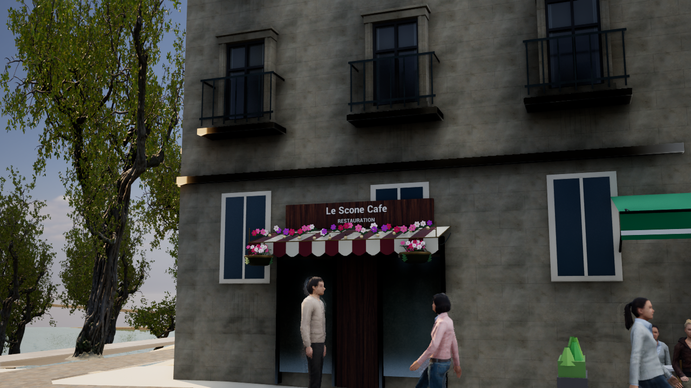
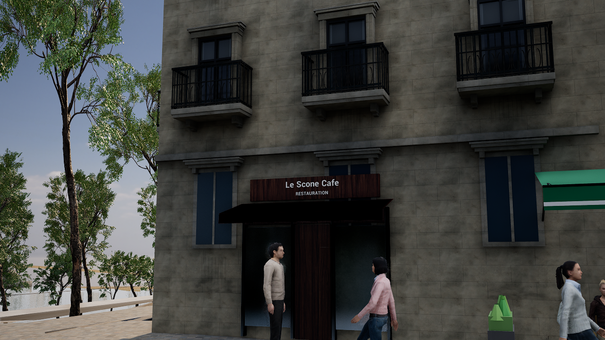
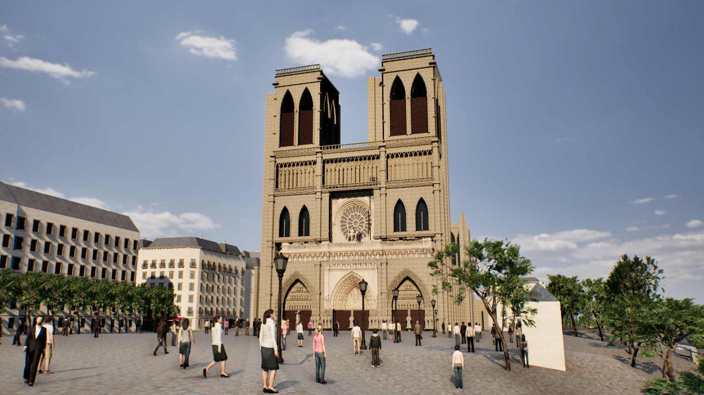
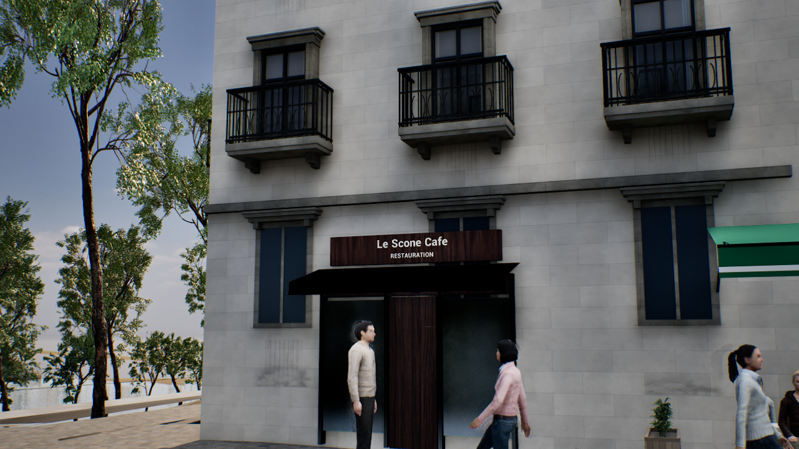
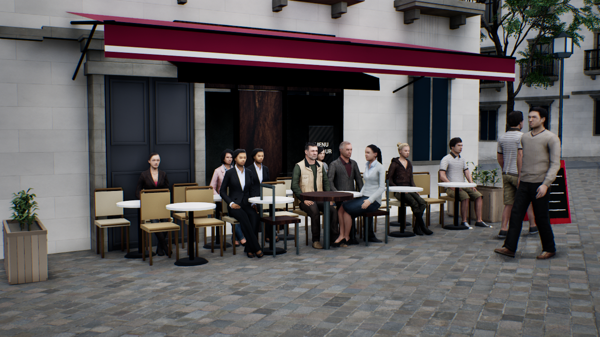

# 写真モードの画質向上

## 変更点

- **写真調の見た目を既定にした:** 写真モード（`-Photoreal` 系の起動）では、`-ParisTwinPhotoLook` を自動で付ける。
  - これまでセーヌの視点（`-ParisTwinSeine`）でしか使っていなかった見た目を、どの視点でも使う。暖かい石灰岩の外壁、亜鉛とスレートの屋根、川岸と並木、写真調の照明と色調整が入る。
  - 起動時の視点は動かさない。
  - `Start-ParisDigitalTwin.ps1 -NoPhotoLook` で従来の見た目に戻せる。
- **描画設定を上げた（`Config/Custom/ParisPhotoreal/DefaultEngine.ini`）:**
  - アンチエイリアスを TSR（Temporal Super Resolution）にし、軽いシャープ化をかけた。
  - 接触影を有効にした。
  - Lumen でメッシュ単位の距離場トレースを有効にし、外壁の細部の陰影を出した。
  - Lumen の反射を、やや粗い面まで追跡するようにした。

## 比較（1280×720、画面解像度100%、高画質、同じ視点）

| 視点 | 変更前 | 変更後 |
| --- | --- | --- |
| ノートルダム正面 |  |  |
| 通り |  |  |

撮影環境（AMD 内蔵 GPU）でのフレームレート:

- ノートルダム正面: 31.5 fps → 21〜22 fps
- 通り: 34.5 fps → 27.9 fps

通常起動は画面解像度80%なので、これより少し軽い。

## 第2段: 映像の仕上げと石の色

- **外壁の石:** 写真調の見た目の石灰岩（`M_ParisSeineStone`、`bake-paris-seine.py`）を、パリらしい明るいクリーム色に寄せた。各テクセルの明暗（目地や汚れ）は保つ。
- **映像の仕上げ（`ParisReference.cpp` の写真調の色調整）:**
  - ローカル露出で、空と影の明暗差を写真のように圧縮した。
  - ごく弱いレンズの色にじみと、細かなフィルム粒子を加えた。
  - ブルームを少し強めた。
- **フレームレート（高画質・解像度100%・撮影環境）:** 通り 27.5 fps、ノートルダム正面 20.7 fps、テラス 23.4 fps。

| ノートルダム正面 | 通り | テラス |
| --- | --- | --- |
|  |  |  |
