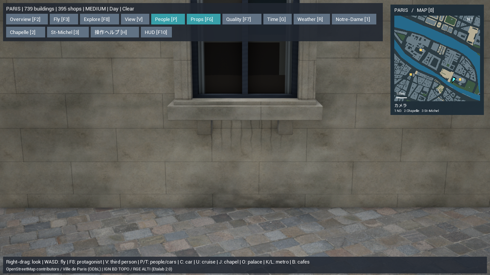

# 道路・壁の汚れと右上のミニマップ

既存の写真由来の石材・舗装、雨、夜景、派手モードを維持し、場所に合わせた汚れと軽量な地図を追加する。

## 変更内容

既存の460か所の雨筋と97か所の壁下汚れを保持し、地区全体に窓下の雨筋19,923か所、地形の高さに合わせた壁下汚れ6,074か所、道路端の土埃・煤の汚れ603か所を追加した。窓の開口を覆わず、道路の汚れは建物・川・橋を避け、実際の表示路面から0.35cm上に置く。外観は推定であり、汚れを現地で実測したものではない。

汚れの強さと形は地物IDから決め、境界をぼかした不規則な濃淡を使う。既存の地形・衝突判定・元の写真材質には手を加えない。追加レイヤーに衝突・影・ナビゲーションへの影響はなく、200mごとの74メッシュへ分割して300mで距離制限する。低画質、Mキーの簡易表面表示、GISの再現レベル・問題・輪郭表示では汚れを隠す。

右上のミニマップは取得済みGISデータから生成した7,687三角形の2D地図。川・道路・建物・公園を描き、中庭の穴を保持する。青い矢印が現在地と視線方向、金色の1／2／3がノートルダム／サント・シャペル／サン・ミシェル。上がLambert-93のグリッド北、縮尺は100m。歩行中は主人公、固定写真視点ではカメラ位置、俯瞰では注視点を表示する。範囲外は矢印を地図端へ寄せ、範囲外と表示する。

`8`で地図、`F10`でHUD全体を切り替える。地図は3Dカメラや別の地理変換を使わず、EPSG:2154の共通原点とUEのcm座標を使う。上部メニューは地図の左へ収め、地図上のクリックを建物選択へ通さない。地図データはオフラインで生成し、ネットワーク接続は不要。

## 再生成・検証

プレビューを閉じて実行する。

```powershell
./unreal/scripts/Build-AIWorldUE.ps1
./unreal/scripts/Build-ParisWeathering.ps1
./gis/.venv/Scripts/python.exe ./unreal/scripts/generate_paris_minimap.py
./gis/.venv/Scripts/python.exe -m unittest discover -s unreal/scripts/tests -p test_paris_weathering.py
./gis/.venv/Scripts/python.exe -m unittest discover -s unreal/scripts/tests -p test_paris_minimap.py
./unreal/scripts/Test-ParisWeathering.ps1
./unreal/scripts/Capture-ParisGrimeMap.ps1 -View Street
./unreal/scripts/Capture-ParisGrimeMap.ps1 -View Close
./unreal/scripts/Capture-ParisGrimeMap.ps1 -View Before
./unreal/scripts/Capture-ParisGrimeMap.ps1 -View Walk
```

主な変更ファイル：`generate_paris_district_grime.py`、`generate_paris_weathering.py`、`generate_paris_minimap.py`、`bake-paris-weathering.py`、`ParisWeathering.cpp`、`ParisMinimap.cpp/.h`、`ParisDigitalTwin.cpp`、生成した中間JSON・素材・メッシュ、起動・検証・撮影スクリプト。変更前は`backups/paris-before-grime-map-20261107-130643`へ保存した。

## 検証結果

Pythonの6件が成功。汚れと地図の再生成一致、既存の汚れの保持、地物IDの追跡、道路の汚れと建物・水面の非重複、路面との高さ、中庭の保持を検証した。C++ビルド成功。UEの10件も成功。汚れの表示と低画質・簡易表示への切替、歩行を妨げないこと、昼夜・雨・音・派手モードの復帰を確認した。地図は共通原点、北・東の向き、歩行中の主人公追跡、俯瞰の注視点、8キーの表示切替を検証した。

[街路と地図](paris-grime-map-street.png)、[汚れありの近景](paris-grime-map-close.png)、[同じカメラの汚れなし](paris-grime-map-before.png)、[歩行中](paris-grime-map-walk.png)をDX12／SM6で撮影し、右上の配置、窓台下の雨筋、壁際の不規則な汚れ、主人公の位置表示を目視確認した。いずれも画像加工は行っていない。

AMD Radeon内蔵GPU、中設定、画面解像度80%で測定した。街路・近景は1280×720、歩行は1600×900。

| 視点 | 平均fps | 95%フレーム時間 |
|---|---:|---:|
| 街路・地図 | 38.56 | 29.64ms |
| 汚れあり・近景 | 42.43 | 26.74ms |
| 汚れなし・近景 | 42.06 | 27.11ms |
| 三人称歩行・1600×900 | 33.48 | 33.63ms |

実際の昼のプレビュー起動も確認し、測定JSONを日本語の現在地ラベルを含むUTF-8で正常に出力できた。目標60fpsは未達。4画面とも材料のコンパイルエラーはない。[機械可読の検証記録](paris-grime-map-validation.json)。




## 今後

汚れは静的な推定表現。雨で時間とともに泥が流れる表現、落ち葉・ごみの動的堆積、地図の拡大・経路案内は未実装。次は地上視点での比較を基に汚れの分布と描画距離を調整する。
