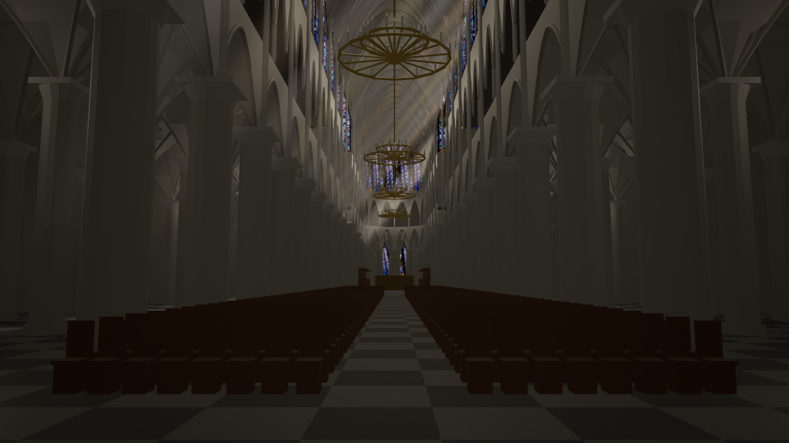
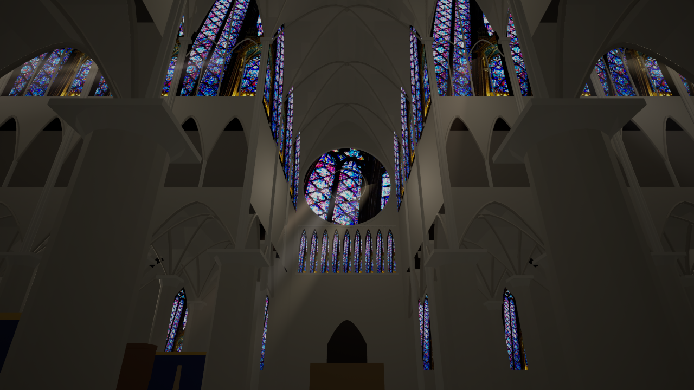
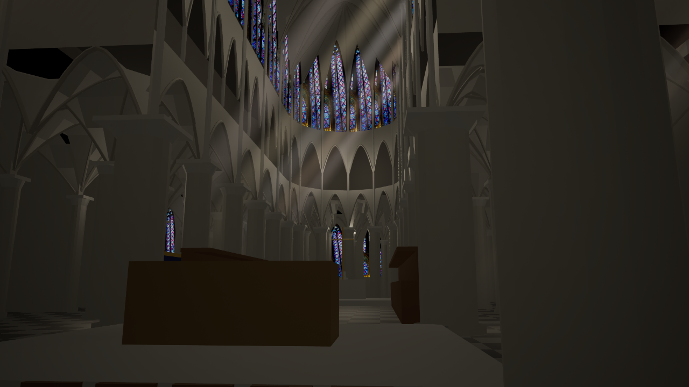

# ノートルダム大聖堂 内部（推定復元）

`AParisNotreDameInterior`（`unreal/AIWorld/Source/AIWorld/ParisNotreDame.cpp`）が、フォトリアルモードで大聖堂の内部を手続き的に組み立てる。外観の GIS 足跡と当たり判定（`osm/way/201611261`）は変えていない。

## 位置合わせ

- 足跡の最小外接長方形の軸（26.98°）を身廊の軸とした。
- 西の塔から身廊までの幅の中心（v = 7760 cm）を中心線とした。南側の香部屋で長方形の中心がずれるため。
- 西正面（u = 20121 cm）を X = 0、床はランドマークの高さ（-142 cm）とした。

## 構成（寸法は公表値に合わせた推定）

- 身廊: 主廊の幅 12 m、ヴォールト 33 m。三層構成（大アーケード、トリビューン、高窓）と二重側廊、側面の礼拝室。
- 翼廊: 南北のバラ窓（直径約 11 m）、その下のガラス窓列、扉口。
- 内陣: 5 ベイ。彩色された内陣障壁、聖職者席、主祭壇、ピエタと十字架。
- 後陣: 半円の 7 本柱と扇状ヴォールト、二重の周歩廊、放射状の礼拝室。
- 西端: バラ窓、オルガン席と大オルガン、扉口。
- 身廊の椅子（約 900 脚）、交差部の祭壇、シャンデリア、南の高窓とバラ窓から差す日差し。

窓ガラスの図柄はサント・シャペルの CC0 写真テクスチャを流用しており、実際のノートルダムの図柄ではない。

## 操作

- `Enter`: 近い方の聖堂（サント・シャペル／ノートルダム）に入る。内部でもう一度押すと出る。
- 内部では WASD で歩ける。壁の外には出ない。
- 内部にいる間は、外の建物や街の物を一時的に隠す。重なった GIS ブロックの境界の壁が身廊内に見えないようにするため。出ると元に戻る。
- `Paris-NotreDame-Interior.cmd` で内部から起動できる。撮影は `unreal/scripts/Capture-ParisNotreDameInterior.ps1 -View 1|2|3`（西・交差部・内陣）。

