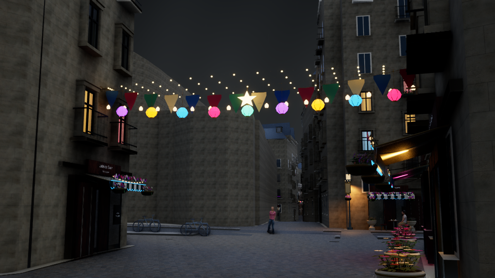

# パリの派手モード v8

`Paris-Party.cmd`または`Paris-City-Festive.cmd`で、お祭り風の雨の夜景から開始する。`9`で派手モードの有無、`7`で地区巡回、`G`で昼・夕・夜、`R`で雨、`F8`で歩行を切り替える。`Paris-Luxury.cmd`は従来の落ち着いた昼景から開始する。

## 実装

既存の通りの吊り飾りへ、5本の金色の光の扇と9個の多色ランタンを重ねる。吊り線の両端は既存の建物壁の取り付け点を保持し、広げた光の扇が建物内部やセーヌ川へ入る候補を除外する。最低高さは各通りの基準地面から470cm以上。布の壁飾りには星と光輪、店の庇にはピンク・シアン・金色のネオンの縁を加える。

配置した光の天蓋は40組、ランタン360個、追加の金色電球3,000個、壁の星飾り150か所、店のネオン395か所。既存の6,362窓（589棟）は派手モードでのみ色付きに変わる。店先の照明は既存の34灯の再利用枠内で色と明るさを変え、追加のスポットライトは作らない。9種類の共有メッシュを使い、追加装飾には衝突・影を付けない。描画距離は低100m／中250m／高350m。`F6`やGISのデバッグ表示で派手な装飾と窓の色を隠す。

`9`で通常モードへ戻すと、追加メッシュを隠し、窓を従来の暖色、店舗照明を白色＋色温度、ブルームを従来値へ戻す。元の59メッシュ、地物の位置、道路・河川・建物の形状、既存の装飾とカメラを保持する。これはゲーム向けに推定した祭りの装飾であり、パリで実測した照明や実在のイベントではない。元データIDと親の配置情報は中間データに保存する。

## 再生成と検証

プレビューを閉じて次を実行する。

```powershell
./unreal/scripts/Build-AIWorldUE.ps1
./unreal/scripts/Build-ParisLuxury.ps1
./unreal/scripts/Test-ParisLuxury.ps1
./unreal/scripts/Capture-ParisLuxury.ps1 -District -Spot 3 -View Night -Festival -OutputPrefix paris-party
./unreal/scripts/Capture-ParisLuxury.ps1 -District -Spot 3 -View Night -OutputPrefix paris-party-baseline
./unreal/scripts/Capture-ParisLuxury.ps1 -District -Spot 3 -View Sunset -Festival -OutputPrefix paris-party
./unreal/scripts/Capture-ParisLuxury.ps1 -District -Spot 0 -View Night -Festival -OutputPrefix paris-party-overview
```

主な変更は`generate_paris_party.py`、`generate_paris_luxury.py`、`bake-paris-luxury.py`、`ParisLuxury.cpp/.h`、`ParisNightLighting.cpp`、`ParisDigitalTwin.cpp`、生成済み素材・メッシュ、起動・撮影・検証スクリプト。変更前は`backups/paris-before-party-20261107-120944`へ保存した。

位置・形状・最低高さ・元データ追跡・再生成一致をPythonで検証し、UEの自動テストで表示の切替、通常照明への復帰、歩行の非干渉、固定照明枠を検証する。C++ビルドと素材のベイク成功。Pythonの11件、UEの9件が成功し、吊り線の最終形状を対象とする2件の追加確認も成功した。元の59メッシュ・全配置・巡回カメラの保持を確認した。

同じカメラで[派手モードの雨の夜](paris-party-night.png)と[通常モードの雨の夜](paris-party-baseline-night.png)を撮影し、ランタン・金色の天蓋・ネオン・窓色の違いと通常状態への復帰を目視確認した。[夕景](paris-party-sunset.png)と[全景](paris-party-overview-night.png)も撮影した。4画面とも材料のコンパイルエラーはない。全景は地理配置の確認用で、高い視点では距離制限により細かな追加飾りを省略する。装飾は地上または7キーの巡回で確認する。

AMD Radeon内蔵GPU、1280×720、中設定、画面解像度80%の実測値：

| 視点 | 平均fps | 95%フレーム時間 |
|---|---:|---:|
| 派手モード・雨の夜 | 37.35 | 30.21ms |
| 通常モード・雨の夜 | 38.10 | 29.64ms |
| 派手モード・夕景 | 37.54 | 31.18ms |
| 全景・雨の夜 | 50.70 | 21.94ms |

地上の3画面は人体モデル5体を表示し、既存の最大8体という中設定の枠を保持した。照明枠は34灯、地上で有効15灯。目標60fpsは未達。[機械可読の検証記録](paris-party-validation.json)。



## 今後

今回は静的な装飾と照明の変更。点灯アニメーション、祭り専用の群衆行動・音楽、現物の店舗・建物外観の詳細な再現は未実装。60fpsの達成は別途最適化を進める。
