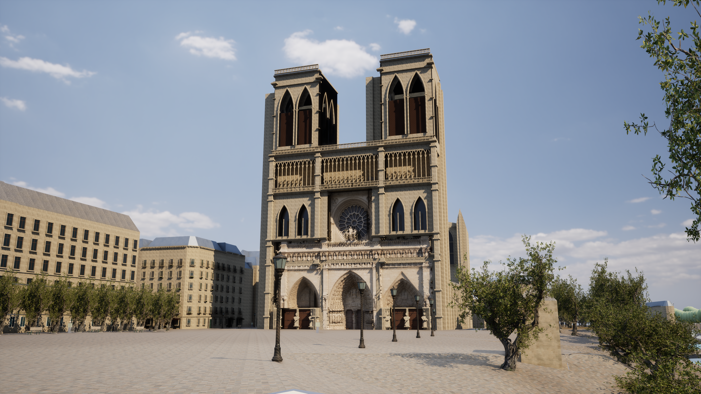

# Paris Photoreal v10 — 西正面の写真由来表面を拡張

2026-10-17。変更前の基準はGit `6ad2107`。都市の面積・地理配置・住民AIを変更せず、ノートルダム西正面の改善を続けた。

## 変更

- 既存の[UC San Diego / CHEI公開点群](https://zenodo.org/records/10363984)から、左右の入口の彫刻・アーチへ採用範囲を拡張した。中央入口・バラ窓・王の回廊を保持。2019年の写真再構成、CC BY 4.0、原本のSHA-256はv9と同じ。新たに現在の建物を測量したわけではない。
- 従来の1.25cmサンプル・7.5cmメッシュ間隔を維持。上部の5cmサンプル・15cmメッシュも試作したが、観測密度と実画面の品質が不足するため不採用。広い上部回廊、外周の柱、塔は元の独自造形を残す。採用範囲を増やすこと自体を成果にしない。
- 密度別のアトラス生成と観測密度による採否判定を実装した。最終生成物は下部1タイルの3481×3601で、4096上限による縮小を避けている。複数タイルが採用される場合は8pxの間隔を設け、既存表示のマスクにも同じ座標変換を使用する。範囲マップの縮小ミップで欠損範囲を変えない。元の側壁を正面の範囲画像で切り抜かないよう、向きによる制限も加えた。
- 近隣の奥行き差が60cmを超える場合は補完しない。採用部の補完の最大距離は40cmで、支持のない範囲には独自造形を残す。
- 3×3深度フィルターを行単位に分割し、全画面分の9層を同時に複製する処理を削減した。画像の上下左右が循環して接続されることも防止した。
- 点が疎な場所では10cmの半径で奥行きの補完段差を平滑化し、推定した色の継ぎ目もならす。観測密度40%以上の奥行きと直接観測した色はこの追加処理でぼかさない。補完範囲の面積は増やさない。これは造形の安定化であり、失われた実測細部の復元ではない。
- 表示メッシュの法線・接線をUEで再計算し、生成手順のハッシュをアセット名とマニフェストに記録する。細かな深度法線は世界座標で使用する。
- 表面素材まで実際にロードできる場合だけ元の表示を隠す。M、Low、精度表示と`-NoScannedFacade`の比較を保持した。

## 再現精度

これは色と奥行きから作った2.5D表面で、裏側の情報を持つ全周モデルではない。位置合わせはv9の幅43.5m・塔69mによる暫定調整のままで、現地測量による位置・方位の確定ではない。写真の照明は完全には除去できておらず、反射率も推定である。

表示範囲には補完が含まれる。面積をすべて実測済みと扱わない。点の少ない場所にはぼけや接合部の差が残り、塔・側面・屋根を含む写真相当の完成版とは呼ばない。[出典と改変内容](../unreal/assets/notre-dame-facade/CREDITS.md)と、元のID・変換・観測/補完セル数を記録した実行時マニフェストを保持する。

## 変更ファイル

|ファイル|内容|
|---|---|
|`unreal/scripts/generate_notredame_scan.py`|密度別の面、開口保護、補完制限、行単位フィルター、アトラス|
|`unreal/scripts/notredame_scan_atlas.py`|メッシュとマスクの共通座標変換|
|`unreal/scripts/bake-notredame-scan.py`|アトラス素材、側壁の保護、範囲マップ設定|
|`unreal/AIWorld/Source/AIWorld/ParisPhotoArchitecture.cpp`|表面素材のロード確認と明示的な割り当て|
|`unreal/scripts/Start-ParisDigitalTwin.ps1`|生成物のrevision確認|
|`unreal/scripts/Measure-ParisDigitalTwin.ps1`|測定に使用できる点群生成物とマニフェストのハッシュ記録|
|`unreal/scripts/tests/test_notredame_scan.py`|境界、開口、密度別UV、補完距離と循環防止の検査|
|`Content/Data/paris-notredame-scan.json`、`Content/ParisPhotoreal/NotreDameScan`、`unreal/assets/notre-dame-facade`|生成物・マップ・出典|

## 再生成と確認

```powershell
./unreal/scripts/Build-AIWorldUE.ps1 -SkipAssets
./unreal/scripts/Build-NotreDameScan.ps1
gis/.venv/Scripts/python.exe -m unittest discover -s unreal/scripts/tests -p test_notredame_scan.py -v
./unreal/scripts/Test-ParisDigitalTwin.ps1 -Photoreal
./unreal/scripts/Test-ParisDigitalTwin.ps1 -LegacyJSON
./unreal/scripts/Start-ParisDigitalTwin.ps1 -Photoreal -PhotoCamera Front -Quality High
./unreal/scripts/Start-ParisDigitalTwin.ps1 -PortalDetail -Quality High
```

生成・ビルド時はAIWorldのUEプレビューを閉じる。原本GLBがキャッシュにあればネット接続なしで生成できる。起動は`Paris-Cathedral.cmd`で全景、`Paris-Cathedral-Detail.cmd`で入口。右ドラッグとWASDで移動、4/5/6で固定視点、F7で品質、Mで素材比較。

## 実行した検証

初回の追加テストで、浮動小数点の境界丸めによるUV範囲判定と、鐘楼アーチ先端への1面の微小な侵入を検出した。許容誤差と面の採否を修正した。失敗ログを残し、修正後のテストと実画面で確認する。

最初のUE比較では、正面の裏向きの面が残ってバラ窓を隠していた。Unlitで照明と切り分け、法線の符号ではなく側壁との直交性で保護を判定するよう修正した。CommandletではEditorSubsystemが利用できないことも確認し、エディタの手動操作に依存せずGeometryScriptの作成設定で法線・接線を再計算する。初回の広い範囲の深度推定は段差が目立ったため、観測密度に応じた安定化を追加した。診断用の画像・失敗ログを完成画像として扱わない。

左右入口の4.5m位置で切り出した案では木製扉の途中に継ぎ目が出た。扉周辺全体への拡張も試したが、欠損・接合差が目立つため不採用。最終版は木製扉と石のまぐさを残し、その上5.2mからの彫刻・アーチに採用を限定した。モデル間の接合差と欠損は残る。上部候補は直接観測セルの比率34.42%に対して採用基準60%を満たさず、実画面でも粗さが目立ったため不採用。これは品質用の保守的な判定で、精度や測量レベルの認定基準ではない。

採用版の表示用メッシュは294,525三角形・150,065頂点。色・法線・範囲の入力PNGは3481×3601。直接観測セル2,248,421、補完セル3,176,068を記録した。補完を含む投影面積828.35m²は、西正面下部43.5×45mの矩形の42.32%。この値を実測済み面積として扱わない。v9は同じ矩形の約28.90%で、今回の増加には多くの補完が含まれる。木製扉、まぐさ、塔・上部回廊は従来の推定造形を保持している。

最終C++ビルド成功（31.56秒）。採用アセットのベイクは0エラーで完了した。非推奨API2件と生成完了マーカー1件がWarningとして記録され、ほぼゼロの接線・従法線についてのDisplay警告も残る。現在は世界座標の法線を使用し、実際の表示を確認する。接線に依存する別素材への変更時は追加検証が必要。

採用した12アセットを残し、未採用の生成試作58ファイルをCRC検査済みZIPへ退避した。[退避記録](paris-v10-prototype-archive.json)。v9でGit管理済みのアセットは保持。最終退避後にUEの写実20件とPython9件が成功した。従来JSON20件も同じDLL・変更のない元GISで成功しており、このモードは点群を使用しない。Pythonでは同じ入力からの再生成と元GISの不変性も検査した。UEの自動テストはNullRHIで、画像の成功は下記の実描画と分けて確認している。

## 採用版の実画面と性能

[検証の集約](paris-v10-verification.json)。最終DLLは `050df417fa1fdca66afe7cfe27e2721846d580579927e2fb7754f9ad4441817e`。元の都市JSONとメッシュバイナリのSHA-256はv9と一致する。739棟・元の地理・衝突を保持した。

AMD Radeon Graphics内蔵GPU / Ryzen 7 7735HS、UE 5.8.3 Development Editor `-game`、DX12 / SM6、Lumen GI・反射とVSM。準備完了・5秒のウォームアップ後に20秒ずつ測定した。HUDなし、他のUEプロセスなし。各解像度1回の測定であり、v9からの速度改善を断定しない。

|視点・品質|出力PNG|内部描画率|平均fps|P95フレーム時間|
|---|---|---|---:|---:|
|全景・High|1280×720|100%|37.95|28.94ms|
|全景・High|3840×2160|100%|7.38|148.37ms|

PNGヘッダーを読み実寸を照合した。両測定で採用マニフェストと形状ハッシュ、同一DLLを照合し、点群表示1部品・Nanite有効・294,525三角形、準備待ち0を確認。元GIS静的描画の境界誤差0cm・配色不整合0も確認した。この境界検査は点群の地理精度を証明するものではない。

このPCで60fps目標は未達。4Kは静止画の確認向け。GPU各処理の時間内訳は今回未測定で、写真品質の完成や全機種での実用速度を確認したとは扱わない。



[720p測定](paris-v10-front-high-performance.json) / [4K測定](paris-v10-front-4k-performance.json) / [v9との同一視点比較](screenshots/paris-v9-front-4k.png)。`*-trial-*`、`initial`、`rejected`、`unlit`などの画像・測定は試作や切り分け用で、採用版の性能表には含めていない。左右の扉と上部は独自の推定造形であり、写真由来部分との接合や点群の欠損は引き続き課題。

## 次の作業

同一視点での写真照合、疎な点群から作られた箇所の品質と接合部の改善を優先する。全周の詳細な外観モデル、照明を取り除いたPBR素材、現在の復元状況と一致する資料、測量による位置合わせは未取得。都市範囲の拡張は行わない。
