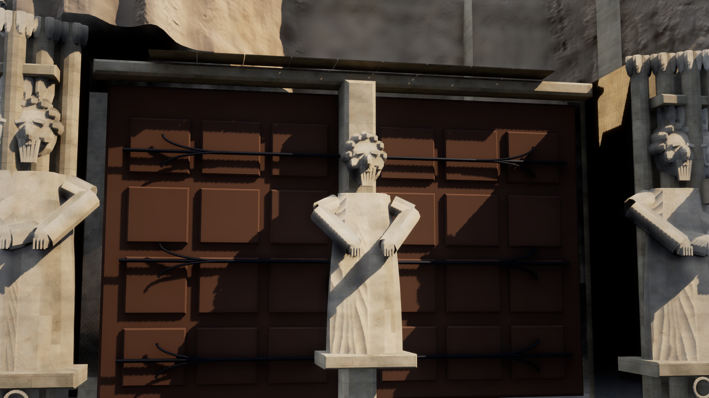
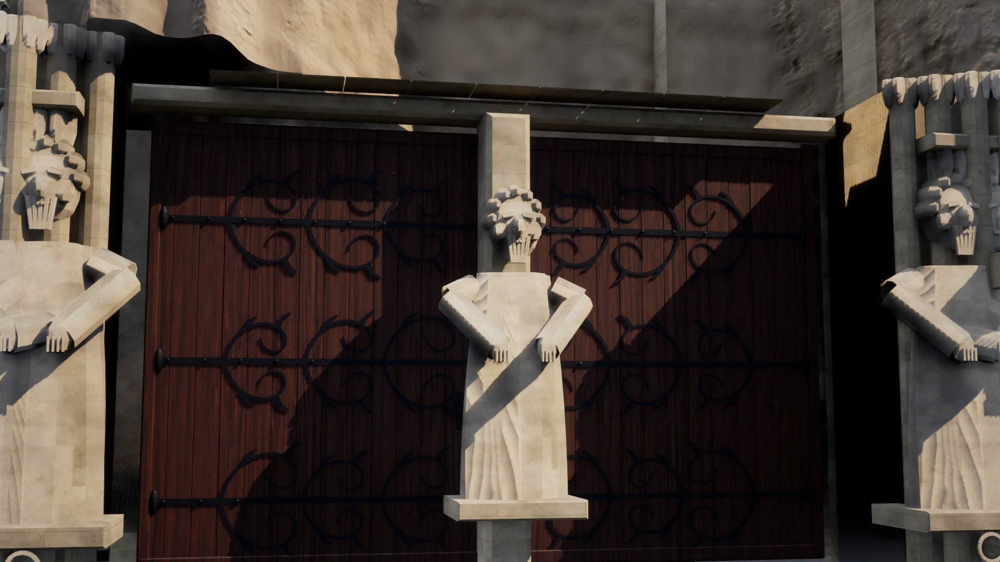
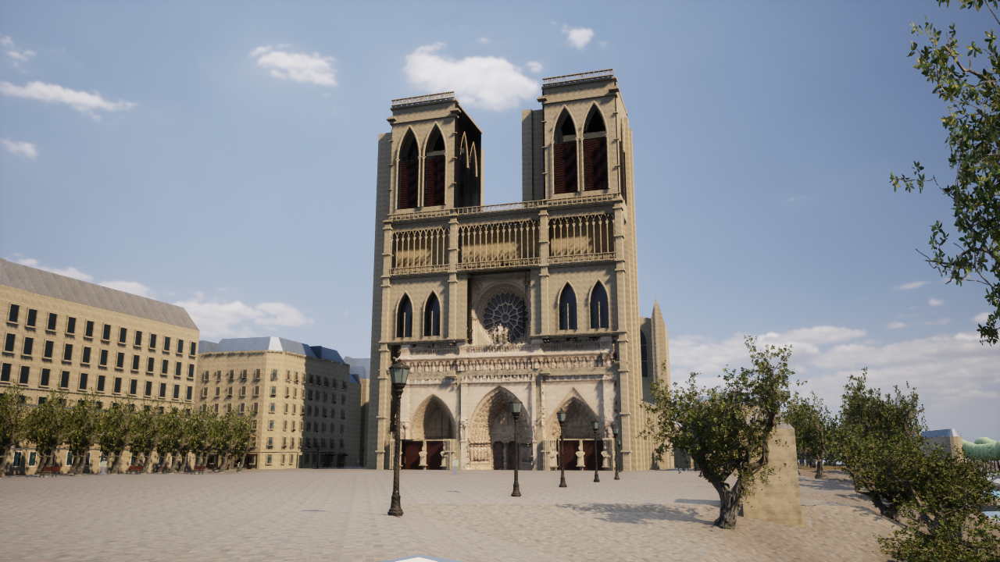

# Paris Photoreal v11 — 木製扉と鍛鉄装飾

2026-10-17。ノートルダム周辺の近景を改善した。都市範囲・GIS配置・住民AIは保持。変更前の未コミットv10と、生成時に更新されるアセットをZIPに保存しCRCを検査した。[バックアップ記録](paris-v11-backup.json)。

## 実装

- 西正面の3入口・6枚の扉を、88枚の木板と閉じた背面、4mmの継ぎ目、面取り、外枠で構成。元の開口と位置を保持した。
- 丸い棒の簡易装飾を、厚みのある平たい鍛鉄帯と渦巻き・葉の形に変更。348本の帯、216枚の葉、162個の鋲、蝶番、台座とリング取っ手を同じ鉄メッシュへ集約。支持帯が木面に接することをレイ検査で確認する。
- [Poly Haven Dark Wood](https://polyhaven.com/a/dark_wood)の2048×2048 Diffuse・DirectX Normal・ORM原本を取得し、サイズ・MD5・SHA-256を固定した。[CC0ライセンス](https://polyhaven.com/license)。元の2mスケールと同じGISフレームで縦の木目を投影し、推定した屋外の粗さ・基部の色変化を加える。ゲーム中の外部APIは使用しない。
- [大聖堂公式のSainte-Anne説明](https://www.notredamedeparis.fr/comprendre/architecture/portail-sainte-anne/)を参照。鍛鉄の文様は独自の推定造形。個々の実在文様の測量・転写や、実際の木材樹種の同定は行っていない。[素材の出典・改変](../unreal/textures/paris-photo/WOOD-SOURCE.md)。
- `Paris-Cathedral-Doors.cmd`で扉の専用視点。高さ170cm・42mm相当の画角。既存の全景・中央彫刻の近景も保持した。
- 専用の生成コマンドを追加。通常素材の再生成時に古い写真素材のキャッシュタグを無効にし、木目PBRが平坦な素材に戻っても検出・再接続する。新しい下地素材を写真由来表面の範囲マスクへ反映する。

描画用の形状・素材を更新し、元の都市メッシュ・建物輪郭・地理基準・選択と歩行の衝突は変更していない。著作独自の建築メッシュは6部品のまま、入力1,122,478三角形、実際のfallback合計1,122,476三角形。写真由来部分はv10の294,525三角形・3481×3601マップを保持する。

## 再生成と起動

アセット生成時はAIWorldのUEプレビューを閉じる。原本がキャッシュにあればオフラインで再生成できる。

```powershell
./unreal/scripts/Build-AIWorldUE.ps1 -SkipAssets
./unreal/scripts/Build-ParisCathedralDetails.ps1
gis/.venv/Scripts/python.exe -m unittest discover -s unreal/scripts/tests -p test_paris_architecture.py -v
gis/.venv/Scripts/python.exe -m unittest discover -s gis/tests -p test_photo_sources.py -v
./unreal/scripts/Test-ParisDigitalTwin.ps1 -Photoreal -DoorDetail
./unreal/scripts/Start-ParisDigitalTwin.ps1 -DoorDetail -Quality High
```

右ドラッグとWASDで自由移動、4/5/6で固定視点、F7で品質、Mで素材比較。`Paris-Cathedral.cmd`で全景、`Paris-Cathedral-Detail.cmd`で中央の彫刻を確認できる。

## 実行済み検証

- C++ビルド成功、61.15秒。[ログ](paris-v11-build.log)。
- 最終アセット生成成功、0エラー・5警告。3件は生成完了マーカー、2件は既存の非推奨MaterialUsage API。[ログ](paris-v11-bake-assets.log)。
- Pythonの建築5件成功、56.4秒。再生成一致、GIS読み取り専用、開口、有限で非退化の扉・鉄形状、支持帯と木面の接触、視点を検証。[ログ](paris-v11-architecture-tests.txt)。
- 写真素材の出典・ハッシュ・色空間・チャンネル・キャッシュ拒否の6件成功。[ログ](paris-v11-photo-source-tests.txt)。
- UEの写実モード20件成功。実際の木目テクスチャがBaseColor・Normal・Roughnessへ接続されること、DirectX法線、42mmの専用視点、6部品とNanite、比較表示と原型復帰、元GISの衝突・歩行を検証。[ログ](paris-v11-native-photo-tests.log)。自動テストはNullRHIであり、画像と性能は別途実描画で確認する。
- 従来JSONモード20件も同じ最終DLLで成功。[ログ](paris-v11-native-legacy-tests.log)。今回実行した合計はUE 40件・Python 11件。[51件・22アセット・実描画2枚の照合記録](paris-v11-verification.json)。
- 元の都市JSON SHA-256 `4e51a9332f3bc44aea0820ee4fcc77d339083fff9c2f73d59a66e1737f5353bb`、メッシュバイナリ `fba61d4426bf6cc2fc40bda2818d48fe4a6d8e3c58bf13e025254ddc20bc97d8` がv10と一致。

最初の補助スクリプトでは日本語パスのエンコーディング、初回素材グラフではClampの入力名の誤りで生成が失敗した。パスを`__file__`から解決する正式な生成スクリプトと、実際のUE入力名に修正した。失敗ログは診断用として保持し、成功結果と区別する。支持帯の接触調整後のメッシュを最終版として検査した。

## 変更ファイル

|ファイル|変更内容|
|---|---|
|`unreal/scripts/notredame_portal_doors.py`、`notredame_west.py`、`generate_paris_architecture.py`|板張り・鍛鉄の生成、revision 11、近景カメラ、推定属性|
|`unreal/scripts/paris_photo_sources.py`、`create-paris-photo-assets.py`、`create-paris-assets.py`|原本の取得・検証、PBR素材、キャッシュ無効化|
|`unreal/scripts/Build-ParisCathedralDetails.ps1`、`bake-paris-cathedral-details.py`|再生成と既存写真表面への素材反映|
|`unreal/AIWorld/Source/AIWorld/ParisPhotoEnvironment.cpp`、`ParisPhotoTests.cpp`、`ParisSurfaceTests.cpp`|専用視点・計測と素材の検証|
|`unreal/scripts/Start-ParisDigitalTwin.ps1`、`Measure-ParisDigitalTwin.ps1`、`Test-ParisDigitalTwin.ps1`|専用視点、生成物確認、撮影時の建築マニフェスト記録|
|`unreal/scripts/tests/test_paris_architecture.py`|接触・近景形状・カメラの回帰検査|
|`Content/Data/paris-photo-architecture.json`、`paris-notredame-scan.json`、`Content/ParisPhotoreal/Architecture`、`Content/ParisPhotoreal/NotreDameScan`、`Content/Materials`、`Content/Textures`|実際に生成・読み込んだアセットとマニフェスト|
|`unreal/textures/paris-photo`、`unreal/assets/paris-photoreal-assets.json`、`Paris-Cathedral-Doors.cmd`、`README.md`|原本・出典・導線|

## 残っている品質課題

写真相当の全体再現は未完成。入口の人物彫刻には従来の推定モデルが残り、顔・衣の精度が不足している。写真由来表面には欠損や継ぎ目、撮影時の照明が残る。塔、側面、屋根の全周モデル、測量による位置合わせ、現地に一致する素材は引き続き必要。都市範囲を広げず、次は入口の人物彫刻と実在の建築細部を確認できる資料・ライセンスの明確なモデルを優先する。

写真由来の彫刻部分の著作表示：UC San Diego – Digital Media Lab / CHEI–UCSD、2019年の写真再構成、CC BY 4.0。[原典・改変・制限](../unreal/assets/notre-dame-facade/CREDITS.md)。

## 実画面・性能

UE 5.8.3 Development Editor `-game`、AMD Radeon Graphics内蔵GPU / Ryzen 7 7735HS。DX12 / SM6、Lumen GI・反射、VSMを実行時に確認。HUDを非表示にし、5秒のウォームアップ後に20秒測定。内部描画率100%、他のUEなし、アセット準備待ち0。出力PNGの実寸と、建築・写真表面マニフェスト、使用DLLのハッシュを記録した。

|撮影|出力|平均fps|P95フレーム時間|
|---|---|---:|---:|
|変更前・扉近景・High|1920×1080|17.75|67.44ms|
|採用版・扉近景・High|1920×1080|17.35|65.55ms|
|採用版・全景・High|1280×720|37.73|30.75ms|

各条件1回の測定。変更前の扉は既存v10の形状・素材へ同じ近景カメラだけを追加して撮影した。両方で照明・カメラ・解像度・描画率・同じ新DLLを使用した。微小な差から速度改善や悪化の因果関係は断定しない。この内蔵GPUでは60fpsの目標は未達。GPUパス別の内訳、他GPU、スマートフォン実機は今回未測定。

[近景の測定](paris-v11-doors-high-performance.json) / [全景の測定](paris-v11-front-high-performance.json) / [変更前の測定](paris-v11-before-doors-performance.json)。

検証後、全景・Highの操作用UEプレビューを開き直し、`PARIS_TWIN_READY buildings=739`を確認した。再起動後も元GISと採用22アセットのハッシュは一致。[起動ログ](paris-v11-interactive-launch.log)。

変更前：



採用版。木目・板の分割と鍛鉄を更新し、人物彫刻と写真表面の継ぎ目には上記の課題が残る：




