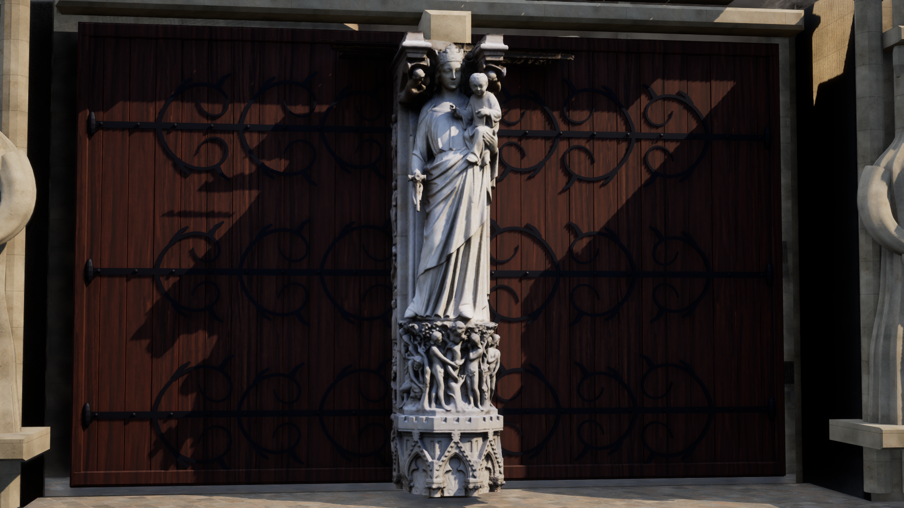
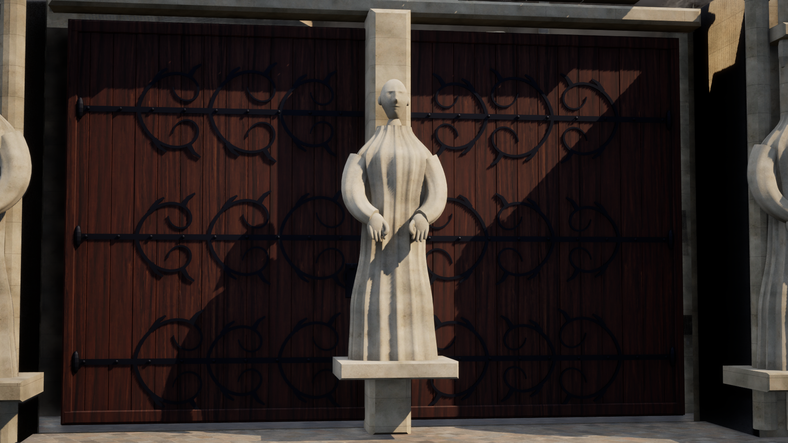
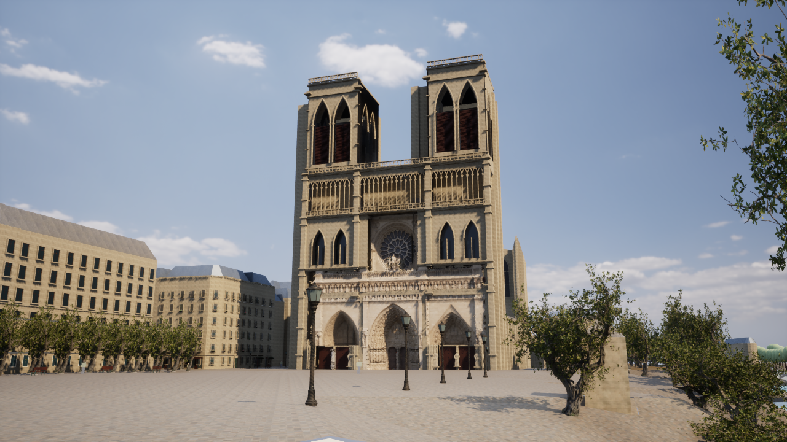

# Paris Photoreal v12 — 聖母の門の実物スキャン

2026-10-17。ユーザーの「非商用の個人用として実物スキャンも使う」という指定に基づく。都市範囲の拡張は行わず、西正面の入口を改善した。変更前のv10/v11の未コミット変更・生成物も含めてバックアップし、ZIPのCRCを検査済み。[バックアップ記録](paris-v12-backup.json)。

## 実装

**西正面左側「聖母の門」の聖母子像に、実際の写真測量モデルを導入。**

- [Notre-Dame de Paris - Virgin Mary](https://sketchfab.com/3d-models/notre-dame-de-paris-virgin-mary-b5bbdc379daa4ee19e3775bb179dbcc1)、作者 **Benoît Rogez / shadows44**、[CC BY-NC 4.0](https://creativecommons.org/licenses/by-nc/4.0/)。公開APIとGLB埋込情報の作者・ID・ライセンスが一致していることを確認した。
- Ai2の[Objaverse公開配布](https://huggingface.co/datasets/allenai/objaverse)から原本GLBを取得。原本は31,828,916 bytes、1,001,053三角形、写真テクスチャは1024×1024。SHA256を固定し、再取得・生成時に照合する。
- 上部の大きな天蓋を切り詰め、像と台座を保持。元の階層変換を適用し、共有GISフレームのUE cmへ一度だけ変換する。元データは保存し、見えない背面を捏造して補完しない。
- 北側（正面左）の既存アンカーへ配置。公式資料の[西正面の説明](https://www.notredamedeparis.fr/comprendre/architecture/la-facade-occidentale/)と照合した。このGISフレームの横軸プラスは観客の左なので、アンカーは+14m。glTFとUEの左右の座標系の違いも位置・法線に適用し、UVを保持する。高さ4.4m、細かな位置・向き・スケールは暫定の推定値であり、現地測量に基づく位置合わせではない。
- UV、写真色、実際の形状法線を保持したNaniteメッシュを生成。Default Lit、推定roughness 0.85、metallic 0、写真色の明示的な補正係数を使用する。写真に元の照明が焼き込まれており、校正済みPBR・高解像度の実測素材とは扱わない。
- 対応する従来の像だけを独立したfallback部品へ分離。正しいライセンス・座標フレーム・メッシュ・素材・テクスチャが揃った場合に切り替える。モデル欠損時や`-ParisTwinNoNCStatues`指定時は元の像を表示する。
- Mの比較で元の像を復元し、Lowと精度デバッグでは詳細表示を隠す。元の地理、739棟、衝突、選択・歩行を保持する。
- `Paris-Cathedral-Virgin.cmd`から高さ約170cm・50mm相当の確認視点を起動できる。

原本と派生NCアセットはGitの対象から外し、個人用のローカル素材として分離した。コードのライセンスで再配布可能になったとは扱わない。[作者・ライセンス・改変内容](../unreal/assets/notre-dame-sculptures/CREDITS.md)。

中央入口の[Jesus Christ候補](https://sketchfab.com/3d-models/notre-dame-de-paris-jesus-christ-5f96979d285746338502636d6950f377)もCC BY-NC 4.0だが、公開Objaverse索引に該当IDがなく、正規のダウンロードAPIは認証なしでHTTP 401を返した。取得・採用はしていない。聖母像を中央や右側の別人物に流用していない。[調査記録](paris-v12-sculpture-candidates.json)。

## 推定モデルも保持

元の大きな像21体は、粗い楕円体・管の組合せから、連続する衣服・顔・袖・指と滑らかな頂点法線へ更新。頭部の比率、襟と肩の接続、写真法線の強度0.18を実描画で調整した。これは独自の推定造形であり、実際の聖人の人体・衣服・持物・図像の再現とは主張しない。左入口の1体は実物スキャン使用時だけ隠れる。

建築revision 12。元の6部品と分離した左入口のfallbackの計7部品。写真点群由来の既存ファサードはv10の採用範囲と形状を保持する。左右の疎な点群の診断は[別記録](paris-v12-statue-source-diagnostic.json)に残し、不確かな形状を拡大して完成扱いにしていない。

## 再生成・起動

AIWorldのUEプレビューを閉じて実行する。NC素材の取得は明示オプションで行い、取得済み原本からはオフラインで再生成できる。

```powershell
./unreal/scripts/Build-AIWorldUE.ps1 -SkipAssets
./unreal/scripts/Build-ParisCathedralDetails.ps1 -NoncommercialStatue
# 取得後のオフライン生成
./gis/.venv/Scripts/python.exe unreal/scripts/prepare_notredame_statue.py
./unreal/scripts/Test-ParisDigitalTwin.ps1 -Photoreal -VirginDetail
./unreal/scripts/Test-ParisDigitalTwin.ps1 -Photoreal -NoNCStatues
./unreal/scripts/Start-ParisDigitalTwin.ps1 -VirginDetail -Quality High
# NC素材を使わない表示
./unreal/scripts/Start-ParisDigitalTwin.ps1 -VirginDetail -Quality High -NoNCStatues
```

右ドラッグ・WASDで移動、Mで素材比較、F7で品質変更。全景は`Paris-Cathedral.cmd`。`Measure-ParisDigitalTwin.ps1 -Photoreal -View VirginDetail`で、NC表示の有無、DLLと各マニフェストのハッシュも含めて実測する。

## 変更ファイル

|ファイル|内容|
|---|---|
|`unreal/scripts/prepare_notredame_statue.py`|原本取得、作者・NCライセンス・ハッシュ確認、天蓋の切り詰め、UVと法線保持、GIS変換|
|`unreal/scripts/bake-notredame-statue.py`|実際の写真・素材・Naniteアセットとメタデータ保存|
|`ParisScannedStatue.cpp/.h`|条件付き読み込み、元の像の復元、品質・比較・精度表示との連動、実測統計|
|`ParisPhotoArchitecture.cpp`、`ParisPhotoEnvironment.cpp`|詳細レイヤー連携、聖母像の確認カメラ|
|`notredame_sculpture.py`、`notredame_west.py`、`generate_paris_architecture.py`|推定曲面、個別法線、左入口fallbackの分離|
|`create-paris-photo-assets.py`|彫刻の幾何法線を優先する素材|
|`Build-ParisCathedralDetails.ps1`、`bake-paris-cathedral-details.py`|再生成手順|
|`Start/Measure/Test-ParisDigitalTwin.ps1`、`Paris-Cathedral-Virgin.cmd`|起動・測定・検証|
|`test_notredame_statue_scan.py`、`test_notredame_sculpture.py`、`test_paris_architecture.py`、`ParisScannedStatueTests.cpp`、既存photoテスト|実物形状、座標、再現性、切替と欠損時の復元|
|`Content/Data/paris-photo-architecture.json`、`paris-notredame-statue.json`、関連UAsset|実際に生成・読み込むデータ。NCのUAssetはローカルのみ|

## 残作業

写真相当の全体再現は未完成。中央キリスト像の正式な取得、右入口や柱沿いの実在彫刻、入口上部との接合、実測寸法による位置合わせ、塔・側面・屋根の全周形状が必要。聖母像も写真テクスチャは1Kで、撮影済み照明と背面欠損が残る。存在しない4K/8K素材、現在の現地測量、全体L5の精度とは扱わない。

既存写真点群の出典：UC San Diego – Digital Media Lab / CHEI–UCSD、2019年の写真再構成、CC BY 4.0。[別の出典と改変内容](../unreal/assets/notre-dame-facade/CREDITS.md)。

<!-- verified-results -->

## 実際の検証結果

C++の最終ビルドは成功（25.18秒）。アセットの最終一括生成も成功（326.74秒、0エラー、11警告、最大物理メモリ約7.86GB）。[C++ログ](paris-v12-native-build-final.log) / [最終生成ログ](paris-v12-bake-assets.log)。MaterialUsageの非推奨API、生成完了マーカー、回復した一時的なファイルロック等の警告はログに保持した。

初回はNC素材の保存先の物理ディレクトリ未作成で失敗した。保存先作成を追加し、その段階と最終の一括生成を再実行して成功。[初回失敗ログ](paris-v12-bake-assets-save-failure.log)。実画面で判明した画角・旧台座との重なり・座標系の左右を修正した。画角や左右の修正前の画像・測定は`trial`として区分し、最終検証に混在させない。

|検証|成功件数|確認内容|
|---|---:|---|
|[UE写実モード](paris-v12-native-photo-tests.log)|21|実際の読み込み、Nanite、衝突・地物選択・歩行・表示切替、欠損時の復元|
|[UE NC素材無効モード](paris-v12-native-nc-off-tests.log)|21|NCメッシュを読み込まず、対応する従来の像を表示|
|[実物スキャンのPython検証](paris-v12-scan-tests.txt)|4|原本とライセンス、再現性、北側の入口、左右座標変換、UV・法線・三角形|
|[推定曲面](paris-v12-sculpture-tests.txt)|5|再現性、有限座標、単位法線、個々の曲面の閉鎖と非退化|
|[建築回帰](paris-v12-architecture-tests.txt)|5|再現性、GIS保持、開口・扉・金具、北側fallbackとカメラ|

合計56回の成功（UEの21項目を2構成で実行、Python14項目）。従来JSON転送モードの再実行、Shippingビルド、iPhone実機検証は今回は行っていない。推定曲面は個々には閉じているが、重なった身体部品をブーリアン結合した単一の多様体とは扱わない。

DX12 / SM6 / Lumen GI・反射 / Virtual Shadow Maps / High・内部解像度100% / Lit。5秒のウォームアップ後に20秒計測し、16秒以降に撮影。アセット待機0、他のUEプロセス0、既存描画キャッシュの境界誤差0・パレット不一致0を確認した。

|実描画|平均FPS|P95フレーム時間 ms|記録|
|---|---:|---:|---|
|聖母像スキャン・1080p|19.24|59.40|[JSON](paris-v12-virgin-high-performance.json)|
|同じ視点の推定造形・1080p|19.16|59.26|[JSON](paris-v12-virgin-fallback-high-performance.json)|
|西正面全景・720p|37.60|30.95|[JSON](paris-v12-front-high-performance.json)|

GPUはこのPCのAMD Radeon Graphics。このHigh設定では60fps目標に未達。近景1080pと全景720pでは解像度・可視範囲が異なるため、直接の速度比較とは扱わない。GPU単独の詳細なボトルネック計測は未実施。

元の都市JSON・GISメッシュのSHA256と、既存写真点群からの採用形状のSHA256はv11と一致。共有座標フレーム、NC原本・生成バイナリ・テクスチャ、実際に使用したUEアセット、最終DLLと撮影時の各マニフェストを照合した。[検証の記録とハッシュ](paris-v12-verification.json)。

描画用の独自建築は入力1,743,490三角形、fallback合計1,743,488。別レイヤーの実物聖母像は610,898三角形。これらはメッシュ入力・fallbackの数であり、カリング後にGPUが実際に描いたNanite三角形数ではない。

実物スキャンの最終UE画面。原作：Benoît Rogez / shadows44、CC BY-NC 4.0。天蓋の切り詰め、左右座標変換、暫定配置と素材調整を実施。[クレジット](../unreal/assets/notre-dame-sculptures/CREDITS.md)。



同一視点でNC素材を無効にしたv12の推定造形。



西正面全景。


