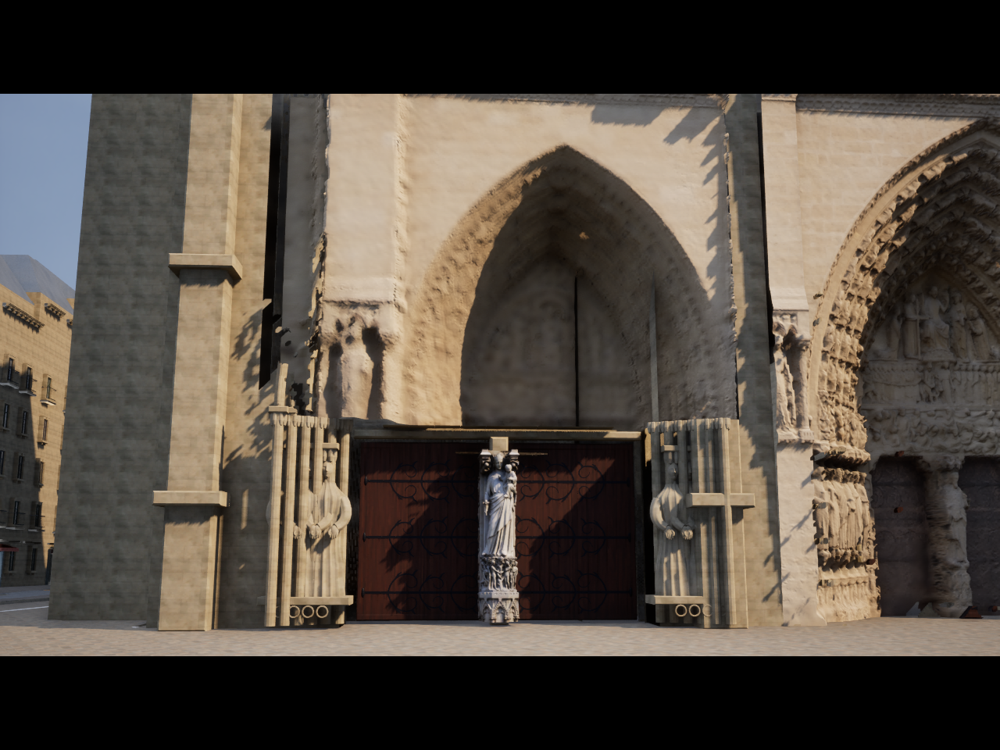
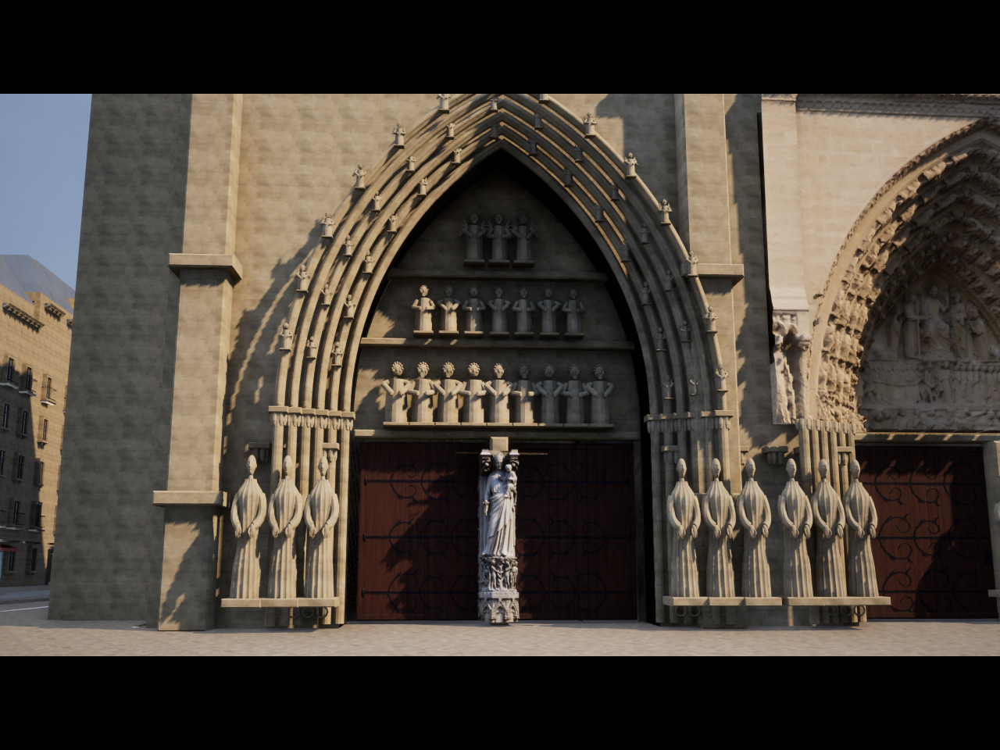

# ノートルダム入口の欠け・像の重なりを修復

2026-10-18。v13時点の画面で、側門の石面が溶け、柱際に穴が出て像が欠けて見える問題を修正した。変更前のスクリプト・データ・スキャン生成物を`unreal/AIWorld/Saved/Backups/portal-before-fix-20261018.zip`へ保存した。

## 原因と修正

1. **側門の不完全な2.5D復元。** 疎な点群から補間した側門の面が、凹んだ入口や独立した彫刻を表現できていなかった。さらに投影したcoverageマスクが正常な3D部品も消していた。側門の高さ17m以下と、全入口の高さ5.2m以下をスキャン形状とcoverageの両方から除外し、元の立体アーチ・扉・柱・像を表示する。支持データのある中央上部の彫刻、バラ窓、王のギャラリーは保持した。
2. **柱による顔の遮蔽と像同士の重なり。** 元形状へのレイ検査で18体中9体の顔が柱の奥にあることを確認。入口脇の像を手前へ移し、横幅と間隔を調整した。縮小に合わせて面法線・頂点法線も逆転置で補正する。中央の実物聖母子像スキャンの位置・形状は保持する。
3. **微細素材の単位。** v13の微細素材UVはm変換後にさらに100で割られていた。余分な除算を外し、記録どおり1mで繰り返すよう修正した。

建築・スキャンのrevisionを14に更新し、起動時に古いアセットを検出する。元のGIS、739棟、当たり判定、地理座標フレームは変更していない。通常の近景カメラも保持し、比較撮影に使った一時的な広いカメラ設定は復元済み。

## 実行した検証

- 建築Pythonテスト **6件成功**。18体すべてで顔より手前に柱がなく、元の開口・扉・法線・再生成一致を確認。
- スキャンPythonテスト **9件成功**。側門と低い位置のcoverageが空であること、中央の支持された彫刻が残ること、非退化・法線・再生成一致を確認。
- 最終アセットのUE写実モードテスト **21件成功**。スキャン・実物像・fallback切替、元の衝突、歩行、環境切替等を確認。
- UE5.8.3で建築アセット生成成功（0エラー、8警告）。中央上部の保持範囲を確定した最終スキャン生成も成功（0エラー、3警告）。非推奨APIと既存の接線警告等をログに保持。
- 同じ位置・向き・35mm相当のカメラ、High、DX12/SM6、1280×960、16:9レターボックスで変更前後を実描画し、穴・欠け・遮蔽の解消を目視確認。最終表示は平均31.43fps、P95 36.97ms。この1回の計測から性能改善率は主張しない。
- 今回はC++を変更していない。既存のビルド済みDLLで新アセットを検証した。Shippingビルドは実行していない。

実行コマンド：

```powershell
./unreal/scripts/Build-ParisCathedralDetails.ps1
./unreal/scripts/Build-NotreDameScan.ps1
./gis/.venv/Scripts/python.exe -m unittest discover -s unreal/scripts/tests -p test_paris_architecture.py -v
./gis/.venv/Scripts/python.exe -m unittest discover -s unreal/scripts/tests -p test_notredame_scan.py -v
./unreal/scripts/Test-ParisDigitalTwin.ps1 -Photoreal -VirginDetail
```

テスト・ベイクログは`unreal/AIWorld/Saved/portal-architecture-tests.txt`、`portal-scan-tests-final.txt`、`portal-native-tests-final.log`、`portal-architecture-fix-bake.log`、`portal-fix-bake-final.log`。

## 実画面

変更前：



修正後：



[最終計測](paris-portal-fixed-performance.json)。立体形状の破綻を修復したものであり、側門の推定モデルが実物スキャン相当の精度になったという意味ではない。入口上部と脇の推定彫刻には、今後も実在資料に基づく形状改善が必要。

写真点群：UC San Diego – Digital Media Lab / CHEI–UCSD、CC BY 4.0。[出典・改変](../unreal/assets/notre-dame-facade/CREDITS.md)。聖母子像：Benoît Rogez / shadows44、CC BY-NC 4.0、ユーザー承認済みの個人非商用利用。[出典・改変](../unreal/assets/notre-dame-sculptures/CREDITS.md)。
