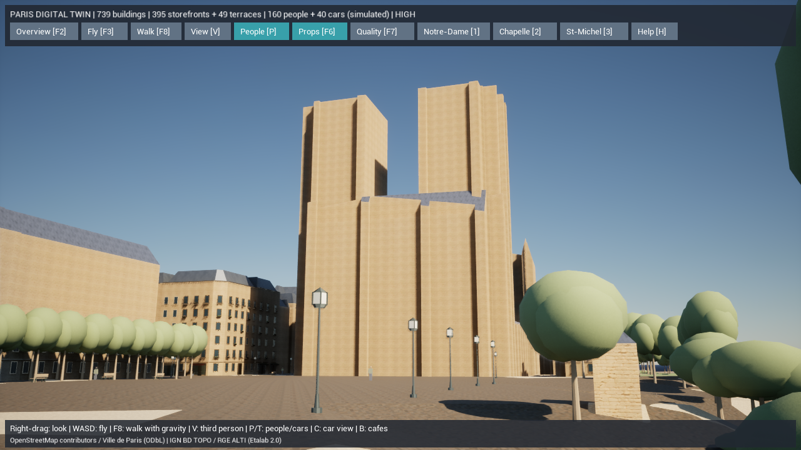
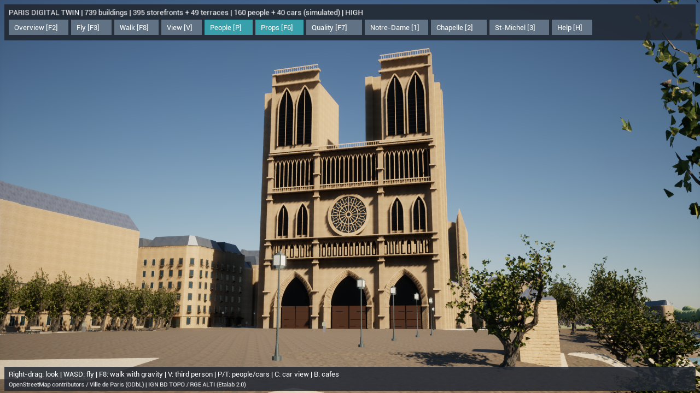
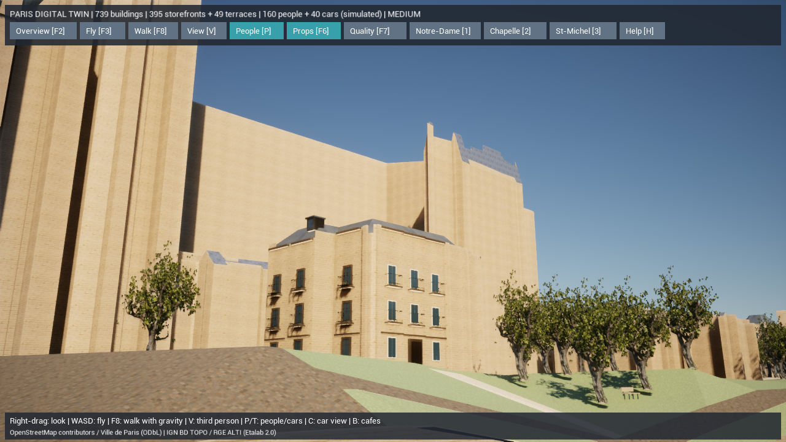

# Paris Photoreal v3 — 近景の形状と樹木

2026-10-16。都市範囲を広げず、ノートルダム西正面の形状、近景の樹木、撮影位置を改善した。写真品質の完成版ではなく、元の箱形から建築要素を持つ表示への段階的な更新である。

## 実装

- **西正面の独立した装飾レイヤー**：3つの尖頭門、重なったアーチ、柱、扉、バラ窓、回廊、28体の彫像の簡易シルエット、双塔の窓、手すり。元のGIS輪郭を基準にしたオリジナルの推定モデル。5メッシュ、102,773三角形。公式資料の西正面幅43.5m、塔高69m、西バラ窓径9.70mを寸法基準とする。彫刻や開口部の細かな寸法・奥行き・配置は推定で、測量モデルや大聖堂全体の完成モデルとは区別する。
- **近景の樹木201本**：Poly HavenのCC0モデル `island_tree_01` を共通のNaniteメッシュとして配置。元データは1,599,403三角形。2KのBase Color・Normal・ARM・葉のOpacityを使用し、葉はMasked / Two Sided Foliage、法線はOpenGL→DirectXへ変換する。樹種の現地同定ではなく外観の代理モデル。OSM位置・ID・元の高さ/樹冠幅・回転を保持する。
- **撮影位置**：正面は川岸から広場側へ、川側は実際の `Pont au Double`（`osm/way/20444388`）上へ移動。正面・川側は28mm相当、街路は35mm相当。橋では描画用の路面メッシュを補間し、その他では歩行面をトレースして地上170cmに合わせる。起動直後の橋の衝突判定に依存せず、河川DEMの高さで橋の下に入る問題を防ぐ。直近の樹木・街灯を避ける。
- **復帰できる表示**：F7のLowでは軽い樹木と元の建物表示へ戻る。再現精度・問題表示・輪郭表示では推定装飾を隠す。追加の建築レイヤーは衝突を持たず、元の歩行・建物選択を維持する。
- **形状の一致確認**：UEのオフライン変換で一部の微小な屋根三角形が除去されることを実テストで検出した。Naniteの代替メッシュをPercentTriangles=100%に指定し、さらに実行時に元の三角形数と照合する。不一致のメッシュは元データから作る既存の厳密な描画方式へ戻す。テストの一致条件は緩和していない。

地理データ739棟、4,799地物、191個の基幹メッシュの比較ハッシュは変更前と同じ：`7ad69c15c2e697908b321b49e0b456c240cd83f59714330371847107003fd1e8`。セーヌ川、道路、建物の実データ、シミュレーションと保存形式を改変していない。

## 主な変更ファイル

| ファイル | 内容 |
|---|---|
| `unreal/scripts/generate_paris_architecture.py` | 既存GISを読み取る西正面の形状生成。取得処理とは独立 |
| `unreal/scripts/bake-paris-architecture.py` | 生成した形状を実在するUEアセットに変換 |
| `unreal/AIWorld/Source/AIWorld/ParisPhotoArchitecture.*` | フレーム照合、装飾の読込、表示切替、実測カウンター |
| `unreal/scripts/fetch_paris_nature.py` | ライセンスとURLを固定したCC0モデルの復元、ハッシュ照合 |
| `unreal/scripts/create-paris-nature.py` | 樹木の座標正規化、PBR・Masked葉・Nanite設定 |
| `unreal/assets/paris-nature/manifest.json` | 13ファイル、約80MBの取得元・MD5・SHA-256 |
| `unreal/AIWorld/Source/AIWorld/ParisDigitalTwin.*` | 近景/遠景のHISM分割、元IDと衝突の維持 |
| `gis/paris_twin/photo_scene.py`, `mesh.py` | 実際の橋と空き地を使う固定カメラ |
| `unreal/AIWorld/Source/AIWorld/ParisPhotoEnvironment.cpp` | カメラのレンズ値をデータから適用 |
| `unreal/AIWorld/Source/AIWorld/ParisRenderCache.cpp`, `bake-paris-photoreal.py` | 代替形状の一致確認と厳密な描画への復帰 |
| `unreal/scripts/Build-ParisPhotoreal.ps1`, `Start-ParisDigitalTwin.ps1` | 再生成とアセット存在確認 |
| `unreal/scripts/Measure-ParisDigitalTwin.ps1` | 同じカメラで追加モデルを無効にした比較測定 |
| `ParisPhotoDetailTests.cpp`, `ParisPhotoTests.cpp`, `ParisDigitalTwinTests.cpp`, Pythonテスト | 表示切替、元ID、カメラ、再現性の検証 |

`Content/ParisPhotoreal/Architecture`、`Content/ParisPhotoreal/Nature`、`Content/Data/paris-photo-architecture.json` が実際に読み込む出力。元の全体モデル候補 `NotreDameCandidate` は配置していない。

## 再生成と検証

```powershell
$env:PYTHONPATH = "$PWD/gis"
gis/.venv/Scripts/python.exe -m paris_twin prepare --offline
unreal/scripts/Build-ParisPhotoreal.ps1
unreal/scripts/Build-AIWorldUE.ps1 -SkipAssets
unreal/scripts/Test-ParisDigitalTwin.ps1 -Photoreal
unreal/scripts/Test-ParisDigitalTwin.ps1 -LegacyJSON
unreal/scripts/Test-AIWorldUE.ps1
gis/.venv/Scripts/python.exe -m paris_twin validate --offline
```

GISは取得済みデータから生成する。樹木の原本が欠けている初回だけ、固定済みマニフェストの公開URLから復元する。ダウンロード後はオフライン生成でき、MD5とSHA-256を照合する。有料APIは使用しない。

変更前のソース/設定104ファイルは `backups/pre-paris-photo-v3-20261016-063901.zip` に退避し、ZIPのCRCを確認済み。

## 品質と未実装

無料で取得済みの大聖堂候補は約30万三角形、16枚の1K画像だが、実際のジオメトリを確認すると上部・屋根・双塔が欠けていた。完成モデルとして配置しない。今回追加した西正面も、公式寸法を使った独自の推定装飾であり、現地計測や彫刻の詳細再現ではない。側面、飛梁、屋根、尖塔を含む全体モデルと、近景の彫刻・汚れ・接合部の品質は引き続き不足する。

次に必要なアセットは、明確な利用・再配布条件、UVとPBRマップを持つ大聖堂全体モデル（Nanite向けに数百万三角形、近景4K程度の石材・装飾、ルーフ/ガラスの材質分離）、周辺建物の現地資料に基づく石材・窓・鉄柵モジュール、近景の人物・カフェ家具である。現地の外観資料とGIS位置の一致を確認してから導入する。未取得アセットを参照して完成とは扱わない。

素材の出典：[Poly Haven tree](https://polyhaven.com/a/island_tree_01)、[CC0ライセンス](https://polyhaven.com/license)。寸法の出典：[ノートルダム公式の建築資料](https://www.notredamedeparis.fr/comprendre/architecture/plans/)。ライセンスの明確な完成モデルを取得できるまでは、西正面レイヤーと元のGISモデルを併用する。

## 実行して確認した内容

- UE 5.8.3のC++ Developmentビルド成功。未実行のビルド結果は含めない。
- UE自動テスト39件成功：Photoreal/軽量データ17件、従来JSON/既存表示17件、既存の村・保存・モデル5件。
- Pythonテスト4件成功：装飾の再生成・元データ不変性、固定カメラと橋の地理座標、遮蔽物回避、描画キャッシュID。
- オフラインGIS検証はエラー0件。元からの建物重複、公式高さの不足、道路ネットワークの分断、範囲端の低い橋2断片の警告は維持し、写真品質や測量精度の達成とは扱っていない。
- 739棟の地理データと基幹形状の比較ハッシュが変更前と一致。最終シーンSHA-256は `4e51a9332f3bc44aea0820ee4fcc77d339083fff9c2f73d59a66e1737f5353bb`。
- マニフェストの原本13ファイルをMD5・SHA-256で再検証。実際に存在する5個の装飾メッシュと樹木メッシュをロードし、低品質への復帰も確認。
- 橋の下にカメラが入る不具合は実画面で発見し、橋メッシュの上向き三角形を補間する方式へ修正。傾斜した路面と裏面の識別、軽量データ/従来JSONの両方をテスト済み。

ログ：[Photoreal](paris-v3-native-photo-tests.log)、[従来表示](paris-v3-native-fallback-tests.log)、[既存の村](paris-v3-village-tests.log)、[Python](paris-v3-python-tests.txt)、[GIS検証](paris-v3-validation.json)、[形状の比較](paris-v3-geometry-contract.json)。

## UE本体の画像

同じ地理データ・同じ正面カメラ・同じ照明で比較した。比較用の無効化フラグは `Measure-ParisDigitalTwin.ps1 -NoArchitecture -NoPhotoNature`。川側は大聖堂側面の簡略形状が残るため、未完成部分も確認できる。

追加モデルを無効にした比較：



新しい正面と樹木：



橋上からの側面。側面・屋根は今後の課題：



## 起動

`Paris-NotreDame.cmd`。または `unreal/scripts/Start-ParisDigitalTwin.ps1 -Photoreal -PhotoCamera Front -Quality High`。

4で正面、5で川側、6で街路へ切り替える。右ドラッグとWASDで自由視点、F7で品質を切り替える。Lowは装飾と新しい樹木を元の軽い表示へ戻す。PCのUE版を確認したもので、iPhoneやWeb版の描画更新ではない。

## 性能の実測

UE 5.8.3、AMD Radeon内蔵GPU、約3GBの予約領域と共有メモリ、使用可能RAM約28.8GB。D3D12 / SM6、Lumen GI・反射、Virtual Shadow Mapsを実際に有効にして測定。別のUEプロセスやビルド・GIS生成を並行させず、5秒の準備後20秒を測定した。

| 表示 | 出力 / 内部解像度 | 平均fps | フレーム時間P95 |
|---|---|---:|---:|
| 同じ正面、追加モデルなし・High | 1280×720 / 100% | 50.40 | 24.28ms |
| 新しい正面・High | 1280×720 / 100% | 43.61 | 28.02ms |
| 橋上の川側・Medium | 1280×720 / 80% | 51.47 | 24.10ms |

60fpsの目標は未達。Mediumの数値は内部解像度80%であり、Highと同じ画質の性能とは扱わない。正面と川側の最終画像は橋のカメラ補正を含むDLLで取得した。

新しい正面では201本の樹木で有効なNaniteデータを確認。GISの静的アセットは17メッシュが一致条件を満たし、残る4メッシュは元の厳密な描画方式に戻った。比較対象156メッシュ全体で元形状との三角形数・色の一致テストが成功し、オフラインアセットの境界誤差0cm・色の不一致0サンプルを確認した。`instance_triangles_before_culling` は比較用の旧プロトタイプ予算で、実際にラスタライズしたNanite三角形数ではない。樹木の代替メッシュ三角形数は別のフィールドで記録する。

記録：[正面](paris-v3-front-high-performance.json)、[追加モデルなし](paris-v3-front-before-performance.json)、[川側](paris-v3-riverside-medium-performance.json)、[検証結果の集約](paris-v3-verification.json)。
