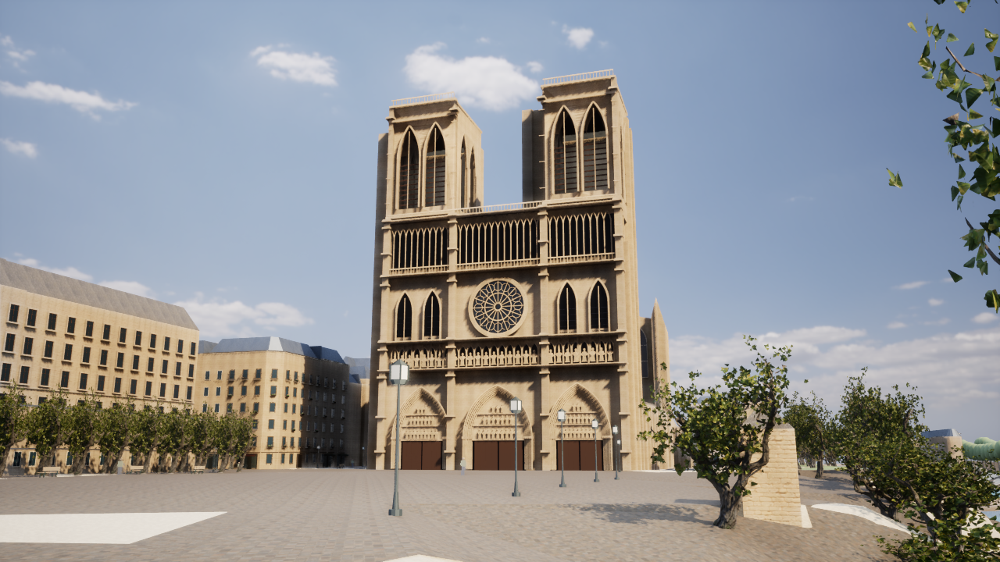
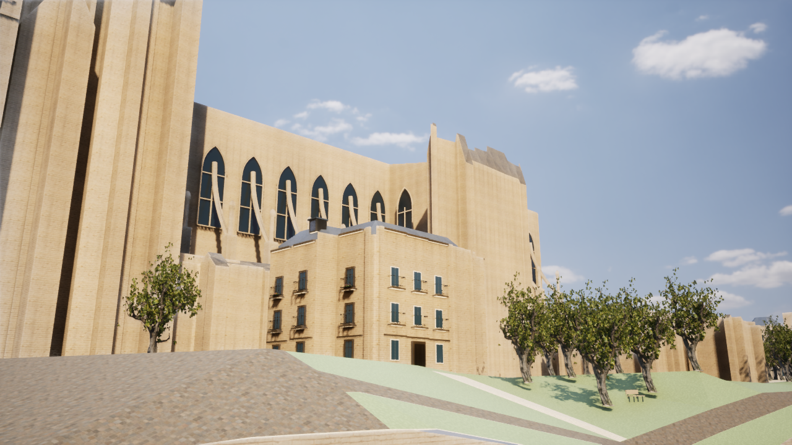

# Paris Photoreal v4

2026-10-16。UE版のノートルダム周辺の品質を改善する更新。都市の範囲・地理データの追加は行っていない。写真品質や、実測に基づく大聖堂全体の完成を意味するものではない。

## 調査した原因

v3のUE実画面で、西正面の黒い平面状の窓、門上部の空白、窓のない大きな側壁、反復する石材、単色の天空が目立っていた。描画はThree.jsではなくUE 5.8.3 / D3D12 / SM6。既存のLumen、Virtual Shadow Maps、物理露出を維持した。

近景の葉については原本glTF、アルファ画像、UEの3つのマテリアルスロットを調査した。幹・葉・枝の順序と割当は一致していた。スロットの取り違えと決めつけて変更していない。樹木は引き続きPoly Havenの外観代理モデルで、現地の樹種や葉形を実測したものではない。

左側の病院 `osm/relation/2449758` は既存の外壁装飾が存在するが、外周のOSM輪郭と描画に使うIGNの高さ別ボリュームの縁が一致しない場所では、窓が壁に埋まっていた。元の描画用ボリュームの辺に沿って補助の窓を生成した。輪郭や高さを見栄えのために移動していない。

## 実装

- **塔の開口と厚み**：西側・側面の壁を実際の開口、石の見込み、柱を持つメッシュにした。元の簡略ボリュームには位置限定のMasked材質を適用して、同じ上部開口が壁でふさがらないようにした。元の頂点、三角形、当たり判定、地物選択は保持する。
- **門と彫刻面**：尖頭門上部を石のティンパヌム、帯、立体的な推定レリーフで埋めた。回廊の人物は頭・胴・腕・衣のひだを持つ立体形状に変更した。個々の彫像の同定や忠実な文化財複製とは区別する。
- **側面**：既存IGNのボリュームの辺から31か所の上部窓と22本の飛梁を生成。飛梁の足が元の建物ポリゴン内に収まる場所のみ使う。形状・細部は推定である。
- **病院の近景窓**：同じIGNボリュームの壁へガラス、立体窓枠、桟、庇・帯を追加。他の高さボリュームに埋まる窓を除外する。元データIDを装飾の出典リストとUEアセットに記録する。
- **石材**：2K写真のBase Color / DirectX Normal / ORMを維持し、数m単位の色むらと縦方向の汚れを重ねた。写真の細かな粒子と大きな変化を分離し、反復を目立ちにくくした。新たな汚れは測量データではなく表現上の補完である。
- **屋根**：CC0の `roof_slates_02` の2K Base Color、Normal、ORMを追加。既存のスレート屋根の材質を写真素材へ変更した。屋根の形状と高さは変更しない。元のプロシージャル材質も保持する。
- **天空**：既存CC0空素材を4Kへ更新し、雲を持つHDRスカイドームを実際に表示する。Sky Lightは同じHDRをSpecified Cubemapとして直接使用する。ドームの係数6000と従来の環境光倍率2に対応して、環境光は12000に設定した。これらは外観の調整値で、パリでの実測照度ではない。静的な撮影環境の再キャプチャを毎フレーム行わず、ライトとドームは再利用する。都市内の原点から一度だけシーンをキャプチャする方法も比較したが、周囲の建物が環境光を遮って日陰が黒くなるため採用していない。
- **比較撮影**：計測スクリプトに `-CleanFrame` を追加。UE標準の `ShowHUD` でHUDだけを隠す。画像生成や後加工を使わず、ゲーム本体のレンダーターゲットを保存する。

最初のUEテストで、カフェ視点と短い会話の2件が失敗した。原因は `AStaticMeshActor` の `bUseDefaultCollision=true` により、球体原本の非同期読込後にBlockAll設定が戻り、空のドームが視線を遮ることだった。単に `SetCollisionEnabled(NoCollision)` を呼ぶだけでは不十分だったため、NoCollisionプロファイル・全チャンネルIgnore・Actorの衝突無効化を明示した。元のテスト条件やタイムアウトは緩めず、既存の2件も含む全件を再実行して通過した。再発防止として、外部の標準衝突設定へ戻らないことも検証している。

Lowでは追加装飾を隠して元の軽い表示へ戻る。再現レベル・問題・輪郭表示でも推定装飾を隠す。`-ParisTwinNoArchitecture` は元の簡略形状を確認するための既存の比較用オプション。`-ParisTwinProceduralSurfaces` は石材・舗装に加えてスレート屋根も元の材質へ戻す。

## 変更ファイル

| ファイル | 内容 |
|---|---|
| `unreal/scripts/generate_paris_architecture.py` | 開口のある塔、彫刻、IGNに沿う側面・近景窓の生成と出典 |
| `unreal/scripts/bake-paris-architecture.py` | 元データIDを記録して実在するNaniteアセットを生成 |
| `unreal/scripts/paris_photo_sources.py` | スレート2K・天空4KのURL、CC0、MD5、SHA-256を固定 |
| `unreal/scripts/create-paris-photo-assets.py` | 石材の大きな色むら、限定開口の材質、天空のグラフ |
| `unreal/scripts/create-paris-assets.py` | スレート屋根の写真材質への接続 |
| `unreal/AIWorld/Source/AIWorld/ParisSurfaceMaterials.cpp` | 大聖堂を含む描画バッチだけに開口材質を割当 |
| `unreal/AIWorld/Source/AIWorld/ParisDigitalTwin.cpp` | スレートの旧材質への復帰 |
| `unreal/AIWorld/Source/AIWorld/ParisPhotoEnvironment.cpp` | 雲のドーム、天空の更新回数、測定値 |
| `unreal/scripts/Start-ParisDigitalTwin.ps1` | 新しい実アセットの存在確認 |
| `unreal/scripts/Measure-ParisDigitalTwin.ps1` | HUDを隠す実画面の撮影 |
| `unreal/AIWorld/Config/Custom/ParisPhotoreal/DefaultEngine.ini` | 通常のVSM描画を保ち、非Naniteの粗い影ページの追加描画を省く |
| `ParisPhotoTests.cpp`, `ParisSurfaceTests.cpp`, `tests/test_paris_architecture.py` | 重複防止、材質接続、実際の開口、元データ保持と再生成の検証 |
| `README.md` | 更新内容と検証記録への入口 |

出力は `Content/Data/paris-photo-architecture*.json`、`Content/ParisPhotoreal/Architecture`、`Content/Materials`、`Content/Textures`。未取得の外部モデルへの参照を完成扱いにしていない。

## 再生成・実行

```powershell
# 原本がない場合のみ取得。有料APIやゲーム実行中のAPI呼出は使わない。
gis/.venv/Scripts/python.exe unreal/scripts/paris_photo_sources.py --download

# 取得済み原本から生成する。UEのAIWorld画面を閉じて実行する。
unreal/scripts/Build-ParisPhotoreal.ps1
unreal/scripts/Build-AIWorldUE.ps1 -SkipAssets
unreal/scripts/Test-ParisDigitalTwin.ps1 -Photoreal
unreal/scripts/Test-ParisDigitalTwin.ps1 -LegacyJSON
unreal/scripts/Test-AIWorldUE.ps1
unreal/scripts/Measure-ParisDigitalTwin.ps1 -View Front -Photoreal -Quality High -CleanFrame -CaptureAfter 16 -ReportPath docs/paris-v4-front-high-performance.json
```

起動は `Paris-NotreDame.cmd`。4で正面、5で川側、6で街路。右ドラッグとWASDで移動、F7で品質切替。

変更前の149ファイルを `backups/pre-paris-photo-v4-20261016-074922.zip` に退避し、ZIPのCRCを確認した。既存の未コミット変更は保持している。

## 不足するアセットと表現

大聖堂全体の実測・写真測量モデルは未導入。既存の無料モデル候補は屋根・双塔が欠けるため、引き続き完成モデルとして配置していない。現在の彫刻は独自の推定レリーフであり、文化財そのものの高精度複製ではない。

実写に近づけるには、明確な再配布条件のある西正面の彫刻・装飾モデルと、大聖堂全体の適切なUV、石材/金属/ガラスの材質分離が必要。近景は4K程度のPBR、数百万三角形のNanite用原本を想定する。周辺の店舗内装、人物、街灯・家具の高品質モデル、現地での外観照合も不足する。未取得アセットは参照していない。

位置限定のMasked材質は元の表示を切り抜くもので、元のGISコリジョンや事前生成された距離場を穴のある文化財モデルに変えるものではない。塔内部を歩く機能や内部の光学精度は今回の完成条件に含めない。

素材の出典：[屋根](https://polyhaven.com/a/roof_slates_02)、[石材](https://polyhaven.com/a/white_sandstone_blocks_02)、[舗装](https://polyhaven.com/a/cobblestone_pavement)、[天空](https://polyhaven.com/a/kloppenheim_05_puresky)、[CC0](https://polyhaven.com/license)。建物の大枠の寸法は[ノートルダム公式](https://www.notredamedeparis.fr/comprendre/architecture/plans/)を参照する。

## 実行結果

- UE 5.8.3 C++ Developmentビルド成功。最終DLL SHA-256：`c54d7f5eadc45227abaf0d67dc372518f40dd44b2241c1be217ee7f065f72ef0`。
- 最終DLLでUEテスト39件通過：Photoreal 17件、従来JSON/従来表示17件、村・保存・プロトコル5件。材質生成後の接続確認1件も別途通過。
- Pythonテスト6件通過：生成の再現性と元データの保持、実際の塔の開口、素材のハッシュ・色空間・チャンネル・ライセンス・パスの検査。
- 追加の建築レイヤーは5メッシュ、295,743三角形。実際のUEアセットの代替メッシュの三角形数もすべて一致した。近景窓852か所、上部窓31か所、飛梁22本。装飾は当たり判定を持たない。
- 元シーンのSHA-256は変更前と同じ `4e51a9332f3bc44aea0820ee4fcc77d339083fff9c2f73d59a66e1737f5353bb`。739棟・4,799地物・191個の基幹メッシュの比較ハッシュも `7ad69c15c2e697908b321b49e0b456c240cd83f59714330371847107003fd1e8` のまま。
- 最終起動時のオフラインGIS検証はエラー0件、座標往復誤差は最大約2.8×10⁻⁹m。元からの建物重複、362棟の公式軒高の不十分な被覆、道路の分断、範囲端の低い橋2断片の警告は保持し、測量精度が向上したとは扱っていない。
- UEの表示キャッシュと元形状の境界誤差0cm、頂点色の不一致0件。17個の既存焼込表示アセットと、201本のNanite樹木を実際にロードした。ゲームAI、保存形式、Docker構成は変更していない。
- 全画像はUE本体の実画面。画像生成AI・画像の後加工は使っていない。正面・川側とも黒い天空や黒つぶれた日陰を解消した状態を目視確認した。写真品質の達成とは扱わない。

実行ログ：[UE Photoreal](paris-v4-native-photo-tests.log)、[従来JSON](paris-v4-native-legacy-tests.log)、[村と保存](paris-v4-village-tests.log)、[形状生成](paris-v4-architecture-tests.txt)、[素材](paris-v4-source-tests.txt)、[地理の比較](paris-v4-geometry-contract.json)、[機械可読の最終記録](paris-v4-verification.json)。

## 性能

AMD Radeon内蔵GPU、予約VRAM約3GB＋共有メモリ、使用可能RAM約28.8GB。D3D12 / SM6、Lumen GI・反射、Virtual Shadow Maps有効。5秒の準備後20秒測定し、他のUEプロセス・ビルド・GIS生成は並行させていない。

| 最終設定 | 出力 / 内部解像度 | 平均fps | フレーム時間P95 |
|---|---|---:|---:|
| 正面 High | 1280×720 / 100% | 41.56 | 28.56ms |
| 川側 Medium | 1280×720 / 80% | 49.83 | 23.98ms |

記録：[正面](paris-v4-front-high-performance.json)、[川側](paris-v4-riverside-medium-performance.json)。

GPUの計測で、影、とくに非Naniteの影の描画が大きな負荷だった。現状は不透明/Maskedの材質を使い、Volumetric Fogも無効なので、Photorealプリセットで `r.Shadow.Virtual.NonNanite.IncludeInCoarsePages=0` とした。通常のVSM受け面への影は保持し、追加の粗い影ページだけを省く。正面の画像を比較して柱・建物・樹木の影を確認した。同じ正面の1回の比較では38.86→41.56fps、約7%改善。将来Forward Lit TranslucencyやVolumetric Fogを導入する場合は、粗い影が必要か再検証し、この設定を見直す。

単一GPUフレームの比較では、Graphics 30.70→27.30ms、ShadowDepths 14.27→12.31ms、非Nanite VSM 12.46→10.34ms。Computeの11.11msは並行実行されるためGraphicsの値に加算しない。GPUフレーム27.30msは60fpsの予算16.67msを超え、**60fpsは未達**。影とLumenを含むGPU負荷が引き続き課題である。各パスの単発測定を、20秒の平均値やすべての視点の保証とは扱わない。

GPU記録：[変更前](paris-v4-front-gpu-breakdown.json)、[変更後](paris-v4-front-gpu-after-breakdown.json)、[変更後の原ログ](paris-v4-front-gpu-after-performance.gpu.log)。次は高精度アセットの導入と合わせて、影を落とす描画バッチと遠景LODを調査する。描画距離や都市の範囲を拡大して解決したとは扱わない。

## UE実画面

変更前のv3：


v4最終版。同じ地理座標・カメラでHUDだけを隠して撮影：



橋上からの側面。実測モデルの不足と未装飾部分も確認できる：


