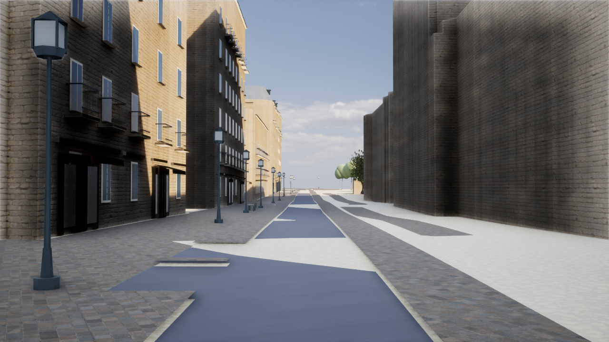
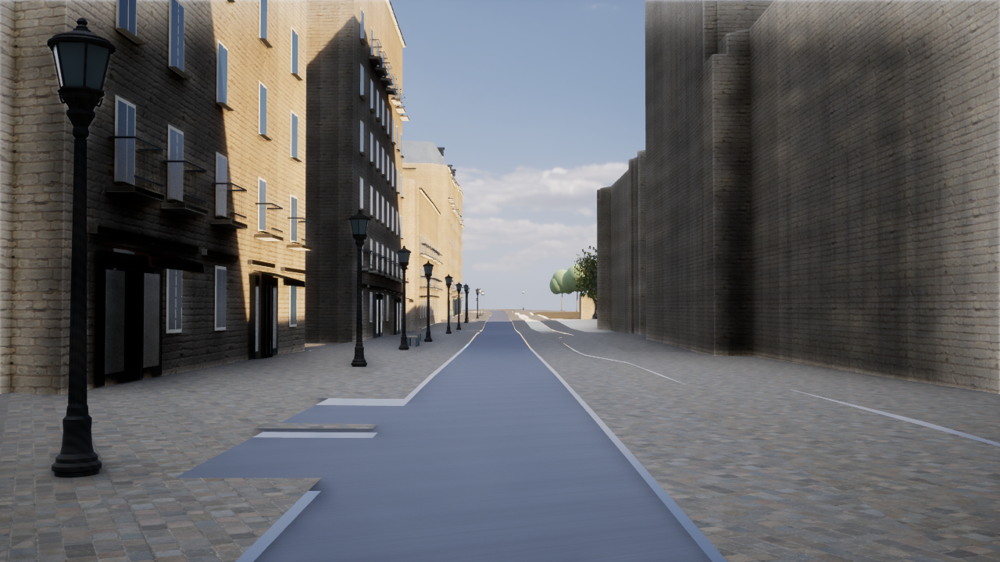
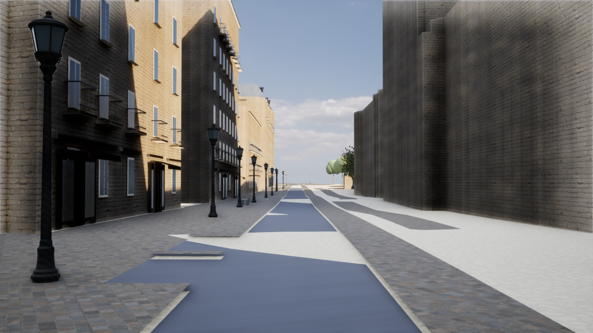
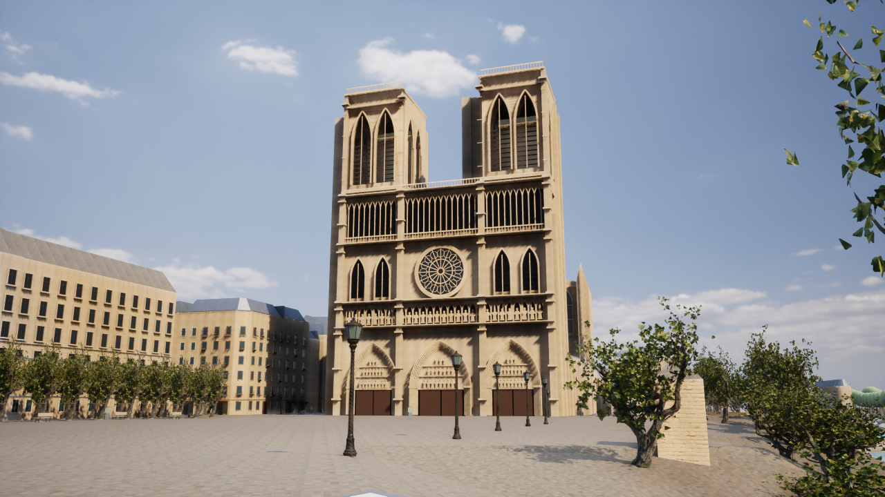
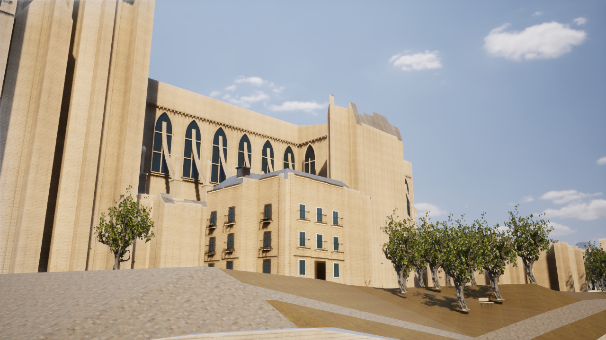

# Paris Photoreal v5 — 近景の街灯・緑地・石造装飾と道路表示の修正

都市の範囲は拡張せず、既存のパリ地区とノートルダム周辺の表示を改善した。UE 5.8.3 / Three.jsへの切替ではなく、UE版の実装である。測量に基づく完成版の大聖堂モデル、写真品質の達成としては扱わない。

## 実装した内容

- 地図に登録済みの近景街灯を、鋳鉄の台座・縦溝・六角の枠・鋲・曲線装飾・屋根を持つ共有モデルに変更。正規化した高さは448cm、金属5,208三角形とガラス12三角形の2メッシュ。170m以内を詳細表示し、元の位置・向き・スケール・地理ID・衝突判定を保持する。外観は独自制作の推定意匠で、現地の実際の器具を測量したモデルではない。
- 街灯の鋳鉄に色むら・酸化のPBR材質、ガラスに反射する不透明の代理材質を追加。透過ガラスや夜間の点光源は今回追加していない。繰り返し配置はISMで2バッチに集約し、描画専用の装飾に衝突を持たせない。
- 地図上の公園ポリゴンに、[Poly Haven Sparse Grass](https://polyhaven.com/a/sparse_grass)（Amal Kumar、[CC0](https://polyhaven.com/license)）の2K Base Color / DirectX Normal / ORMを使用。実寸2mタイル。取得URL・作者・サイズ・MD5・SHA-256・色空間をmanifestに保存し、キャッシュが揃えばオフラインで再生成できる。現地の植生を撮影・計測した素材ではない。
- 大聖堂側面の飛梁を丸い棒から矩形の石造リブへ変更し、控壁の台座・帯と軒の持送り・水平の石造コーニスを追加。既存のIGNボリュームの縁を基準とする推定装飾で、地理・高さの元データは変更しない。建築レイヤー全体は5メッシュ、291,335三角形。
- 道路・歩道・広場・公園・河川・橋の下に隠れる地形を、表示用メッシュから正確に除外。元の地形データと衝突用メッシュは保持する。低品質・輪郭・精度・問題表示では元の地形表示へ戻す。
- 道路等のデータに覆われない近景の露出地面は、西正面基準点から100m以内に限って石畳のPBRを補完し、130mまでに元の地形色へ滑らかに戻す。これは推定の舗装表現であり、実際の土地被覆を計測・登録したものではない。元の地形・道路・公園の分類は変えない。

## 道路の白い三角模様の原因

同じDEMを使っても、地形と道路を異なる三角形で補間すると、高さが数cmずれる。街路カメラの前方60mの確認点では、元の地形がUE Z=-117.78cm、道路が-121.12cmで、地形が3.34cm高かった。これが道路を突き抜ける広い三角形として見えていた。

既存の道路等の**実際の描画三角形のXY範囲**で地形を切り抜き、残った面のZを元の地形三角形上で補間する。地形を一律に沈めるオフセットは使わない。生成時は30,896三角形、UE保存後の実際のRenderDataは30,419三角形。元の地形2,993三角形と衝突判定、WGS84/EPSG:2154の座標はそのまま残る。表示用アセットに元シーンのSHA-256を記録し、入力が一致しない場合は元の表示へ戻す。

UE保存後のRenderDataを実際に取り出して元の面範囲と比較した。約273,692m²に対する面積差は0.07421m²で、差はすべて0.5mm以内の境界帯に収まる。境界帯の外で欠落・過剰な面積は0m²、サンプル点の最大Z誤差は0.000361cmだった。三角形数が一致したと偽らず、保存後の範囲と高さでも検証した。[検証JSON](paris-v5-ground-render-validation.json)。

物理用の地形は既存データのままなので、道路面との数cmの差も物理側には残る。今回の変更は表示の突き抜けの解消であり、地形・道路の元データを統合して再生成したという意味ではない。

## 操作と再生成

`Paris-NotreDame.cmd` で起動。`4` 正面、`5` 川側、`6` 街路、右ドラッグで自由視点、WASDで移動。`F7` 品質切替、`F6` 街路設備、`F1` 建物精度表示。Lowでは元の簡易街灯・地形表示へ戻る。

```powershell
./unreal/scripts/Build-AIWorldUE.ps1 -SkipAssets
./unreal/scripts/Build-ParisPhotoreal.ps1
./unreal/scripts/Test-ParisDigitalTwin.ps1 -Photoreal
./unreal/scripts/Test-ParisDigitalTwin.ps1 -LegacyJSON
./unreal/scripts/Test-AIWorldUE.ps1
./unreal/scripts/Start-ParisDigitalTwin.ps1 -Photoreal -PhotoCamera Front -Quality High
```

比較用の測定例。`-NoGroundCutout` は今回の地形の表示補正（切り抜き・近景舗装）を無効にし、`-NoPhotoStreet` は装飾街灯だけを元に戻す。

```powershell
./unreal/scripts/Measure-ParisDigitalTwin.ps1 -View PhotoStreet -Photoreal -Quality High -Duration 20 -CaptureAfter 16 -CleanFrame -ReportPath docs/paris-v5-street-high-performance.json
```

## 検証結果

<!-- VERIFIED_RESULTS -->
- C++ Developmentビルド成功。[最終ビルド記録](paris-v5-build-final.log)。DLL SHA-256：`807456c52afa6b71648b212f596c8a6b09e7d5862ebce02b498b879e15342ed6`。
- UEテスト41件通過：Photoreal 18件、従来JSON/表示18件、村・保存・プロトコル5件。最終の舗装材追加後にもPhotoreal 18件を再実行し、すべて通過。[Photoreal](paris-v5-native-photo-tests.log)、[従来表示](paris-v5-native-legacy-tests.log)、[村・保存](paris-v5-village-tests.log)。
- Pythonテスト9件通過：建築2件、素材5件、街灯1件、地形1件。元データの保持、同一入力での再生成、実際の開口、面範囲・高さ、正常な三角形・法線、素材の改変・欠損・色空間・ライセンス・古いキャッシュを検証。
- 保存済みUE RenderDataの面範囲・高さも別途検証し、合格。[検証結果](paris-v5-ground-render-validation.json)。
- 739棟・4,799地物・191基幹メッシュの比較ハッシュは変更前と同じ `7ad69c15c2e697908b321b49e0b456c240cd83f59714330371847107003fd1e8`。[比較記録](paris-v5-geometry-contract.json)。元シーンSHA-256も `4e51a9332f3bc44aea0820ee4fcc77d339083fff9c2f73d59a66e1737f5353bb` を維持。
- UE実行時に近景の街灯63本を2描画バッチで確認。地理上の街路設備数は2,018、元の5,607インスタンスを保持する。木は従来の実モデル201本を継続し、建物の表示キャッシュの境界誤差・色の不一致はともに0。
- 最終起動時のオフラインGIS検証はエラー0。既存の警告（OSM輪郭の重なり、362棟の軒高資料不足、道路の分断、境界で切れた低い橋2片）は残る。往復座標誤差の最大は2.79×10⁻⁹m。[起動・検証記録](paris-v5-launch.log)。

初回の街灯保存は出力先フォルダーがなく失敗し、続く作成でもフォルダーの存在判定で失敗した。実パスでのフォルダー作成とUEへの登録を行うように修正し、UE内でOSのDirectory属性を確認してから再実行した。Street/Groundのコマンドレットは正常終了し、最終の材質更新と地形保存も正常終了した。アセット未生成の段階で先に実行したテストの失敗も残し、生成後にすべて再検証した。失敗を成功として数えていない。[初回保存](paris-v5-assets-initial-failure.log)、[保存の再試行](paris-v5-assets-retry-failure.log)、[生成完了](paris-v5-assets-completion.log)、[最終材質](paris-v5-final-materials.log)、[初回テスト失敗](paris-v5-native-photo-initial-failure.log)。

機械可読の集約：[paris-v5-verification.json](paris-v5-verification.json)。
<!-- /VERIFIED_RESULTS -->

## 実機性能

Ryzen 7 7735HS / AMD Radeon内蔵GPU、使用可能RAM約28.8GB、共有メモリを利用する環境。D3D12 / SM6、ソフトウェアLumen GI・反射、Virtual Shadow Mapsを使用。出力1280×720、5秒の準備後20秒測定。ほかのUE・ビルド・GIS生成は並行させず、通常のアプリは終了していない。

| 視点 / 設定 | 内部解像度比率 | 平均fps | フレーム時間P95 |
|---|---:|---:|---:|
| 街路 High | 100% | 28.64 | 41.68ms |
| 正面 High | 100% | 37.32 | 34.50ms |
| 川側 Medium | 80% | 45.69 | 27.27ms |
| 街路 Medium・GPU診断表示あり | 80% | 32.41 | 36.81ms |

記録：[街路High](paris-v5-street-high-performance.json)、[正面High](paris-v5-front-high-performance.json)、[川側Medium](paris-v5-riverside-medium-performance.json)、[街路Medium診断](paris-v5-street-medium-gpu-performance.json)。Mediumは平均30fpsを上回るが、常時30fps以上の保証ではない。**60fpsの目標は未達。**

街路Mediumで開始約3秒のGPUフレームを別途採取した。Graphics 36.305ms、ShadowDepths 17.585ms（内、非Nanite VSM 14.615ms）、BasePass 10.965ms。Compute側は26.090ms、LumenScreenProbeGatherは14.912ms。キューは並行動作するためComputeとGraphicsを足し合わせない。これはウォームアップ完了前の単発フレームであり、上表の20秒平均の代わりには使わない。

このサンプルでは、非Naniteの影、基礎描画、Lumen GIが大きなGPU負荷になっている。次の最適化では、影を落とすメッシュの距離・分割と近景/遠景の材質負荷を調整する。画質追加で60fpsまで改善したとは報告しない。[内訳](paris-v5-street-medium-gpu-breakdown.json)、[元のGPUログ](paris-v5-street-medium-gpu-performance.gpu.log)。

## UE実画面

以前の街路表示：



今回の街路。装飾街灯、地形の表示補正、近景の推定舗装を有効にした最終版：



同じ新しい街灯を使い、地形の表示補正だけを無効にした比較：



正面と川側。河岸の草地素材は乾いた草・土の外観であり、現地の植生の再現を保証するものではない：





## 主な変更ファイル

| 役割 | ファイル |
|---|---|
| 街灯の形状とUE保存 | `unreal/scripts/generate_paris_street_detail.py`, `bake-paris-street-detail.py` |
| 地形の切り抜きとUE保存 | `unreal/scripts/generate_paris_ground_display.py`, `bake-paris-ground.py` |
| 保存後の形状検査 | `unreal/scripts/inspect-paris-ground-asset.py`, `check_paris_ground_render.py` |
| 大聖堂の石造装飾 | `unreal/scripts/generate_paris_architecture.py`, `bake-paris-architecture.py` |
| 素材の取得・検証・材質生成 | `unreal/scripts/paris_photo_sources.py`, `create-paris-photo-assets.py`, `unreal/textures/paris-photo/manifest.json` と草地の3画像・提供元メタデータ |
| UEでの差し替え・表示切替・統計 | `unreal/AIWorld/Source/AIWorld/ParisDigitalTwin.cpp`, `ParisPhotoArchitecture.cpp/.h`, `ParisGroundDisplay.cpp/.h`, `ParisSurfaceMaterials.cpp` |
| 自動検証 | 同Source配下の `ParisGroundTests.cpp`, `ParisPhotoDetailTests.cpp`, `ParisSurfaceTests.cpp`, `ParisDigitalTwinTests.cpp`; `unreal/scripts/tests/test_paris_ground_display.py`, `test_paris_street_detail.py`; `gis/tests/test_photo_sources.py` |
| ビルド・起動・比較測定 | `unreal/scripts/Build-ParisPhotoreal.ps1`, `Start-ParisDigitalTwin.ps1`, `Measure-ParisDigitalTwin.ps1`, `Test-ParisDigitalTwin.ps1` |
| UEアセットと中間設定 | `Content/ParisPhotoreal/Street`, `Ground`, `Architecture` の新規uasset、`Content/Materials` の材質、`Content/Textures` の草地3画像、`Content/Data/paris-photo-{street,ground,architecture}.json` |
| 案内 | `README.md`, `.gitignore`, 本資料と実画面・検証記録 |

大きな生成用JSONはignoreし、取得元・生成スクリプト・実際のuasset・小さい実行時manifestを残す。変更前のバックアップ：`backups/pre-paris-photo-v5-20261016-084124.zip`（143ファイル、6,222,432bytes、ZIP CRC検証済み）。既存の未コミット変更を含む作業コピーを保存した。

## 残る品質上の課題と次の工程

大聖堂の細部は引き続き推定によるオリジナル制作で、現物を測量した高精細モデルではない。近景の石彫、トレーサリー、扉、窓の奥行き、周辺建物の実際の立面、植生・人物・車両の形状が必要。街灯のガラスも不透明の代理表現である。写真のような完成品質としては報告しない。

次は文化財の参照資料・権利が明確なモデルを基に、正面100m内の実際の彫刻・窓・屋根を整える。必要アセットはUVとPBRを備える大聖堂の完全な外装、窓・門・鉄柵・バルコニーの近景モジュール、近景に耐える葉と人物である。近景材質は2K〜4K、実寸とテクセル密度を明記し、このPCの共有VRAM予算に合わせて使用する。存在しない完成モデルの参照や都市範囲の拡張で品質を達成したとは扱わない。
