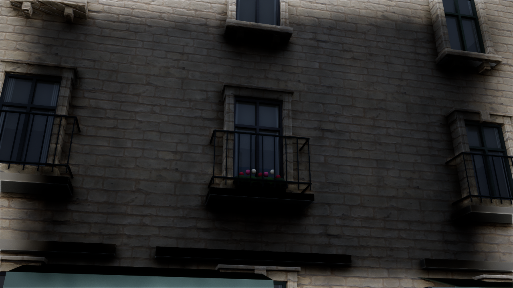

# Paris Photoreal v6 — 近景の窓と表示キャッシュ

2026-10-16。対象範囲は既存地区のまま。街路の窓の改善と描画経路の整備を実装した。実測された高精細ファサードや、完成した実写デジタルツインではない。

## 実装

- ノートルダム西正面から100m以内、15棟・584か所の既存窓へ、立体の石製枠、段付きの窓台、持ち送り、塗装木製の桟を追加。3つの共有メッシュ、115,828三角形。位置・幅・高さは既存の窓の四角形から取得した。
- ガラスに専用UVと不透明のPBRマテリアルを設定。見る方向に応じた簡易室内とカーテンを表現する。室内はシェーダー上の推定表現であり、実際の室内メッシュや調査済みの部屋ではない。窓の配置自体も従来の推定配置である。
- 病院と大聖堂は既存の専用装飾を保持し、窓の追加対象から除外。新しい装飾には衝突判定・ナビゲーション・オーバーラップイベントを持たせない。Low、平面マテリアル、輪郭、再現レベル、問題表示では追加レイヤーを非表示にする。
- 建物・屋根の既存21件の近景用表示アセットを維持する。広域の追加Nanite化も同条件で試したが、内蔵GPUでは街路Highが26.50fps、追加なしが28.88fpsとなり、約8.3%遅かったため採用しなかった。試験用135アセットはバックアップへ退避し、実装から除外した。最終実装は元の17件の正確なNanite表示と、形状差がある場合の既存フォールバックを維持する。
- Nanite使用時に未保存のマテリアル用途フラグが要求されていた問題を修正。実際のスロットと親マテリアルを調べ、17種類の用途フラグを保存した。素材のグラフ・テクスチャ・ライセンスは変更していない。
- 性能測定ではUEのアセットコンパイル管理に登録されたシェーダー、テクスチャ、メッシュ、距離場、メッシュカードの準備を待つ。準備中は計測開始時刻を戻し、完了後5秒のウォームアップを経て20秒計測する。未設定のNanite用途、マテリアルコンパイル失敗、準備中の測定結果を検出したら失敗にする。

## 維持したデータ

主要メッシュ191件、739棟、元地物4,799件の契約ハッシュは `7ad69c15c2e697908b321b49e0b456c240cd83f59714330371847107003fd1e8` のまま。

`paris-digital-twin.json`、軽量JSONとバイナリ、GIS処理モジュールを変更していない。新しい補助マニフェストは元シーンのSHAと原点を照合する。座標への変換は追加しない。装飾と推定室内の出所をメタデータに記録する。

## 変更ファイル

|役割|ファイル|
|---|---|
|窓の抽出・形状生成|`unreal/scripts/generate_paris_frontages.py`|
|窓用素材・アセット生成|`unreal/scripts/bake-paris-frontages.py`|
|Naniteマテリアルの保存と検査|`unreal/scripts/ensure-paris-nanite-materials.py`|
|表示レイヤー・SHA/原点検査|`unreal/AIWorld/Source/AIWorld/ParisPhotoFrontages.cpp`, `.h`|
|起動と品質切替、準備後の測定|`ParisDigitalTwin.cpp`, `ParisPhotoArchitecture.cpp`|
|自動検証|`ParisFrontageTests.cpp`, `unreal/scripts/tests/test_paris_frontages.py`, `Test-ParisDigitalTwin.ps1`|
|生成・起動・比較測定|`Build-ParisPhotoreal.ps1`, `Start-ParisDigitalTwin.ps1`, `Measure-ParisDigitalTwin.ps1`|
|生成物|`Content/Data/paris-photo-frontages.json`, 新規窓メッシュ、17種類の親マテリアル|
|生成元の除外|`.gitignore`（再生成できる窓形状JSONとPythonキャッシュ）|

変更前に `backups/pre-paris-photo-v6-20261016-133122.zip`、既存マテリアルの設定を変える前に `backups/pre-paris-v6-nanite-materials-20261016-134735.zip` を作成し、ZIPのCRCを検査した。

## 再生成と検証手順

```powershell
./unreal/scripts/Build-AIWorldUE.ps1 -SkipAssets
./unreal/scripts/Build-ParisPhotoreal.ps1
./gis/.venv/Scripts/python.exe -m unittest discover -s unreal/scripts/tests -p test_paris_frontages.py -v
./unreal/scripts/Test-ParisDigitalTwin.ps1 -Photoreal
./unreal/scripts/Test-ParisDigitalTwin.ps1 -LegacyJSON
./unreal/scripts/Test-AIWorldUE.ps1
./unreal/scripts/Measure-ParisDigitalTwin.ps1 -Photoreal -View PhotoStreet -Quality High -Duration 20 -CaptureAfter 16 -CleanFrame -ReportPath docs/paris-v6-street-high-performance.json
./unreal/scripts/Start-ParisDigitalTwin.ps1 -Photoreal -PhotoCamera Street -Quality Medium
```

アセットを更新する前に本プロジェクトのUEウィンドウを閉じる。Pythonからデータを生成する段階とUEアセットを生成する段階を分離している。表示比較には測定スクリプトの `-NoFrontages` を使える。`-View WindowDetail` は街路カメラの位置を保ち、最も近い上階の既存窓へ向ける検査用の視点である。追加レイヤーの有無で同じ構図を使う。

## 検証結果と測定

- UE 5.8.3 / D3D12・SM6 / ソフトウェアLumen / Virtual Shadow Maps。Ryzen 7 7735HS内蔵AMD Radeon、RAM 28.8GB、UMA。出力1280×720、Highは内部100%、Mediumは80%。他のUEプロセスなし。
- C++ビルド成功。最終DLL SHA-256: `840977fcd750a2629d22dfeddc7adda7ba15c67ccc4a1825ac5be5c76522680c`。
- UEテスト43件成功（Photoreal 19 / Legacy JSON 19 / 村 5）。Pythonの窓検証4件成功。UVの実レンダーデータ、Naniteマテリアル用途フラグ、衝突・品質/デバッグ切替、異なる元シーンの拒否を検証した。
- 主要メッシュの契約ハッシュと元シーン全体のSHAが変更前と一致。描画キャッシュの境界誤差0cm、パレット不一致0。最終版のNanite表示用建物/屋根は17メッシュ。窓の追加表示は3メッシュ・584窓・115,828三角形。
- 全測定で準備中ジョブ数0、同一DLL、同一元シーンを確認。平均fpsは性能保証ではなく、この環境での単回測定値。60fpsの目標は未達。

|視点|平均fps|P95フレーム時間|
|---|---:|---:|
|街路 High|27.36|42.43 ms|
|街路 Medium|31.97|36.63 ms|
|大聖堂正面 High|39.14|30.20 ms|
|川沿い Medium|46.79|25.86 ms|
|窓の検査 High・追加後|25.84|44.76 ms|
|窓の検査 High・追加前|26.91|43.12 ms|

窓の比較は同じ歩行者カメラ位置・方向・光源・露出で、新しい表示レイヤーのみを切り替えた。窓の枠の厚み・窓台の影・反射とカーテンを目視確認した。新しい装飾による負荷は、この検査視点で約4%のfps低下だった。


[同じ視点の追加前](screenshots/paris-v6-window-detail-before.png) / [街路](screenshots/paris-v6-street-high.png) / [大聖堂正面](screenshots/paris-v6-front-high.png) / [川沿い](screenshots/paris-v6-riverside-medium.png)

集計は [paris-v6-verification.json](paris-v6-verification.json)。各測定の元JSONとテストログも `docs/paris-v6-*` に保存した。Docker・Web版は変更しておらず、今回はUE版のビルド・検証を実行した。検証後に街路ビュー・MediumでUE版を開き直し、739棟の準備完了ログとウィンドウ応答を確認した。

初回の `paris-v6-street-warmup-performance.json` と `paris-v6-compiling-warmup-performance.json` は準備処理を含み、性能評価には使用していない。用途フラグの警告を保存した `paris-v6-initial-warmup.log` と、準備中の撮影 `screenshots/paris-v6-compiling-warmup.png` を原因確認の記録として保持した。広域キャッシュの比較は最終版より前の同一DLLで実施した。[追加あり](paris-v6-wide-cache-performance.json) と [追加なし](paris-v6-street-no-extra-performance.json) は同じカメラ・光源・画質。単回測定のため、差の統計的な再現性までは主張しない。

## 残る品質の限界と次の作業

大聖堂は既存の独自に生成した推定建築モデルのまま。調査済みの高精細な全面モデルへの置換は未完了。街路の店舗、バルコニー、人物、樹木と、建物の大きな平面部分も実写品質には達していない。今回は地区を拡張していない。

次はライセンスと現地との対応が確認できる大聖堂の詳細アセット、近景の店舗と玄関、実資料に基づく屋根・バルコニーを優先する。遠景の表示距離と影の負荷の最適化を行い、現在の内蔵GPUに合う品質予算を測定して決める。
