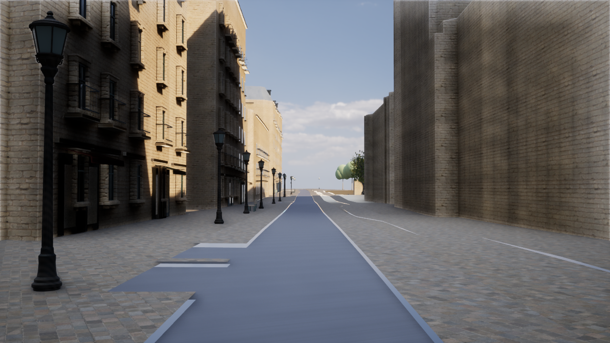
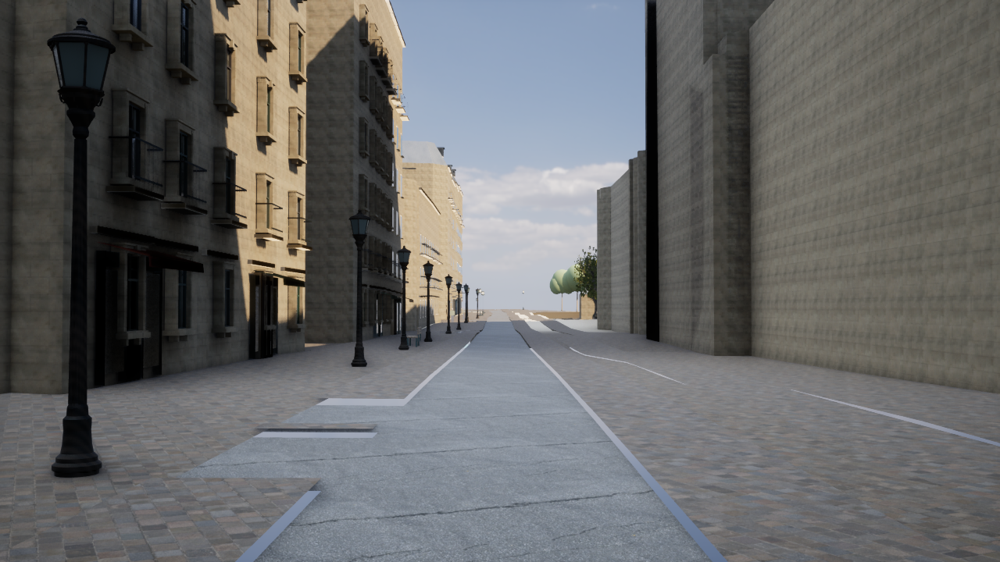
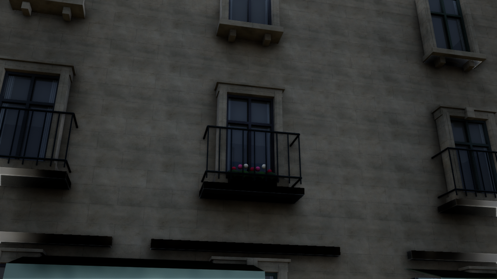
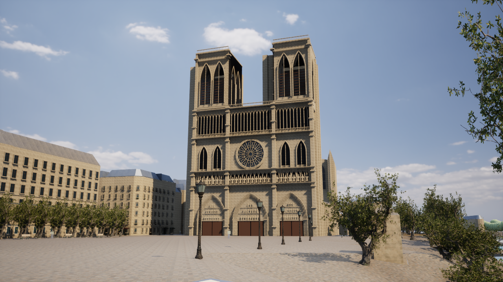

# Paris Photoreal v7 — 面材とエッジの改善

2026-10-16。地区の拡張と地理データの追加を行わず、既存の建物・窓・道路の外観を更新した。実写品質の完成版ではない。

## 調査と変更

前版のスクリーンショットでは、全体に強く出る粗い砂岩の目地と表面凹凸が、街並みを模型・石積みの城壁のように見せていた。窓枠の直角の角と、平坦で青みの強い道路も残っていた。

- 外壁・既存の石材装飾の表面を、写真由来の細粒面と浅い切石の目地へ変更。目地は32cm×88cmの推定パターンで、凹凸は法線で表現する。元メッシュを変位させない。表面の粒子はスキャンした漆喰素材を用いた外観の補完で、パリの石灰岩を現地スキャンした素材ではない。
- 目地の画面上の太さを微分で調整し、遠距離でのちらつきを抑える。表面法線を弱め、過大な凹凸を避ける。石ごとの色の違いを小さく付ける。日光、環境光、露出、撮影位置は前版の設定を維持。
- 15棟・584窓の石枠・窓台・持ち送りに3.5mmの面取りを追加。26面の閉じた形状として生成し、元の外形寸法を保つ。窓の位置・大きさ・ガラス・元の衝突判定は維持。
- 道路には写真由来の2Kアスファルトを追加。元の道路形状と幅を保ち、写真素材の3mスケールで貼る。道路だけの専用マテリアルにし、既存の手続き生成版も維持。
- 外観素材のオフライン検証に、素材IDと実寸スケールの一致検査を追加。古い素材がハッシュ検査だけを通って再利用されることを防ぐ。

大聖堂は既存の推定モデルを維持。屋根・彫刻・店舗・人物を調査済みの高品質モデルへ置き換えたという主張はしていない。

## 素材とライセンス

新規素材は [White Plaster 02](https://polyhaven.com/a/white_plaster_02) と [Asphalt 02](https://polyhaven.com/a/asphalt_02)（Rob Tuytel / Poly Haven）。[公式ライセンス](https://polyhaven.com/license) でCC0を確認した。前者の実寸は1m、後者は3m。Base ColorはsRGB、法線とORMは線形、DirectX法線としてインポートする。2Kの原本の提供元MD5・サイズとローカルSHA-256を検証し、`unreal/textures/paris-photo/manifest.json` に記録した。

[Public APIの条件](https://github.com/Poly-Haven/Public-API/blob/master/ToS.md) に沿った識別用User-Agentを付け、開発時に取得して保存する。ゲーム実行時には素材APIへ接続しない。有料API・有料アセットは使用していない。

## 変更ファイル

|役割|ファイル|
|---|---|
|固定した素材・ID/実寸検証|`unreal/scripts/paris_photo_sources.py`|
|切石の表面シェーダー|`unreal/scripts/paris_masonry.py`|
|UEマテリアル生成|`unreal/scripts/create-paris-photo-assets.py`|
|面取り付き窓枠|`unreal/scripts/generate_paris_frontages.py`|
|道路の素材切替|`unreal/AIWorld/Source/AIWorld/ParisSurfaceMaterials.cpp`|
|起動時の生成物検査|`unreal/scripts/Start-ParisDigitalTwin.ps1`|
|検証|`ParisSurfaceTests.cpp`, `gis/tests/test_photo_sources.py`, `unreal/scripts/tests/test_paris_frontages.py`|
|生成物|素材マニフェスト・原本、UEの石材/道路素材とテクスチャ、窓の石材メッシュとマニフェスト|

変更前に `backups/pre-paris-photo-v7-20261016-163041.zip`（182ファイル）を作成し、CRC検査を行った。地理の元シーン・軽量メッシュバイナリは変更していない。

## 再生成・実行

UEを閉じてから次を実行する。通常の `Build-ParisPhotoreal.ps1` からも同じ生成処理が呼ばれる。

```powershell
./gis/.venv/Scripts/python.exe unreal/scripts/paris_photo_sources.py --ensure
./unreal/scripts/Build-AIWorldUE.ps1 -SkipAssets
./unreal/scripts/Build-ParisPhotoreal.ps1
./unreal/scripts/Test-ParisDigitalTwin.ps1 -Photoreal
./unreal/scripts/Test-ParisDigitalTwin.ps1 -LegacyJSON
./unreal/scripts/Test-AIWorldUE.ps1
./unreal/scripts/Start-ParisDigitalTwin.ps1 -Photoreal -PhotoCamera Street -Quality Medium
```

`M`、F7のLowで従来の簡易表示へ戻れる。手続き生成マテリアルの比較オプションも維持した。測定はアセットとシェーダーの準備完了後に5秒待ち、20秒間行う。

## 実行・検証結果

- UE C++ビルド成功（`paris-v7-build.log`、39.86秒）。最終DLLのSHA-256は `69e71568fdac08fc64728a84d774e61f322eb52f3cf95f8b40e2c2b0a11be478`。
- UEの自動テストは写実表示19件、従来JSON表示19件、住民・保存・通信5件の計43件が成功。NullRHIで構造と動作を検証し、見た目は別途DX12の実描画で確認した。
- Pythonは窓生成5件と素材検証6件の計11件が成功。窓位置・元の外形寸法・閉じた面取り形状・生成の再現性・素材IDと実寸スケールを検証した。
- 元シーンと軽量メッシュバイナリのSHA-256がv6と一致。739棟・4,799地物・191基礎メッシュの座標と形状の照合も成功。地理や衝突の変更で描画差を作っていない。
- 最終マテリアル17種類のNanite使用フラグが保存されていることを確認。実測時はDX12 / SM6、Lumen GI・反射・VSMが有効。アセット準備待ち0、静的表示の境界誤差0cm・色の不一致0件。
- 窓の追加表示メッシュは115,828→309,460三角形。15棟・584窓は同数。石枠の面取りによる増加で、GISの元シーンの1,075,590三角形は変更していない。

測定機はRyzen 7 7735HSのAMD Radeon内蔵GPU。UE 5.8.3 Development Editorの `-game`、1280×720、VSyncと上限を解除し、アセット準備完了から5秒待って20秒測定した。他のUEプロセスは停止。日光・露出・カメラはv6と同じ設定で、各1回の測定である。温度や共有メモリ等のばらつきがあるため、小さな差を高速化の証明とはしない。

|視点|品質 / 内部解像度|v6平均fps|v7平均fps|v7 P95フレーム時間|
|---|---|---:|---:|---:|
|街路|High / 100%|27.36|27.98|40.97ms|
|街路|Medium / 80%|31.97|32.39|34.94ms|
|窓の接近|High / 100%|25.84|23.99|47.01ms|
|大聖堂正面|High / 100%|39.14|39.22|30.47ms|
|大聖堂側面・河岸|Medium / 80%|46.79|47.51|25.75ms|

60fpsには届かない。窓の接近視点では約7%低下しており、細部の表示負荷が残る。操作用はMediumを使用する。集計・入力ハッシュ・個別ログへの参照は [検証JSON](paris-v7-verification.json)、個別の生データは `paris-v7-*-performance.json` に保存した。

16:54 JST時点で街路 / Mediumの操作用ウィンドウを再起動し、`PARIS_TWIN_READY buildings=739` と応答ありを確認した。右ボタンを押しながらマウスで視線、WASDで移動。4で大聖堂正面、5で河岸、6で街路、F7で品質を切り替える。

計測は次の形で再実行できる。`-View` は `WindowDetail`、`Front`、`Riverside` も指定可能。

```powershell
./unreal/scripts/Measure-ParisDigitalTwin.ps1 -View PhotoStreet -Photoreal -Quality Medium -Duration 20 -CaptureAfter 16 -CleanFrame -ReportPath docs/paris-v7-street-medium-performance.json
```

## UE実画面の比較

生成画像や加工した完成予想図ではなく、実際のゲーム描画をキャプチャした。左壁の粒子・目地は細かくなり、アスファルトの粒子と亀裂が見える。日陰の窓枠の縁に小さな反射が出る一方、遠景の簡易樹木、巨大な無装飾の壁、路面の細い段差や継ぎ目は残る。これらを完成扱いにはしていない。

街路・変更前（v6 / High）:



街路・変更後（v7 / High）:



窓・変更前（v6 / High）:


窓・変更後（v7 / High）:



大聖堂・変更後（v7 / High）:



側面・河岸は [Mediumの実画面](screenshots/paris-v7-riverside-medium.png)、操作設定の街路は [Mediumの実画面](screenshots/paris-v7-street-medium.png) も確認した。

## 残る課題

実際のノートルダム大聖堂を詳細に再現した全面モデルがまだなく、建物の大きな平面部分、バルコニー、店舗、人物、植物には簡略化が残る。面材だけで写真相当の都市が完成するものではない。次は地理を保ったまま近景の建築モジュールと、出所を確認できる高品質な大聖堂モデルを優先する。60fpsの目標は、実測した負荷と内蔵GPUの制約を踏まえて引き続き検討する。
