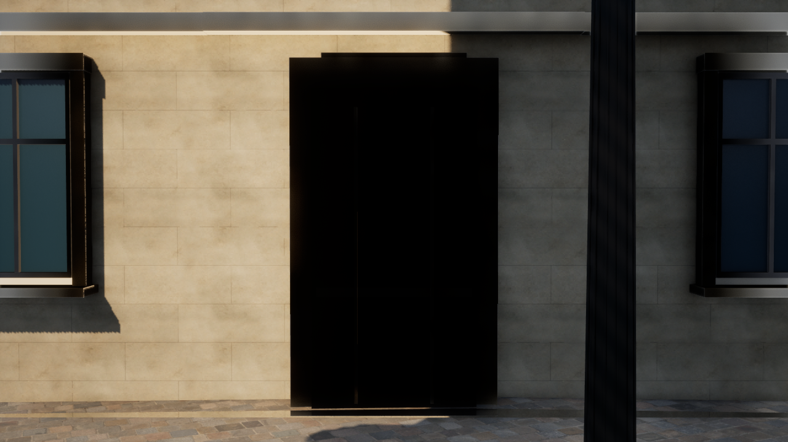
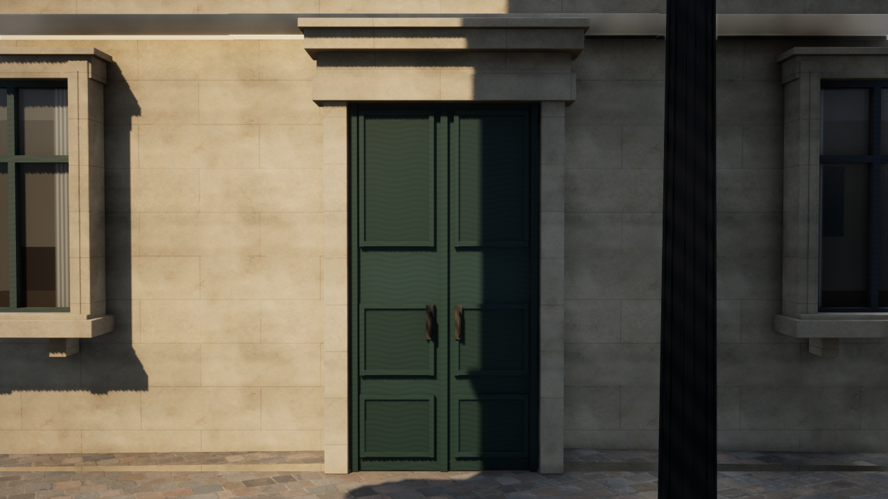

# Paris Photoreal v8 — 入口と軒の立体化

2026-10-16。既存のパリ近景で、平坦だった入口と単純な軒の表示を更新する。都市範囲や地理データの追加は行わない。

## 実装

- 元シーンの入口11か所に、両開きの木製扉、各扉の面取り付きパネル、縁取り、石造の枠・上部装飾、円形断面の鉄製取っ手を追加した。扉は元の板状表示の手前、石枠の奥に置き、浅い見込みを表現する。元の壁を切り抜いたり衝突を変更したりはしない。
- 元の軒107区間に、4段の張り出しと持ち送りを追加。各区間の位置・幅・高さは元の軒から取得し、実測形状の再現とは区別する。
- 入口・軒とも元のメッシュID、面番号、建物ID、座標、壁からの距離を保存。既存の近景範囲内に限定し、大聖堂とオテル・デューには住宅用モジュールを適用しない。
- 元の584窓候補のうち、入口に重なる11か所の追加窓飾りを除外し、573窓を表示する。最初の実画面で見つかった、扉を横切る窓台を解消した。残した窓の位置・大きさは維持し、元のGIS側の窓や建物は変更していない。除外した元の面と対応する入口を記録する。表示用バッチは石材・木材・ガラス・鉄の4つで、細部を物体ごとにActor化しない。Low・簡易素材・地理デバッグ表示では追加表示をまとめて隠す。
- 入口の専用確認視点を追加。全体が入るよう入口から6m離れた建物の外側に位置を選び、UEでは元の歩行可能面をトレースして目線を170cmに合わせる。35mm相当の画角、露出、照明は変更しない。通常の固定カメラ位置は変更しない。
- 生成物の形式をv2へ変更し、起動時に古い形式や部品不足を検出して再生成する。

外観はすべて推定による補完であり、現地写真・測量に基づく実在の扉や軒を再現したものではない。新たな有料アセット・APIや外部モデルは追加していない。大聖堂の詳細な全面モデルが完成したという主張もしない。

変更前のバックアップは `backups/pre-paris-photo-v8-20261016-200517.zip`。149ファイル、CRC確認済み。

## 主な変更ファイル

|ファイル|内容|
|---|---|
|`unreal/scripts/generate_paris_frontages.py`|元の入口・軒の抽出、扉と軒・鉄製取っ手のメッシュ、追跡属性と確認用カメラ|
|`unreal/scripts/bake-paris-frontages.py`|4部品の保存と全関連建物IDの集約|
|`unreal/AIWorld/Source/AIWorld/ParisPhotoFrontages.cpp`|v2の読み込み、影、確認用視点、入口・軒の統計|
|`unreal/AIWorld/Source/AIWorld/ParisFrontageTests.cpp`|追加部品・表示切替・衝突維持の検証|
|`unreal/scripts/tests/test_paris_frontages.py`|元の面との対応、重複、形状、再生成、カメラ位置の検証|
|`unreal/scripts/Start-ParisDigitalTwin.ps1`|古い生成物の検出、`-EntryDetail`による起動|
|`unreal/scripts/Measure-ParisDigitalTwin.ps1`|`EntryDetail`での実描画測定|
|`Paris-EntryDetail.cmd`|入口を近くから見るための起動ショートカット|
|`unreal/AIWorld/Content/Data/paris-photo-frontages*.json`、`Content/ParisPhotoreal/Frontages`|再生成した表示用データとメッシュ|

## 起動・再生成

`Paris-EntryDetail.cmd` をダブルクリックすると、入口の近景をMediumで起動する。右ボタンを押しながらマウスで視線、WASDで移動。4で大聖堂正面、5で河岸、6で街路、F7で品質を切り替える。入口モードでは6の街路カメラが入口確認位置になる。

```powershell
./unreal/scripts/Start-ParisDigitalTwin.ps1 -EntryDetail -Quality Medium
```

通常の街路は次で起動する。

```powershell
./unreal/scripts/Start-ParisDigitalTwin.ps1 -Photoreal -PhotoCamera Street -Quality Medium
```

クリーンな環境での再生成はUEを閉じてから行う。

```powershell
./unreal/scripts/Build-AIWorldUE.ps1 -SkipAssets
./unreal/scripts/Build-ParisPhotoreal.ps1
./unreal/scripts/Test-ParisDigitalTwin.ps1 -Photoreal
./unreal/scripts/Test-ParisDigitalTwin.ps1 -LegacyJSON
./unreal/scripts/Test-AIWorldUE.ps1
./unreal/scripts/Measure-ParisDigitalTwin.ps1 -View EntryDetail -Photoreal -Quality High -Duration 20 -CaptureAfter 16 -CleanFrame -ReportPath docs/paris-v8-entry-detail-performance.json
```

## 検証結果と実画面

C++ビルドは45.13秒で成功。最終DLLは `3f9ebdcbfb12f347aa9ba7ea5b2d10d9af9647d3fcb7916c924c45916d0d8d8b`。

- UEの自動テスト43件（写実表示19件、従来JSON19件、住民・保存・通信5件）が成功した。NullRHIで構造と動作を検査し、画像は別途DX12で実描画した。
- Pythonの7件が成功した。元の窓・入口・軒の面との対応、重複配置の防止、閉じた面取り、正常な面の向き、法線・UV、同じ入力からの再生成、元データの読み取り専用、建物外側の確認カメラを検証した。
- 元シーンと軽量メッシュバイナリのSHA-256はv7と同じ。739棟・4,799地物・191基礎メッシュの照合も成功した。
- 追加表示の三角形は309,460→381,510（約7.2万増）。元シーンの1,075,590三角形は変更していない。描画部品は4つ、入口11、軒107、窓573。
- 最初の実画面で入口を横切る追加窓台を発見し、該当する11か所の窓飾りを除外した。初回の計測スクリプトには3部品を期待する古い検査も残っていたため4部品へ修正し、最終計測をやり直した。初回の画像・統計は診断記録としてのみ保存し、下の最終値には使用しない。

測定機はRyzen 7 7735HSのAMD Radeon内蔵GPU。UE 5.8.3 Development Editorの `-game`、DX12 / SM6、Lumen GI・反射・VSMを使用した。1280×720、アセット準備完了後5秒待機、20秒の単回測定。ほかのUEプロセスは停止し、準備待ち0・元データとの境界誤差0cm・色の不一致0件を確認した。

|視点|品質 / 内部解像度|平均fps|P95フレーム時間|
|---|---|---:|---:|
|入口・追加表示なし|High / 100%|30.50|36.63ms|
|入口|High / 100%|25.95|42.71ms|
|入口|Medium / 80%|35.06|33.75ms|
|街路|High / 100%|29.99|38.00ms|
|街路|Medium / 80%|34.61|33.41ms|
|大聖堂正面|High / 100%|40.08|29.06ms|
|側面・河岸|Medium / 80%|47.34|25.03ms|

60fpsには届かない。操作用の入口・街路はMediumで約35fps。追加ファサードを切った入口Highは約30.5fps、有効時は約26.0fpsだった。画質の追加に負荷があることを示す単回の参考値で、扉だけの費用や統計的な性能差を証明するものではない。日光・露出・画角は同じ設定。

集計と入力ハッシュは [検証JSON](paris-v8-verification.json)、個別の生データは `paris-v8-*-performance.json`、テストの出力は `paris-v8-*-tests.log` と `paris-v8-frontage-tests.txt` に保存した。

いずれも実際のUE5描画で、生成画像や完成予想図ではない。

同じ確認用カメラ・照明・素材で、追加ファサード表示を切った対照（High / 100%）:



入口・窓の追加表示を有効にした状態（High / 100%）:



上の対照はv7そのものではなく、同じ最終DLLで `-NoFrontages` を指定したもの。v7の窓飾りも含む追加ファサード表示をまとめて隠しており、入口だけの負荷差とは扱わない。通常の街路のv7/v8比較は、同じ固定視点の [変更前](screenshots/paris-v8-street-high-before.png) / [変更後](screenshots/paris-v8-street-high.png) を参照。

大聖堂正面の [High実画面](screenshots/paris-v8-front-high.png)、側面・河岸の [Medium実画面](screenshots/paris-v8-riverside-medium.png)、操作設定の [入口Medium実画面](screenshots/paris-v8-entry-medium.png) も確認した。

20:34 JST時点で、入口確認 / Mediumの操作用ウィンドウを起動し、応答あり・SM6・739棟の準備完了を確認した。変更途中で置き換えた2メッシュは `backups/paris-v8-unused-intermediate-meshes.zip` に保管し、実行用フォルダから除いた。v7以前のアセットは保持している。

## 残る課題

入口の奥行きは既存の板の手前に作った表示用の浅い構造で、室内へ入る機能ではない。元の入口・窓の配置自体も推定であり、実在外観との照合が必要。大きな無装飾の壁、店舗、屋根の細部、人物などにも簡略化が残る。写真相当に向けては、現地資料に対応する建築形状と高品質モデルの整備、遠近に応じた負荷制御が必要である。

次は近景の1階店舗、屋根・雨樋の細部と、出所・ライセンスを確認できる大聖堂モデルを優先する。面積は拡張せず、今回と同じ固定視点・実画面・性能測定で確認する。
