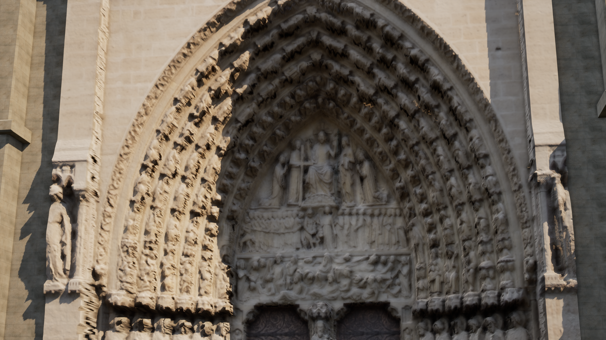
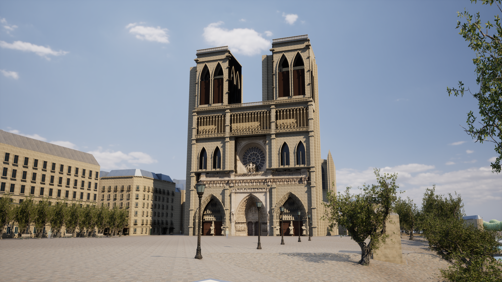

# Paris Photoreal v9 — 写真測量由来のノートルダム西正面

2026-10-16。ノートルダム西正面周辺に限定した改善。変更前の基準は Git `61a9c12`。都市範囲を増やさず、既存の地理・衝突・住民・保存処理を維持した。

## 実装済み

西正面の中央入口、バラ窓、王の回廊に、実際の写真から再構成された色と奥行きを取り込んだ。資料は [UC San Diego – Digital Media Lab / CHEI の公開点群](https://zenodo.org/records/10363984)。[原掲載](https://sketchfab.com/3d-models/notre-dame-paris-facade-hi-res-point-cloud-50deeb164f324d1c8607bafa67f948b9)、GLB内の著作者表示、CC BY 4.0を確認した。105枚の旅行写真を基にした2019年公開資料であり、2024年の修復後を測量した資料ではない。

- 原本405,027,212 bytes、MD5 `6d5d5ae624614283ddc99a5cfc3d3452`、SHA-256 `7dec002065505a878941f663a2e8a5df528cb7a94dbf359405617a0cdfdf7b1e`を照合。実読取14,460,822点。公開Objaverseミラーから取得し、配布元のZenodoチェックサムと照合した。初回の部分応答や取得失敗を完全なファイルとして採用していない。
- 密度の高い3範囲を、201,271三角形・102,688頂点の表示用メッシュへ変換。色、法線、観測範囲のマップは3481×3601。法線は深度から算出し、写真の光をそのまま発光表示する方式は使用していない。
- 実行中に有効なNaniteデータを確認。表示部品は1つ。元のGISメッシュは保持し、観測範囲に応じて既存表示を隠す。欠損部には独自造形が残る。M、Low、精度表示で切り替え、当たり判定と地物の選択は従来のものを使う。
- 独自造形も更新。深い3入口、126体のアーチ装飾、28体の回廊彫像、立体の組子と色ガラス、透かし欄干、面取り、鐘楼のルーバーを6メッシュに集約した。これらの造形・図像は推定である。
- 入口用に目線170cm・50mm相当のカメラを追加。通常の正面・河岸・街路カメラは保持。`Paris-Cathedral.cmd`で全景、`Paris-Cathedral-Detail.cmd`で入口を開ける。

## 再現精度と制限

これは大聖堂全周の完成モデルではない。点群は面・UV・PBR素材を持たないため、観測を基に2.5Dの面を再構成した。壁の裏側や観測されていない横面の情報は増えない。

幅43.5mと塔69mの[公式寸法](https://www.notredamedeparis.fr/comprendre/architecture/plans/)を基準に、水平と垂直を別々に暫定調整した。元のWGS84・EPSG:2154・cm原点・NGF基準を共有するが、点群自体の測量座標を復元したものではない。配置をL4/L5の測量精度として扱わない。変換係数、原点、元データIDとライセンスは `paris-notredame-scan.json` に記録した。

深度には3×3メディアン処理と最大40cm距離の推定補完が含まれる。生成範囲内の観測セルは2,052,370、補完セルは1,661,478。表示面は西正面下部43.5×45mの矩形の約28.9%で、他の範囲は独自造形のままである。大きな欠損を実測済みとみなして埋めてはいない。

元写真の照明は完全には除去できていない。石材への色合わせは線形RGB倍率0.72 / 0.64 / 0.52、法線強度0.35、粗さ0.82の美術調整で、計測した反射率ではない。4Kキャプチャは出力の解像度であり、入力資料の精度を4Kの現地測量へ引き上げるものではない。出典・改変内容は [CREDITS](../unreal/assets/notre-dame-facade/CREDITS.md) に保存した。

## 主な変更ファイル

|対象|変更|
|---|---|
|`unreal/scripts/notredame_west.py`、`generate_paris_architecture.py`、`bake-paris-architecture.py`|開口、独自造形、色ガラス、専用カメラ|
|`fetch_notredame_facade.py`、`inspect_notredame_facade.py`|公開データの取得・照合・点群検査|
|`generate_notredame_scan.py`、`bake-notredame-scan.py`|観測面、法線・色・範囲マップ、Nanite、既存表面の切り替え|
|`ParisPhotoArchitecture.cpp`、`ParisSurfaceMaterials.cpp`、`ParisDigitalTwin.*`|実行時の適用、出典表示、欠損時・遠景・品質切替|
|`ParisPhotoEnvironment.cpp`|近接カメラの読み込みと地表への接地|
|`ParisScannedFacadeTests.cpp`、`ParisPhotoDetailTests.cpp`、Pythonテスト|描画部品・衝突・復帰・再生成・形状の検査|
|`Build-NotreDameScan.ps1`、`Build-ParisPhotoreal.ps1`、`Start/Measure/Test-ParisDigitalTwin.ps1`|生成・起動・比較・実寸確認付き撮影|
|`Content/Data`、`Content/ParisPhotoreal`、`Content/Materials`、`unreal/assets/notre-dame-facade`|実際の生成物・素材・出典|

原本GLBと中間バイナリはGit対象外。再取得に必要なURL・ハッシュ、生成スクリプト、採用したUEアセットとマップを保持する。

## 実行・検証手順

```powershell
# ネイティブのビルド
./unreal/scripts/Build-AIWorldUE.ps1 -SkipAssets

# 全描画アセット。点群の生成物がある構成では、その生成処理も呼ぶ
./unreal/scripts/Build-ParisPhotoreal.ps1

# 点群由来部分だけ再生成。原本キャッシュがあればネット接続不要
./unreal/scripts/Build-NotreDameScan.ps1

# 通常 / 入口 / 推定造形のみ
./unreal/scripts/Start-ParisDigitalTwin.ps1 -Photoreal -PhotoCamera Front -Quality High
./unreal/scripts/Start-ParisDigitalTwin.ps1 -PortalDetail -Quality High
./unreal/scripts/Start-ParisDigitalTwin.ps1 -PortalDetail -NoScannedFacade -Quality High

# 回帰検査
./unreal/scripts/Test-ParisDigitalTwin.ps1 -Photoreal
./unreal/scripts/Test-ParisDigitalTwin.ps1 -LegacyJSON
./unreal/scripts/Test-AIWorldUE.ps1
gis/.venv/Scripts/python.exe -m unittest discover -s unreal/scripts/tests -p test_paris_architecture.py -v
gis/.venv/Scripts/python.exe -m unittest discover -s unreal/scripts/tests -p test_notredame_scan.py -v

# 実際に4Kで描画したことをPNGヘッダーから検査する撮影
./unreal/scripts/Measure-ParisDigitalTwin.ps1 -View PortalDetail -Photoreal -Quality High -Width 3840 -Height 2160 -Duration 20 -CaptureAfter 16 -CleanFrame -ReportPath docs/paris-v9-portal-4k-performance.json
```

右ドラッグで視線、WASDで移動、4/5/6で固定視点、F7で品質、Mで素材比較。入口起動では4が入口の近接位置となる。

## 実際に検証した内容

- 最終C++ビルド成功。UE自動テスト45件（写実20、従来JSON20、住民・保存・通信5）とPython8件が成功した。
- 三角形・法線・UV・表示マスクの整合、同じ入力からの再生成、元のGISの不変性、カメラが建物外にあることを検査した。旧表示への復帰、Low・精度表示・M切替と衝突維持はUE上で検査した。
- 元データは739棟、4,799地物、191基幹メッシュのまま。`paris-v8-geometry-contract.json`との照合に成功した。世界の面積・道路・建物の地理配置は変更していない。
- 実描画はDX12 / SM6、Lumen GI・反射、VSMで行う。NullRHIテストを画像の描画成功と混同しない。
- 初回の点群変換では疎な部分が破片として現れたため採用せず、範囲・深度・欠損補完を修正した。初回に無効だったNaniteデータも、保存設定を修正して実行中の有効状態を確認した。
- 最初の4K指定はOSのウィンドウ制約で888×500へ縮小されていた。エンジンの`-ForceRes`とPNG実寸検査を追加し、縮小された測定を4Kの結果として採用しない。

検証の集約は [paris-v9-verification.json](paris-v9-verification.json)。採用した12アセットを保持し、未採用の試作32ファイルはCRC検査済みZIPへ退避した（[記録](paris-v9-prototype-archive.json)）。

## 実画面と性能

AMD Radeon Graphics内蔵GPU / Ryzen 7 7735HS、UE 5.8.3 Development Editor `-game`、DX12 / SM6で測定した。各20秒、準備待機後5秒、他のUEプロセスなし。視点・品質ごとに1回の測定であり、平均的な機種性能を保証するものではない。

|視点|PNG出力|内部描画率|平均fps|P95フレーム時間|
|---|---|---|---:|---:|
|入口・High|1280×720|100%|31.18|36.33ms|
|入口・Medium|1280×720|80%|37.41|31.88ms|
|全景・High|1280×720|100%|33.82|34.36ms|
|河岸・Medium|1280×720|80%|46.01|25.84ms|
|入口・推定造形のみ・High|1280×720|100%|31.02|36.87ms|
|入口・High|3840×2160|100%|6.23|175.99ms|
|全景・High|3840×2160|100%|7.09|156.69ms|

全7枚のPNGヘッダーを読み実寸を照合した。最終DLLのSHA-256は `bddb0cc48ff0beaff264cec6eb0571e1ad2ec60cce5a618db1f146f19dbe8205`。各測定で点群由来の表示1部品・Nanite有効、読み込み待ち0、元表示との境界誤差0cm・配色不整合0を確認（推定造形のみの測定は点群表示0）。既存の境界検査は元GIS静的メッシュのもので、点群の地理精度を証明しない。

60fps目標はこの構成では未達。4Kは静止画確認向けで、散策には720pのHighまたはMediumを使用する。入口の写真由来あり31.18fps・なし31.02fpsの差は単発測定のばらつきで、速度改善とは判断しない。

UEから撮影した3840×2160の入口：



UEから撮影した全景。塔と側入口などには独自の推定造形が残る：



[入口Highの測定](paris-v9-final-portal-high-performance.json) / [Medium](paris-v9-final-portal-medium-performance.json) / [推定造形のみ](paris-v9-final-portal-authored-only-performance.json) / [入口4K](paris-v9-portal-4k-performance.json) / [全景4K](paris-v9-front-4k-performance.json)。実画像では中央彫刻の情報量は増えたが、写真由来部分の軟らかい輪郭・接合部の差・推定範囲の単純さが残る。

## 残る作業

全周を写真相当へ仕上げるには、塔・側面・後陣・飛梁・屋根を含む外観モデル、現地資料に対応する彫刻と素材、正確なスケール・方位・位置合わせが必要。次のアセットは、再配布可能な権利、実寸、UV、照明が焼き込まれていないBase Color、Normal、Roughness、近景4K〜8Kと軽量版、Naniteと衝突を分離した仕様で検収する。未取得の全周モデルを参照して完成扱いにはしない。

次は同じ地点での写真照合と、推定部分・接合部の改善を優先する。都市範囲の拡張は行わない。
