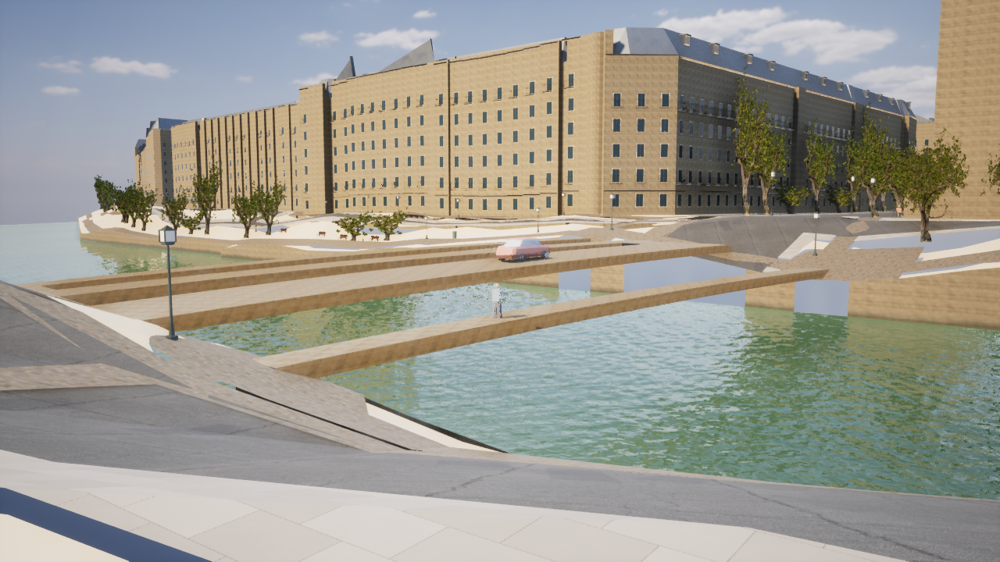
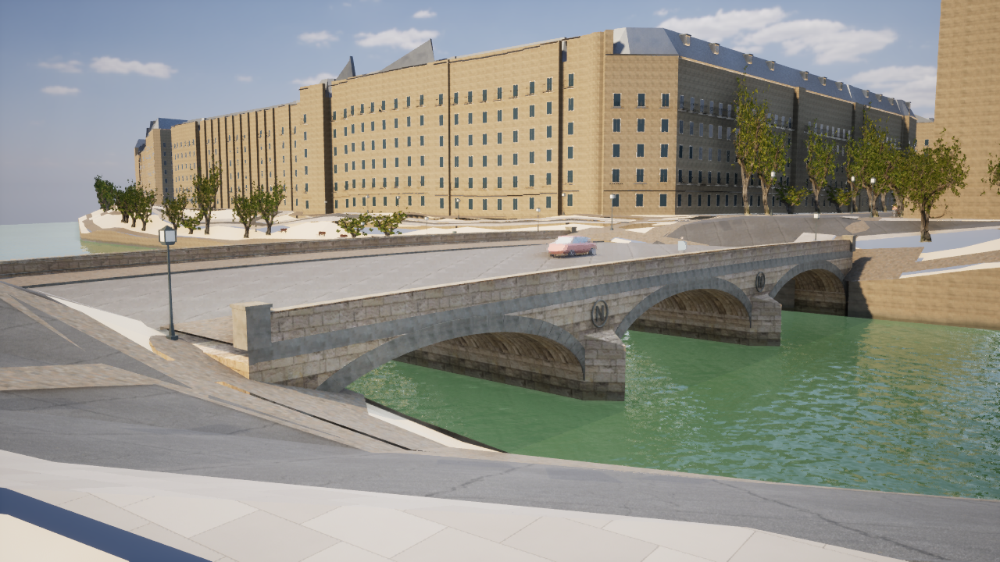

# パリの橋の構造と材質

2026-10-26〜27。地図の範囲を広げず、取得済みの地理データにある完全な7橋を再構築する。

## 改善した問題

従来は、OSMの車線・自転車道・歩道を個別に幅付けしたポリゴンに、厚さ70cmの側面を付けただけだった。橋梁の構造はなく、独立した車線と歩道の間が開いていた。小さな経路の幅が橋全体の幅として扱われる問題もあった。

新しい表示では、元の中心線・位置・方向を使い、工学資料の全幅を参照して連続した路面を生成する。車道と歩道の段差、左右の欄干、橋の下の構造、橋台と橋脚を作り分ける。路面と欄干には軽い専用の衝突メッシュがあり、外観の細部全体に衝突処理を掛けない。

## 橋の種類と根拠

| 橋 | 資料で確認した構造 | 参照全幅 |
|---|---|---:|
| プティ・ポン | 単一の石造アーチ | 20m |
| サン・ミシェル橋 | 3連の楕円アーチ、Nのメダリオン | 30m |
| ポン・オ・シャンジュ | 3連の石造アーチ、Nのメダリオン | 30m |
| アルシュヴェシェ橋 | 3連の石造アーチ | 11m |
| ポン・オ・ドゥブル | 単一の鋳鉄アーチ、銅で覆われた鋳鉄の欄干 | 20m |
| アルコル橋 | 単一の鉄製アーチ、14本のリブ | 20m |
| ノートルダム橋 | 中央の鉄製アーチ、両岸側の石造アーチ | 20m |

構造の出典はフランス土木工学協会AFGCの技術資料：
[Petit Pont](https://www.afgc.asso.fr/history-heritage/petit-pont-a-paris/)、
[Saint-Michel](https://www.afgc.asso.fr/history-heritage/pont-saint-michel-a-paris/)、
[au Change](https://www.afgc.asso.fr/history-heritage/pont-au-change-a-paris/)、
[Archevêché](https://www.afgc.asso.fr/history-heritage/pont-de-larcheveche-a-paris/)、
[au Double](https://www.afgc.asso.fr/history-heritage/pont-au-double-a-paris/)、
[Arcole](https://www.afgc.asso.fr/history-heritage/pont-darcole-a-paris/)、
[Notre-Dame](https://www.afgc.asso.fr/history-heritage/pont-notre-dame-a-paris/)。

アーチの比率を既存の地図の区間へ合わせているため、モデルの各径間は資料の数値と完全には一致しない。標高は既存のIGN地形に基づく推定値、アーチの立ち上がり・石の割り付け・欄干の細部・メダリオンの彫刻は原作者による推定形状。現地測量・写真測量によるL4/L5の完成モデルではない。サン・ルイ橋とポン・ヌフの地区境界で切れている3メッシュは元の表示を維持する。

橋の端は、その直外の元の道路・歩道・地面の最上面をサンプリングして接続する。端から1cmの位置を優先し、欠損している場合は45〜180cm先まで探す。元の端点の標高とサンプル距離もマニフェストに保持し、接続のための補正と区別する。

## 描画と通行

- 石造アーチには実際の開口、湾曲した下面、放射状の石の縁取り、橋脚と水切りがある。開口を暗い平面で代用しない。
- 鉄橋には曲がったリブ、支柱、横桁、リベットを配置する。欄干の手すり・支柱・縦棒・環状装飾も立体メッシュ。
- 壁面には [Poly Haven Sandstone Blocks 05](https://polyhaven.com/a/sandstone_blocks_05) の2K Base Color・DirectX Normal・ORMを使う。[CC0ライセンス](https://polyhaven.com/license)。現地の石灰岩を撮影したものではなく、石積みの外観の代理素材である。取得先・MD5・SHA-256・実寸3mタイルは `unreal/textures/paris-bridges/manifest.json` に記録する。
- 石の縁と舗装には既存の写真由来素材を利用。金属の色・粗さ・酸化斑、水位付近の汚れと濡れ色は推定表現。石材は金属度0。
- 描画メッシュは実在するUEのStatic Meshアセットとして生成し、Naniteを有効にする。7個の簡単な衝突メッシュで連続した路面と転落防止の欄干を扱う。
- 元の橋メッシュと地理データは保存し、詳細表示が有効な場合に描画と衝突を切り替える。建物・川の位置、原本の座標変換は変更しない。
- 歩行者と車の経路ID、XY位置、経路長、予約・移動の状態は維持する。新しい橋の範囲では見た目の高さだけを路面へ合わせる。橋の下の遊歩道を上の橋へ移さないよう、元の標高との差も確認する。
- 詳細橋の路面をクリックすると元のOSM IDと実際のクリック位置を表示する。

## 起動と再生成

```powershell
# UEプレビューを閉じて実行する。
./unreal/scripts/Build-ParisBridges.ps1
./unreal/scripts/Build-AIWorldUE.ps1 -SkipAssets

# 橋を見る固定カメラから起動する。
./unreal/scripts/Start-ParisDigitalTwin.ps1 -BridgeView -Quality Medium

# 同じカメラで従来の橋と比較する。
./unreal/scripts/Start-ParisDigitalTwin.ps1 -BridgeView -Quality Medium -LegacyBridges

# 生成された幾何形状、通行と地理情報を確認する。
./gis/.venv/Scripts/python.exe -m unittest discover -s unreal/scripts/tests -p test_paris_bridges.py -v
./unreal/scripts/Test-ParisDigitalTwin.ps1 -Photoreal
```

ルートの `Paris-Bridges.cmd` からも起動できる。`F10`でHUDを隠し、`F7`で品質を変更する。低品質でも連続した路面を維持する。精度・問題・輪郭のデバッグ表示では元のGIS表現を確認できる。

原本からの取得と形状生成を分離している。取得済みのテクスチャはハッシュを検証してオフラインで再利用する。形状は `generate_paris_bridges.py` で生成し、`bake-paris-bridges.py` が材質とUEアセットへ変換する。元のGISが変化した場合は起動時に再生成する。

## 主な変更ファイル

- `unreal/scripts/generate_paris_bridges.py`：元の橋ポリゴンの分類、連続路面、7種類の橋の構造と確認カメラ。
- `unreal/scripts/fetch_paris_bridge_surfaces.py`、`unreal/textures/paris-bridges/`：固定した写真由来素材と出典。
- `unreal/scripts/bake-paris-bridges.py`、`Build-ParisBridges.ps1`：実際に存在するUE素材とアセットの生成。
- `unreal/AIWorld/Source/AIWorld/ParisBridgeDetail.cpp/.h`：橋の描画、衝突の切り替え、路面の高さ、OSM IDの選択と計測。
- `ParisDigitalTwin.cpp/.h`、`ParisPedestrians.cpp`、`ParisTraffic.cpp`、`ParisPhotoEnvironment.cpp`、`ParisPhotoArchitecture.cpp`：既存の街・歩行者・車・カメラ・計測との接続。
- `ParisBridgeTests.cpp`、`unreal/scripts/tests/test_paris_bridges.py`、`Test-ParisDigitalTwin.ps1`：開口・面・通行・転落防止・元IDを確認。
- `Paris-Bridges.cmd`、起動・計測・全体生成スクリプト、`DefaultGame.ini`：起動経路とCook対象。

パッケージビルド、別GPU、モバイルでの検証は今回の対象外。

## 実画面と検証

変更前：



変更後：



UEの実際の描画をキャプチャしている。生成AIの完成予想図ではない。

Windows / UE 5.8.3 / D3D12 / SM6、AMD Radeon(TM) Graphicsの内蔵GPU、1280×720・中品質（内部解像度80%）の同じカメラで計測する。LumenとVirtual Shadow Mapsを使用。アセット準備完了後、5秒のウォームアップを経て10秒のフレーム時間を記録する。性能値はこの固定視点の短時間の記録であり、街全体や別のGPUの性能を保証しない。

| 条件 | 平均fps | フレーム時間P95 |
|---|---:|---:|
| 元の橋 | 46.48 | 24.37ms |
| 再構築した橋 | 40.21 | 27.51ms |

形状と影を追加した結果、平均fpsは約13.5%低下した。暫定目標の60fpsには未達。実際にNaniteデータを持つ橋の描画バッチ30件、独立した連続路面の衝突メッシュ7件を、実行時のレポートで確認した。生成時の設定だけで有効と判断していない。材質のコンパイルエラーとデフォルト素材への置き換えはなかった。

- C++ビルド成功。
- UE側の自動確認26件成功。橋では7橋×25地点＝175地点の路面高さと衝突の一致、7箇所の欄干に対するカプセル衝突、元OSM IDのクリック表示、低品質でも連続路面を保つこと、精度表示への復帰を確認した。既存の主人公の歩行・走行、住民、車両、街路、建物選択、座標の確認も成功。
- Pythonの幾何形状確認4件成功。連続した全幅路面、開いたアーチ、正常な面とUV、アーチ下面の法線が開口側を向くことを確認した。
- カメラが地形の下に入らないよう、元の地形三角形から地上170cm以上の位置を決定した。起動直後の非同期の衝突生成に依存しない。
- 未参照の試作アセット99件を削除し、実際に参照する30アセットに整理した。

測定の原本は `paris-bridges-before-performance.json`、`paris-bridges-medium-performance.json`。確認結果と元データのハッシュは `paris-bridges-validation.json` に保存している。

元のGIS JSONとメッシュblobのSHA-256は変更前と一致している。

| 原本 | SHA-256 |
|---|---|
| `paris-digital-twin.json` | `4e51a9332f3bc44aea0820ee4fcc77d339083fff9c2f73d59a66e1737f5353bb` |
| `paris-digital-twin-meshes.bin` | `fba61d4426bf6cc2fc40bda2818d48fe4a6d8e3c58bf13e025254ddc20bc97d8` |
