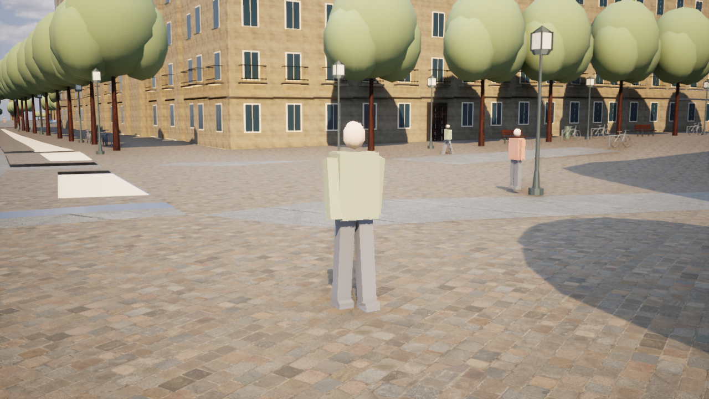
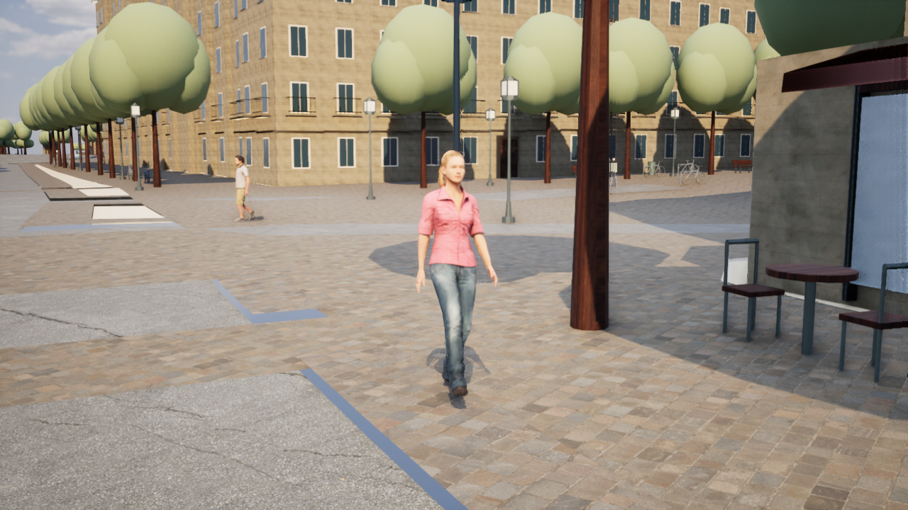

# 歩行者の人体モデル・骨格アニメーション

2026-10-19。UE 5.8.3のパリ歩行者の近景を、6部品の簡易形状からテクスチャ付きのスキンメッシュに更新。

## 表示と行動

- Microsoft Rocketboxの男女2モデルを採用。元の骨格・スキンウェイト、歩行・呼吸待機・着席の各モーションを使用する。
- 肌・衣服の色と法線マップは最大2048px。元のspecularマップを範囲を制限した推定roughnessへ変換し、金属として扱わない。頭部はsubsurface、髪は両面のmasked素材。実測PBRや現地人物のスキャンではない。
- 歩行の再生速度を既存の移動速度に合わせ、待機・歩行・着席をネイティブのブレンドグラフで接続する。rootの移動は固定し、経路シミュレーションがワールド位置を管理する。
- 中品質は22m以内・最大8人、高品質は35m以内・最大16人を骨格描画する。各人体に3段階のLODを用意。遠景・低品質・素材が未導入の場合は既存の軽量モデルを使用する。
- 同一人物を人体モデルと簡易モデルで二重描画しない。選択用カプセルを使って人物IDを取得し、既存の経路、回避、店舗訪問、予約、会話、着席を利用する。人物の表示を切ってもシミュレーションは保持する。
- 人口160人、GIS配置、既存の衝突地形は変更していない。専用の表情・挨拶モーション、足裏IK、プレイヤーの三人称モデルの刷新は今回の対象に含めていない。

| モデル | 身長 | 元FBXの三角形数 | UE LOD0 / 1 / 2 頂点数 |
|---|---:|---:|---|
| Male_Adult_01 | 182.37cm | 7,440 | 4,647 / 1,494 / 860 |
| Female_Adult_01 | 174.33cm | 8,732 | 5,472 / 1,637 / 931 |

2モデルの繰り返しは残る。顔の種類や服装セットを増やすには追加モデルが必要で、接写の人物写真相当まで完成したという意味ではない。

## 再生成と起動

```powershell
./unreal/scripts/Build-ParisPeople.ps1
# 取得済みの25ファイルのSHA256を検証し、オフラインで再生成:
./unreal/scripts/Build-ParisPeople.ps1 -Offline
./unreal/scripts/Build-AIWorldUE.ps1 -SkipAssets
./unreal/scripts/Test-ParisDigitalTwin.ps1 -Photoreal
```

`Paris-People.cmd`で写実・高品質の街路カメラから起動する。F8で歩行、F7で品質、Pで人物表示、F10でHUDを切り替えられる。従来の人物表示との比較は`Start-ParisDigitalTwin.ps1 -Photoreal -SimplePeople`。起動後に住民へ近づくと人体モデルが表示される。

`Measure-ParisDigitalTwin.ps1 -Photoreal -PeopleView -PeopleIndex 1 -CleanFrame`は、実際のシミュレーション中の人物を撮影する確認用カメラ。カメラは建物内部と遮蔽物を避け、人物や経路は撮影のために移動させない。この追従は撮影指定時にのみ有効で、通常の操作には適用しない。

## アセットと保存

出典は[Microsoft Rocketbox](https://github.com/microsoft/Microsoft-Rocketbox)、MIT。取得はコミット`0943055db6ec570bcef9f2c8b41c9e5467c808f9`へ固定。元ファイルURL・ハッシュは[sources.json](../unreal/assets/paris-people/sources.json)、許諾全文は[LICENSE.md](../unreal/assets/paris-people/LICENSE.md)、改変内容は[CREDITS.md](../unreal/assets/paris-people/CREDITS.md)。有料APIは使用しない。

原本はローカルの`unreal/assets/paris-people/Raw/`へキャッシュする。UE用のモデル・骨格・素材・テクスチャ・モーションは`Content/ParisPhotoreal/People/`、実行時設定は`Content/Data/paris-people.json`へ保存する。パッケージ化のcook対象にも指定したが、Shippingビルドは今回実行していない。

UE Pythonの配列内structは、ループで得たコピーの変更だけでは元配列へ反映されない。編集したmaterial slotを配列へ書き戻し、アセットを明示的に保存する。別プロセスで再読込した材質、テクスチャ参照、skeletal用のusageフラグ、root lockも自動検証する。頭・体・髪の材質が欠ける場合は、灰色の人体を表示せず簡易モデルへ戻す。

## 主な変更ファイル

- `ParisPedestrians.cpp/.h`: 既存行動と近景の骨格プール、選択・品質・二重描画防止。
- `ParisHumanAnimation.cpp/.h`: 待機・歩行・着席のネイティブブレンド。
- `ParisHumanTests.cpp`: 骨の実変化、着席、保存済み素材、上限・選択・切替の検査。
- `fetch_paris_people.py`, `bake-paris-people.py`, `Build-ParisPeople.ps1`: 取得・検証・骨格/LOD/素材生成。
- `ParisDigitalTwin.cpp`, `Measure-ParisDigitalTwin.ps1`: 実人物の確認撮影と骨格・instance別の計測。
- `Start-ParisDigitalTwin.ps1`, `Test-ParisDigitalTwin.ps1`, `AIWorld.Build.cs`, `DefaultGame.ini`, `Paris-People.cmd`, `README.md`: 起動・依存モジュール・cook・使用手順。

## 検証結果

- UE 5.8.3 Development EditorのC++ビルド成功。最終ログは`Saved/people-verified-build.log`。
- `Test-ParisDigitalTwin.ps1 -Photoreal`: **22件成功**。従来の経路・衝突・店舗予約・着席・会話・1000ステップの歩行検査に加え、人体の実寸、保存済み3材質・テクスチャ参照、root lock、実際の足の骨の変化、着席時の腰の下降、選択、上限、二重描画防止、低品質・非表示切替を検査。`Saved/people-verified-tests.log`。
- `fetch_paris_people.py --offline`: 原本23ファイルのSHA256照合成功。骨格2点も含め、起動に必要な参照先が実ファイルとして保存されていることを生成スクリプトで検査する。
- `-ParisTwinSimplePeople`を指定した別プロセスでも、軽量モードの検査1件が成功。骨格素材を読み込まず、従来の表示で実描画できることも確認した。
- 元GISのSHA256は`4e51a9332f3bc44aea0820ee4fcc77d339083fff9c2f73d59a66e1737f5353bb`で維持。
- AMD Radeon(TM) Graphics / UMA、DX12 SM6、Lumen、High、1280×720、100%解像度、10秒計測。実歩行者の追従ビューで**平均33.89fps、P95 44.76ms**。計測終了時の骨格描画5人、軽量instance人物93人、使用メモリ約5290MiB。[実測JSON](paris-people-high-performance.json)。この環境で60fpsには達していない。
- 画面を実際に確認し、灰色だった材質の保存問題を修正。修正後の女性の歩行、背景の男性の衣服、接地と実寸、肌・髪・服の色を確認した。人物の種類と表情の拡充、足裏IK、重い視点での追加最適化は今後の課題。

従来の軽量表示での単発比較は平均37.81fps、P95 32.22ms、骨格描画0人。[比較JSON](paris-people-simple-performance.json)。同一設定・人物IDで撮影したが、実時間のシミュレーションとアセット準備時間により人の位置や周辺の状態は完全には一致しない。人体だけの正確なGPUコスト差を示す計測ではない。

従来の簡易人物：



改善後のUEの実画面（画像生成ではない）：


