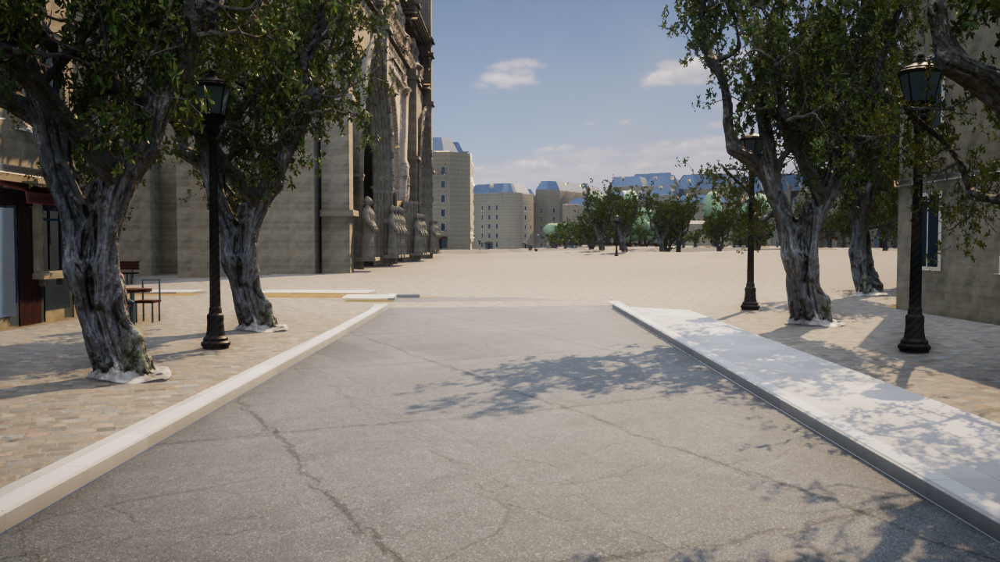
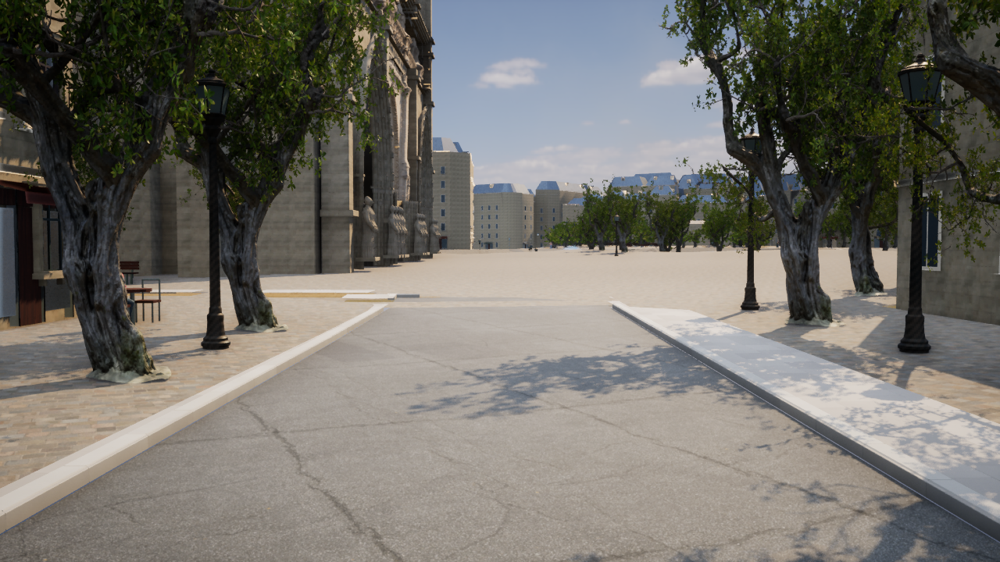

# パリの樹木の描画改善

2026-10-26。UE 5.8.3版の樹木のマテリアルと遠景表示を更新した。都市範囲と地理データの追加はしていない。

## 変更内容

- 写真由来の樹木モデルを使う範囲を、ノートルダムの品質中心から170m以内の201本から、取得済みの街路樹1,108本へ変更。近景・遠景の2個のHISMで同じNaniteメッシュと2Kテクスチャを共有する。907本の遠景樹木にも枝と葉の隙間ができる。
- 葉はMasked / Two Sided Foliageを使用。葉を通る光、表面の粗さ、遮蔽を調整し、個体ごとに控えめな緑・黄緑の差を付ける。HISMの乱数シードを固定し、同じ入力で同じ色の分布になる。
- 樹皮の写真、法線、粗さを維持。細枝のglTF法線強度0.5を反映し、根元の色を少し暗く苔色へ寄せる。これは見た目の補完であり、現地の苔の観測データではない。
- 葉と細枝が風で数cm揺れる。根元と幹のメッシュは固定し、衝突形状は動かさない。25〜55mで揺れを弱め、60mからコンポーネントのWPOを停止。頂点の最大変位を6cmに制限し、CPUで毎フレーム木を動かす処理は追加していない。
- 中品質では中心から170mを超える樹木の影を省略する。高品質では遠景の樹木も影を落とす。低品質では全ての樹冠・幹を元の軽いモデルへ戻す。
- 元のOSM ID、位置、高さ・樹冠幅に基づくスケール、向き、幹の衝突判定、設備表示の切り替えを保持する。

樹木モデルは既存の [Poly Haven Island Tree 01](https://polyhaven.com/a/island_tree_01) を使用している。[ライセンスはCC0](https://polyhaven.com/license)。元データは1,599,403三角形、樹皮・葉・細枝の3マテリアル。Naniteが表示距離に応じて描画量を調整するため、1,108本×原本の三角形数を実描画数として報告しない。原本の取得元とハッシュは `unreal/assets/paris-nature/manifest.json` に固定している。

このモデルは外観の代理であり、OSMに記録されたプラタナス等の実際の樹種・枝ぶりの再現ではない。取得済み地理データの高さと樹冠幅にも推定値が含まれる。

## 起動と再生成

ルートの `Paris-Trees.cmd` を開くと、中品質の並木道から開始する。`F7`で低・中・高品質、`F10`でHUD、`F6`で設備表示を切り替える。写実モードの他の起動方法でも新しい木を使用する。

```powershell
# 取得済み原本のハッシュを検証し、樹木だけを再生成する。
# 原本が欠けている場合は固定マニフェストのURLから復元する。
./unreal/scripts/Build-ParisNature.ps1

# C++の変更をビルドする。
./unreal/scripts/Build-AIWorldUE.ps1 -SkipAssets

# 元の街の操作・衝突・品質切り替えと、全樹木の位置を検証する。
./unreal/scripts/Test-ParisDigitalTwin.ps1 -Photoreal

# 実際のGPU描画・スクリーンショット・フレーム時間を取得する。
./unreal/scripts/Measure-ParisDigitalTwin.ps1 -View PhotoStreet -Photoreal -RoadView -Quality Medium -Duration 10 -CaptureAfter 12 -CleanFrame -ReportPath docs/paris-trees-medium-performance.json -ScreenshotPath docs/screenshots/paris-trees-medium.png
```

樹木の出力マニフェストは `unreal/AIWorld/Content/Data/paris-nature.json`。生成スクリプトと材質レシピのSHA-256を保存し、同じレシピなら再生成を省略する。起動時にもレシピのバージョンを確認する。

## 実際に確認した内容

- C++ビルド成功、6アクション、76.63秒。
- UEの自動確認25件成功。新しい樹木確認では、1,108本の元ID・3D位置・向き・スケールの一致、重複なし、Naniteデータ、2バッチ、固定シード、60mのWPO停止設定、低品質への復帰、元の幹の衝突を確認した。既存の歩行・走行、道路、人物、地理座標、建物選択の確認も成功。
- D3D12 / SM6で実描画を行い、樹皮・細枝・葉のマテリアルのコンパイル失敗がなく、代替のデフォルト材質に置き換わっていないことをログで確認した。
- 描画レポートで実際にNaniteを持つ樹木1,108本、遠景907本、共有2バッチを確認した。この本数はカリング前の登録数であり、全本数が毎フレーム同時に見えるという意味ではない。
- 元のGIS JSONとメッシュのSHA-256は変更前と一致した。

| 元データ | SHA-256 |
|---|---|
| `paris-digital-twin.json` | `4e51a9332f3bc44aea0820ee4fcc77d339083fff9c2f73d59a66e1737f5353bb` |
| `paris-digital-twin-meshes.bin` | `fba61d4426bf6cc2fc40bda2818d48fe4a6d8e3c58bf13e025254ddc20bc97d8` |

## 実画面と性能

変更前：



変更後・中品質：



画像はUEの実描画。生成AIの完成予想画像や加工した比較画像ではない。

AMD Radeon(TM) Graphicsの内蔵GPU、UE 5.8.3 Development Editor `-game`、D3D12 / SM6、Lumen / Virtual Shadow Maps、1280×720で測定。中品質の内部解像度は80%。同じカメラ、10秒測定、5秒ウォームアップ、アセット準備完了後に計測した。短時間の特定視点での値であり、市内全域や別GPUの性能を保証しない。

| 条件 | 平均fps | フレーム時間P95 |
|---|---:|---:|
| 変更前・中品質 | 29.73 | 37.81ms |
| 変更後・中品質 | 28.57 | 37.60ms |
| 変更後・高品質 | 26.14 | 42.60ms |

高品質は内部解像度100%、遠景の樹木にも影がある。中品質の平均fpsは約3.9%低下した。60fpsの目標には未達。P95の小さな差は改善の根拠としない。測定の原本は `paris-trees-before-performance.json`、`paris-trees-medium-performance.json`、`paris-trees-high-performance.json` に保存している。

自動確認と元データの一致の記録は `paris-trees-validation.json` に保存している。

## 変更ファイル

- `unreal/scripts/paris_foliage.py`：葉・樹皮・細枝のPBRと風。
- `unreal/scripts/create-paris-nature.py`：原本検証、素材生成、レシピキャッシュとマニフェスト。
- `unreal/scripts/Build-ParisNature.ps1`：樹木だけの再生成。
- `unreal/AIWorld/Source/AIWorld/ParisDigitalTwin.cpp`：全登録地点での詳細モデル、固定シード、品質と影の制御。
- `unreal/AIWorld/Source/AIWorld/ParisPhotoArchitecture.cpp`：実際の樹木登録数・Nanite・風の距離制限の記録。
- `unreal/AIWorld/Source/AIWorld/ParisTreeTests.cpp`、`unreal/scripts/Test-ParisDigitalTwin.ps1`：地理情報・操作を保つ自動確認。
- `unreal/AIWorld/Content/ParisPhotoreal/Nature/`：更新済みの実在する木と3マテリアル。
- `unreal/AIWorld/Content/Data/paris-nature.json`、`Paris-Trees.cmd`、`Start-ParisDigitalTwin.ps1`、`README.md`：起動と生成レシピ。

今後の改善候補は、実際のパリの樹種に対応する複数のモデル、剪定形状、接地部の地面との自然な接続。今回の変更を現地樹木のスキャンによる完成版とは扱わない。パッケージ化・他GPU・モバイルでの検証は行っていない。
