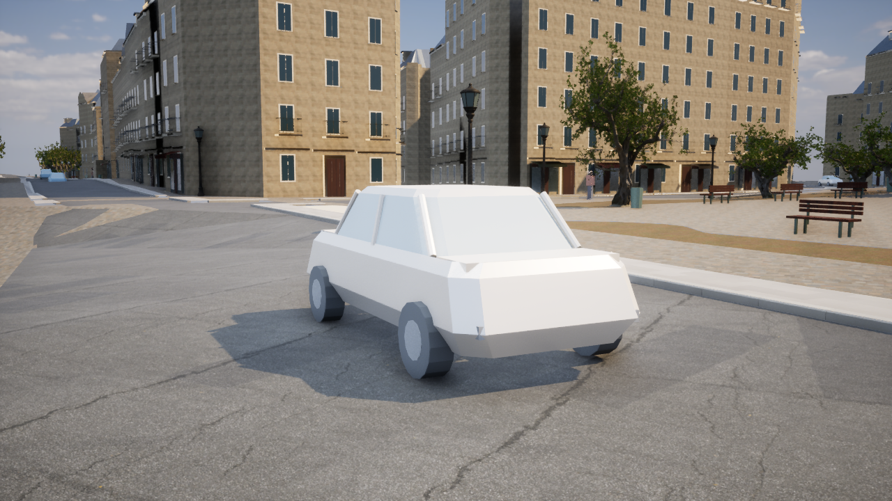
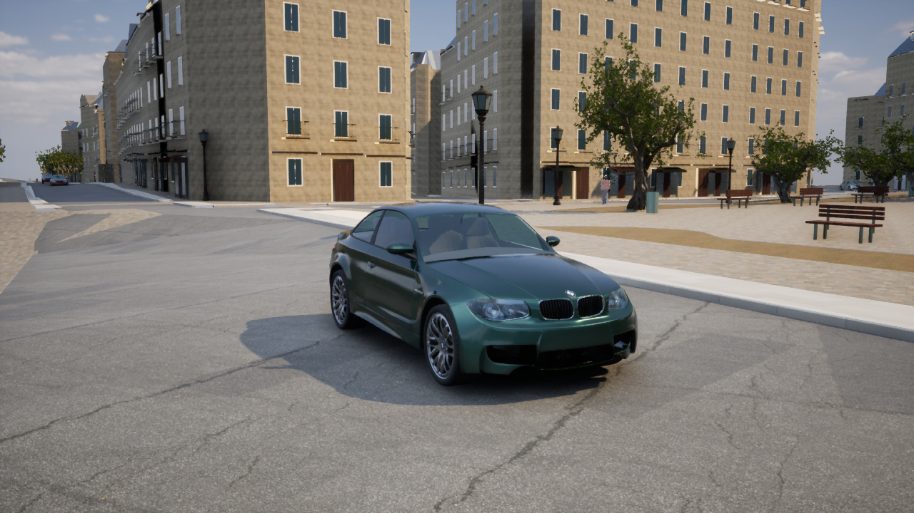

# パリの車両の描画改善

`Paris-Cars.cmd` でUE版の車両確認画面を起動します。`C`で近くの車に視点を合わせ、`F7`で低・中・高品質、`F10`でHUDを切り替えられます。通常起動では車は従来の実道路ルートを走ります。

## 実装

- 中・高品質では精細なセダンを表示。車体、透過ガラス、独立した4輪の6メッシュで構成。
- クリアコート塗装6色、窓越しの内装、立体グリル、ミラー、ブレーキディスク、金属ホイール、形状付きタイヤ。
- ガラスはThin TranslucentとSurface Forward Shadingを使用。塗装には実行中のインスタンス別データを渡す。
- ブレーキランプは停止中に強く点灯。ヘッドランプは低い輝度の発光材質を使い、車ごとの点光源は追加していない。
- タイヤは実際の移動距離÷半径で回転。停止時は回転しない。前輪は元の車線の曲がりに沿って操舵する。
- 車の中心と前後の路面を当たり判定で調べ、表示高さと傾きを道路へ合わせる。地形サンプルと道路メッシュの補間差による車体の沈み込みを防ぐ。車の確認視点へ移る際はカメラカットを通知し、過去の映像が残る現象を抑える。
- 精細な車の表示更新は最大60Hz。部品ごとの前の姿勢を車両IDで追跡し、表示距離によるインスタンスの並べ替え時も正しいモーションベクトルを渡す。出現・再配置では移動履歴をリセットする。
- 同一モデルをInstancedStaticMeshで共有。車体と4輪はNanite、透明ガラスは通常描画。6バッチという値は部品の共有単位で、GPUの描画コール数ではない。
- 品質「低」および `-SimpleCars` で従来モデルに戻せる。アセットが不正・欠落している場合も従来モデルを使用する。
- クリックの元道路ID、実際のクリック座標、車線の方向、歩行者・主人公への譲り、車両の再配置処理を保持。

| 品質 | 表示台数の上限 | 表示距離 | モデル |
|---|---:|---:|---|
| 低 | 20 | 120m | 従来の簡易モデル |
| 中 | 40 | 250m | 精細セダン |
| 高 | 40 | 450m | 精細セダン |

## 出典と寸法

[Morgan McGuire's Computer Graphics Archive](https://casual-effects.com/g3d/data10/index.html) に掲載されている、Mike Pan / Morgan McGuireによるBMWモデルを使用。[配布元の個別メタデータ](https://casual-effects.com/g3d/data10/research/model/bmw/info.js) は2019-04-17版を **CC0/Public Domain** と明記しています。旧版と区別し、ZIP・OBJ・MTL・ライセンス表示の取得時ハッシュを `unreal/assets/paris-vehicles/manifest.json` に固定しました。

これは制作された車両モデルで、実際のパリの交通をスキャンしたものではありません。車種は1種類で塗装に6色の違いがあります。既存の交通の安全域に収めるため、長さ4.2mに等方スケールで変換しています。幅約1.839m、高さ約1.417m、タイヤ半径約33.18cm、車軸間約255.85cmです。特定の市販車の寸法を保証する値ではありません。

元形状の面・法線を保持し、ゼロ面積の333面を除外。27面は接続だけを分離し、UEのメッシュ処理で非多様体として欠落しないようにしました。元データにUVがない面などには投影UVを補完しています。最終形状は384,829三角形、通常描画用フォールバックは全6部品を合わせて78,950三角形です。フォールバックの簡略化による境界の数cmの変化も含め、元の交通の半径2.4mの安全域に収まることを確認しています。

17種類の表面材質はこのプロジェクト向けに制作したPBR変換です。外部の写真テクスチャや写真測量に基づく塗装ではありません。ナンバープレートの登録番号も架空です。地理座標や実交通の観測情報を追加する変更は含みません。

## 再生成

```powershell
./unreal/scripts/Build-ParisVehicles.ps1
./unreal/scripts/Build-AIWorldUE.ps1 -SkipAssets
./gis/.venv/Scripts/python.exe -m unittest discover -s unreal/scripts/tests -p test_paris_vehicles.py -v
./unreal/scripts/Test-ParisDigitalTwin.ps1 -Photoreal
```

ビルド時はUEのプレビューとエディタを閉じます。取得処理は `fetch_paris_vehicles.py`、座標・部品の変換は `prepare_paris_vehicles.py`、UEの材質とメッシュ生成は `bake-paris-vehicles.py` です。既存GIS環境のNumPyを使用します。追加のPythonライブラリは不要です。

チェックサムが一致するローカルキャッシュからはオフラインで再生成できます。`Raw/` と `Generated/` はGit対象外です。生成済みのUEアセット、実行時の `Content/Data/paris-vehicles.json`、取得元情報をリポジトリに保持します。配布サーバーの内容が変わった場合はハッシュ不一致として取得を止めます。

## 検証

UE 5.8.3のC++ Development Editorビルドが成功。自動確認27件が成功し、既存の1000ステップの交通、主人公の歩行・走行、橋や道路の衝突、住民の移動なども通過しました。新しい確認では、移動とタイヤ回転の一致、停止時の回転停止、6部品の対応、実際の複雑トレースによる車両選択、元道路ID・WGS84座標の取得、低品質への復帰と非表示時の選択除外に加え、400ステップにわたる移動中の車体と路面の高さの一致を検証しています。

Pythonの形状検査3件も成功。全バイナリの整合性、面の向き、法線、UV、4輪の位置、元の道路の安全域、OBJの負インデックス解釈を確認しました。

元GISデータのSHA-256は変更前と一致しています。

- シーン: `4e51a9332f3bc44aea0820ee4fcc77d339083fff9c2f73d59a66e1737f5353bb`
- メッシュ: `fba61d4426bf6cc2fc40bda2818d48fe4a6d8e3c58bf13e025254ddc20bc97d8`

## 実画面と性能

比較測定では同じ視点・中品質を使用し、`-FreezeTraffic` で交通を停止して構図を固定します。このスイッチは測定用で、通常の `Paris-Cars.cmd` には指定していません。

UE 5.8.3 Editorの`-game`、AMD Radeon(TM) Graphics、D3D12/SM6、Lumen/VSM、出力1280×720、中品質の内部解像度80%です。アセット・シェーダーの準備完了を待ち、5秒のウォームアップ後に10秒測定しました。

| 条件 | 平均fps | P95フレーム時間 | 表示中の精細車両 |
|---|---:|---:|---:|
| 従来モデル・交通停止 | 45.42 | 25.88ms | 0 |
| 精細モデル・交通停止 | 38.85 | 29.19ms | 8 |
| 精細モデル・通常走行 | 36.26 | 31.26ms | 6 |

固定構図の比較では約14.5%のfps低下です。通常走行では車が移動して画面内の台数も変わるため、停止状態の測定と速度差を直接比較できません。現在の実機で60fpsには達していません。通常走行の記録では全40台を保持し、起動から約2,468mの合計移動を確認しました。全測定で準備待ちアセット数は0、精細モデルの測定では5部品の実Naniteデータを確認し、材質の標準フォールバックエラーもありません。

結果は `paris-vehicles-validation.json`、`paris-vehicles-before-performance.json`、`paris-vehicles-medium-performance.json`、`paris-vehicles-moving-performance.json` に記録しています。

```powershell
./unreal/scripts/Measure-ParisDigitalTwin.ps1 -View Traffic -Photoreal -SimpleCars -FreezeTraffic -Quality Medium -Duration 10 -CaptureAfter 12 -CleanFrame -ReportPath docs/paris-vehicles-before-performance.json -ScreenshotPath docs/screenshots/paris-vehicles-before.png
./unreal/scripts/Measure-ParisDigitalTwin.ps1 -View Traffic -Photoreal -FreezeTraffic -Quality Medium -Duration 10 -CaptureAfter 12 -CleanFrame -ReportPath docs/paris-vehicles-medium-performance.json -ScreenshotPath docs/screenshots/paris-vehicles-medium.png
./unreal/scripts/Measure-ParisDigitalTwin.ps1 -View Traffic -Photoreal -Quality Medium -Duration 10 -CaptureAfter 12 -CleanFrame -ReportPath docs/paris-vehicles-moving-performance.json -ScreenshotPath docs/screenshots/paris-vehicles-moving.png
```

改善前:



改善後:



パッケージ化したゲーム、他のGPU、モバイルでは未測定です。
