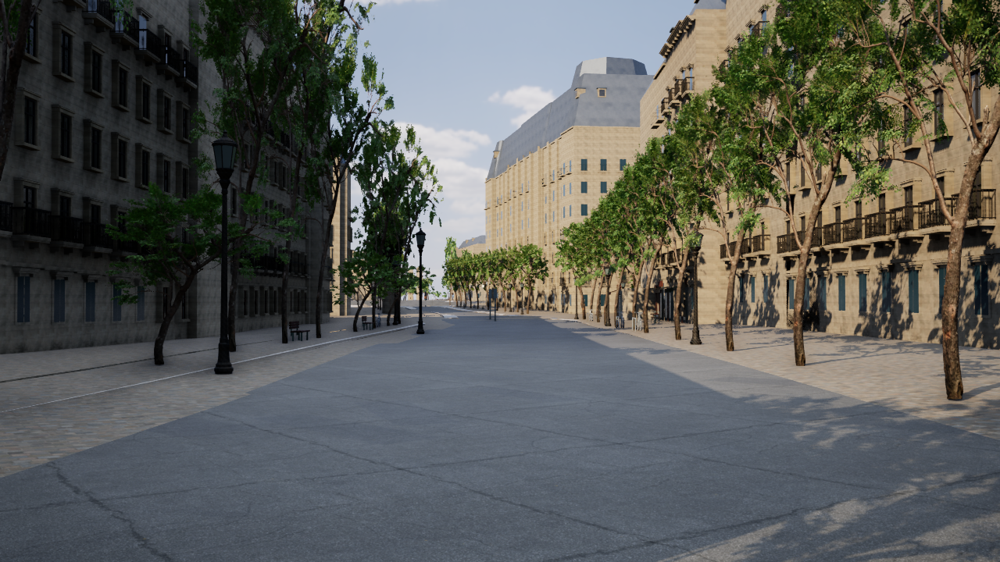

# 参照画像に近づける街路の改修

2026-11-08。サン・ミシェル河岸を中心とする半径180mの建物に、元のGISメッシュへ追跡できる建築ディテールを追加した。参照画像と同じ街路・実物外観の再現を意味しない。

`Paris-Reference.cmd` で自然光のパレ大通りから起動する。`F8` 散策、`F3` 飛行、`G` 昼／夕方／夜、`R` 雨、`F7` 品質、`8` マップ、`F10` HUD。従来のお祭り・小物モードも各起動ファイルで使用できる。

## 変更内容

- 191棟、7,244窓に立体の窓上見切り。既存の窓中心・向き・大きさを使用。
- 2,860か所の既存バルコニー位置に、厚みのある石の床・持ち送り・立体の鋳鉄欄干を追加。
- 1,480か所の既存軒位置に、段状のコーニスと持ち送りを追加。
- 177か所の既存入口位置に、石の枠・塗装木のパネル・取っ手を追加。既存の詳細な入口は除外。
- 177棟の既存の平らな屋根面に、石の煙突と中空のテラコッタの排気筒を推定配置。元の屋根の三角形・建物IDへ追跡できる。
- 写真由来の石材PBRを複製し、自然なクリーム色の専用素材を作成。
- 新しい樹木を実際に取得・インポート。元の位置・大きさ・幹の衝突プロキシを継続使用。
- 専用表示では装飾・ガーランド・飾り鉢などを抑え、隠れた小物の衝突判定も無効にする。既存の窓枠と夜の窓明かりは継続。
- 晴天の昼に、方向光50,000 lux、色温度5,900K、空の補助光・露出・霞を調整。太陽の方向は保存した街路方向を基準とし、カメラ移動では変化しない。夕方・夜・雨の切り替えを継続。
- 近景の樹木の影と精細な街灯を、専用の確認地点から170mの範囲で優先。元のノートルダム周辺だけを近景と判定していた問題を専用表示で調整。
- 専用の歩道素材で、道路テクスチャの方向ベクトルがゼロに近いときの代替方向を設定。UVと法線の計算が不正な数値になるのを防ぐ。
- ノートルダムから240mを越えると単色へ戻っていた地面に、専用表示では周囲と同じPBR石畳を継続使用。大通り沿いの白い帯を解消。形状・高さ・衝突判定は保持。

追加の装飾・扉・欄干の様式は推定。L4/L5の実物外観の根拠にはしない。元のGISの建物・屋根・道路・河川メッシュ、実測／推定高さ、元データID、EPSG:2154の共通原点は変更しない。追加ディテール自体には衝突判定を設定せず、元の建物の衝突判定を使用する。

## 再生成

UEを閉じ、プロジェクト直下で実行する。

```powershell
$project=& .\unreal\scripts\Get-AIWorldProject.ps1
& 'D:\Epic Games\UE_5.8\Engine\Build\BatchFiles\Build.bat' AIWorldEditor Win64 Development $project -WaitMutex -NoHotReloadFromIDE -NoUBA -MaxParallelActions=3
.\unreal\scripts\Build-ParisReference.ps1
.\gis\.venv\Scripts\python.exe -m unittest discover -s unreal/scripts/tests -p test_paris_reference.py -v
.\unreal\scripts\Test-ParisReference.ps1 -NativeOnly
```

取得済みの固定ファイルがそろっていればオフラインで再生成できる。ダウンロードはMD5とSHA-256を検証する。`source_mesh_id`・`source_quad_index`・`source_id` で元の窓・入口・軒を追跡できる。中間データは `unreal/assets/paris-reference/Generated/reference.json`、UE読み込み用は `unreal/AIWorld/Content/Data/paris-reference.json`。

同じ視点の撮影は以下。実際のUE描画を保存し、画像加工は行わない。比較用に人物・交通は両方の撮影で停止する。通常の起動では有効。

```powershell
.\unreal\scripts\Capture-ParisReference.ps1 -View Before
.\unreal\scripts\Capture-ParisReference.ps1 -View After
.\unreal\scripts\Capture-ParisReference.ps1 -View Sunset
.\unreal\scripts\Capture-ParisReference.ps1 -View Night
```

## 出典

樹木：[Poly Haven Tree Small 02](https://polyhaven.com/a/tree_small_02)、[CC0利用条件](https://polyhaven.com/license)。2Kの樹皮・枝・葉のテクスチャ、元メッシュ2,062,487三角形。6m × 6m × 10mの基準範囲に正規化し、既存の各樹木の寸法へ変換する。実際のパリの樹種を同定したモデルではない。固定取得記録は `unreal/assets/paris-reference-nature/manifest.json`。

石材は既存のCC0写真テクスチャと推定の石積み目地を使用。GISは既存の[© OpenStreetMap contributors](https://www.openstreetmap.org/copyright)、Paris Open Data、IGNのデータ・ライセンス記録を継続使用。

## 検証と制約

自動検証・実画像・性能の結果は `paris-reference-validation.json` に記録する。

実行済み：UE C++ビルド、アセット保存、Python 5件、UEの既存機能11件＋専用表示1件の自動検証が成功。生成データの完全な再生成でもSHA-256が一致。元のGISメッシュのSHA-256は既存の道路生成記録と一致した。

1280×720・High・描画解像度100%・人物／交通を止めた同一視点の実測：変更前27.09fps、変更後26.39fps、夕方25.29fps、夜25.70fps。AMD Radeon(TM) Graphics、物理メモリ28.8GB。60fpsには達していない。通常の起動はMedium・80%で人物／交通を有効にするため、この比較条件とは異なる。



[変更前](paris-reference-before.png)・[夕方](paris-reference-sunset.png)・[夜](paris-reference-night.png)。画像はUEから直接保存し、加工していない。

最初の撮影ではサン・ミシェル河岸西側の路面に過大な横断勾配が見つかった。元のDTMと河岸の段差の扱いに補正が残る。比較カメラはパレ大通りへ移し、1.7mの目線高さと6m幅の横断高低差25cm未満を検証する。河岸全体の地形修復が完了したという扱いにはしない。

参照画像と同等の仕上がりには、実物に合わせた屋根・煙突・ドーマーの個別形状、連続した店舗の開口部、建物ごとの外壁ディテール、樹種・樹形の複数バリエーションがさらに必要。今回の推定の装飾層だけで街全体の外観再現が完成したとはしない。60fpsは実測で達した場合だけ達成として扱う。

次の実装順は、河岸の上下段と橋の取り付け部の標高制約、重点100m区間の建物別の屋根・店舗、GPU計測に基づく描画予算の調整。一部OSM輪郭の重複、道路ネットワークの分断、公式軒高の部分的な欠損、境界で切れた低い橋片についても、既存データの警告を保持する。

主な変更：`ParisReference.cpp/.h`、`ParisReferenceTests.cpp`、`ParisDigitalTwin.cpp`、`ParisLuxury.cpp`、`ParisGroundDisplay.cpp`、`ParisSurfaceMaterials.cpp`、`generate_paris_reference.py`、`paris_reference_roofs.py`、`bake-paris-reference.py`、`fetch_paris_nature.py`、`create-paris-nature.py`、各起動・ビルド・撮影・検証スクリプト。変更前のバックアップ：`backups/paris-before-reference-20261108-092546`。
