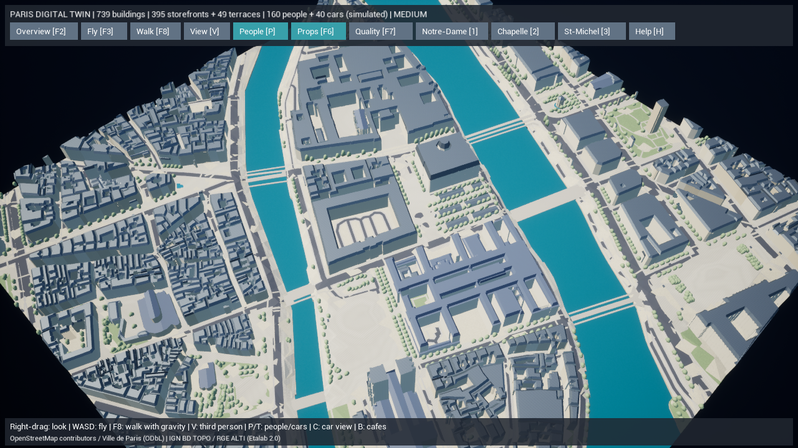
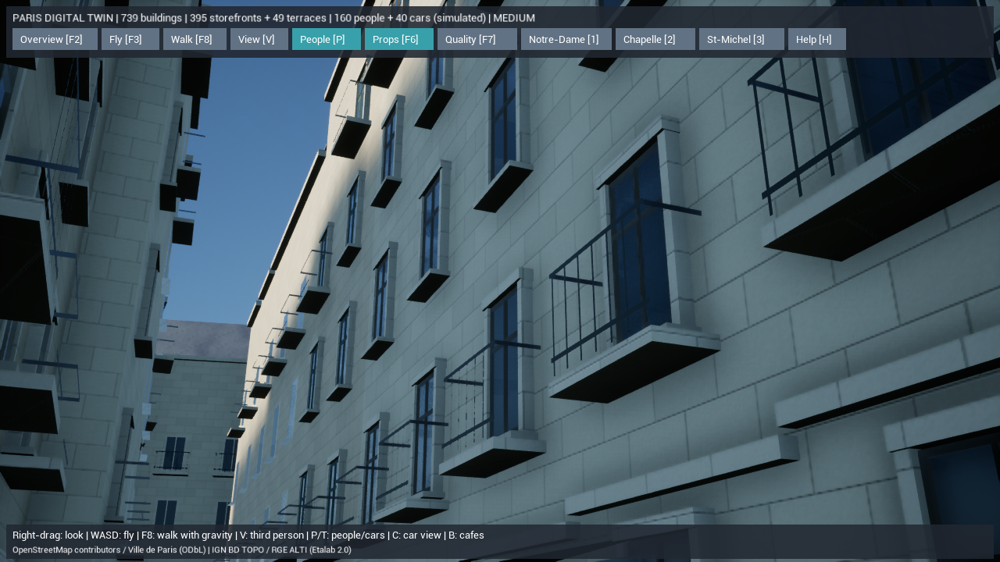

# Paris Digital Twin — 建物描画のキャッシュ化

2026-10-15。739棟の配置・高さと道路・河川・橋、住民の経路・着席・挨拶を維持し、建物本体と屋根の描画を最適化しました。開始前の未コミット変更72ファイルは `backups/pre-paris-render-20261015-192302.zip` に保存し、ZIPのCRCも確認しています。

## 実装した内容

既存の100m単位の本体77メッシュと屋根79メッシュ、合計156メッシュ・124,233三角形を、同じ位置・法線・頂点色の `UStaticMeshComponent` で表示します。UEの静的メッシュ描画経路を使い、毎フレームの動的メッシュ準備を減らします。形状の簡略化やLODの置換は行っていません。

元の `UProceduralMeshComponent` は地物IDの選択と衝突判定を担当します。派生クラス `UParisCollisionMesh` はキャッシュ表示中に描画プロキシを作らず、GPUの形状データを二重に確保しません。衝突のデータは保持します。再現度・問題表示では元の描画を復元し、輪郭表示では両方を非表示にします。素材・品質の切替も同期します。キャッシュ作成に失敗した地物は従来描画を継続します。

キャッシュは起動時に生成する一時オブジェクトです。中間のMeshDescriptionは保持しません。NaniteやエディターのHLODを生成したものではなく、World Partitionによる読み込みも未導入です。[フォトリアル機能の調査](paris-photoreal-audit.md)を別途まとめています。

## 変更ファイル

| ファイル | 役割 |
| --- | --- |
| `ParisCollisionMesh.h/.cpp` | 衝突・地物情報を保持したまま描画プロキシを切り替え |
| `ParisRenderCache.h/.cpp` | 同じ形状・色の静的描画、素材・デバッグ表示の同期、計測項目 |
| `ParisDigitalTwin.h/.cpp` | キャッシュ接続、3秒後のGPU診断、比較起動フラグ |
| `ParisRenderTests.cpp` | 形状・色・衝突・選択と表示切替の検証 |
| `Start-ParisDigitalTwin.ps1` / `Test-ParisDigitalTwin.ps1` | 従来描画への切替、13件の検査 |
| `Measure-ParisDigitalTwin.ps1` | 測定の排他制御、古いDLLの拒否、DLLハッシュ、GPUログと併走UEプロセスの記録 |

C++ファイルは `unreal/AIWorld/Source/AIWorld/`、スクリプトは `unreal/scripts/` にあります。既存の未追跡 `DefaultInput.ini` は保持しています。

## 起動・検証手順

通常は `Paris-DigitalTwin.cmd`、街路の素材確認は `Paris-Materials.cmd` を使います。標準で新しい描画を使用します。操作は従来どおり、F2全景、F8散策、V視点、M素材、F7品質です。

```powershell
.\unreal\scripts\Build-AIWorldUE.ps1 -SkipAssets
.\unreal\scripts\Start-ParisDigitalTwin.ps1
# 比較用の従来描画
.\unreal\scripts\Start-ParisDigitalTwin.ps1 -NoRenderCache
# 自動検証
.\unreal\scripts\Test-ParisDigitalTwin.ps1
.\unreal\scripts\Test-ParisDigitalTwin.ps1 -LegacyJSON
.\unreal\scripts\Test-ParisDigitalTwin.ps1 -NoRenderCache
.\unreal\scripts\Test-AIWorldUE.ps1
# 実画面・性能。ビルドやテストと同時に実行しない
.\unreal\scripts\Measure-ParisDigitalTwin.ps1 -View Overview -ReportPath docs/check-cache-performance.json
.\unreal\scripts\Measure-ParisDigitalTwin.ps1 -View Overview -NoRenderCache -ReportPath docs/check-procedural-performance.json
# パス別のGPU診断は3秒後の1フレームを記録
.\unreal\scripts\Measure-ParisDigitalTwin.ps1 -View Overview -ProfileGPU -ReportPath docs/check-profile-performance.json
```

## 実際の検証

UE 5.8.3 Development Editorの最終C++ビルドは成功しています。描画クラス追加を含むビルド122.94秒、最後のキャッシュ用メモリ調整のビルド26.91秒。アセット素材は前回の生成結果を使い、今回のビルドは `-SkipAssets` で実行しました。配布用のCook/Packageは実行していません。

軽量データ＋キャッシュ13件、旧JSON＋キャッシュ13件、軽量データ＋従来描画13件、従来の村5件、合計44件に成功しました。キャッシュの三角形数、位置・高さの境界1mm以内、GPUに渡す色、衝突、元の地理IDとクリック座標、再現度・問題・輪郭表示、素材と品質の切替を検証しています。従来の歩行・交通・カフェ訪問・着席・挨拶も含みます。[検証結果](paris-twin-render-test-results.json)。

初期の実装では、UE 5.8のHiddenInGameがIsVisibleにも影響することと、静的メッシュ構築時のsRGB変換を見落とし、表示互換性・色のテストが失敗しました。可視フラグを保って描画プロキシを切り替え、静的メッシュの色符号化を補正しています。修正後に上記の全条件を検証しました。

GIS検証はエラー0件、建物と道路の重複面積0㎡、座標往復誤差約2.8×10⁻⁹m。元データの重複・軒高不足・道路網の分断・範囲端の橋についての既存警告4種類を維持します。シーンSHA-256は `3840a8c864991c111ef7f48485707541daeaf4d3b1df3d67956a5368e032232f` で変更していません。[地理検証](paris-twin-render-validation.json)。

Dockerの基本構成とUnrealの重ね合わせ構成は `docker compose config --quiet` に成功しました。コンテナの再構築とSQLiteの変更は行っていません。今回GIS生成コードを変更していないため、前回のPython全60件は再実行していません。追加したアセット監査のPython5件は別途実行しています。

## 実描画と性能

AMD Radeon(TM) Graphics / Ryzen 7 7735HS / RAM約28.8GB。DX11、出力1280×720、内部80%、中品質、影あり、VSyncとFPS上限なし、`-RenderOffscreen`。5秒予熱後に15〜20秒測定し、ビルド・自動テストとは分離しました。

| 条件 | 平均fps | P95 ms | 計測秒数 |
| --- | ---: | ---: | ---: |
| [最終DLL・キャッシュ、他UEなし](paris-twin-render-isolated-cache-performance.json) | 92.92 | 12.23 | 20 |
| [最終DLL・従来描画、他UEなし](paris-twin-render-isolated-procedural-performance.json) | 63.48 | 17.41 | 20 |
| [変更前・全景](paris-twin-render-before-performance.json) | 57.28 | 19.35 | 20 |
| [キャッシュ・全景の初回](paris-twin-render-overview-performance.json) | 88.71 | 12.80 | 20 |
| [従来描画・全景、通常UE版併走](paris-twin-render-procedural-performance.json) | 40.60 | 30.92 | 20 |
| [キャッシュ・全景の再測定、通常UE版併走](paris-twin-render-overview-repeat-performance.json) | 68.91 | 18.03 | 20 |
| [従来描画・再測定、通常UE版併走](paris-twin-render-procedural-repeat-performance.json) | 33.92 | 36.13 | 20 |
| [キャッシュ・カフェ、通常UE版併走](paris-twin-render-cafe-performance.json) | 77.31 | 16.25 | 15 |
| [キャッシュ・素材視点、通常UE版併走](paris-twin-render-materials-performance.json) | 78.29 | 16.30 | 15 |

測定中の20:04:52 JSTに通常起動のUEゲーム画面が起動しました。コマンドラインとプロセス作成時刻で確認し、以降の測定は併走として区別しています。初回と後半の差をすべて描画方式の差として扱いません。新旧描画の比較は同じ最終DLLでも行い、そのハッシュをJSONに記録しました。追加の[GPU診断](paris-twin-render-profile-after-performance.json)では、別のUEゲーム1プロセスの存在も自動記録しています。

通常UE版が終了した後、同じ最終DLL・同じ視点で再比較しました。両実行とも開始・終了時の別UEプロセスは0件です。従来描画63.48fps・P95 17.41ms、キャッシュ92.92fps・P95 12.23msで、この条件では平均60fpsとP95 16.67ms以内を達成しました。

全測定のキャッシュ全景は約69〜93fps。併走時のP95は18.03msで、**すべての条件・すべてのフレームで60fpsを維持した結果ではありません**。街路2視点は併走時も平均60fpsとP95 16.67ms以内でした。DX12・4K・iPhone・配布パッケージでの計測結果ではありません。

キャッシュの初回読込は2.39秒、併走時の再測定では3.57秒。従来描画も1.64〜2.62秒の幅がありました。起動時の静的メッシュ生成の負担があり、並列実行状況も異なるため、読込増分を一つの値にはしません。各実行の物理メモリは約2.85〜2.98GiBです。





## 未実装と次の段階

全景用の形状簡略化、地区の段階読み込み、World Partition/HLOD、Nanite/Lumen用の保存アセット構築は未実装です。次は重点100m範囲のメッシュをエディター保存形式で生成し、閉じた壁・法線・距離フィールド・Lumen CardsとNaniteの構築を検証します。現在の実地理と衝突を基準に、描画アセットだけを交換できる構造を維持します。
