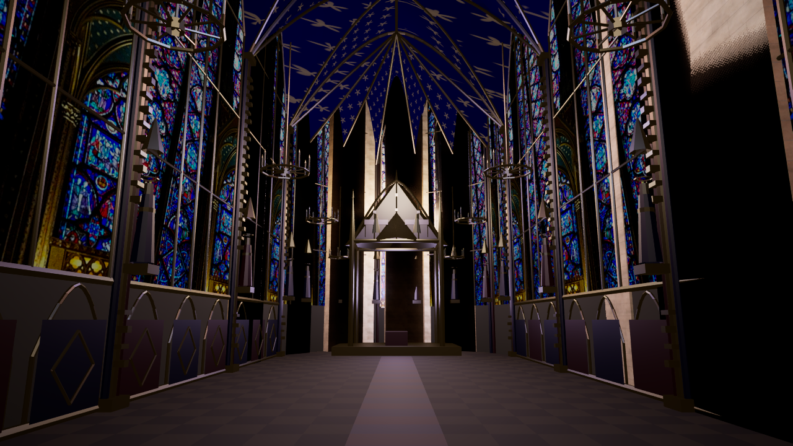

# Sainte-Chapelle exterior study

The existing GIS building footprint and its collision remain in place. The additional geometry is a documented reconstruction, **not** a survey or a scan of the entire monument. The anchor and orientation were computed from the local OSM relation `3344870`; the ground anchor comes from the existing GIS landmark. A guarded source point prevents placing it against a different footprint. The IGN gutter reference is 23.4 m and is not a surveyed roof profile. The photo-referenced detail adds stone buttresses, glazing with three-dimensional pointed tracery, a west rose, a slate roof and an inferred spire whose tip is 75 m above the local ground. Its silhouette and ornament are simplified, and the existing solid volume means windows are not true openings and the interior cannot be visited.

Architectural evidence: [Sainte-Chapelle, Centre des monuments nationaux](https://www.sainte-chapelle.fr/decouvrir/histoire-de-la-sainte-chapelle) describes a 75 m spire, a nave of four bays, seven-sided apse, and fifteen stained-glass windows. [The official window dossier](https://www.sainte-chapelle.fr/content/download/9873213/file/Dossier%20th%C3%A9matique-Les%20verri%C3%A8res%20de%20la%20Sainte-Chapelle.pdf?version=1) describes the dimensions of the nave and apse windows. OSM footprint © OpenStreetMap contributors (ODbL).

The glass material contains a selected portion of Gerda Arendt’s [Sainte-Chapelle upper chapel windows](https://commons.wikimedia.org/wiki/File:Sainte-Chapelle,_Paris,_upper_chapel_windows.jpg), CC0 1.0, dated December 2024. This is an **interior** photograph reused as illustrative exterior glass; the individual stories, positions, lighting and visible appearance do not represent measured exterior windows. The photo SHA-256 and exact source are recorded in `unreal/assets/sainte-chapelle/manifest.json`. Existing project stone/slate materials are used for the remainder; no model was acquired from the non-downloadable scans.

Run `Paris-Sainte-Chapelle.cmd`, or `unreal/scripts/Start-ParisDigitalTwin.ps1 -ChapelleView -Quality Medium`. J toggles the close view and F2 returns to overview. Low quality and map/debug views hide the added detail and retain the underlying GIS rendering. To regenerate the glass material from the CC0 photo, close the Unreal preview and run `unreal/scripts/Build-ParisChapelle.ps1`; an already downloaded, verified photo supports offline use.

## 内部（上層礼拝堂）

2026-11-09。外観の再現物に続き、上層礼拝堂の内部を追加した。`Paris-Sainte-Chapelle-Interior.cmd`（または `Start-ParisDigitalTwin.ps1 -ChapelleInterior`）で西のバラ窓方向の視点から始まる。**J** で外観 → 内部（西向き）→ 内部（後陣向き）→ 内部（窓を見上げる）→ 自由視点の順に切り替わる。`-ParisTwinChapelleInterior=1..3` で起動視点を指定できる。

- 4つのベイと7角形の後陣、窓16面（側廊の窓8＋後陣7＋西のバラ窓1）、リブ付きの交差ヴォールト（天井は縦横2つの尖頭アーチの高い方）、頂部の飾り、柱の束ね柱、窓下のブラインド・アーケード、西側のバルコニーと入口、後陣の壇と金の天蓋、タイル床。
- 窓は既存のCC0内部写真（外観の窓と同じ）を自発光させたガラスで、実在のパネルの位置や図像の再現ではない。天井の星・百合の模様は手続き的な意匠で、実測や写真ではない。
- 寸法は公開されている窓の高さ約15mと4ベイ＋7角形の後陣に合わせた推定。ただし窓頂部・ヴォールト頂部を、GISの建物殻の軒高23.4mの下に収めるため、実際の高さより圧縮している（床5.2m、頂部23m）。
- 外から見た表示とGISの衝突は変えない。内部メッシュと光源は、内部視点のときだけ表示され、その間だけ外光（太陽・空・霧）を切って暗所向けの露出（ISO400・1/30秒）に切り替える。内部を歩く機能はなく、自由飛行（F3）なら内部に入れる。
- 実行時に生成する手続きメッシュなので追加アセットはない。マテリアル3種（`M_SainteChapelleInterior`、`InnerGlass`、`Vault`）は `Build-ParisChapelle.ps1` が生成する（UEを閉じて実行）。

撮影: `Capture-ParisChapelleInterior.ps1 -View 1|2|3`。結果は [西向き](paris-chapelle-interior-1.png)、[後陣向き](paris-chapelle-interior-2.png)、[窓を見上げる](paris-chapelle-interior-3.png)。1280×720・High・DX12で、いずれも35〜45fps（AMD Radeon Graphics）。

残る課題: 石・金の部分が暗く、彫刻や壁画（十二使徒像、扉口の装飾）がない。聖遺物の天蓋は簡略形で、下層礼拝堂は未作成。バラ窓は西壁のみで、本来の複雑な構成には届かない。

## 内部の作り込み（第2弾）

Wikimedia Commons の写真（CC0: "Sainte-Chapelle, Paris, upper chapel windows/rose"、CC BY-SA 4.0: Oberkirche Ost 1/2 ほか）を参照資料として確認し、次を追加した（形状は推定で、写真そのものは再配布していない）。

- 使徒像（柱ごと・後陣）と尖塔付きの天蓋
- 燭台シャンデリア（燭台の炎は発光）
- 柱の金の装飾帯、壁下部の赤・青の菱形パネル
- 聖遺物箱の切妻天蓋、尖塔、天使
- 石材・金の環境光相当の発光（暗室露出で黒つぶれするため）
