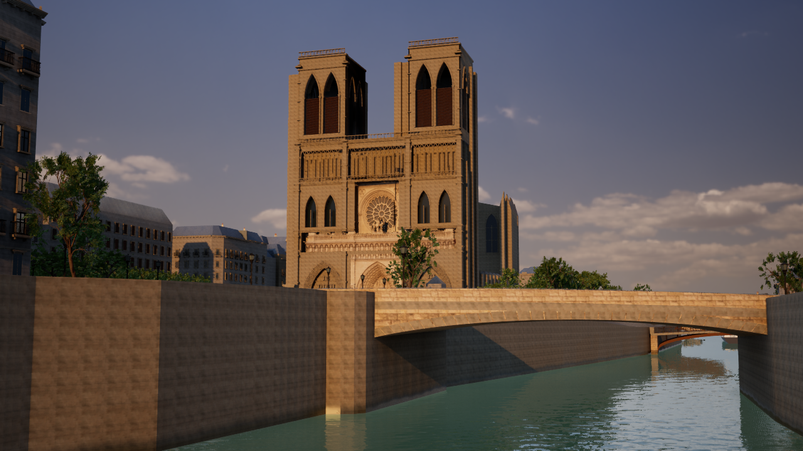

# セーヌ河岸・石造建築・夕景の表示

2026-11-09。参照された複数のパリ写真をもとに、既存のGIS地区へ河岸を眺める表示を追加する。写真は構図と光の参考で、素材への貼り付けには使用していない。

`Paris-Seine.cmd` は川からノートルダム方向を見る夕景。`Paris-Seine-Bridge.cmd` はサン・ミシェル橋、`Paris-Seine-Aerial.cmd` は取得済み地区の上空表示。通常はMedium・1280×720・描画80%。`G` で昼／夕／夜、`R` で雨、`F3` で自由飛行、`F6` で細部、`F7` で品質、`8` で地図、`F10` でHUDを切り替える。河川上の鑑賞カメラは地上の歩行開始点ではない。街路散策は既存の `Paris-Lane.cmd` / `Paris-Explore.cmd` も使える。

## 実装

- 石造の窓上見切り27,979か所、バルコニー11,100か所、軒飾り5,792か所、入口564か所、煙突549か所を、589棟の既存建物へ紐づけた。元の窓・壁・屋根の面をたどる推定の建築装飾で、実測のL4/L5外観にはしない。
- 地区の実際の並木位置に既存の詳細樹木を使用。川越しの建物の装飾が消えないよう、この表示では距離を広げる。遠景の軒飾りは面取りを省略して生成面数を抑える。
- 水専用の散乱・吸収を使う既存のSingle Layer Waterを複製し、緑の強さと波の法線を抑えた独立素材を追加。実際の河川ポリゴン・水位・岸の距離場と流れは引き継ぐ。反射は既存のLumen設定を使用し、固定写真を水へ貼らない。
- 水面の下に描画用の河床、実際の岸の線に沿って背面の隙間を塞ぐ石壁と幅60cmの笠石を追加。河床は水面下4.5mとする推定で、測量された水深ではない。壁の高さは既存の橋の端点高さ＋推定110cmの欄干高から滑らかに補間し、水際のDTMによる尖りを避ける。追加3メッシュを含め85種類を使用する。これらは鑑賞用の表面補完で、元の衝突や歩行面の勾配は修正しない。
- 石灰岩を穏やかな白灰色へ寄せた独立素材、昼の斜光、4200Kの低い夕日、控えめな霧とブルームを追加。夜は大聖堂の塔を狙う推定の照明2基を加え、光源プールは上限36基にする。
- 晴れた夜は既存HDRパノラマを暗く青く調整した夕暮れ直後の空を使用する。夜間だけ水面の透過色・散乱を抑え、大聖堂の照明を強める。空・水・照明とも芸術的な補完で、撮影されたパリの夜空や計測した水の光学特性ではない。
- 大聖堂・橋・上空の3カメラに、WGS84座標とNGF標高を記録する。橋・護岸・大聖堂は既存の再現アセットを使用する。

## 再生成・検証

UEを閉じ、プロジェクトルートから実行する。

```powershell
.\unreal\scripts\Build-AIWorldUE.ps1 -SkipAssets
.\unreal\scripts\Build-ParisSeine.ps1
.\unreal\scripts\Test-ParisSeine.ps1
.\unreal\scripts\Capture-ParisSeine.ps1 -View Before
.\unreal\scripts\Capture-ParisSeine.ps1 -View After
.\unreal\scripts\Capture-ParisSeine.ps1 -Camera Bridge -View Day
.\unreal\scripts\Capture-ParisSeine.ps1 -View Night
.\unreal\scripts\Capture-ParisSeine.ps1 -Camera Aerial -View After
```

中間データは `unreal/assets/paris-seine/Generated/seine.json`、UE用は `unreal/AIWorld/Content/Data/paris-seine.json`。入力は既存の取得済みGISとメッシュバッファで、ネットワーク接続は不要。元の道路・建物・河川の形状と衝突は変更しない。EPSG:2154・cm・X東/Y南/Z上の共通基準点を使い、Cesiumの変換は適用しない。

追加ファイルは `generate_paris_seine.py`、`paris_seine_banks.py`、`bake-paris-seine.py`、`Build/Capture/Test-ParisSeine.ps1`、地理検証テストと起動cmd。既存の `generate_paris_reference.py` / `bake-paris-reference.py` は生成先・範囲を選べるようにし、C++の `ParisReference`、`ParisSurfaceMaterials`、`ParisNightLighting` と共通ランチャーへ表示を接続した。

実行結果は `paris-seine-validation.json` と `paris-seine-*-performance.json`、UEの未加工画像は `paris-seine-*.png` に記録する。変更前バックアップは `backups/current-seine-backup.txt` に記録。

## 再現範囲

元データは既存の [OpenStreetMap](https://www.openstreetmap.org/copyright)、Paris Open Data、IGNの取得済みスナップショット。写真由来の石・樹木等の素材と利用条件は既存の [参照表示](paris-reference-look.md)、[橋](paris-realistic-bridges.md)、[川](paris-realistic-river.md) の出典記録を継続する。今回、新たな外部アセットは取得していない。

取得範囲は800m角の既存地区。島全体・パリ全域の再現ではなく、範囲の端は上空から見える。ポン・ヌフなど範囲外の橋を追加した扱いにはしない。建物ごとの外観・屋根の正確さと河岸DTMの不自然な勾配は残り、参照写真と同等の再現精度にはまだ届いていない。未取得の高品質アセットを参照して完成扱いにはしない。

次は重点100m区間の河岸地形と衝突を整合させ、実資料と照合しながら建物ごとの屋根・窓割り・石の継ぎ目・局所的な汚れを詰める。遠景と近景で装飾と樹木の影の予算を分け、実機の描画時間に合わせて調整する。

<!-- execution-results -->

実行済み：UE 5.8のC++ビルドとアセット保存に成功。地理検証3件とUE内検証5件が成功し、最終データでの水面素材の適用も再確認した。元のGISメッシュと従来の2表示用データは変更前と一致。最初からの再生成も同一ハッシュになった。

大聖堂の昼・夕・夜は同じ位置・画角で撮影。全て1280×720、High、描画100%、DX12/SM6、人物・車の移動を止めた未加工のUE実画像。AMD Radeon(TM) Graphicsの環境で60fpsには未達。通常起動はMedium・80%・人物と交通ありで条件が異なる。

| 実画面 | fps |
| --- | ---: |
| [上空・夕方](paris-seine-aerial-after.png) | 16.42 |
| [サン・ミシェル橋・昼](paris-seine-bridge-day.png) | 26.04 |
| [大聖堂・夕方](paris-seine-cathedral-after.png) | 26.09 |
| [大聖堂・昼](paris-seine-cathedral-day.png) | 26.40 |
| [大聖堂・夜](paris-seine-cathedral-night.png) | 26.58 |


