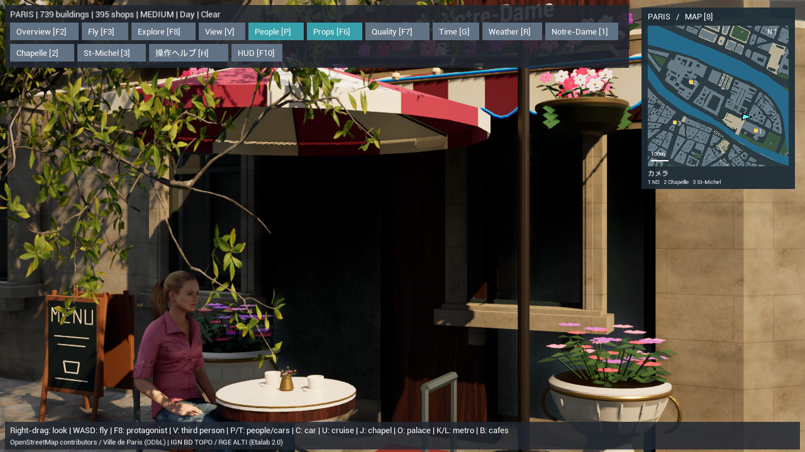

# 店先のディスプレイとカフェのパラソル v9

店先に260か所の小物を追加した。内訳はメニュー看板138、本・ポストカードの棚55、花台60、果物の陳列台7。既存のカフェテラス17か所には、椅子とテーブルに合わせたパラソルを追加する。9種類の共有モデルを使い、色や並びに違いを付ける。店舗のジャンルを基準にした推定の外観・配置であり、現地で調査した商品棚や看板ではない。

`Paris-Street-Life.cmd`でカフェ付近の地上視点から起動する。

## 配置と操作

入口、道路、橋、川、既存の街路設備・花鉢、歩行者の移動経路を避ける。歩道・歩行者道上に支持される位置を選び、元の店舗ID・建物IDと配置地点の緯度経度を保存する。パラソルは既存の屋外席だけに付け、屋根の下に210cm以上の高さを確保する。支柱はテーブルの脇に寄せ、入口を避ける。

追加物は`F6`で街路の小物と一緒に表示を切り替え、隠す際は衝突判定も無効にする。物をクリックすると、推定配置であること、店舗ID、緯度経度を確認できる。ミニマップは`8`、地区巡回は`7`、派手モードは`9`。既存の68モデルと配置、汚れ、地図、雨・夜景、巡回カメラを保持した。

## 再生成と確認

プレビューを閉じて実行する。

```powershell
./unreal/scripts/Build-AIWorldUE.ps1
./unreal/scripts/Build-ParisLuxury.ps1
./gis/.venv/Scripts/python.exe -m unittest discover -s unreal/scripts/tests -p test_paris_luxury.py
./unreal/scripts/Test-ParisLuxury.ps1
./unreal/scripts/Capture-ParisStreetProps.ps1 -View After
./unreal/scripts/Capture-ParisStreetProps.ps1 -View Before -CafeCamera
./unreal/scripts/Capture-ParisStreetProps.ps1 -View Cafe
./unreal/scripts/Capture-ParisStreetProps.ps1 -View Night
```

`Before -CafeCamera`はカフェと同じカメラで、追加の看板・棚・パラソルだけを隠した比較画面。元の花や飾りは表示する。

主な変更：`generate_paris_street_props.py`、`generate_paris_luxury.py`、`bake-paris-luxury.py`、`ParisLuxury.cpp`、起動・撮影スクリプトと検証コード、生成済みJSON・モデル・素材。変更前は`backups/paris-before-street-props-20261107-142709`へ保存した。

## 検証記録

C++ビルド、Pythonの12件と、支柱位置を調整した後の2件の確認が成功。地理座標、歩道の支持、建物・川・歩行者経路との非重複、元の68モデル・全配置・カメラの保持、同じ入力からの生成一致を確認した。UEの11件も成功。新しい小物の衝突、F6で隠したときの衝突解除、既存の雨・夜景・汚れ・ミニマップを確認した。

[カフェの追加前](paris-street-props-before.png)と[追加後](paris-street-props-cafe.png)を同じカメラで撮影し、看板とパラソルの表示を確認した。[地区の街路](paris-street-props-after.png)と[雨の夜](paris-street-props-night.png)も撮影した。画像加工は行っていない。全4画面で材料のコンパイルエラーはない。

AMD Radeon内蔵GPU、1280×720、中設定、画面解像度80%での実測値。

| 視点 | 平均fps | 95%フレーム時間 |
|---|---:|---:|
| 地区の街路 | 38.73 | 28.69ms |
| カフェ・追加前 | 31.35 | 34.77ms |
| カフェ・追加後 | 31.15 | 35.52ms |
| 雨の夜 | 37.18 | 30.18ms |

目標60fpsは未達。[検証記録](paris-street-props-validation.json)。




## 今後

商品棚や看板は静的な装飾。商品購入、店員の接客、営業時間に合わせた出し入れ、現物の店舗ごとの商品再現は未実装。次は人の店先への立ち寄りや店舗ごとの外観を詳しくする。
