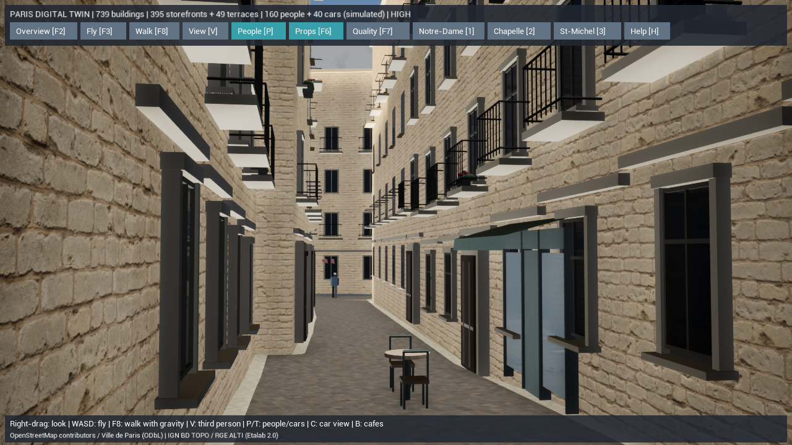

# 街路から見た写実表現の改善

参考写真の石壁、敷石、窓の厚み、鉄柵、花を目標に、まずSaint-Michelの100m四方を更新しました。実データの地理・高さ・建物精度と、推定した外観を区別します。現状の大聖堂と人物は簡易モデルであり、写真相当の完成とはしていません。

## 実装

- 壁と敷石に実写由来の2K albedo / DirectX normal / ORMを導入。cm単位のワールド投影により、実建物のUVや輪郭を変更せず貼り付けます。
- 石壁は2m、敷石は2.5mの実寸タイル。ORMはR=AO、G=roughness、B=metallic。従来のARH（B=height）と別のマテリアル生成処理を使います。
- 100m範囲の窓524か所・24棟に石の額縁・木製建具、丸棒のバルコニー柵208か所、プランターと花140個を配置。窓枠とコーニスは目地のない別材質です。装飾は推定でL1のまま。教会と特別な歴史建築には住宅用装飾を生成しません。
- 細部は歩行を妨げないcosmetic geometryで、低品質・輪郭表示では非表示、描画距離100m。壁に実際の開口を切った処理ではありません。
- 5700Kの太陽光とHDRの環境光・反射を設定。DX11互換描画を維持し、Nanite / Lumen / VSMを有効化したとはしていません。起動品質による内部解像度は低65%・中80%・高100%。F7は描画距離と細部の品質を切り替えます。
- 人の目線1.7mで実際の街路の通行可能位置を探す起動モードを追加。視線方向の障害物を調べ、建物を動かさず街路に沿って見渡します。

## 起動と比較

`Paris-Realism.cmd` を起動します。右ドラッグで見回し、WASDで移動、F8で重力付き散策、F2で全景、MでPBR/単色、F7で品質を切り替えます。



[変更前の同じMaterials視点](screenshots/paris-street-realism-before.png) / [更新後のMaterials視点](screenshots/paris-street-realism-materials.png) / [全景](screenshots/paris-street-realism-overview.png)。いずれも実際のUEからのキャプチャです。

```powershell
# 新しい街路ビュー
.\unreal\scripts\Start-ParisDigitalTwin.ps1 -StreetPhotoView
# 元の独自生成素材と照明に戻して比較
.\unreal\scripts\Start-ParisDigitalTwin.ps1 -StreetPhotoView -ProceduralSurfaces
# 同じ正面構図で素材を比較
.\unreal\scripts\Start-ParisDigitalTwin.ps1 -MaterialsView
```

## 出典とオフライン生成

全素材は[Poly HavenのCC0](https://polyhaven.com/license)。有料APIや実行中のネット接続は使いません。

| 用途 | 素材・作者 | 留意点 |
| --- | --- | --- |
| 石壁 | [White Sandstone Blocks 02 — Rob Tuytel](https://polyhaven.com/a/white_sandstone_blocks_02) | 白い砂岩。パリの実測石灰岩ではない外観用の代替素材 |
| 敷石 | [Cobblestone Pavement — Charlotte Baglioni](https://polyhaven.com/a/cobblestone_pavement) | 現地舗装の測量資料ではない |
| 環境光 | [Kloppenheim 05 Pure Sky — Greg Zaal / Jarod Guest](https://polyhaven.com/a/kloppenheim_05_puresky) | 空の光と反射用。パリの現地撮影ではない |

元ファイル・API応答・URL・作者・権利・物理寸法・各ファイルのSHA-256は `unreal/textures/paris-photo/manifest.json` に保存。取得は `paris_photo_sources.py --download` を明示した場合だけです。APIの[利用条件](https://github.com/Poly-Haven/Public-API/blob/master/ToS.md)に従いUser-Agentを指定します。通常ビルドは同梱済み画像のハッシュを検査してオフラインで取り込みます。

```powershell
$env:PYTHONPATH=Join-Path (Get-Location) 'gis'
.\gis\.venv\Scripts\python.exe unreal/scripts/paris_photo_sources.py
.\gis\.venv\Scripts\python.exe -m paris_twin prepare --offline
.\gis\.venv\Scripts\python.exe -m paris_twin validate --offline
.\unreal\scripts\Build-AIWorldUE.ps1
.\unreal\scripts\Test-ParisDigitalTwin.ps1
.\unreal\scripts\Measure-ParisDigitalTwin.ps1 -View Realism -Quality High -Duration 15 -ReportPath docs/paris-street-realism-performance.json
```

舗装はワールド座標XYを250cmで割ったUVと、実際の地面法線に沿う接空間で描画します。最初の画像確認で見つかった路面の筋状の伸びを修正しました。壁は三方向投影です。法線関数はインストール済みUE5.8の実在する `WorldAlignedNormal2` を読み込みます。

## 実際に確認した描画と地理

UE5.8.3 Development Editorの `-game -dx11 -RenderOffscreen`、AMD Radeon Graphics（Ryzen 7 7735HS内蔵）、1280×720で測定。起動後5秒を除き15秒を集計しました。測定中の他のUEプロセスは開始・終了とも0です。移動中の最低fpsやiPhone実機での性能を測った結果ではありません。

| ビュー | 品質・内部解像度 | 平均fps | フレーム時間P95 |
| --- | --- | ---: | ---: |
| 変更前のMaterials | 中・80% | 98.31 | 11.69ms |
| 更新後のMaterials | 中・80% | 109.19 | 10.57ms |
| 更新後の街路 | 高・100% | 100.75 | 11.53ms |
| 更新後の全景 | 中・80% | 101.65 | 11.27ms |
| 元の素材と照明へ戻した街路 | 中・80% | 110.93 | 10.43ms |

変更前後のMaterials視点はカメラの仰角22.091046°・標高NGF35.412987mが一致しました。結果JSONにはDLL・シーンのSHA-256、測定条件、他のUEプロセス数を記録しています。高品質の街路と中品質のMaterialsは異なる条件なので、直接の速度比較には使いません。

- [高品質の街路](paris-street-realism-performance.json) / [同じMaterialsモード](paris-street-realism-materials-performance.json) / [全景](paris-street-realism-overview-performance.json) / [元の素材](paris-street-realism-fallback-performance.json)。
- 最終シーン：739棟、395店舗、49テラス、160人、40台。メッシュ466個、1,231,408三角形。街路設備は引き続きインスタンシングします。
- 装飾を除いた全191メッシュの形状・色・属性と、選択用4,799地物・地理基準・ランドマーク・変換チェックを前後で比較し、SHA-256が `7ad69c15c2e697908b321b49e0b456c240cd83f59714330371847107003fd1e8` で一致しました。
- [GIS検証](paris-street-realism-validation.txt)はエラー0、道路・建物の生成面重複0㎡、座標往復誤差最大2.794e-9m（計算精度であり現地測量精度ではありません）。元データの建物重複・高さ未確定362棟・道路の分断・境界で切れた低い橋2本の警告4種は残しています。
- シーンSHA-256：`28e18dd640f25af7bbd1fc288e6b11f2587ab4ff87a50b49bd2356d7ec805694`。最終DLL：`8a7e1c8318471f26b62b128faff71aba011bf5675adca9e3ade685f831137ffc`。

最終ビルドのUE自動テストは通常の軽量データ14件＋従来JSON14件＋村シミュレーション5件＝33件成功。素材の実ファイル読み込み、実際の出力への配線、色空間・2Kソース・DirectX法線、衝突と歩行、地物選択、カフェ・着席・交流、描画キャッシュの一致と切り替え、保存・地形を検証しました。[通常データ](paris-street-realism-native-tests.log) / [従来JSON](paris-street-realism-legacy-tests.log) / [村](paris-street-realism-village-tests.log)。NullRHIではGPU用の素材参照一覧が空になるため、素材接続は保存された出力チェーンを辿って確認し、実描画は上の画像で別途確認しています。

Pythonは細部の範囲・決定性・法線・頂点色、実画像のSHA-256、ライセンス情報、改変・欠損・色空間・ORM/ARH混同の拒否、必要アセットの架空参照拒否など関連10件成功。[実行ログ](paris-street-realism-python-tests.txt)。全GISテストスイートを今回再実行したという意味ではありません。

[最終検証・ファイルハッシュ一覧](paris-street-realism-verification.json)に証跡をまとめました。

## 不足するアセットと次段階

写真の品質へ進めるには、次の現物が必要です。架空のアセットパスを参照して完成扱いにはしていません。

1. 現地資料に対応した石灰岩・亜鉛・スレート：2K通常/4K重点、albedo/DirectX normal/ORM、物理寸法、権利情報。今回の砂岩は置換可能な代理素材です。
2. パリの住宅用モジュール：実際の開口、奥行きのあるガラス・窓内側、コーニス、鍛鉄装飾、店舗。cmスケール、UV0、LOD、別の簡易衝突。対応する建物IDと写真資料を残します。
3. ノートルダムの資料に基づく外装：塔・門・彫刻・バラ窓・控壁。現在のGISボリュームを基準に高詳細モデルを作成し、L4/L5の根拠を別途記録します。
4. 現実的な人物と街路樹：リグ・歩行/着席アニメーション、人物LODと肌・衣服PBR、葉の透過・粗さ。現在のAIやカフェ予約・交通データに接続します。
5. オフライン静的メッシュへの出力とDX12描画の実測。既存のGPU能力検査だけでLumen/Naniteの画質・性能を保証しません。[機能調査とアセット仕様](paris-photoreal-audit.md)を参照。

## 変更箇所

- `gis/paris_twin/facades.py`：重点範囲の立体柵・花・推定属性。
- `unreal/scripts/paris_photo_sources.py` / `create-paris-photo-assets.py`：取得・検証とUE取り込みを分離。
- `create-paris-assets.py`：従来素材を残し、新素材をオフラインで構築。
- `ParisDigitalTwin.cpp` / `ParisSurfaceMaterials.cpp`：街路ビュー、HDR環境光、影、比較モード。
- `ParisSurfaceTests.cpp` / `Test-ParisDigitalTwin.ps1`：実際のUE素材・2Kソース・チャンネル・代替素材の読み込み検査。
- `gis/tests/test_facade_details.py` / `test_photo_sources.py`：範囲、決定性、出典・ハッシュ改変、チャンネル混同を検証。
- `check_paris_geometry_contract.py`：装飾以外の全形状と地理情報を前後比較。
- `Paris-Realism.cmd` / 起動・性能測定スクリプト、アセット台帳、監査レポート。

変更前の作業内容は `backups/pre-paris-street-realism-20261015-203902.zip` に退避済みです。既存Docker・バックエンド・住民AIは変更していません。
