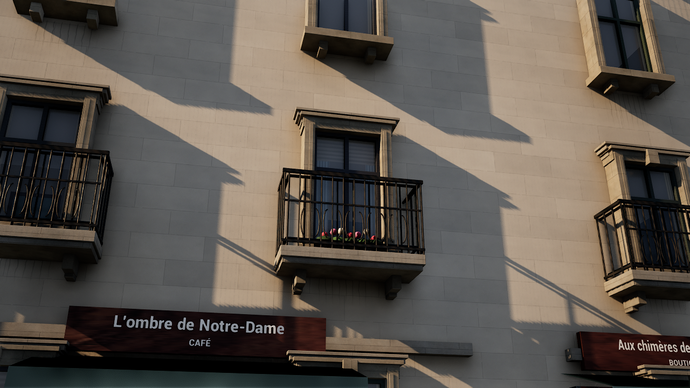

# 石灰岩と窓の質感更新

2026-11-12。既存のパリ写真モードを対象に、石壁の全面に出ていた強い黒ずみと、均一な青黒い窓を改善した。撮影条件と照明設定は変更していない。

## 変更内容

- 石灰岩の明るさを整え、石ごとの微妙な色差と目地を残す。既存の写真由来の細かな法線と、窓下・壁際へ配置した汚れは保持する。旧素材の大きな黒い斑点を弱める。
- 窓には視線に応じて見え方が変わる簡易室内を描画する。カーテン幅、布の色、ブラインド、室内の色を窓ごとに変える。外観・室内とも推定で、実在住戸の再現ではない。
- 窓の反射にはUEの既存の環境反射を使用する。微細なガラスのうねりと、端に寄った汚れによる粗さの差を加える。反射用の固定写真は追加しない。
- 近景の573枚と地区内15,530枚の窓の表示層へ専用素材を接続する。表示距離・品質によるカリングは維持する。近景用の夜間発光は専用インスタンスへ分ける。地区の窓は既存の点灯レイヤーを使い、新素材側に同じ明かりを足さない。
- 色とインスタンス値を安定した段階値へ変換してから窓の模様・点灯を決める。補間の微小な誤差が増幅され、窓面のピクセルごとに点灯判定が変わることを防ぐ。
- 元のGIS、建物位置、道路、河川、衝突メッシュは変更しない。追加の室内メッシュや光源は使わない。水面とライティングは今回の変更対象外。

## 起動と再生成

通常の写真モードとセーヌ表示に自動適用する。通常の写真モードでは `-NoPhotoLook` で従来表示に戻せる。`-Seine` は専用素材を使用する。

```powershell
# 通りから確認
.\unreal\scripts\Start-ParisDigitalTwin.ps1 -Photoreal -PhotoCamera Street

# UEを閉じてから再ビルド・素材保存
.\unreal\scripts\Build-AIWorldUE.ps1 -SkipAssets
.\unreal\scripts\Build-ParisSeine.ps1 -SkipGenerate
.\unreal\scripts\Test-ParisSurfaceRealism.ps1

# 実画面の保存
.\unreal\scripts\Capture-ParisSurfaceRealism.ps1 -View Windows
.\unreal\scripts\Capture-ParisSurfaceRealism.ps1 -View Street
.\unreal\scripts\Capture-ParisSurfaceRealism.ps1 -View Windows -Time Night
.\unreal\scripts\Capture-ParisSurfaceRealism.ps1 -View Street -Time Rain
```

`Capture` の `-Stage Before` は保存ファイル名の指定。比較元は変更前のビルド・素材で実際に撮影したものであり、旧素材へ切り替えるフラグではない。

## 変更ファイル

素材生成は `unreal/scripts/paris_surface_realism.py` と `bake-paris-seine.py`。`M_ParisSeineStone` を更新し、`M_ParisSeineWindow` と `MI_ParisSeineCoreWindow` を追加。適用は `ParisLuxury.cpp` と `ParisPhotoFrontages.cpp`、適用検証は `ParisReferenceTests.cpp`。共通起動スクリプトの素材存在チェックも通常写真モードへ拡張した。

バックアップの場所は `backups/current-surface-realism-backup.txt`。開始時のGitコミットと、変更前のソース・石材・実行DLLを保存している。

## 実行結果

UE 5.8のC++ビルド、素材保存、自動検証2件が成功。新しい窓素材の実メッシュへの適用、昼夜・詳細表示切替後の復元、雨の継続・屋根下・乾燥を検証した。最終の素材だけの調整は、DX12/SM6で描画して確認した。元のGISと中間データは開始時のGitコミットと差分なし。

比較は1280×720、High、描画100%、人物・車の移動を止めたUE実画像。窓とカフェはそれぞれ同じカメラで比較している。夜の粒状ノイズが消えたことも実画像で確認。AMD Radeon内蔵GPU環境では60fps未達。通常起動のMedium・80%とは条件が異なる。

| 昼の比較 | 変更前 | 変更後 |
| --- | --- | --- |
| 窓の近景 | [変更前](paris-surface-before-windows-day.png) 20.63fps | [変更後](paris-surface-after-windows-day.png) 21.80fps |
| カフェ前 | [変更前](paris-surface-before-street-day.png) 21.08fps | [変更後](paris-surface-after-street-day.png) 22.88fps |

[夜の窓](paris-surface-after-windows-night.png)：20.51fps。[雨のカフェ前](paris-surface-after-street-rain.png)：21.97fps。

[機械可読の実行記録](paris-surface-realism-validation.json)



## 残る差と次の改善

店舗の構造、建物ごとの窓割り・屋根・彫刻、遠景の形状には参照写真との差が残る。窓の室内はシェーダーで奥行きを表現している。次の重点は100m区間の店先と建物の細部。

## 11月13日のテラス植栽

テラスの木鉢に板の継ぎ目、縁、金具、脚、土を作り、茎と葉を立体化した。葉の高さや色、向きを変え、左右の鉢は向きを変えて配置する。テラスの位置は既存データを使い、鉢と植栽の外観は推定で作成した。`ParisStreetLife.cpp` の共有メッシュを各テラスに使う。

```powershell
.\unreal\scripts\Build-AIWorldUE.ps1 -SkipAssets
.\unreal\scripts\Capture-ParisSurfaceRealism.ps1 -View Street -OutputPrefix paris-terrace-planters
```

UE 5.8でビルドし、地区内の73テラスに146鉢を読み込んだ。共有メッシュは2,654三角形。1280×720、High、描画100%の同一視点で、今回の実測は21.47fps。

[木鉢の更新前](paris-surface-after-street-day.png) · [木鉢の更新後](paris-terrace-planters-after-street-day.png)

写真モードで既存のUE自動検証 `BusinessesAndTerraces` が成功。実際の店舗・テラスの生成と、店舗の地理IDの取得を確認した。
