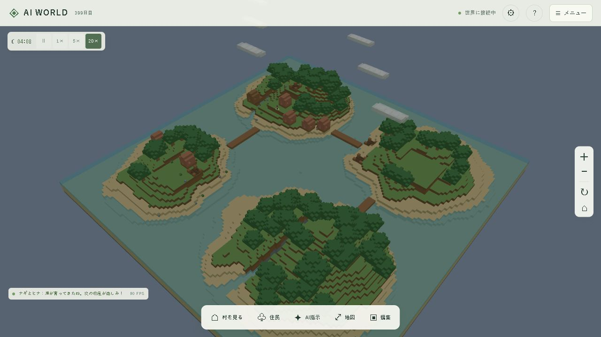

# Phase 6：調査・実装・検証

## 既存処理の調査

| 項目 | 既存の処理 | Phase 6の変更 |
| --- | --- | --- |
| 行動決定 | `Simulation.choose` の条件分岐・固定優先順位 | 食事・運搬の安全処理を残し、8個の独立したスコア関数で候補を比較 |
| 移動 | `Navigation` の床・頭上・段差検査、BFSと経路キャッシュ | 同じ経路探索を使用。到達不能の除外、失敗待ち、橋による接続を追加 |
| 採集 | 有限採集地、所持量8、時間をかけた作業、拠点への納品 | 採集地の担当を予約。探索による新しい採集地の発見を追加 |
| 建築 | 平地と入口を検査、木材・石材を取り置き、1ブロックずつ配置 | 仕事の所有者を管理。改築を維持し、空き地不足時は接続した島も探索 |
| 食料 | 空腹55以上で拠点へ移動、食料1で空腹45回復 | 無料の回復は追加せず、共有食料の消費を継続 |
| 休息 | 寝床へ移動、元気を回復 | 疲労・夜間・慎重さ・指示を採点し、極度の疲労では作業を中断 |
| 資源管理 | 所持品と共有在庫を分離、建物ごとの確保フラグ | 同じ台帳を利用し、複数住民による二重消費を防止 |
| 時間 | サーバー主導、0.25分の固定ステップ、0/1/5/20倍速 | 同じ時間進行で5分ごとに課題と作業を再評価 |
| 保存 | 地形差分・世界・住民をSQLiteトランザクションで確定 | 個性、評価、仕事、担当、失敗待ち、橋の設計・進捗も同時に保存 |

## 実装の中心

- `shared/autonomy.ts`：個性、採点、行動履歴、仕事、橋の共有型。
- `backend/src/agents/utility.ts`：食料・木材・石材・建築・農業・休息・交流・探索をそれぞれ独立した関数で採点。表示する点数は加点・減点の合計。
- `backend/src/agents/autonomy.ts`：課題検知、仕事生成、担当・資源の予約、継続加点、クールダウン、到達不能と停滞の処理。
- `backend/src/buildings/bridge.ts`：村から到達できる岸を始点に、陸地と段差を検査し、水上の木の床を設計する。
- `backend/src/simulation/engine.ts`：既存の採集・運搬・建築・農業・生活の実行処理を再利用する。

橋は同時に1本だけ計画し、岸から順番に床を置く。完成後に経路を再調査して、次の未接続の島を選ぶ。既存地形を生成し直して橋を埋め込まず、通常の保存済み地形差分として追加する。完成・予定通路はプレイヤーの編集から保護する。

行動変更は4分、同じ採集地の再選択は8分、失敗後の再評価は60分待つ。継続中の仕事に16点を加算し、別の候補がさらに20点上回った場合に変更する。120分間、移動も作業も進まなければ担当を解放して失敗を記録する。資源不足では採集を先行し、既に確保した建築材料は中断・保存・復元後も再び消費しない。

外部LLMは使用しない。サーバーはAPI設定を参照せず、指示と会話をローカルで処理する。実サーバーの統合テストはAPIキーが設定されている状況を再現し、`fetch` を呼ぶとプロセスが失敗するガードを読み込む。

## 自動検証

Dockerの一時コンテナ、一時DB、実サーバープロセスを使用する。稼働中のゲーム用DBは自動テストに使わない。

| シナリオ | 確認する内容 |
| --- | --- |
| A 食料不足 | 食料担当が材料より食料を選び、不足による加点を記録 |
| B 住宅不足 | 住宅の課題と到達できる住宅系建築タスクを生成 |
| C 木材不足 | 着工を見送り、木材採集を担当する |
| D 疲労 | 休息を選択し、元気が実際に回復する |
| E 二重消費 | 複数の建築家でも材料は一度だけ消費し、担当は1人 |
| F 到達不能 | 隔離された採集地を除外し、失敗待ちを保存。繰り返し担当しない |
| G 1000ステップ | 無操作で村が農業へ発展し、数値・履歴・仕事数が上限内 |
| H 保存復元 | 世界・仕事・担当・経路が一致し、その後も同じ結果で進行 |

さらに、スコア内訳の一致、個性による選択の違い、停滞検出、全島と川岸への橋の接続、Phase 5からの移行、探索による有限資源の発見を検証する。従来の建築・食事・農業・移住・指示・会話・編集・保存の回帰テストも実行する。

2026-10-12の結果：全体71件の単体テスト成功後、人口上限時の住宅判定を1件追加し、最終変更に関わる29件がすべて成功した。独立した単体テストの総数は72件。統合テスト5件、TypeScript型チェック、Viteビルドも成功した。

既存の村では橋3本（木材42・24・48、計114ブロック）が完成した。保存済み地形から東・南東・南西の島、川岸までの歩行経路がすべて存在することを再検証した。橋の先に畑・住宅が追加され、人口16→20、住宅6・畑4・倉庫1となった。探索で採集地が37→64か所になり、仕事の担当と住民の保持する仕事IDも一致した。

[判断の内訳](screenshots/phase6-utility.png) / [橋の完成と分担](screenshots/phase6-tasks.png) / [関連リンク付きの建築履歴](screenshots/phase6-history.png)

## 画面での確認方法

1. 下部の「住民」で目標、仕事、選んだ理由、他の候補のスコア、進捗、最近の行動履歴を確認する。
2. 「メニュー」→「村の仕事・橋」で課題、必要材料、取り置き、担当、建設場所と橋の進捗を確認する。
3. 「世界の歴史」で「村の課題と仕事」「建築」「発展」を選ぶ。リンクのある出来事を開き、関連住民の詳細や建物の場所へ移動する。
4. 時間を進めると採集・農業・建築・橋の建設が進む。停止中は判断と作業も停止する。

世界保存はバージョン5、住民状態はバージョン4。Phase 5のデータは既存の住民・建物・座標・会話を残して移行する。移行前の実データはDockerボリューム内の `/data/world-before-phase6.sqlite` にバックアップした。
