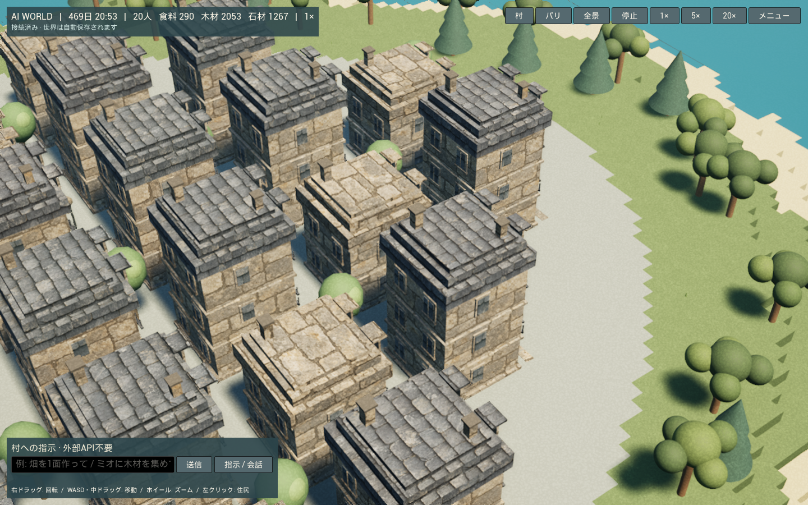
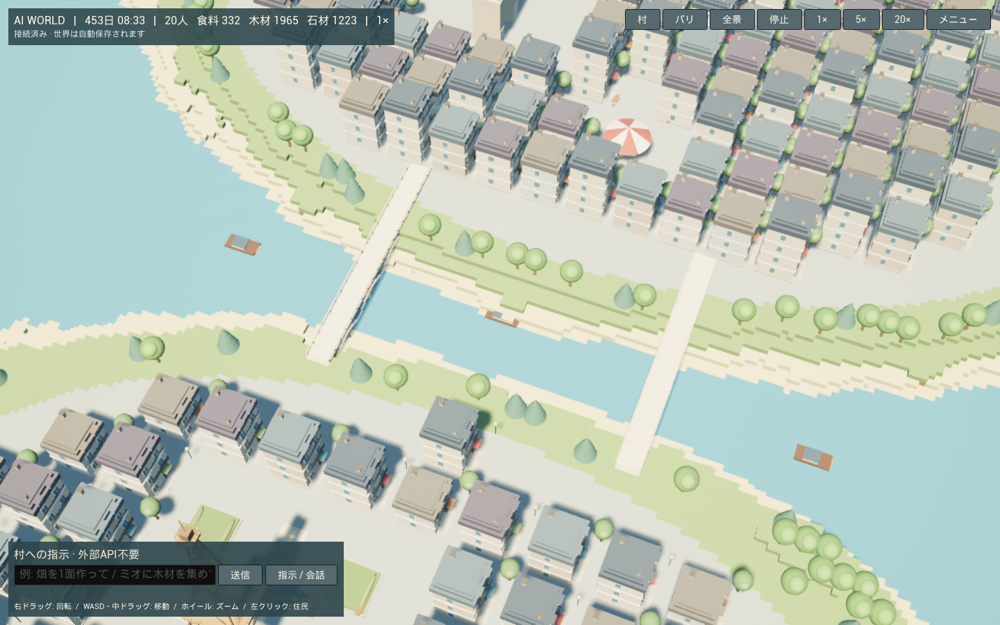
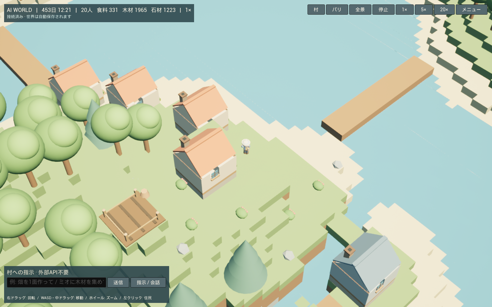

# AI WORLD — Unreal Engine移行

Windows用のネイティブUE 5.8プロジェクトを `unreal/AIWorld` に追加しました。地形・モデル・住民・カメラ・操作パネルはUEで描画します。住民AI、経路探索、資源予約、農業、人口増加、自然言語の解析、会話、SQLiteの保存は既存のローカルシミュレーションを利用します。UEの中にWeb画面を表示する方式ではありません。

## 起動

実地理に基づくパリ地区は **`Paris-DigitalTwin.cmd`**、素材と窓枠の確認は **`Paris-Materials.cmd`** で開きます。どちらもUE Editorのゲームモードを使います。開発ターゲットの `Binaries/Win64/AIWorld.exe` を直接開くと、Cook済みGlobal shader libraryがなく終了するため、起動用CMDを使用してください。[最新の素材・起動・検証](paris-digital-twin-materials.md)。

UE 5.8.3の現在の場所は `D:\Epic Games\UE_5.8` です。Docker Desktopを起動して、リポジトリーのルートで実行します。

初回ビルドにはUE 5.8、Visual Studio C++ツールとWindows SDK、Node.js 22以上が必要です。このPCではUE 5.8.3、MSVC 14.44、Windows SDK 10.0.22621.0、Node.js 24.16.0を確認しています。ビルド済みのこの環境では、ルートの **`AIWorld-Unreal.cmd` をダブルクリック**して起動できます。

```powershell
.\unreal\scripts\Build-AIWorldUE.ps1
.\unreal\scripts\Start-AIWorldUE.ps1
```

初回ビルドで独自モデルをエクスポートし、C++をコンパイルし、UEのマテリアルと起動マップを生成します。次回から起動スクリプトだけで開けます。UEエディターとして開く場合は `Start-AIWorldUE.ps1 -Editor` です。エディターの▶（Play）で保存された世界を表示します。別のUE配置先は両スクリプトの `-EngineRoot` で指定できます。

シミュレーションは既存のComposeに `compose.unreal.yaml` を重ねて起動します。公開する追加ポートはPC内の `127.0.0.1:3001` のみです。既存の `ai-world_world-data` ボリュームと保存バージョン8を使います。起動スクリプトはボリュームを削除しません。

今回の移行前のSQLiteは `backups/world-pre-unreal-20261012-1900.sqlite` に保存しています。稼働中のSQLiteから `VACUUM INTO` で一貫したバックアップを作成しました。このバックアップはGitには含めません。

## 操作

- 右ドラッグ: カメラを回転。WASD・矢印・中ドラッグ: 移動。ホイール: ズーム。
- 「村」「パリ」「全景」、またはV・P・Home: 対象へ移動。
- 住民を左クリック: 選択して追跡。メニューに目標、実際の判断理由・スコア、所持品、行動履歴、記憶・会話を表示。
- 下部の入力: 日本語で村に指示。「指示 / 会話」で選択中の住民との会話に切り替え。
- 「停止」「1×」「5×」「20×」: 保存される世界の速度を変更。
- メニュー「仕事」: 村の課題・担当・必要資源・予約済み資源・進捗と指示のJSONを確認。
- 「歴史」: 実際のイベント。クリックで関係する住民、建物、場所へ移動。
- 「設定」: 低・中・高品質、ジオラマ／ボクセル表示、素材の配置・削除・直前の編集を戻す。

編集中は地形の形を正確に表示し、サーバーが住民・建築・橋・記念物の保護と編集競合を検査します。保存の返答を受け取ってから描画へ反映し、切断中は編集を送信しません。再接続では生成済みのベース地形と全保存差分から復元するため、追加だけでなく削除も復元できます。

## 移行した構成

- `backend/src/presentation/unreal.ts` と `/api/unreal/world`: 世界のベース、保存差分、元のモデルの隠蔽マスクを読み取り専用で提供。
- `tools/export-unreal.ts`: 既存の独自エッフェル塔、163棟のフランス建物、凱旋門、橋、回転木馬、船、段階別建築、住民の衣装と道具をFloat32のUE用メッシュへ変換。
- `unreal/AIWorld/Source/AIWorld`: 地形のGreedy Meshing、ProceduralMeshComponent、樹木・装飾のHISM、住民の衣装・道具・運搬品・歩行／作業／休息／表情アニメーション、吹き出し、作業エフェクト、ローカル生成の効果音、WebSocket同期、ネイティブSlate UI。
- `unreal/AIWorld/Config`: DX11、Lumenなし、通常の影、AO、トーンマッピング、昼夜の光、波のある水面。統合GPUで使えるよう初期品質は中。
- `unreal/scripts`: エクスポート・ビルド・マテリアル生成・起動・自動検証。

## ジオラマ質感のリメイク

島の配置、住民AI、建築状態、ゲーム座標は維持し、UEの材質と描画だけを更新しました。生成した独自の石灰岩・スレート・草のテクスチャを、UE標準のワールド座標投影で貼り、建物をまたいで模様が連続するようにしました。石造り建物、屋根、緑の地形・樹冠を色に応じて分け、海は青緑の色調と穏やかな波の起伏にしています。柔らかな斜光、AO、昼光向けの露出も調整しました。画像の建物や樹木を素材として流用せず、既存の独自モデルに新しい材質を適用しています。

元のPNG素材は `unreal/textures/` に置き、`unreal/scripts/create-assets.py` でUEアセットへ取り込みます。スクリーンショットはUE 5.8.3 / DX11の実ゲーム画面です。



地形は384×384×32、100 UE cm = 1ブロックです。既存の `(x,y,z)` をUEの `(x,z,y)` に変換し、元の座標と住民AIへ描画座標を逆流させません。地形は144チャンクに分割して更新し、住民の描画フレームは固定250msのシミュレーションから独立しています。

日本語パスをMSVC/UBAが誤解する環境では、`Get-AIWorldProject.ps1` が `%LOCALAPPDATA%\AIWorldUE\<hash>` に同じD:のプロジェクトを指すジャンクションを作ります。ソースと出力の実体はD:です。.NET Framework SDK不足は公式Microsoft SDKのハッシュ検証済みファイルをD:の `.toolchain` へ展開し、現在のユーザーのSDK参照キーに登録します。システムにSDKがあればそれを使います。

## 検証

既存側の型チェック、102件の単体テスト、6件のHTTP/WebSocket統合テストを通過しました。新規テストでUE向けデータの完全性、読み取りによる非変更、保存と同じスナップショットを確認しています。UE側にもメッシュ・座標・復元・日本語コマンド・モデルバッファ・実サーバー接続の自動テストを追加しています。

```powershell
.\unreal\scripts\Test-AIWorldUE.ps1
```

UE 5.8.3 / Win64 Development Editorのコンパイルを通過し、生成マップで実ゲームを起動しました。UE側の4件（独自モデル、実サーバーの保存された20人との同期、日本語コマンド、地形と復元）もすべて通過しています。合計112件の自動テストが通過しました。

DX11の実描画で、既定材質へのフォールバックを起こしていた水面の入力接続と、樹木のインスタンス材質の使用フラグを修正しました。日本語のUI、青い水面、フランス街区と橋、柔らかな影を画像で確認しています。近くで追跡する住民は動き・表情を更新し、遠い全景では表情のメッシュ更新を控えます。変化していない建築の隠蔽マスクは再計算しません。屋内の住民を追跡すると屋根を省略して観察できます。



**実機:** Ryzen 7 7735HS / AMD Radeon統合GPU / RAM 28.8GB / Windows 11。別のUEエディターも開いている状態で、1440×900ウィンドウ、20人、144チャンク、20秒を計測しました。中品質は最適化前の約42fpsから **54.8fps、フレーム時間P95 25.4ms** へ改善しました。[実測JSON](unreal-medium-performance.json)

村の近景の低品質は **95.8fps、フレーム時間P95 19.0ms** で、60fpsの目標を超えました。[低品質の実測JSON](unreal-low-performance.json)。パリの中品質は60fpsにまだ届いていません。異なる視点での計測なので、品質の差だけを比較する数値ではありません。

最適化前は品質を下げても約43fpsで、画面外の住民の表情更新と大きな地形マスクの重複処理を抑えると改善しました。CPU側の描画準備・同期処理の影響があることを示しています。20人の詳細なメッシュとWebSocketの全住民状態の解析は引き続き行うため、さらに削減する余地があります。FPSは視点と同時起動するアプリによって変化します。



ブラウザー版の既存DockerサービスとiPhoneでの接続経路も残しています。UE版には現在の村の資源・住宅・職業・仕事・記憶・歴史を移行し、保存バージョンは変更していません。

## 対応範囲

UE版はWindows向けです。住民AIとDBはローカルNode.js/Dockerサービスとして継続します。ブラウザー版はiPhoneを含む従来の接続用に残してあります。UE版のiOSビルドやPixel Streaming配信、配布用のパッケージ化は別途の工程です。モデルデータはビルド時に再生成され、既存ゲームのモデル・有料API・外部LLMは利用しません。
